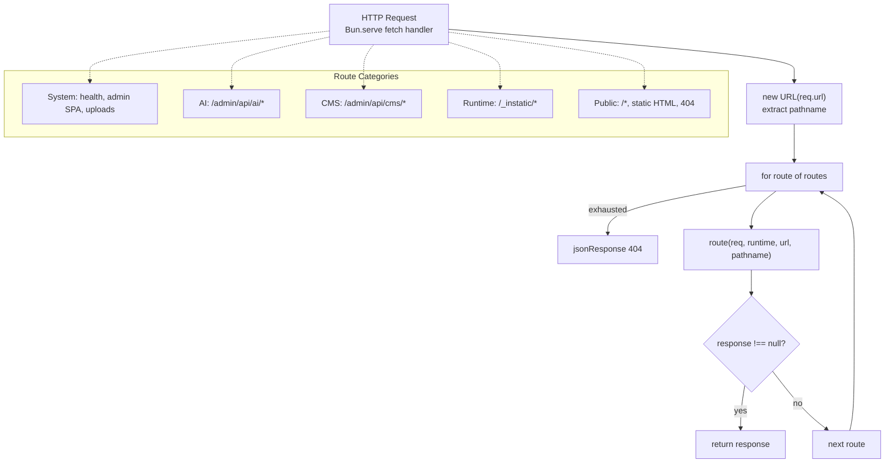
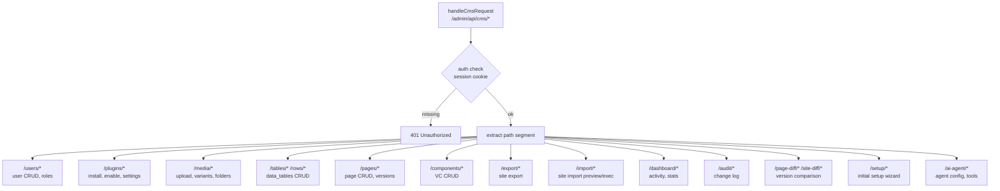

# Server: Hand-Written 19-Route Dispatcher and Handlers

Instatic's server is built on `Bun.serve` with a hand-written 19-route table — no Express, Hono, or Fastify. Routes are an ordered array of `RouteHandler` functions tried top-to-bottom; first non-null `Response` wins. This document covers the routing table, handler pattern, CMS handlers, public router, repositories, and database adapter.

**Source:** `/home/darkvoid/Boxxed/@formulas/src.rust/src.AI/src.Instatic/Instatic/server/router.ts` (44 route entries across dispatcher and handlers)

## Server Entrypoint

```typescript
// server/index.ts
// Boots Bun.serve({ fetch: handleServerRequest, idleTimeout: 0 })
// Sets up DbClient (Postgres or SQLite), static dirs, uploads
// idleTimeout: 0 — AI streams pause 10+ seconds between tool calls
```

The entrypoint creates the `ServerRuntime` object containing the DB client, static directory, uploads directory, and `DATABASE_URL`, then passes it to the request dispatcher.

**Source:** `server/index.ts`.

## Route Handler Interface

```typescript
// server/router.ts:45-50
type RouteHandler = (
  req: Request,
  runtime: ServerRuntime,
  url: URL,
  pathname: string,
) => Promise<Response | null> | Response | null
```

Each handler checks its own URL path and method. If it matches, it returns a `Response`. If not, it returns `null` and the dispatcher tries the next handler.

## Server Runtime

```typescript
// server/router.ts:25-35
interface ServerRuntime {
  db: DbClient           // Database client (Postgres or SQLite)
  staticDir?: string     // Static files directory
  uploadsDir?: string    // Uploads directory
  databaseUrl?: string   // Raw DATABASE_URL for handlers that need it
}
```

## The 19-Route Table

Routes are tried in strict order. The first match wins:

| # | Handler | URL Pattern | Purpose |
|---|---------|-------------|---------|
| 1 | `tryServeHealth` | `/health` | Health check: `{ status: 'ok', ts: ... }` |
| 2 | `tryServeAi` | `/admin/api/ai/*` | AI chat streams, credentials, models |
| 3 | `tryServeCmsApi` | `/admin/api/cms/*` | CMS CRUD operations |
| 4 | `tryServeLoopRuntimeAsset` | `/_instatic/loop/runtime/*` | Loop runtime JS assets |
| 5 | `tryServeLoop` | `/_instatic/loop/*` | Loop runtime execution |
| 6 | `tryServeHoleRuntimeAsset` | `/_instatic/hole/runtime/*` | Hole runtime JS asset |
| 7 | `tryServeHole` | `/_instatic/hole/<nodeId>` | Lazy-fetch dynamic content |
| 8 | `tryServeModuleJsAsset` | `/_instatic/module-js/*` | Per-module published JS |
| 9 | `tryServePublicForm` | `/_instatic/form/*` | Native CMS form handling |
| 10 | `tryServeRuntimeAsset` | `/_instatic/assets/*` | Runtime JS/CSS assets (disk-first, DB fallback) |
| 11 | `tryServeRuntimePackageNamespace` | `/_instatic/runtime/cache/*` | Per-site `bun install` dependency cache |
| 12 | `tryServeSiteCssNamespace` | `/_instatic/css/*` | Per-page CSS bundles (hash-named) |
| 13 | `tryServeMediaRedirect` | `/_instatic/media/*` | Signed redirect for plugin storage adapters |
| 14 | `tryServeStaticAsset` | Published static HTML | Layer A: baked HTML files |
| 15 | `tryServeUpload` | `/uploads/*` | Uploaded media files |
| 16 | `tryServeAdminApp` | `/admin/*` | Admin SPA (React app) |
| 17 | `tryServePublicRoute` | `/*` | Public page rendering (Layer B/C) |
| 18 | `trySetupRedirect` | Setup wizard | Redirects to setup if not configured |
| 19 | `tryServeNotFoundPage` | Any unmatched | 404 page |

**Source:** `server/router.ts` lines 62-85.

### Route Dispatch Flow



**Aha:** Prefix-namespaced handlers (`/_instatic/css/`, `/_instatic/runtime/cache/`, `/_instatic/media/`) absorb their entire namespace and emit a 404 themselves rather than falling through. This prevents unknown paths under a known prefix from accidentally matching a later route — for example, `/_instatic/css/anything.css` with a stale hash returns 404 inside the handler instead of falling through to `tryServePublicRoute` which would render the homepage. This is a security property: it stops URL probing from rendering unintended content.

### Route Handler Example

```typescript
// server/router.ts:109-112
function tryServeHealth(_req, _runtime, _url, pathname) {
  if (pathname !== '/health') return null
  return jsonResponse({ status: 'ok', ts: Date.now() })
}
```

The pattern is simple: check the path, return `null` if not matching, return a `Response` if matching.

## CMS Handlers

The CMS handler (`server/handlers/cms/index.ts`) dispatches to specific handlers based on the path segment after `/admin/api/cms/`:



**Source:** `server/handlers/cms/index.ts`.

### Key Handler Modules

| Module | Purpose | Source |
|--------|---------|--------|
| `server/handlers/cms/` | CMS CRUD (tables, rows, pages, components) | `server/handlers/cms/` |
| `server/handlers/auth/` | Authentication, sessions, access control | `server/handlers/auth/` |
| `server/handlers/cms/imageVariant*` | Image processing (sharp + blurhash) | `server/handlers/cms/` |
| `server/handlers/cms/loop` | Loop runtime execution | `server/handlers/cms/loop.ts` |
| `server/handlers/cms/hole` | Hole runtime (Layer C lazy fetch) | `server/handlers/cms/hole.ts` |
| `server/handlers/cms/moduleJs` | Module JS asset serving | `server/handlers/cms/moduleJs.ts` |
| `server/forms/handler.ts` | Public form submission handling | `server/forms/handler.ts` |

**Source:** `server/handlers/`, `server/forms/`.

## AI Handlers

```typescript
// server/ai/handlers/index.ts
// /admin/api/ai/* → chat streams, browser bridge, credentials, models
```

The AI namespace owns:
- Chat streams (POST `/admin/api/ai/chat/site`)
- Browser bridge (for AI agent browsing)
- Credentials CRUD (API key management)
- Conversation history
- Model discovery

Endpoints live under `/admin/api/` so the admin session cookie — scoped to `Path=/admin` — is carried automatically. The `requireCapability` gates (`ai.chat`, `ai.tools.write`, `ai.providers.manage`) ensure proper authorization.

**Source:** `server/ai/handlers/`.

## Repository Pattern

Repositories encapsulate database access. Each repository works against the `DbClient` interface, not a specific database engine:

```
server/repositories/
├── cms.ts              — CMS table/row operations
├── auth.ts             — User authentication
├── plugins.ts          — Plugin package management
├── setup.ts            — Initial setup state
├── media.ts            — Media file management
├── runtimeAsset.ts     — Runtime asset CRUD
└── ...
```

### Example Repository Pattern

```typescript
// Repositories use template-literal SQL via DbClient
// They are dialect-naive — the DbClient handles $1 vs ? differences
```

**Source:** `server/repositories/`.

## Static File Serving

```typescript
// server/static.ts
// serveStaticFile, serveAdminApp, hardenUploadResponse
```

The static serving module handles:
- Admin SPA serving (`serveAdminApp`) — falls back to `index.html` for client-side routing
- Upload serving with hardened responses (`hardenUploadResponse`) — sets `Content-Disposition: inline` only for safe MIME types
- General static file serving (`serveStaticFile`) — serves Vite build output from `dist/`

**Aha:** `tryServeStaticAsset` deliberately skips `/` and `/index.html` so `serveAdminApp` keeps ownership of the admin HTML pipeline (login skeleton + boot-API kickoff + authenticated preload). This prevents the generic static handler from intercepting admin HTML requests.

**Source:** `server/static.ts`.

## Public Router

The public page rendering pipeline (`server/publish/publicRouter.ts`) handles unmatched routes:

```typescript
// server/publish/publicRouter.ts
// renderPublicResolution — resolves route → page → LRU/disk/hole
// renderNotFoundResponse — renders 404 from site's 404 page or fallback
```

The public router:
1. Resolves the URL path to a route in the page tree
2. Checks Layer A (static disk artifact) first
3. Falls back to Layer B (LRU cache) or Layer C (live render with holes)
4. Returns 404 if no route matches

## Database Adapter

```typescript
// server/db/client.ts
// DbClient interface — ANSI SQL, dialect-naive
// Postgres via Bun.sql, SQLite via bun:sqlite
// Template-literal SQL with $1 vs ? handled by DbClient
```

**Source:** `server/db/`, `server/repositories/`.

## HTTP Response Helpers

```typescript
// server/http.ts — jsonResponse helper
// server/binary.ts — binaryResponse, toArrayBuffer
```

**Source:** `server/http.ts`, `server/binary.ts`.

## Next

Continue to [03-publisher](03-publisher.md) for the three-layer publishing pipeline: static baking, LRU caching, and lazy hole rendering.
