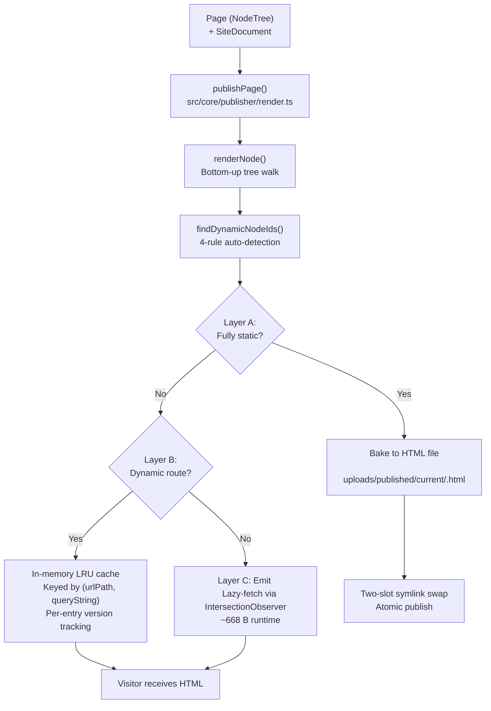
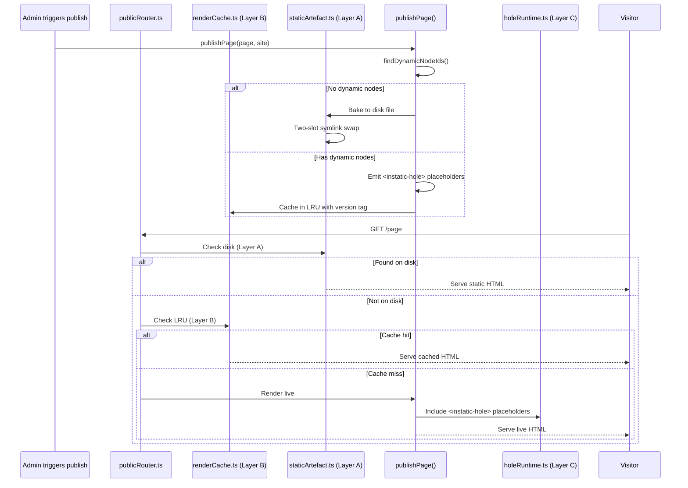

# Publisher: Three-Layer Publishing Pipeline

The publisher transforms page trees into clean, standalone HTML documents. Published output has **no framework runtime**, **no client-side hydration**, and **no decorative markup**. The pipeline has three layers that handle static, dynamic, and request-dependent content.

**Source:** `/home/darkvoid/Boxxed/@formulas/src.rust/src.AI/src.Instatic/Instatic/src/core/publisher/`

## Publishing Overview



## The publishPage Flow

```typescript
// src/core/publisher/render.ts — Entry point
// publishPage(page, site, registry, options?) → full HTML document string
```

The flow:

1. **Resolve template context** — page/site/route frames
2. **Inject root classIds** into `<body>` tag
3. **Build `<head>`** — title, description, favicon, lang, importmap, runtime `<script>`s, CSP
4. **renderNode(rootNodeId)** — recursive bottom-up walk
5. **Collect CSS** — deduplicated by moduleId via CssCollector (~60-80% size reduction)
6. **Emit full HTML document**

**Source:** `src/core/publisher/render.ts`.

## renderNode: The Recursive Walker

```typescript
// src/core/publisher/renderNode.ts
// renderNode(nodeId, config, acc) — bottom-up walk
```

For each node:

1. If `node.hidden`, return `''` immediately (pruned before any renderer)
2. Specialized renderer for `base.visual-component-ref` → `renderVisualComponentRef`
3. Specialized renderer for `base.loop` → `renderLoop`
4. Standard rendering for everything else (`renderStandardNode`)
5. Collect deduped CSS via CssCollector
6. Inject author class names

**Source:** `src/core/publisher/renderNode.ts`.

## Module Render is a Pure Function

**Aha:** Module `render()` functions are **pure** — no DOM access, no React, no side effects (Constraint #179). They receive props and rendered children, return HTML string. Every node's props pass through `escapeProps` before `render()` (Constraint #211), escaping string props at the render boundary based on schema control `type`.

**Source:** `src/core/publisher/escapeProps.ts`.

## Three Publishing Layers

### Layer A: Static Baking

Fully static pages are baked to disk at publish time:

```
uploads/published/current/<route>.html
```

Publishing uses a **two-slot symlink swap** for atomic updates:


**Source:** `server/publish/staticArtefact.ts`.

**Aha:** The two-slot symlink swap is atomic — there's no moment where a visitor gets a partially-written file. The path validation (`resolveArtefactPath`) URL-decodes, rejects `..` traversal, and verifies containment after `path.join` — preventing directory traversal attacks on published content.

### Layer B: In-Memory LRU

Dynamic routes are cached in an in-memory LRU:

```typescript
// server/publish/renderCache.ts
// Key: (urlPath, canonicalQuery) — only pagination params matter
// Per-entry version tracking; bumpPublishVersion() evicts lazily
```

**Aha:** The cache key uses `canonicalRenderQuery()` which keeps only `loop_<nodeId>_page` pagination params — arbitrary junk params collapse to `''` so they never mint new cache slots. This prevents cache pollution from random query string variations. Version capture at render start discards results from mid-flight publishes, preventing stale HTML from being cached.

**Source:** `server/publish/renderCache.ts`, `server/publish/publishState.ts`.

### Layer C: Lazy Holes

Nodes auto-detected as request-dependent emit `<instatic-hole>` placeholders:

```html
<instatic-hole data-node-id="abc123"></instatic-hole>
```

A ~668 B `IntersectionObserver` runtime lazy-fetches each fragment:

```
GET /_instatic/hole/<nodeId>
```

**Auto-detection rules** (4 rules, one walker in `src/core/publisher/dynamicDetection.ts`):

1. Modules flagged `dynamic: true`
2. Request-dependent bindings
3. Loop sources
4. VC refs containing dynamic content

**Aha:** Authors don't toggle anything — `findDynamicNodeIds` auto-classifies nodes. It's a single walker with four detection rules plus a loop body promotion step (Rule 3.5). This means pages that mix static and dynamic content get the best of both: static parts bake to disk, dynamic parts lazy-load only when scrolled into view.

**Source:** `src/core/publisher/dynamicDetection.ts`, `server/publish/holeRuntime.ts`.

## CSS Bundling

The publisher builds a single per-page CSS bundle:

```
src/core/publisher/cssCollector.ts    — CssCollector + collectClassCSS
src/core/publisher/classCss.ts        — Compile StyleRule entries → CSS
src/core/publisher/reset.ts           — PUBLISHER_RESET_CSS
src/core/publisher/frameworkCss.ts    — Site framework CSS
src/core/publisher/siteCssBundle.ts   — Hash-named bundle composition
```

CSS is deduplicated by `moduleId` — if two modules use the same CSS class, it's emitted once. This achieves ~60-80% size reduction on typical pages.

**Source:** `src/core/publisher/cssCollector.ts`.

## Publishing Pipeline Flow



## Site Snapshot Storage

On each publish, the `SiteDocument` is stored once in `site_snapshots`. Page versions reference it via `data_row_versions.site_snapshot_id`. The reassembled `PublishedPageSnapshot` remains the canonical audit record.

**Source:** `server/publish/publicRenderer.ts`.

## Media Presentation

At publish time, media is materialized into `<picture>`/`<srcset>` elements:

```typescript
// server/publish/mediaPresentation.ts
//  → <picture><source srcset=...></picture>
```

The `sizesResolver.ts` derives `` from the layout using a linear width model (caps, fractions, grid tracks) per viewport tier.

**Source:** `server/publish/mediaPresentation.ts`, `src/core/publisher/sizesResolver.ts`.

## Next

Continue to [04-plugin-system](04-plugin-system.md) for the QuickJS-WASM sandbox, capability permissions, and plugin lifecycle.
