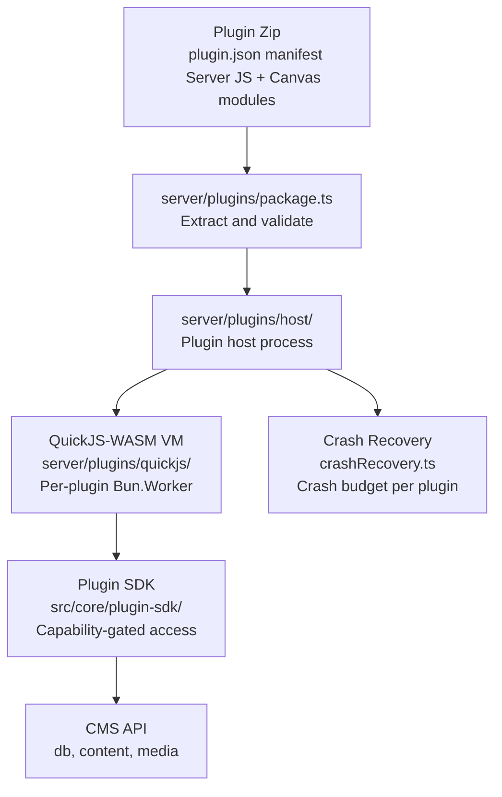
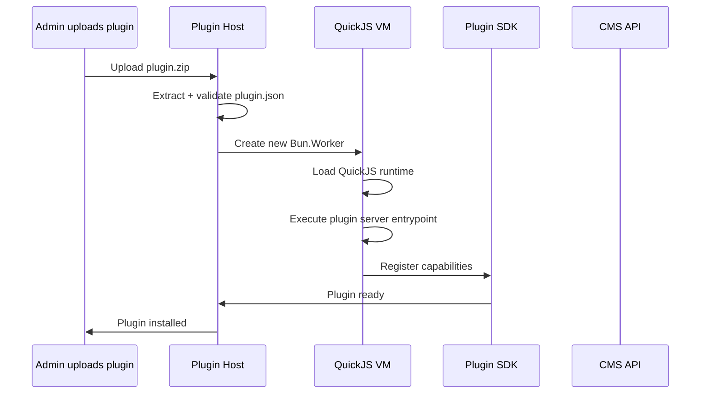

# Plugin System: QuickJS-WASM Sandbox

Instatic's plugin system runs server entrypoints and canvas module packs inside a **QuickJS-WASM sandbox** with no ambient host access. Plugins reach the CMS only through a capability-gated SDK.

**Source:** `/home/darkvoid/Boxxed/@formulas/src.rust/src.AI/src.Instatic/Instatic/server/plugins/`

## Architecture



**Aha:** The host process **never imports plugin code**. Plugin server code runs entirely inside the QuickJS-WASM VM in a separate `Bun.Worker`. A crash in one plugin VM only affects that plugin — the host respawns it with a crash budget. This is true isolation: a malicious or buggy plugin can't access the host filesystem, network (unless permitted), or other plugins.

**Source:** `server/plugins/host/`, `server/plugins/quickjs/`, `server/plugins/pluginWorker.ts`.

## Plugin Package Format

Plugins are zip packages with a `plugin.json` manifest:

```json
{
  "name": "my-plugin",
  "version": "1.0.0",
  "permissions": ["network.outbound", "content.read"],
  "networkAllowedHosts": ["api.example.com"],
  "serverEntrypoint": "dist/server.js",
  "canvasModules": { "my-block": "dist/canvas/my-block.js" }
}
```

**Source:** `examples/plugins/` directory.

## QuickJS-WASM Sandbox

### Bootstrap

The VM bootstrap is authored as typed TypeScript in `server/plugins/quickjs/bootstrap/src/` and bundled to committed string artifacts in `bootstrap/generated/`:

```bash
bun run bootstrap:sync   # Rebuild bootstrap artifacts
```

This is gated by `plugin-bootstrap-fresh.test.ts` — if the bootstrap source changes but artifacts weren't rebuilt, the test fails.

**Source:** `server/plugins/quickjs/bootstrap/src/`, `bootstrap/generated/`.

### SDK Factory

The SDK factory creates the bridge between the plugin VM and the CMS:

```typescript
// server/plugins/quickjs/
// Creates SDK functions exposed to the VM
// Each function checks grantedPermissions, not declared permissions
```

**Aha:** Permission enforcement validates against `grantedPermissions`, **never** the declared `permissions` array. This means even if a plugin declares `network.outbound` in its manifest, it only gets network access if the admin has explicitly granted that permission. This prevents privilege escalation through manifest manipulation.

### Module Pack VM

Canvas module packs also run in QuickJS-WASM:

```typescript
// server/plugins/modulePackVm.ts
// Validates and executes canvas module packs in the sandbox
```

## Plugin Lifecycle



### Scheduling

Plugins can register scheduled tasks:

```typescript
// server/plugins/pluginScheduleRegistration.ts
// Registers plugin tick functions with the scheduler
// server/plugins/scheduler.ts — runs scheduled tasks
```

### Event Broadcasting

Plugins can emit and listen to events:

```typescript
// server/plugins/eventBroadcaster.ts
// Broadcasts events between plugins and the host
```

### Settings Cache

Plugin settings are cached for performance:

```typescript
// server/plugins/settingsCache.ts
// Caches plugin settings to avoid repeated DB reads
```

**Source:** `server/plugins/` directory.

## Permission System

| Permission | Purpose |
|-----------|---------|
| `network.outbound` | HTTP requests to external hosts |
| `content.read` | Read CMS content |
| `content.write` | Write CMS content |
| `media.read` | Read media files |
| `media.write` | Upload media files |
| `ai.chat` | Access AI chat |
| `ai.tools.write` | Write AI tools |
| `ai.providers.manage` | Manage AI providers |

**Source:** `src/core/capabilities.ts`, plugin manifest schema.

## Crash Recovery

```typescript
// server/plugins/host/crashRecovery.ts
// Each plugin VM has a crash budget
// If a VM crashes, the host respawns it
// After budget exhausted, the plugin is disabled
```

**Source:** `server/plugins/host/crashRecovery.ts`.

## Plugin Development

### Creating a Plugin

```bash
bun instatic-plugin   # Scaffold a new plugin
```

### Plugin Directory

```
examples/plugins/
├── plugin.json           # Manifest
├── dist/
│   ├── server.js         # Server entrypoint (runs in QuickJS)
│   └── canvas/
│       └── my-block.js   # Canvas module (runs in QuickJS)
```

### Bootstrap Sync

After editing the bootstrap TypeScript source:

```bash
bun run bootstrap:sync   # Rebuild bootstrap artifacts
bun run bootstrap:check  # Verify bootstrap is fresh
```

**Source:** `package.json` scripts.

## Next

Continue to [05-visual-editor](05-visual-editor.md) for the canvas, panels, Zustand+Mutative store, and React Compiler.
