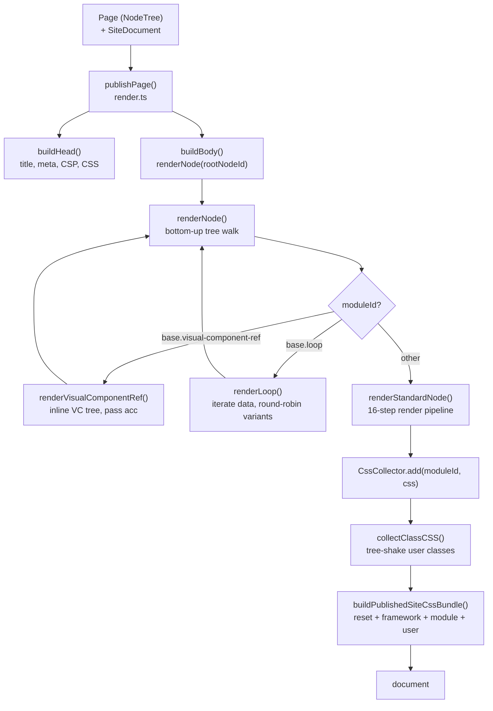
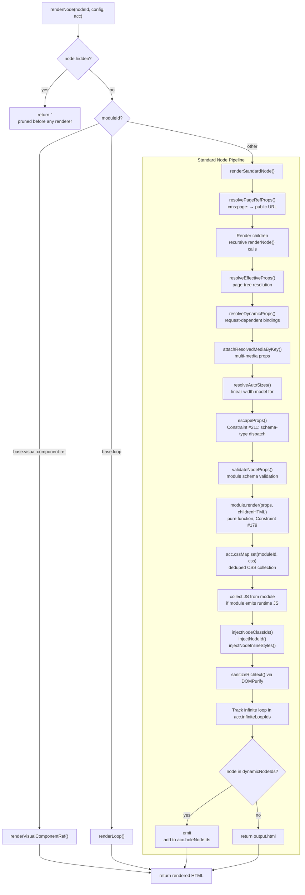

# Publisher Deep Dive: Every File, Every Function

This document provides complete source-level coverage of every file in `src/core/publisher/`. Every public and important private function is documented with signatures, behavior, error handling, and code.

**Source:** `/home/darkvoid/Boxxed/@formulas/src.rust/src.AI/src.Instatic/Instatic/src/core/publisher/`

## File Map (19 files)

| File | Purpose | Lines |
|------|---------|-------|
| `render.ts` | `publishPage()` — page orchestrator, `<head>`/`<body>` assembly | ~200 |
| `renderNode.ts` | `renderNode()` — recursive bottom-up node walk | ~200 |
| `renderConfig.ts` | `RenderConfig`, `RenderAccumulators`, `RenderNodeFn` types | ~175 |
| `renderVisualComponentRef.ts` | Specialized renderer for `base.visual-component-ref` | ~155 |
| `renderLoop.ts` | Specialized renderer for `base.loop` — iteration, round-robin | ~125 |
| `dynamicDetection.ts` | `findDynamicNodeIds()` — 4-rule static/dynamic classification | ~200 |
| `escapeProps.ts` | Constraint #211: dispatch per-prop escaping on schema type | ~119 |
| `classInjection.ts` | Inject classIds, node IDs, inline styles into root element | ~161 |
| `classCss.ts` | `CssCollector`, `bagToCSS`, `generateClassCSS`, cascade ordering | ~445 |
| `cssCollector.ts` | `collectClassCSS()` — tree-shake class CSS across pages + VCs | ~159 |
| `cspPlan.ts` | Content-Security-Policy plan generation | ~50 |
| `frameworkCss.ts` | Site framework CSS (spacing, typography, utilities) | ~100 |
| `reset.ts` | `PUBLISHER_RESET_CSS` — cross-browser baseline | ~100 |
| `siteCssBundle.ts` | Hash-named bundle composition | ~80 |
| `userStylesheets.ts` | Site-level user stylesheets | ~50 |
| `sizesResolver.ts` | `` from layout — linear width model | ~509 |
| `holeSubtreeModules.ts` | Collect module IDs inside hole subtrees | ~50 |
| `utils.ts` | `escapeHtml`, `isSafeUrl`, `sanitiseCssValue` | ~80 |
| `index.ts` | Barrel export | ~20 |

## Publisher Architecture



## renderNode Bottom-Up Pipeline



---

## renderConfig.ts: The Two Shapes

**Source:** `src/core/publisher/renderConfig.ts` (174 lines)

Every recursive renderer call is threaded with TWO explicit shapes:

### RenderConfig (Read-Only Inputs)

```typescript
// src/core/publisher/renderConfig.ts:76-121
export interface RenderConfig {
  readonly page: Page                                    // The page being rendered
  readonly site: SiteDocument                            // Site definition + style rules
  readonly registry: IModuleRegistry                     // Module definitions
  readonly breakpointId: string | undefined              // Which viewport breakpoint
  readonly templateContext?: TemplateRenderDataContext   // Entry stack for loops/VCs
  readonly mediaAssets?: ReadonlyMap<string, RenderResolvedMedia>  // Pre-fetched media
  readonly loopData?: ReadonlyMap<string, ResolvedLoopRenderData>  // Pre-fetched loop data
  readonly dynamicNodeIds?: ReadonlySet<string>          // IDs classified as dynamic
  readonly publishVersion?: number                       // Monotonic version for holes
  readonly annotateNodeIds?: boolean                     // Editor-only uid attributes
}
```

Every field is `readonly`. Collections are `ReadonlyMap`/`ReadonlySet`. A renderer needing a different page constructs a NEW child config — it never mutates the one it received.

### RenderAccumulators (Mutable Outputs)

```typescript
// src/core/publisher/renderConfig.ts:132-162
export interface RenderAccumulators {
  readonly cssMap: Map<string, string>         // moduleId → CSS (deduped)
  readonly jsMap: Map<string, string>          // moduleId → runtime JS (deduped)
  readonly infiniteLoopIds: Set<string>        // Loops requesting infinite-scroll runtime
  readonly holeNodeIds: Set<string>            // Nodes that actually emitted <instatic-hole>
}
```

The container references are `readonly` (never swapped), but contents are mutated — that's the entire point. Because this is an explicitly-passed parameter, the shared-mutable output is visible at every call site.

### RenderNodeFn

```typescript
// src/core/publisher/renderConfig.ts:169-173
export type RenderNodeFn = (
  nodeId: string,
  config: RenderConfig,
  acc: RenderAccumulators,
) => string
```

The recursive render callback. Specialized renderers receive this as a parameter (rather than importing `renderNode` directly) so the file graph stays acyclic.

### ResolvedLoopRenderData

```typescript
// src/core/publisher/renderConfig.ts:38-43
export interface ResolvedLoopRenderData extends LoopFetchResult {
  pageNumber: number   // 1-indexed page number (infinite mode)
  hasMore: boolean     // Whether more rows remain past current page
}
```

### RenderResolvedMedia

```typescript
// src/core/publisher/renderConfig.ts:53-68
export interface RenderResolvedMedia {
  publicPath: string
  mimeType: string
  width: number | null
  height: number | null
  altText: string
  blurHash: string | null
  variants: ReadonlyArray<{
    width: number
    height: number
    format: 'webp' | 'jpeg' | 'png' | 'avif'
    path: string
    sizeBytes: number
  }>
  posterPath: string | null
}
```

The pure render function reads `props._resolvedMediaByKey[<propKey>]` to get the variant ladder/BlurHash/intrinsic dimensions for image/media props and emits responsive markup. Falls back to raw prop string when undefined.

---

## render.ts: Page Orchestrator

**Source:** `src/core/publisher/render.ts` (~200 lines)

### PublishedPage

```typescript
// src/core/publisher/render.ts:52-64
interface PublishedPage {
  filename: string     // e.g. "index.html", "about-us.html"
  html: string         // Complete <!DOCTYPE html> document
  jsModuleIds: string[] // Module-JS candidates for script injection
}
```

### PublishPageOptions

```typescript
// src/core/publisher/render.ts:66-100
interface PublishPageOptions {
  breakpointId?: string
  templateContext?: TemplateRenderDataContext
  runtimeAssets?: PublishedPageRuntimeAssets
  loopData?: Map<string, ResolvedLoopRenderData>
  mediaAssets?: Map<string, RenderResolvedMedia>
  loopEndpointBaseUrl?: string
  cssMode?: 'inline' | 'external'
}
```

### publishPage()

```typescript
export function publishPage(
  page: Page,
  site: SiteDocument,
  registry: IModuleRegistry,
  options?: PublishPageOptions,
): PublishedPage
```

The page-level orchestration function. Straight-line flow:

1. **Build template context** — `buildPageFrame(page)`, `buildSiteFrame(site)`, `buildRouteFrame(page)` default any missing frames
2. **Detect dynamic nodes** — `findDynamicNodeIds(page, site, registry)` returns the set
3. **Check Layer A viability** — if `dynamicNodeIds.size === 0` AND no loops with data, page is fully static
4. **Initialize accumulators** — `cssMap`, `jsMap`, `infiniteLoopIds`, `holeNodeIds`
5. **Resolve root classIds** — `classNamesForClassIds(rootNode.classIds)` for `<body>` tag
6. **Build `<head>`** — title, description, favicon, lang, importmap, runtime `<script>`s, CSP
7. **Render body** — `renderNode(rootNodeId, config, acc)` recursive walk
8. **Collect CSS** — `collectClassCSS()` + `sanitizeModuleCSS()` + `collectUserStylesheetCss()`
9. **Emit CSS** — inline `<style>` or external `<link>` based on `cssMode`
10. **Assemble document** — `<!DOCTYPE html>` + `<html>` + `<head>` + `<body>`

### Private Functions

#### `buildHead()`

```typescript
function buildHead(
  page: Page,
  site: SiteDocument,
  config: RenderConfig,
  cssBlock: string,
  runtimeAssets?: PublishedPageRuntimeAssets,
  hasInfiniteLoops: boolean,
  hasHoles: boolean,
): string
```

Constructs the `<head>` element with:
- `<title>` from page title
- `<meta name="description">` from page description
- `<link rel="icon">` from site favicon
- `<html lang="...">` from site language
- `<meta http-equiv="Content-Security-Policy">` from CSP plan
- Runtime `<script>` tags for loops/holes
- Inline `<style>` or `<link>` tags for CSS

#### `buildBody()`

```typescript
function buildBody(
  page: Page,
  site: SiteDocument,
  config: RenderConfig,
  acc: RenderAccumulators,
): string
```

Renders the page body by:
1. Getting the root node from `page.nodes[page.rootNodeId]`
2. Calling `renderNode(rootNodeId, config, acc)`
3. Injecting root classIds onto the `<body>` tag
4. Returning the complete body HTML

---

## renderNode.ts: Recursive Walker

**Source:** `src/core/publisher/renderNode.ts` (~200 lines)

### renderNode()

```typescript
export function renderNode(
  nodeId: string,
  config: RenderConfig,
  acc: RenderAccumulators,
): string
```

The entry point for the bottom-up walk. Two paths:

#### Path 1: Specialized Renderers

```typescript
// Check for specialized renderers by moduleId:
if (moduleId === 'base.visual-component-ref') {
  return renderVisualComponentRef(node, config, acc, renderNode)
}
if (moduleId === 'base.loop') {
  return renderLoop(node, config, acc, renderNode)
}
```

**Aha:** Specialized renderers receive `renderNode` as a callback so the file graph stays acyclic — only `renderNode.ts` knows both ends of the recursion.

#### Path 2: renderStandardNode

For all other nodes, the bottom-up flow:

1. **Hidden check** — if `node.hidden`, return `''` immediately (pruned before any renderer)
2. **Resolve page refs** — `resolvePageRefProps()` converts `cms:page:<id>` to public paths
3. **Render children** — `renderNode(childId)` for each child, concatenating results
4. **Resolve effective props** — `resolveProps()` from page-tree
5. **Resolve dynamic props** — `resolveDynamicProps()` for request-dependent bindings
6. **Attach media** — `attachResolvedMediaByKey()` for multi-media props
7. **Resolve sizes** — `resolveAutoSizes()` for responsive images
8. **Escape props** — `escapeProps()` (Constraint #211)
9. **Validate** — `validateNodeProps()` against module schema
10. **Call module.render()** — pure function returning HTML (Constraint #179)
11. **Collect CSS** — `acc.cssMap.set(moduleId, css)` (deduped)
12. **Collect JS** — `acc.jsMap.set(moduleId, js)` if module emits runtime JS
13. **Inject classes** — `injectNodeClassIds()`, `injectNodeId()`, `injectNodeInlineStyles()`
14. **Sanitize richtext** — `sanitizeRichtext()` via DOMPurify
15. **Track infinite loops** — if node is loop with infinite mode, add to `acc.infiniteLoopIds`
16. **Track holes** — if node is in `dynamicNodeIds`, emit `<instatic-hole>` and add to `acc.holeNodeIds`

### Private Functions

#### `resolvePageRefProps()`

```typescript
// src/core/publisher/renderNode.ts:63-76
function resolvePageRefProps(
  props: Record<string, unknown>,
  pages: RenderConfig['site']['pages'],
): Record<string, unknown> {
  let out: Record<string, unknown> | null = null
  for (const [key, value] of Object.entries(props)) {
    if (!isPageRef(value)) continue
    const resolved = resolvePageRef(value, pages)
    if (resolved === null) continue
    if (!out) out = { ...props }
    out[key] = resolved
  }
  return out ?? props
}
```

Converts `cms:page:<id>` internal page references to actual public URLs. Non-ref values pass through untouched; a ref to a missing page becomes `#`. Generic over all props so any module's URL-shaped prop resolves without each `render()` needing site access.

#### `attachResolvedMediaByKey()`

```typescript
// src/core/publisher/renderNode.ts:78-100
function attachResolvedMediaByKey(
  safeProps: Record<string, unknown>,
  def: AnyModuleDefinition,
  mediaAssets?: ReadonlyMap<string, RenderResolvedMedia>,
): void
```

Attaches every resolved media asset on this node, keyed by prop key, so modules with multiple media props (e.g. `base.video` with `videoUrl` + `poster`) can read each one independently. The render() boundary preserves non-string values, so `_resolvedMediaByKey` survives `escapeProps` untouched.

---

## escapeProps.ts: Constraint #211

**Source:** `src/core/publisher/escapeProps.ts` (119 lines)

Every string prop is escaped BEFORE being handed to a module's pure `render()` function. The escaper for each prop is chosen by the prop's declared control `type` in the module's `PropertySchema` — NOT by guessing from the prop's key name.

### controlForKey()

```typescript
// src/core/publisher/escapeProps.ts:48-58
function controlForKey(schema: PropertySchema, key: string): PropertyControl | undefined {
  const direct = schema[key]
  if (direct) return direct
  for (const control of Object.values(schema)) {
    if (control.type === 'group') {
      const child = controlForKey(control.children, key)
      if (child) return child
    }
  }
  return undefined
}
```

Resolves the control declared for `key`. Top-level keys are a direct lookup; `group` controls hold their children under `.children` but DO NOT nest the data shape (group is visual-only), so a child's key is still a flat prop key — recurse one group level to find it.

### escapeProps()

```typescript
// src/core/publisher/escapeProps.ts:71-118
export function escapeProps(
  props: Record<string, unknown>,
  schema: PropertySchema,
): Record<string, unknown>
```

Four categories with distinct rules:

| Prop Type | Treatment | Why |
|-----------|-----------|-----|
| `url`/`image`/`media` | `isSafeUrl()` (unsafe → `#`) | Block `javascript:`/`vbscript:`/`data:` schemes; pass safe URLs raw so module's `safeUrl()` can HTML-escape without double-escaping ampersands |
| `richtext` | `sanitizeRichtext()` (DOMPurify) | Defense-in-depth on top of editor-side sanitization at write time |
| `svg` | `sanitizeSvg()` (DOMPurify SVG profile) | So `base.svg` module can emit raw `<svg>` markup |
| Everything else | `escapeHtml()` | The safe default — a prop the schema doesn't describe is never trusted to carry markup or a URL |

Non-string values pass through unchanged so derived assets like `_resolvedMediaByKey` survive the boundary.

**Aha:** Routing by name is a shadow type-system that silently mis-escapes any prop whose name misses the heuristic. A `richtext`-typed `pageBody` HTML-escaped instead of sanitised → broken markup AND unsanitised stored XSS; a `url`-typed `assetPath` escaped instead of scheme-checked → `javascript:` not blocked. The schema already knows the type, so we dispatch on it.

---

## classInjection.ts: Root Element Annotation

**Source:** `src/core/publisher/classInjection.ts` (161 lines)

### injectClassIntoRootElement()

```typescript
// src/core/publisher/classInjection.ts:42-68
function injectClassIntoRootElement(html: string, classAttr: string): string {
  const tagMatch = html.match(/<([a-zA-Z][\w-]*)\b([^>]*)>/)
  if (!tagMatch) return html

  const [fullMatch, tagName, attrs] = tagMatch
  const tagStart = tagMatch.index ?? 0
  const classRe = /\bclass="([^"]*)"/
  const existingClass = attrs.match(classRe)

  let newAttrs: string
  if (existingClass) {
    newAttrs = attrs.replace(classRe, `class="${classAttr} ${existingClass[1]}"`)
  } else {
    newAttrs = ` class="${classAttr}"${attrs}`
  }

  const newTag = `<${tagName}${newAttrs}>`
  return html.slice(0, tagStart) + newTag + html.slice(tagStart + fullMatch.length)
}
```

Locates the FIRST opening element tag and modifies only that tag — never a nested descendant. Comments/DOCTYPE/processing-instructions before the first element tag are skipped. If `html` contains no element tag at all, the original is returned unchanged.

**Aha:** The previous implementation used a non-anchored regex that could match a nested descendant's `class="..."` when the root had no class — causing parent classes to be wrongly prepended to the deepest classed element rather than to the root itself. The anchored `<[a-zA-Z]` fix ensures only the root tag is modified.

### injectStyleIntoRootElement()

```typescript
// src/core/publisher/classInjection.ts:101-123
function injectStyleIntoRootElement(html: string, styleAttr: string): string
```

Same pattern as class injection but for `style` attributes. Author inline styles are appended AFTER any style the module already emitted so the author's declarations win (last declaration wins within an inline style attribute).

### injectNodeClassIds()

```typescript
// src/core/publisher/classInjection.ts:79-90
export function injectNodeClassIds(
  html: string,
  classIds: readonly string[] | undefined,
  site: SiteDocument,
): string
```

Resolves classIds against `site.styleRules` (skipping unknown ids), HTML-escapes every token, joins with spaces, and prepends onto the root element's `class` attribute. Returns `html` unchanged when the node has no classIds, every classId is unknown, or `html` contains no element tag.

### injectNodeInlineStyles()

```typescript
// src/core/publisher/classInjection.ts:132-140
export function injectNodeInlineStyles(
  html: string,
  inlineStyles: Record<string, unknown> | undefined,
): string
```

Serialises the bag via `bagToInlineStyle()` and injects as `style="…"`. Returns `html` unchanged when the node has no inline styles, nothing survives sanitisation, or `html` has no element tag.

### injectNodeId()

```typescript
// src/core/publisher/classInjection.ts:152-160
export function injectNodeId(html: string, nodeId: string): string
```

Editor-only annotation. Inserts `uid="<id>"` as the first attribute on the first opening element tag. Used by the agent read-surface (and the token benchmark) so each tag can be traced back to the page node that produced it.

---

## classCss.ts: CSS Generation Engine

**Source:** `src/core/publisher/classCss.ts` (445 lines)

### toKebab()

```typescript
// src/core/publisher/classCss.ts:9-11
function toKebab(camel: string): string {
  return camel.replace(/([A-Z])/g, (_, c: string) => `-${c.toLowerCase()}`)
}
```

Converts camelCase CSS property names to kebab-case.

### Property Validation

```typescript
// src/core/publisher/classCss.ts:39-43, 58-60
const DENIED_PROPS = new Set<string>(['behavior', '-moz-binding', '-ms-behavior'])
const VALID_PROPERTY_RE = /^-{0,2}[a-zA-Z][a-zA-Z0-9-]*$/

export function isEmittableProperty(prop: string): boolean {
  return VALID_PROPERTY_RE.test(prop) && !DENIED_PROPS.has(prop.toLowerCase())
}
```

**Aha:** The publisher used to gate emitted declarations against a hand-maintained allowlist of ~110 camelCase property names. That was whack-a-mole: every real-site import surfaced another batch of dropped-but-perfectly-valid properties (`flex-grow`, `grid-auto-flow`, `list-style-type`). The allowlist was never the security boundary — `sanitiseCssValue` is. So the name gate is now permissive: any syntactically-valid CSS property name is emittable, except a tiny denylist of genuinely dead/dangerous names.

### Side Shorthand Collapse

```typescript
// src/core/publisher/classCss.ts:94-99
function buildSidesShorthand(top: string, right: string, bottom: string, left: string): string {
  if (top === right && right === bottom && bottom === left) return top
  if (top === bottom && left === right) return `${top} ${right}`
  if (left === right) return `${top} ${left} ${bottom}`
  return `${top} ${right} ${bottom} ${left}`
}
```

Collapses 4 per-side values into the shortest valid CSS shorthand:
- All four equal → `"T"` (e.g. `20px`)
- Top == bottom, left == right → `"T L"` (e.g. `20px 0`)
- Left == right → `"T L B"` (e.g. `20px 8px 12px`)
- Otherwise → `"T R B L"` (e.g. `20px 8px 12px 4px`)

### tryCollapseSides()

```typescript
// src/core/publisher/classCss.ts:106-120
function tryCollapseSides(
  bag: Record<string, unknown>,
  prefix: SideShorthandPrefix,
): string | null
```

If `bag` carries all four `<prefix>Top/Right/Bottom/Left` values, returns the collapsed shorthand. Returns `null` when any side is missing or dropped by the sanitiser — the caller falls back to per-side longhand.

### bagToDeclarations()

```typescript
// src/core/publisher/classCss.ts:140-167
function bagToDeclarations(bag: Record<string, unknown>): Array<[string, string]>
```

The shared core behind both `bagToCSS` and `bagToInlineStyle`. Extracts ordered, emittable, sanitised `[kebab-property, value]` pairs. Side-shorthand collapse, the property denylist, and value sanitisation all live here so the two formatters can never drift.

### bagToCSS() / bagToInlineStyle() / bagToReactStyle()

```typescript
export function bagToCSS(bag: Record<string, unknown>): string
export function bagToInlineStyle(bag: Record<string, unknown>): string
export function bagToReactStyle(bag?: Record<string, unknown>): Record<string, string | number> | undefined
```

Three serialization formats for the same style bag, all using `bagToDeclarations()` as the shared extraction core.

### compareViewportContextCascade()

```typescript
// src/core/publisher/classCss.ts:259-268
export function compareViewportContextCascade(
  a: { breakpoint: ViewportContext; index: number },
  b: { breakpoint: ViewportContext; index: number },
): number
```

Pure `max-width` contexts emit widest first so the narrowest matching query wins. Pure `min-width` contexts emit narrowest first so the widest matching query wins. Mixed/custom viewport queries keep the user's registry order.

### createStyleRuleCssEmitter()

```typescript
// src/core/publisher/classCss.ts:290-347
export function createStyleRuleCssEmitter(
  breakpoints: ViewportContext[],
  conditions: ReadonlyArray<ConditionDef> = [],
): StyleRuleCssEmitter
```

Returns a function that emits CSS blocks for ONE style rule under an arbitrary selector: the base declaration block plus every `contextStyles` override wrapped in its real `@media`/`@container`/`@supports` prelude. This is the single emission engine behind every surface that renders style rules — the published page and the editor canvas — so the cascade can never drift between what the editor shows and what a publish ships.

### generateClassCSS()

```typescript
// src/core/publisher/classCss.ts:349-378
export function generateClassCSS(
  classes: Record<string, StyleRule>,
  breakpoints: ViewportContext[],
  conditions: ReadonlyArray<ConditionDef> = [],
): string
```

Generates the full CSS string for all classes in the registry. Rules are sorted by `order` (stylesheet source order) so later, more-specific overrides appear later and win on equal specificity.

### sanitizeRawKeyframesCss()

```typescript
// src/core/publisher/classCss.ts:387-398
function sanitizeRawKeyframesCss(rawCss: string): string | null
```

Raw style rules are intentionally narrow: today only imported `@keyframes` are represented this way. Normal declarations still flow through `bagToCSS`. Validates against:
- Must match `@keyframes` pattern
- No `</` (style block escape)
- No `expression(`, `javascript:`, `behavior:`, `-moz-binding`, `data:text`, `@import`

### isSafeConditionText()

```typescript
// src/core/publisher/classCss.ts:409-411
function isSafeConditionText(text: string): boolean {
  return !/[{}]/.test(text) && !/<\//.test(text) && !/;/.test(text)
}
```

Rejects condition queries that could break out of the generated `@<kind> <query> { … }` block or the surrounding `<style>` element.

---

## cssCollector.ts: CSS Deduplication

**Source:** `src/core/publisher/cssCollector.ts` (159 lines)

### Why moduleId-keyed deduplication?

A typical page might contain 50 instances of `base.text`. Without dedup, every instance emits an identical CSS block → 50× overhead. With moduleId keying:
- 200-node page → at most N_unique_module_types CSS entries
- At 200 nodes (average 8 unique module types), this reduces published CSS by ~60–80% vs naive concatenation
- Lookup/insert is O(1) per node (Map key = moduleId string)

### collectClassCSS()

```typescript
// src/core/publisher/cssCollector.ts:38-100
export function collectClassCSS(site: SiteDocument): string
```

Collects all user-authored CSS class declarations for the classes referenced across a site's pages and VC trees. Framework-generated utilities are emitted through `framework.css` by `generateFrameworkCss()` instead.

Only emits CSS for classes actually used by at least one node (tree-shaking). Traverses both page nodes (flat map) and VisualComponent flat tree nodes so that classes used inside VCs are also included.

### sanitizeModuleCSS()

```typescript
// src/core/publisher/cssCollector.ts:121-123
export function sanitizeModuleCSS(css: string): string {
  return css.replace(/<\/style/gi, '<\\/style')
}
```

**Constraint #228:** module CSS is inserted directly between `<style>…</style>` tags. A module that returns `css: 'h1{color:red}</style><script>…</script><style>'` would break out of the style block and inject arbitrary HTML/script.

The HTML5 RAWTEXT tokenizer recognises an end-tag for `<style>` whenever `</style` is followed by whitespace, `/`, or `>`. A simple `</style\s*>` strip would miss `</style/>`, `</style /…>`, `</style/foo>`. Instead we insert a backslash inside the bigram, turning `</style…` into `<\/style…`. CSS string literals resolve `\/` back to `/`, so any author-intended URL value such as `url("…</style…")` round-trips identically.

### CssCollector Class

```typescript
// src/core/publisher/cssCollector.ts:125-158
export class CssCollector {
  private readonly seen = new Map<string, string>()

  add(moduleId: string, css: string): void {
    if (!this.seen.has(moduleId)) {
      this.seen.set(moduleId, sanitizeModuleCSS(css))
    }
  }

  collect(): string {
    return Array.from(this.seen.values()).join('\n')
  }

  get size(): number { return this.seen.size }
  get isEmpty(): boolean { return this.seen.size === 0 }
  clear(): void { this.seen.clear() }
}
```

First-write-wins per module type. CSS is sanitized via `sanitizeModuleCSS()` before storage.

---

## sizesResolver.ts: Automatic `` Resolver

**Source:** `src/core/publisher/sizesResolver.ts` (509 lines)

The publisher generates the site's CSS, so it can compute what the browser will lay out instead of asking the author to predict it. The image module always emits the resolved value — there is no user-facing `sizes` knob.

### Model

Walking the ancestor chain ROOT → IMAGE, every node's width is `min(…)` over a set of LINEAR functions of the viewport (`a·vw + b px`), plus an optional px FLOOR (from `min-width`) emitted as a `max()` wrapper. Every supported CSS construct preserves linearity:

- `width`/`max-width` in px → a constant candidate (`a=0`)
- `width: P%`/`max-width: P%` → scales every candidate by P/100
- `width: Nvw` → replaces the set with the viewport term
- `min-width: Npx` → raises the floor (rendered as `max(Npx, …)`)
- px paddings → subtract from the content box (published CSS is border-box)
- grid columns → the child's track share

### WidthTerm / WidthState

```typescript
// src/core/publisher/sizesResolver.ts:72-84
interface WidthTerm {
  vw: number   // Viewport coefficient as a fraction (1 = 100vw)
  px: number   // Pixel offset — negative for gap/padding subtractions
}

interface WidthState {
  cands: WidthTerm[]  // Linear width candidates
  floor: number       // px floor from min-width constraints; 0 = no floor
}
```

### prune()

```typescript
// src/core/publisher/sizesResolver.ts:109-128
function prune(cands: WidthTerm[]): WidthTerm[]
```

Drops candidates that can never be the minimum (another candidate is ≤ in BOTH coefficients), dedupes, and caps the set at the terms that achieve the minimum at the reference viewports (360, 768, 1280, 1920). Bounds the emitted attribute to ≤ 4 `min()` arguments.

### parseLength() / pxOrZero()

```typescript
// src/core/publisher/sizesResolver.ts:144-160
function parseLength(value: unknown): CssLength | null
function pxOrZero(value: unknown): number
```

Parse `"800px"` / `"800"` / `800` / `"50%"` / `"50vw"`. Returns `null` for anything else (`auto`, `rem`, CSS functions).

### parseGridTracks()

```typescript
// src/core/publisher/sizesResolver.ts:177-195
function parseGridTracks(value: unknown): GridTrack[] | null
```

Parses a `grid-template-columns` track list into px/%/fr tracks. `repeat(N, …)` with a literal count is expanded. Anything else (auto-fit/auto-fill, minmax(), auto, named lines) returns `null` — the caller bails to the container width.

### effectiveBag()

```typescript
// src/core/publisher/sizesResolver.ts:219-235
function effectiveBag(
  node: PageNode,
  site: SiteDocument,
  breakpointId: string | null,
): Record<string, unknown>
```

Merges a node's styles into one effective bag for a tier, mirroring the published cascade: classes in `styleRule.order` (stylesheet source order — NOT the node's classIds order), each class's `contextStyles[breakpointId]` over its base, and `node.inlineStyles` last.

### chainRootToNode()

```typescript
// src/core/publisher/sizesResolver.ts:247-259
function chainRootToNode(nodeId: string, page: Page): PageNode[]
```

Walks from `nodeId` outward using the node's denormalised `parentId` pointer (O(depth)), then reverses: `[root, …, parent, image]`.

### childAvailableWidth()

```typescript
// src/core/publisher/sizesResolver.ts:293-350
function childAvailableWidth(
  state: WidthState,
  parentBag: Record<string, unknown>,
  parent: PageNode,
  child: PageNode,
  ctx: TierContext,
): WidthState
```

Calculates the width available to `child` inside `parent` — the parent's content box, split by the parent's layout when it can be modelled linearly. Handles grid (px/%/fr tracks), flex (safe over-estimate), and border-box padding subtraction.

### applyOwnWidth()

```typescript
// src/core/publisher/sizesResolver.ts:353-393
function applyOwnWidth(state: WidthState, bag: Record<string, unknown>): WidthState
```

Applies the node's OWN `width`/`max-width`/`min-width`. A floor the model can't express (`min-width: 30rem`) means this node may be WIDER than its declared width — skip the node's own narrowing entirely rather than under-estimate.

### tierWidth()

```typescript
// src/core/publisher/sizesResolver.ts:396-406
function tierWidth(chain: PageNode[], ctx: TierContext): WidthState
```

Resolves the image's width state for one viewport tier by walking the chain from root to image, applying parent available width and own width at each step.

### resolveAutoSizes()

```typescript
// src/core/publisher/sizesResolver.ts:463-508
export function resolveAutoSizes(
  nodeId: string,
  page: Page,
  site: SiteDocument,
): string | null
```

The entry point. Returns the `sizes` string for the image at `nodeId`, or `null` when the layout doesn't constrain it at any tier (caller falls back to `100vw`).

---

## renderVisualComponentRef.ts: VC Inlining

**Source:** `src/core/publisher/renderVisualComponentRef.ts` (156 lines)

### instantiatedNodeToPageNode()

```typescript
// src/core/publisher/renderVisualComponentRef.ts:37-50
function instantiatedNodeToPageNode(node: InstantiatedVCNode): PageNode
```

Adapts an `InstantiatedVCNode` to the `PageNode` shape required by the publisher walker. VCNode is structurally compatible with PageNode for all fields the walker reads. The extra `InstantiatedVCNode` fields (`_owningRefId`, `_fromSlotContent`) are harmlessly ignored. `dynamicBindings` is intentionally absent: VCNodes don't support template bindings.

### renderVisualComponentRef()

```typescript
// src/core/publisher/renderVisualComponentRef.ts:68-155
export function renderVisualComponentRef(
  node: PageNode,
  config: RenderConfig,
  acc: RenderAccumulators,
  renderNode: RenderNodeFn,
): string
```

Renders a `base.visual-component-ref` node by inlining its VC tree:

1. Extract `componentId` from props — return comment if missing
2. Build `propOverrides` from node props
3. Select VC from site by ID — return comment if unknown
4. Build `slotInstancesByName` from the ref node's `base.slot-instance` children
5. Call `instantiateVCAtRef()` to expand the VC with overrides and slot content
6. Build a synthetic Page from the instantiated flat node map
7. Call `reindexNodeParents()` for the synthetic page (needed by `resolveAutoSizes`)
8. Derive a child config: `page` = synthetic page, `dynamicNodeIds` = undefined, `annotateNodeIds` = undefined
9. Recursively render: `renderNode(rootNodeId, syntheticConfig, acc)`
10. Inject the ref node's classIds + inline styles onto the VC's root element
11. Annotate with `uid` if `annotateNodeIds` is set

**Aha:** The page-level ref node's own classIds are injected onto the VC's root element AFTER recursive rendering, preserving the page author's intent. The `acc` accumulators are passed through unchanged — the SAME `cssMap` instance — which is what makes CSS dedup work across the VC boundary: a VC used three times contributes module CSS only once.

---

## renderLoop.ts: Loop Iteration

**Source:** `src/core/publisher/renderLoop.ts` (125 lines)

### renderLoop()

```typescript
// src/core/publisher/renderLoop.ts:53-124
export function renderLoop(
  node: PageNode,
  config: RenderConfig,
  acc: RenderAccumulators,
  renderNode: RenderNodeFn,
): string
```

Renders a `base.loop` node by iterating its resolved data and round-robining over the loop's children:

1. Look up pre-fetched loop data by nodeId — return comment if missing
2. Get loop variants (children) — return comment if none
3. Return empty string if no data items
4. For each item:
   - Select variant at `i % variants.length` (round-robin)
   - Create a NEW `iterationTemplateContext` with `entryStack: [...baseStack, item]`
   - Create a NEW `iterationConfig` with the iteration context
   - Call `renderNode(variantId, iterationConfig, acc)`
5. Build wrapper element with `data-instatic-loop` attributes
6. If `pagination === 'infinite'`, add sentinel attributes and register loopId in `acc.infiniteLoopIds`
7. Inject classIds + inline styles onto wrapper
8. Annotate with `uid` if requested

**Aha:** Each iteration renders against a FRESH child `RenderConfig` whose `templateContext.entryStack` is a new array `[...baseStack, item]` — there is no in-place push/pop on a shared array, so a VC ref (or nested loop) rendered inside the body sees an immutable per-iteration snapshot rather than a live, mutating list.

---

## dynamicDetection.ts: Static/Dynamic Classification

**Source:** `src/core/publisher/dynamicDetection.ts` (~200 lines)

### isBindingSourceRequestDependent()

```typescript
// src/core/publisher/dynamicDetection.ts:63-80
function isBindingSourceRequestDependent(source: string, field: string): boolean {
  switch (source) {
    case 'route':
      return field === 'query' || field.startsWith('query.')
    case 'currentEntry':
    case 'parentEntry':
    case 'page':
    case 'site':
      return false
    default:
      return false  // Unknown sources treated as publish-time deterministic
  }
}
```

**Aha:** Unknown binding sources are conservatively treated as publish-time deterministic to avoid false positives forcing unnecessary dynamic rendering. Plugin authors adding request-dependent sources should update this function.

### findDynamicNodeIds() / findDynamicNodesWithReasons()

The four detection rules:

| Rule | Condition | Effect |
|------|-----------|--------|
| 1 | Module flagged `dynamic: true` | Node is dynamic |
| 2 | `dynamicBindings` with request-dependent source (`route.query.*`) | Node is dynamic |
| 2b | String prop contains `{source.field}` token with request-dependent source | Node is dynamic |
| 3 | `base.loop` with `requestDependent: true` source | Node is dynamic |
| 4 | `base.visual-component-ref` whose VC tree contains any dynamic node | Outer VC ref is dynamic |

**Aha:** When a VC definition tree is dynamic, the **outer VC ref node ID** (in the page tree) goes into `dynamicPageNodeIds` — not the inner VC node IDs. The hole boundary is the VC ref, not any inner node. Diagnostic reasons from inner VC traversal are still appended so authors can see WHICH inner construct made the VC dynamic.

---

## utils.ts: Utility Functions

**Source:** `src/core/publisher/utils.ts` (~80 lines)

### escapeHtml()

```typescript
export function escapeHtml(str: string): string
```

HTML-escapes a string: `&` → `&amp;`, `<` → `&lt;`, `>` → `&gt;`, `"` → `&quot;`, `'` → `&#x27;`.

### isSafeUrl()

```typescript
export function isSafeUrl(value: string): string
```

Validates a URL by blocking `javascript:`, `vbscript:`, and `data:` schemes. Returns the URL if safe, `#` if unsafe.

### sanitiseCssValue()

```typescript
export function sanitiseCssValue(value: string | number): string | null
```

Sanitises a CSS value by blocking `expression()`, `javascript:`, `behavior:`, `-moz-binding`, `data:text`, `{`, `}`, `</`. Returns `null` if unsafe, the value if safe.

---

## cspPlan.ts: Content Security Policy

**Source:** `src/core/publisher/cspPlan.ts` (~50 lines)

### createBaseCspPlan() / cspMetaTag()

Generates a Content-Security-Policy meta tag for the published page, handling:
- `script-src` (allowlist for runtime scripts)
- `style-src` (allowlist for stylesheets)
- `img-src` (allowlist for images)
- `font-src` (allowlist for fonts)
- `connect-src` (allowlist for XHR/fetch)

---

## frameworkCss.ts: Site Framework CSS

**Source:** `src/core/publisher/frameworkCss.ts` (~100 lines)

### buildSiteFrameworkCss()

Generates the site framework CSS including:
- Spacing scale
- Typography
- Utility classes
- Generated utilities from breakpoints/conditions

---

## reset.ts: Publisher Reset CSS

**Source:** `src/core/publisher/reset.ts` (~100 lines)

### PUBLISHER_RESET_CSS

A cross-browser baseline reset CSS string, embedded directly into every published page. Resets margins, paddings, borders, and default element styles to ensure consistent rendering across browsers.

---

## siteCssBundle.ts: CSS Bundle Composition

**Source:** `src/core/publisher/siteCssBundle.ts` (~80 lines)

Composes the final CSS bundle from:
1. Reset CSS
2. Framework CSS
3. Module CSS (from CssCollector)
4. User stylesheet CSS

Generates a hash-named bundle for external linking or inline emission.

---

## userStylesheets.ts: User Stylesheets

**Source:** `src/core/publisher/userStylesheets.ts` (~50 lines)

### collectUserStylesheetCss()

Collects CSS from site-level user stylesheets and merges it into the published CSS output.

---

## holeSubtreeModules.ts: Hole Subtree Module Collection

**Source:** `src/core/publisher/holeSubtreeModules.ts` (~50 lines)

### collectHoleSubtreeModuleIds()

Collects all module IDs inside hole subtrees. This ensures the correct module-JS bundles are injected for pages with dynamic content. The server intersects this with the site module-JS map before injecting `<script>` tags.

---

## Next

Continue to [06-plugin-deep](06-plugin-deep.md) for the plugin host, VM, protocol, bootstrap, and RPC deep dive.
