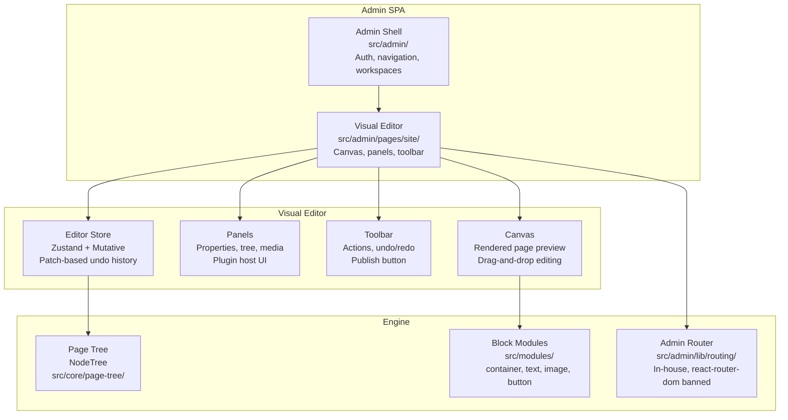
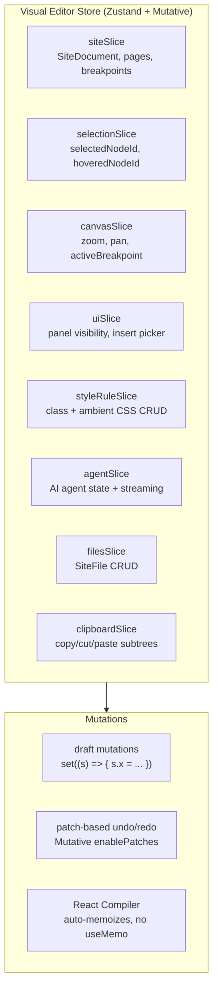

# Visual Editor: Canvas, Panels, and Store

The visual editor is a React 19 application with the React Compiler enabled, Zustand + Mutative for state management, and CodeMirror for code editing. It lives at `src/admin/pages/site/` and is served under `/admin/*`.

**Source:** `/home/darkvoid/Boxxed/@formulas/src.rust/src.AI/src.Instatic/Instatic/src/admin/pages/site/`

## Architecture



## React Compiler and Memoization

**Aha:** The React Compiler is enabled via a Babel preset in `vite.config.ts`. This means **do not hand-write `useMemo`, `useCallback`, or `memo`**. The compiler auto-memoizes everything. Hand-written memoization is not just unnecessary — it can conflict with the compiler's optimizations and cause unexpected behavior.

Store mutations use draft-mutation style:
```typescript
set((s) => { s.x = … })
```

If a recipe returns a partial, it must wrap it in `rawReturn(...)` or Mutative emits a performance warning.

**Source:** `CLAUDE.md` line 41, `vite.config.ts`.

## Editor Store

The editor uses Zustand with Mutative for state management:



**Source:** `src/admin/pages/site/store/store.ts` (combined store creation), `src/admin/pages/site/store/slices/` (14 slices).

This enables:
- **Undo/Redo** — Mutative patches record every state change, enabling precise undo without snapshot overhead
- **Draft mutations** — `set((s) => { s.x = … })` style mutations
- **Selective re-renders** — Zustand subscriptions only fire when the subscribed slice changes

**Source:** `src/admin/pages/site/` store files.

## Canvas

The canvas renders the current page as a live preview. It uses:

- **@dnd-kit/core** for drag-and-drop reordering of blocks
- **Module renderers** for each block type (text, image, button, container, etc.)
- **Inline editing** — clicking text on the canvas opens an editor

**Source:** `src/admin/pages/site/` canvas components.

## Panels

The editor has several panels:

| Panel | Purpose |
|-------|---------|
| Page Tree | Navigate and organize pages |
| Properties | Edit selected block's properties |
| Media | Upload and manage media files |
| Plugin Host | Installed plugins management |

**Source:** `src/admin/pages/site/` panel components.

## Admin Router

**Aha:** Instatic uses an in-house router at `src/admin/lib/routing/`, replacing `react-router-dom`. The rules:

1. Use the admin router for all internal admin navigation
2. Links rendered from the site editor must use the admin router
3. `react-router-dom` is **banned** repo-wide
4. Raw `<a href="/admin...">` hard navigations are **banned** in admin UI
5. `src/core/` + `src/modules/` must **not** import the admin router

This is gated by `admin-router-usage.test.ts`.

**Source:** `src/admin/lib/routing/`, `src/__tests__/architecture/admin-router-usage.test.ts`.

## Icon System

**Aha:** Instatic uses vendored `pixel-art-icons` — not lucide-react. The rules:

1. Deep-import icons: `pixel-art-icons/icons/<name>` (tree-shakeable)
2. No lucide-react — banned repo-wide
3. No inline SVG strings — banned repo-wide
4. Add a new icon by importing it and running `bun run icons:sync`

Gated by `no-third-party-icons.test.ts` and `direct-icon-imports.test.ts`.

**Source:** `vendor/pixel-art-icons/`, `src/__tests__/architecture/`.

## First-Party Block Modules

```
src/modules/
├── container/     — Layout container
├── text/          — Rich text (TipTap)
├── image/         — Image with variants
├── button/        — CTA button
├── ...            — More block types
```

Each module defines:
- `module.render(props, children)` — pure function returning HTML
- Property schema (TypeBox)
- Property controls (for the editor UI)

**Source:** `src/modules/`.

## Editor Preferences

The editor supports configurable preferences:

```
docs/features/editor-preferences.md
```

**Source:** `docs/features/editor-preferences.md`.

## Next

Continue to [06-ai-runtime](06-ai-runtime.md) for the HTTP-only AI drivers and multi-turn tool loop.
