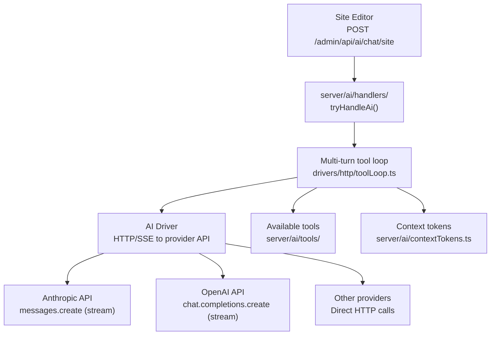

# AI Runtime: HTTP-Only Drivers

Instatic's AI integration talks directly to provider REST APIs over HTTP/SSE — **no provider SDKs**. Each driver in `server/ai/drivers/` shares one multi-turn tool loop. `@anthropic-ai/sdk`, `@openai/agents`, and `@modelcontextprotocol/sdk` are all **banned** repo-wide.

**Source:** `/home/darkvoid/Boxxed/@formulas/src.rust/src.AI/src.Instatic/Instatic/server/ai/`

## Architecture



**Aha:** The AI drivers don't use any provider SDK. They make raw `fetch()` calls to the provider's REST API, passing TypeBox schemas through as JSON Schema. This means:

1. **No SDK dependency updates** — when Anthropic releases a new SDK version, Instatic doesn't need to update
2. **Consistent interface** — all drivers share the same tool loop implementation
3. **Smaller bundle** — no SDK code in the server
4. **Gated by test** — `ai-driver-isolation.test.ts` verifies no banned SDK imports exist

**Source:** `CLAUDE.md` line 50, `server/ai/drivers/`.

## AI Handlers

```
server/ai/handlers/
├── index.ts            — Route dispatcher for /admin/api/ai/*
├── chat.ts             — Chat stream handler
├── browser.ts          — Browser bridge for AI agent
├── credentials.ts      — API key CRUD
├── conversations.ts    — Conversation history
├── defaults.ts         — Default model/provider settings
└── models.ts           — Model discovery
```

### Chat Endpoint

```
POST /admin/api/ai/chat/site
```

The site editor sends chat messages here. The handler:
1. Validates the request with TypeBox
2. Checks `requireCapability('ai.chat')`
3. Routes to the configured provider's driver
4. Streams the response back via SSE

**Source:** `server/ai/handlers/chat.ts`.

## Driver Architecture

Each driver implements the same interface:

```typescript
// server/ai/drivers/
// Each driver:
// 1. Reads provider config (API key, model, etc.)
// 2. Makes HTTP/SSE call to provider API
// 3. Parses response
// 4. Returns to the tool loop
```

### Provider Drivers

| Driver | Provider API | Method |
|--------|-------------|--------|
| `drivers/anthropic/` | `https://api.anthropic.com/v1/messages` | POST, SSE stream |
| `drivers/openai/` | `https://api.openai.com/v1/chat/completions` | POST, SSE stream |
| `drivers/other/` | Provider-specific | HTTP |

**Source:** `server/ai/drivers/`.

## Multi-Turn Tool Loop

The tool loop (`drivers/http/toolLoop.ts`) manages the conversation:

```mermaid
sequenceDiagram
    participant Client as Site Editor
    participant Loop as toolLoop.ts
    participant Driver as AI Driver
    participant Tools as Available Tools
    participant Provider as Provider API

    Client->>Loop: POST /ai/chat/site { messages }
    Loop->>Driver: Send messages to provider
    Driver->>Provider: HTTP/SSE request
    Provider-->>Driver: Stream response
    Driver-->>Loop: Parsed response
    alt Tool call
        Loop->>Tools: Execute tool
        Tools-->>Loop: Tool result
        Loop->>Driver: Send tool result
        Driver->>Provider: HTTP/SSE request
        Provider-->>Driver: Stream response
        Driver-->>Loop: Parsed response
    end
    Loop-->>Client: SSE stream response
```

**Source:** `server/ai/drivers/http/toolLoop.ts`.

## Credentials Management

API keys are stored and managed through:

```
server/ai/credentials/
```

Each provider has its own credential type. Credentials are validated before use and redacted from logs.

## Context Tokens

The AI system uses context tokens for pricing and tracking:

```typescript
// server/ai/contextTokens.ts
// Tracks token usage per conversation
```

**Source:** `server/ai/contextTokens.ts`.

## AI Audit

The AI system includes audit logging:

```
server/ai/audit/
```

**Source:** `server/ai/audit/`.

## Pricing

AI pricing information is tracked for cost estimation:

```
server/ai/pricing/
```

**Source:** `server/ai/pricing/`.

## Banned SDKs

The following are banned repo-wide, gated by `ai-driver-isolation.test.ts`:

| Banned Package | Reason |
|---------------|--------|
| `@anthropic-ai/sdk` | Direct HTTP calls instead |
| `@anthropic-ai/claude-agent-sdk` | Direct HTTP calls instead |
| `@openai/agents` | Direct HTTP calls instead |
| `@openrouter/agent` | Direct HTTP calls instead |
| `@modelcontextprotocol/sdk` | No MCP needed |

**Source:** `CLAUDE.md` line 50, `src/__tests__/architecture/ai-driver-isolation.test.ts`.

## Next

Continue to [07-content-model](07-content-model.md) for the content model, NodeTree, and TypeBox validation.
