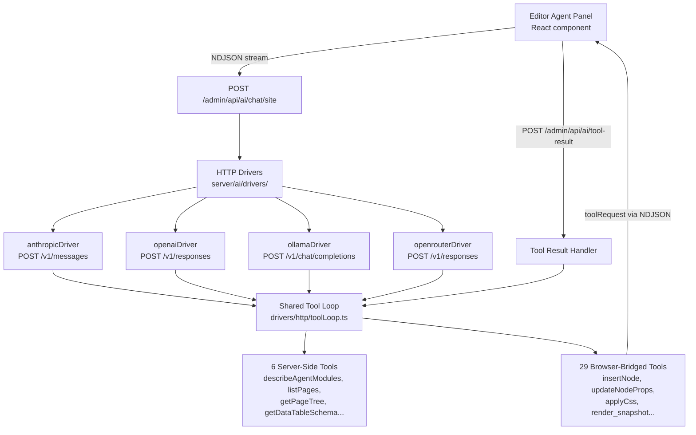
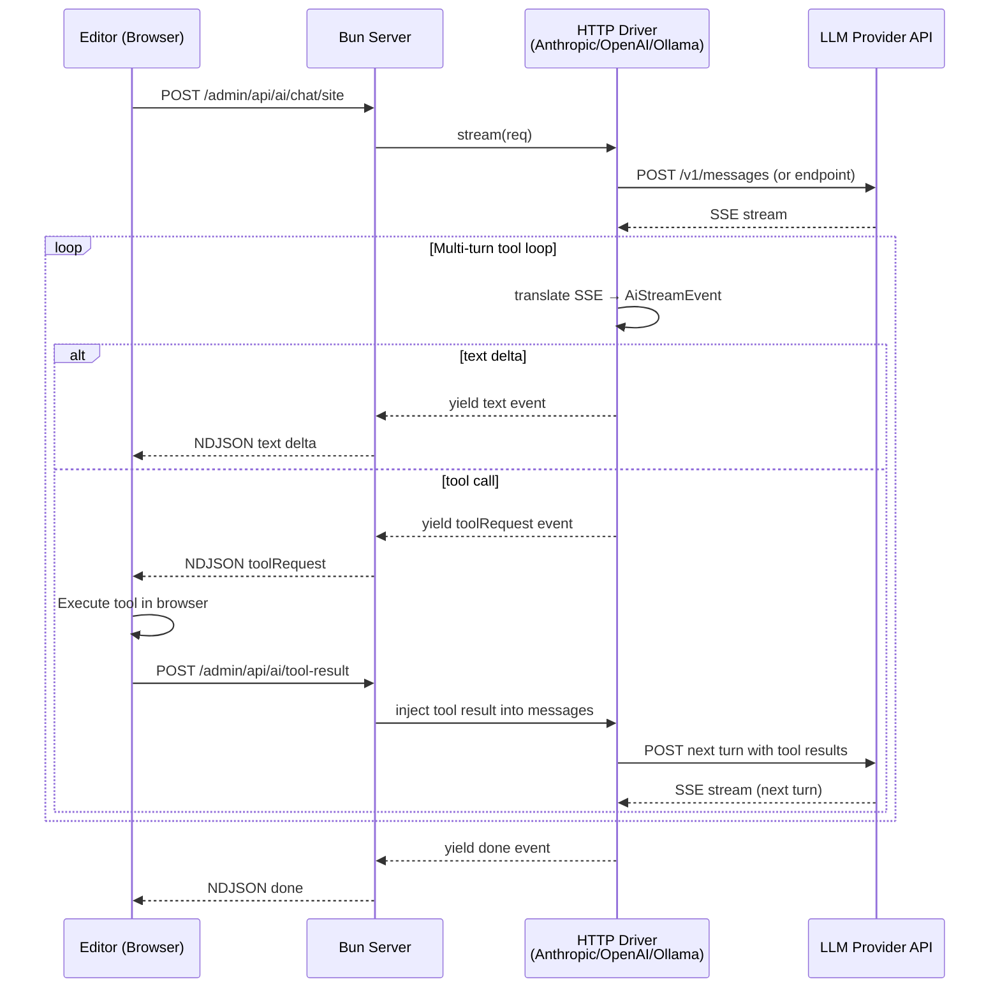

# Instatic AI Runtime — HTTP-Only Drivers with Shared Tool Loop

**Instatic's AI integration talks directly to provider REST APIs over raw HTTP/SSE — zero vendor SDKs.** Each driver in `server/ai/drivers/` (Anthropic, OpenAI, Ollama, OpenRouter) is ~200 lines of HTTP request/response handling. They share a single multi-turn tool loop (`server/ai/drivers/http/toolLoop.ts`) that handles tool call parsing, execution, and result injection — the drivers only provide a small `ProviderAdapter` with three mapping functions. The system exposes 35 tools (6 server-side directory readers + 29 browser-bridged write tools) through a dual-endpoint bridge: the server streams NDJSON to the editor, editor-side tools execute in the browser, and results POST back to `/admin/api/ai/tool-result`.

Source: `server/ai/` + `src/core/ai/` + `src/admin/pages/site/agent/`

## Architecture



## AiProvider Interface

```typescript
// server/ai/drivers/index.ts
const DRIVERS: Record<AiProviderId, AiProvider> = {
  anthropic: anthropicDriver,
  openai: openaiDriver,
  ollama: ollamaDriver,
  openrouter: openrouterDriver,
}

interface AiProvider {
  readonly id: AiProviderId
  stream(req: AiStreamRequest): AsyncIterable<AiStreamEvent>
  listModels(credentials: AiResolvedCredential): Promise<AiProviderModel[]>
  capabilities(modelId: string): AiProviderCapabilities
}
```

**Aha:** There's no `@anthropic-ai/sdk`, no `openai` npm package, no `@modelcontextprotocol/sdk`. Each driver is a thin HTTP client using Bun's native `fetch`. The `ai-driver-isolation.test.ts` architecture test bans all AI vendor SDKs — the repo enforces this with import checking. The rationale: SDKs add ~40-80KB of bundled deps per provider, introduce supply-chain risk, and hide the actual API contract behind abstraction layers that break silently on provider API changes.

## The Shared Tool Loop

```typescript
// server/ai/drivers/http/toolLoop.ts — shared by all 4 drivers
// Each driver provides a minimal ProviderAdapter:
interface ProviderAdapter {
  mapHistory(messages: AiMessage[]): ProviderNativeMessage[]
  createTranslator(): TurnTranslator  // Parses SSE chunks into AiStreamEvent
  buildRequestBody(messages, tools, config): ProviderRequestBody
}

// The shared loop:
async function* runToolLoop(
  adapter: ProviderAdapter,
  messages: AiMessage[],
  tools: AiTool[],
  abortSignal: AbortSignal,
): AsyncIterable<AiStreamEvent> {
  while (true) {
    const body = adapter.buildRequestBody(messages, tools)
    const response = await fetch(endpoint, {
      method: 'POST', body: JSON.stringify(body),
      headers: { 'Content-Type': 'application/json', ...authHeaders },
      signal: abortSignal,
    })
    const translator = adapter.createTranslator()
    let hasToolCalls = false

    for await (const chunk of parseSSE(response.body)) {
      const event = translator.translate(chunk)
      if (event.type === 'tool_call') {
        hasToolCalls = true
        const result = await executeAiTool(event.toolName, event.toolArgs)
        messages.push({ role: 'assistant', tool_calls: [event.toolCall] })
        messages.push({ role: 'tool', tool_call_id: event.toolCall.id, content: result })
      } else {
        yield event  // Text delta, usage, etc. — stream to editor
      }
    }

    if (!hasToolCalls) break  // Model finished without tool calls — done
  }
}
```

**Aha:** The tool loop is provider-agnostic because tool calls are normalized to a common format BEFORE they enter the loop. The `createTranslator()` function handles the format differences: Anthropic uses `content_block_start`/`content_block_delta` SSE events, OpenAI uses `response.output_text.delta` and `response.output_item.added`, Ollama uses plain JSON chunks. The translator maps all of these to the same `AiStreamEvent` type.

## 35 Tools — 6 Server-Side + 29 Browser-Bridged

### Server-Side Tools (read-only directory operations)

| Tool | What It Returns |
|------|----------------|
| `describeAgentModules` | All registered block modules with schemas |
| `describeAgentTokens` | CSS custom properties, font families, color tokens |
| `listPages` | All pages in the site |
| `listComponents` | All visual components |
| `getPageTree` | Full page tree as JSON |
| `getDataTableSchema` | Schema for a content data table |

### Browser-Bridged Tools (mutate the page tree)

These 29 tools execute in the EDITOR's browser context, not the server. The server sends `toolRequest` via NDJSON; the editor executes and POSTs results back:

| Category | Tools |
|----------|-------|
| **Node CRUD** | `insertNode`, `replaceNodeHtml`, `deleteNode`, `updateNodeProps`, `moveNode`, `renameNode`, `duplicateNode` |
| **CSS** | `applyCss` (upserts — reapplying a selector changes the existing rule), `assignClass`, `removeClass` |
| **Pages** | `addPage`, `deletePage`, `renamePage`, `duplicatePage`, `setPageTemplate`, `clearPageTemplate` |
| **Tokens** | `setColorTokens`, `setFontTokens`, `setTypeScale`, `setSpacingScale` |
| **Code** | `list_code_assets`, `read_code_asset`, `write_code_asset`, `patch_code_asset`, `inspect_code_runtime` |
| **Read** | `read_document`, `open_document` |
| **Debug** | `render_snapshot`, `getNodeHtml` |

**Aha:** `insertNode` and `replaceNodeHtml` accept semantic HTML strings. The browser executor calls `importHtml` to convert HTML → `PageNode` fragments. CSS is imported the same way humans paste CSS: `<style>` blocks in the payload, `class=` attributes on elements, or the dedicated `applyCss` tool for standalone CSS editing. The AI writes HTML, not JSON.

## Dual-Endpoint Bridge



**Source:** `server/ai/drivers/http/toolLoop.ts` (shared loop), `server/ai/handlers/toolResult.ts` (result bridge), `server/ai/runtime/transport.ts` (NDJSON streaming).

**Aha:** `idleTimeout: 0` on `Bun.serve` because AI streams can pause 10+ seconds between tool calls (the LLM is thinking, the tool is executing). Without this, Bun would close the connection.

## System Prompt — Split Design

The system prompt has a static prefix (module catalog, token families, page metadata — built once at session start) and a dynamic suffix (current page context, runtime agent state — rebuilt at the start of each turn). This avoids re-sending the entire module catalog on every LLM call.

## Cross-References

- [Core Engine](01-architecture.md) — The page tree and module engine that AI tools operate on
- [Plugin System](04-plugin-system.md) — QuickJS sandbox (AI tools are native, not sandboxed)

## Next

→ [Plugin System](04-plugin-system.md) — QuickJS-WASM sandbox, RPC protocol, 23 capabilities.
