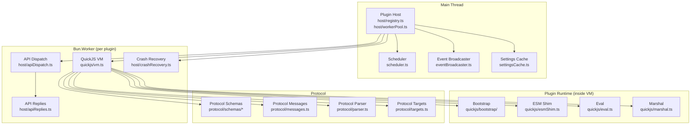

# Plugin System Deep Dive: Host, VM, Protocol, Bootstrap, RPC

This document provides source-level detail of the plugin system's internal architecture: the host process, QuickJS VM, protocol definitions, bootstrap system, and RPC mechanism.

**Source:** `/home/darkvoid/Boxxed/@formulas/src.rust/src.AI/src.Instatic/Instatic/server/plugins/`

## Architecture Overview



## File Map

| File | Purpose |
|------|---------|
| `host/registry.ts` | Plugin registration and lifecycle |
| `host/workerPool.ts` | Worker pool management |
| `host/workerState.ts` | Worker state tracking |
| `host/workerErrors.ts` | Worker error types |
| `host/crashRecovery.ts` | Crash recovery with budget |
| `host/apiDispatch.ts` | API call dispatch to handlers |
| `host/apiReplies.ts` | API reply serialization |
| `host/rpc.ts` | RPC mechanism |
| `host/routeIo.ts` | Route I/O handling |
| `host/settingsSync.ts` | Settings synchronization |
| `host/media.ts` | Media handling in VM |
| `host/network.ts` | Network access control |
| `host/types.ts` | Host type definitions |
| `host/handlers/content.ts` | Content handler |
| `host/handlers/contentProjection.ts` | Content projection |
| `host/handlers/crypto.ts` | Crypto handler |
| `host/handlers/hooks.ts` | Lifecycle hooks |
| `host/handlers/loops.ts` | Loops handler |
| `host/handlers/media.ts` | Media handler |
| `host/handlers/network.ts` | Network handler |
| `host/handlers/routes.ts` | Routes handler |
| `host/handlers/schedule.ts` | Schedule handler |
| `host/handlers/settings.ts` | Settings handler |
| `host/handlers/storage.ts` | Storage handler |
| `modulePackVm.ts` | Module pack VM |
| `package.ts` | Package validation |
| `pack.ts` | Pack operations |
| `pluginWorker.ts` | Plugin worker creation |
| `pluginScheduleRegistration.ts` | Schedule registration |
| `runtime.ts` | Plugin runtime |
| `scheduler.ts` | Plugin scheduler |
| `settingsCache.ts` | Settings cache |

## QuickJS VM

| File | Purpose |
|------|---------|
| `quickjs/vm.ts` | VM creation and execution |
| `quickjs/eval.ts` | Code evaluation in VM |
| `quickjs/marshal.ts` | Value marshaling between host and VM |
| `quickjs/limits.ts` | Resource limits (memory, time) |
| `quickjs/types.ts` | VM type definitions |
| `quickjs/esmShim.ts` | ESM module shim |

### Bootstrap

The bootstrap is authored as TypeScript in `quickjs/bootstrap/src/` and bundled to committed string artifacts in `quickjs/bootstrap/generated/`:

| Source File | Generated Artifact |
|------------|-------------------|
| `bootstrap/src/pluginRuntime.ts` | `bootstrap/generated/pluginBootstrap.ts` |
| `bootstrap/src/modulePackRuntime.ts` | `bootstrap/generated/modulePackBootstrap.ts` |

The bootstrap provides:

| File | Purpose |
|------|---------|
| `bootstrap/index.ts` | Bootstrap entry point |
| `bootstrap/base64.ts` | Base64 codec (evaluated inside every VM) |
| `bootstrap/crypto.ts` | Crypto shim (evaluated inside every VM) |
| `bootstrap/fetch.ts` | Fetch shim (evaluated inside every VM) |
| `bootstrap/timers.ts` | Timer shim (evaluated inside every VM) |
| `bootstrap/polyfills.ts` | Polyfills for QuickJS |
| `bootstrap/src/boundary.ts` | Host-VM boundary |
| `bootstrap/src/buildApi.ts` | API builder for VM |
| `bootstrap/src/globals.d.ts` | Global type definitions |

**Aha:** The QuickJS VM has no built-in event loop, so timers can't be a pure JS implementation. The timer shim (`bootstrap/timers.ts`) uses `queueMicrotask` to approximate async behavior within the synchronous VM execution model.

## Protocol

The plugin protocol defines how the host and VM communicate:

### Protocol Schemas

| Schema | Purpose |
|--------|---------|
| `protocol/schemas/content.ts` | Content operations schema |
| `protocol/schemas/crypto.ts` | Crypto operations schema |
| `protocol/schemas/hooks.ts` | Lifecycle hooks schema |
| `protocol/schemas/loops.ts` | Loop operations schema |
| `protocol/schemas/media.ts` | Media operations schema |
| `protocol/schemas/network.ts` | Network operations schema |
| `protocol/schemas/routes.ts` | Route operations schema |
| `protocol/schemas/schedule.ts` | Schedule operations schema |
| `protocol/schemas/storage.ts` | Storage operations schema |

### Protocol Core

| File | Purpose |
|------|---------|
| `protocol/apiCallSchema.ts` | API call validation schema |
| `protocol/bodyEncoding.ts` | Request/response body encoding |
| `protocol/messages.ts` | Message type definitions |
| `protocol/parser.ts` | Protocol parser |
| `protocol/targets.ts` | Protocol target definitions |

## Crash Recovery

```mermaid
sequenceDiagram
    participant Host as Plugin Host<br/>(host/registry.ts)
    participant Pool as Worker Pool<br/>(host/workerPool.ts)
    participant Worker as Bun.Worker
    participant VM as QuickJS VM<br/>(quickjs/vm.ts)
    participant Recovery as Crash Recovery<br/>(host/crashRecovery.ts)

    Host->>Pool: activatePlugin(id)
    Pool->>Worker: create Bun.Worker
    Worker->>VM: createPluginVm({source, env})
    VM-->>Host: VM ready, exported hooks

    loop Plugin lifecycle
        Host->>VM: runLifecycle('install')
        VM-->>Host: success
    end

    Note over VM: VM crashes<br/>(uncaught exception,<br/>memory limit exceeded)
    VM--x>Pool: Worker exit/error
    Pool->>Recovery: recordCrash(pluginId)
    Recovery->>Recovery: check crash budget

    alt budget remaining
        Recovery->>Pool: respawn worker
        Pool->>Worker: create Bun.Worker
        Worker->>VM: createPluginVm(...)
        VM-->>Host: VM respawned
        Recovery->>Recovery: decrement budget
    else budget exhausted
        Recovery->>Host: disablePlugin(pluginId)
        Note over Host: Plugin disabled<br/>logged, no more dispatch
    end
```

Each plugin VM has a crash budget. When a VM crashes:
1. The host detects the crash via worker exit
2. If budget remains, the VM is respawned
3. Budget is decremented
4. If budget exhausted, the plugin is disabled

**Source:** `server/plugins/host/crashRecovery.ts`, `server/plugins/host/workerPool.ts`.

## Worker Pool

```
host/workerPool.ts
host/workerState.ts
```

The worker pool manages one `Bun.Worker` per active plugin:
- Workers are created on plugin activation
- Each worker hosts a single QuickJS VM
- Workers are destroyed on plugin deactivation
- State is tracked in `workerState.ts`

## API Dispatch

```
host/apiDispatch.ts
```

API calls from the VM are dispatched to handlers based on the call type:
- Content → `handlers/content.ts`
- Crypto → `handlers/crypto.ts`
- Hooks → `handlers/hooks.ts`
- Loops → `handlers/loops.ts`
- Media → `handlers/media.ts`
- Network → `handlers/network.ts`
- Routes → `handlers/routes.ts`
- Schedule → `handlers/schedule.ts`
- Settings → `handlers/settings.ts`
- Storage → `handlers/storage.ts`

## Content Projection

```
host/handlers/contentProjection.ts
```

Content projection maps plugin content to CMS structures, handling field mapping between plugin schemas and CMS data tables.

## Scheduler

```
scheduler.ts
pluginScheduleRegistration.ts
```

The plugin scheduler runs scheduled tasks:
- Plugin tick — periodic plugin operations
- Scheduled publish — time-based publishing
- Leader election via `pg_try_advisory_lock` for multi-instance HA

## Next

Continue to [08-canvas](08-canvas.md) for the canvas rendering system.
