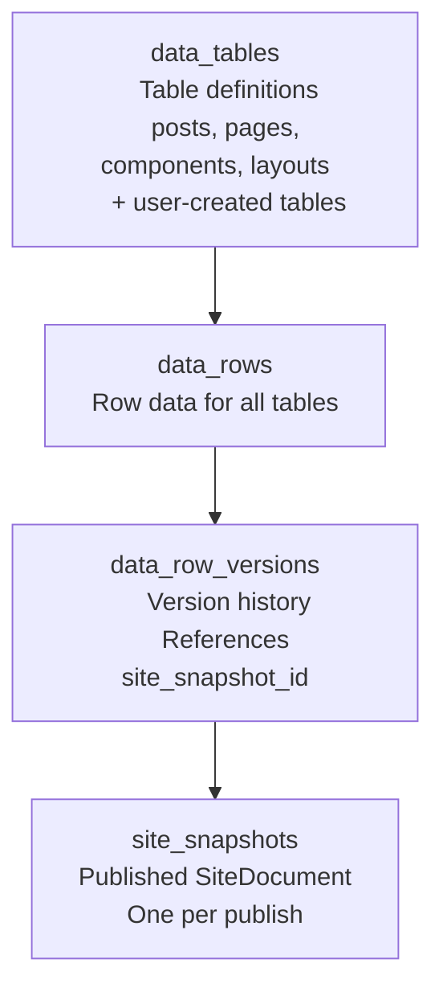
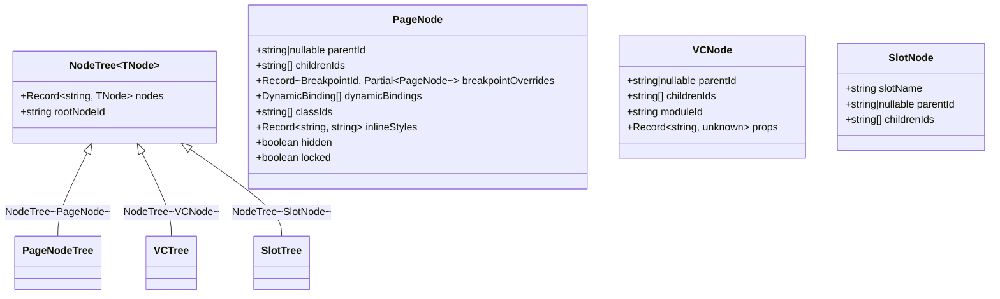

# Content Model: Data Tables, NodeTree, and TypeBox

Instatic's content model stores everything in two tables (`data_tables` + `data_rows`), uses a single tree primitive (`NodeTree<TNode>`) for all node structures, and validates every untyped boundary with TypeBox.

**Source:** `/home/darkvoid/Boxxed/@formulas/src.rust/src.AI/src.Instatic/Instatic/src/core/`

## Content Storage



**Aha:** There are **no separate `pages` or `page_versions` tables**. Everything — posts, pages, visual components, layouts — lives in the same two tables. The four system tables are seeded and locked from rename/delete. This simplifies the data model: one table for definitions, one table for data, one table for versions.

**Source:** `docs/features/content-storage.md`.

## NodeTree: The Universal Tree Primitive



**Source:** `src/core/page-tree/treeSchema.ts`, `src/core/page-tree/pageNode.ts`, `src/core/visualComponents/`.

Every tree of nodes uses the same shape:

| Tree Type | Instantiation |
|-----------|--------------|
| Page Tree | `NodeTree<PageNode>` |
| Visual Component Tree | `NodeTree<VCNode>` |
| Slot Fills | `NodeTree<SlotNode>` |

Mutations are tree-agnostic — the same insert, delete, reorder functions work on any `NodeTree<TNode>`.

**Source:** `src/core/page-tree/treeSchema.ts`, `docs/reference/page-tree.md`.

## TypeBox Validation

**Aha:** Every untyped boundary uses TypeBox — HTTP responses, request bodies, persisted JSON, plugin manifests, settings. The pattern is:

```typescript
const FooSchema = Type.Object({ ... })
type Foo = Static<typeof FooSchema>
// Never a parallel interface — the schema IS the source of truth
```

**zod is banned** repo-wide. The AI drivers pass TypeBox schemas through as JSON Schema directly, so no typebox→zod adapter is needed.

**Source:** `CLAUDE.md` line 45, `docs/reference/typebox-patterns.md`.

### TypeBox Patterns

| Pattern | Usage |
|---------|-------|
| `Type.Object({...})` | Object schemas |
| `Static<typeof Schema>` | Type derivation |
| JSON Schema output | AI drivers, plugin manifests |

**Source:** `docs/reference/typebox-patterns.md`.

## Page Tree

The page tree manages site navigation and content organization:

```
src/core/page-tree/
├── treeSchema.ts         — NodeTree<TNode> definition
├── ...                   — Tree operations
```

**Source:** `src/core/page-tree/`, `docs/reference/page-tree.md`.

## Visual Components

Visual Components are reusable page fragments:

```
src/core/visualComponents/
├── ...                   — VC definition, rendering, schema
```

**Source:** `src/core/visualComponents/`, `src/core/visual-components-schema/`.

## Module Engine

Modules are the building blocks of pages:

```
src/core/module-engine/
├── types.ts              — ModuleDefinition, PropertySchema
├── propertySchema.ts     — Property control definitions
├── runtimeResolver.ts    — Module resolution at runtime
├── dependencies.ts       — Module dependency tracking
└── index.ts              — Public barrel
```

Each module defines:
- **PropertySchema** — what properties it accepts (TypeBox)
- **render()** — pure function returning HTML
- **Controls** — how properties are edited in the visual editor

**Source:** `src/core/module-engine/`.

## HTML Sanitization

```
src/core/sanitize.ts       — DOMPurify at publisher boundary
src/core/html-sanitize/    — HTML sanitization utilities
src/core/css-sanitize/     — CSS sanitization
```

**Source:** `src/core/sanitize.ts`, `src/core/html-sanitize/`, `src/core/css-sanitize/`.

## Loops

Loops iterate over content sources:

```
src/core/loops/
```

Loop rendering round-robins child variants:

**Source:** `src/core/publisher/renderLoop.ts`, `docs/features/loops.md`.

## Forms

Native CMS forms:

```
src/core/forms/
server/forms/handler.ts    — Form submission handling
```

**Source:** `src/core/forms/`, `docs/features/cms-native-forms.md`.

## Templates

Site templates for quick starts:

```
src/core/templates/
```

**Source:** `src/core/templates/`, `docs/features/templates.md`.

## Next

Continue to [08-deployment](08-deployment.md) for Docker, database setup, TLS, and multi-instance HA.
