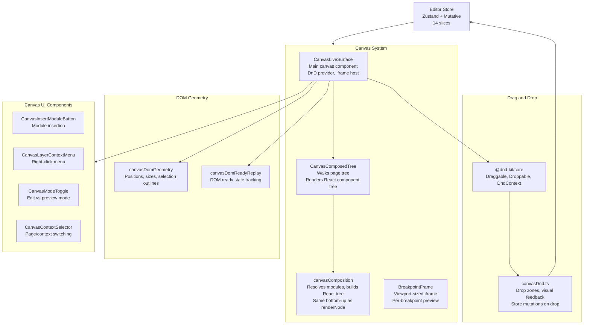
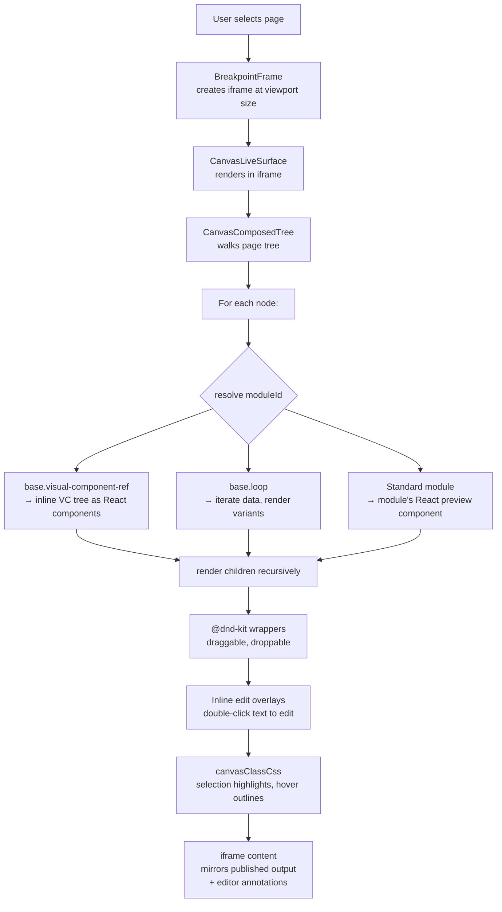

# Canvas Deep Dive: Rendering, DnD, Composition, Breakpoint Frames

The visual editor canvas is the core of Instatic's editing experience. It renders pages live, supports drag-and-drop reordering, inline editing, and breakpoint-aware previews. The canvas uses the same bottom-up walk as the publisher but produces React components instead of HTML strings.

**Source:** `/home/darkvoid/Boxxed/@formulas/src.rust/src.AI/src.Instatic/Instatic/src/admin/pages/site/canvas/`

## Canvas Architecture

## Canvas Rendering Pipeline

**Aha:** The canvas renders pages using the **same rendering pipeline** as the publisher, but in preview mode. This means what you see in the canvas is exactly what gets published — no separate preview renderer. The canvas uses `canvasComposition.ts` which follows the same bottom-up walk as `renderNode.ts`, but produces React components instead of HTML strings. Both share the same module registry and `escapeProps` logic — the only divergence is the output format (React tree vs HTML string) and the editor-only annotations (`uid` attributes, selection outlines).

**Aha:** The canvas uses an **iframe** not just for style isolation, but for viewport-accurate layout. The `BreakpointFrame` component creates an iframe at the exact breakpoint dimensions (375px mobile, 768px tablet, 1440px desktop), so the layout inside the iframe matches what visitors see. CSS media queries fire correctly inside the iframe because its viewport is the iframe's width, not the full editor window.

## File Map

| File | Purpose |
|------|---------|
| `CanvasLiveSurface.tsx` | Main canvas surface with live rendering |
| `CanvasComposedTree.tsx` | Composed tree rendering (modules + VCs) |
| `canvasComposition.ts` | Composition logic for rendering nodes |
| `canvasNodeClassName.ts` | Class name resolution for canvas nodes |
| `canvasDnd.ts` | Drag-and-drop integration (@dnd-kit/core) |
| `canvasDomGeometry.ts` | DOM geometry calculations |
| `canvasDomReadyReplay.ts` | DOM ready state replay |
| `canvasFormPreview.ts` | Form preview in canvas |
| `BreakpointFrame.tsx` | Breakpoint-aware rendering frame |
| `BreakpointSelectionOverlay.tsx` | Breakpoint selection overlay |
| `CanvasContextSelector.tsx` | Context selection UI |
| `CanvasContexts.ts` | React contexts for canvas |
| `CanvasInsertModuleButton.tsx` | Module insertion button |
| `CanvasLayerContextMenu.tsx` | Layer context menu |
| `CanvasModeToggle.tsx` | Mode toggle (edit/preview) |
| `canvasClassCss.ts` | Canvas-specific CSS class handling |

## CanvasLiveSurface

The `CanvasLiveSurface` is the main canvas component:

- Renders the page tree as a live preview inside an iframe
- Supports inline editing (click text to edit)
- Handles drag-and-drop for reordering nodes via `@dnd-kit/core`
- Manages breakpoint frames for responsive preview
- Integrates with the editor store for state

## CanvasComposedTree

The `CanvasComposedTree` renders the composed tree:

- Walks the page tree node by node
- For each node, resolves the module definition from the registry
- Renders the corresponding module's React preview component
- Handles Visual Component refs by inlining the VC tree as React components
- Handles loops by rendering the current iteration
- Wraps each node in `@dnd-kit` draggable/droppable components

## Canvas Composition

The `canvasComposition` module handles:

- Resolving module definitions for each node from the registry
- Building the React component tree from the page tree
- Handling specialized node types (VC refs, loops)
- Passing render configuration to modules
- Same bottom-up walk as publisher's `renderNode.ts`

**Source:** `src/admin/pages/site/canvas/canvasComposition.ts`

## Drag and Drop

The `canvasDnd` module integrates with `@dnd-kit/core`:

- Defines drop zones for each node
- Handles drag start, drag over, and drop events
- Updates the page tree via the editor store on drop
- Manages visual feedback during drag operations (drop indicators, hover states)
- Computes insertion position from pointer geometry

**Source:** `src/admin/pages/site/canvas/canvasDnd.ts`

## DOM Geometry

The `canvasDomGeometry` module handles:

- Calculating node positions and sizes within the iframe
- Handling viewport scaling (zoom in/out)
- Managing selection outlines (accurate bounding box of selected element)
- Computing insertion indicators (where a dragged node will land)

## Breakpoint Frames

The `BreakpointFrame` component:

- Renders the page at a specific viewport size (375px, 768px, 1440px)
- Shows breakpoint boundaries
- Allows switching between breakpoints
- Maintains layout consistency across breakpoints

## DOM Ready Replay

The `canvasDomReadyReplay` module:

- Tracks DOM ready state during page load inside the iframe
- Replays DOM mutations for accurate preview
- Handles timing-dependent modules (animations, lazy loading)

## Canvas Contexts

The `CanvasContexts.ts` file defines React contexts for:

- Current page reference
- Editor store access
- Breakpoint context
- Selection context
- Mode context (edit vs preview)

## Next

Continue to [10-ai-agent](10-ai-agent.md) for the site agent deep dive.
