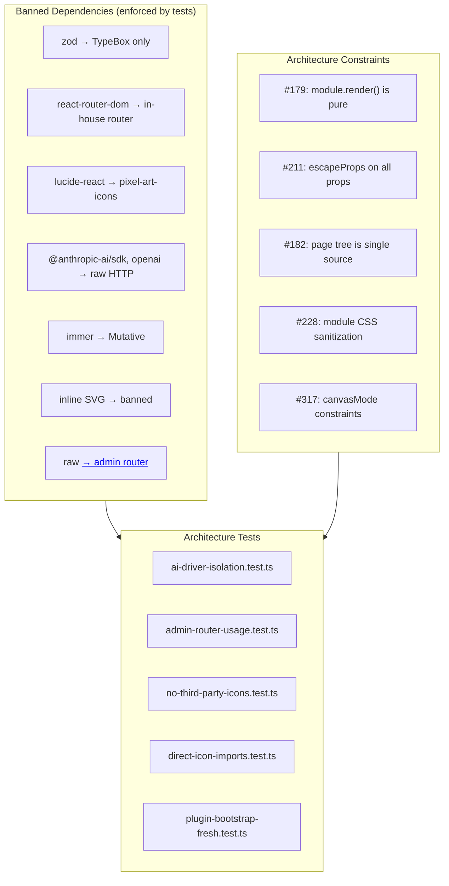
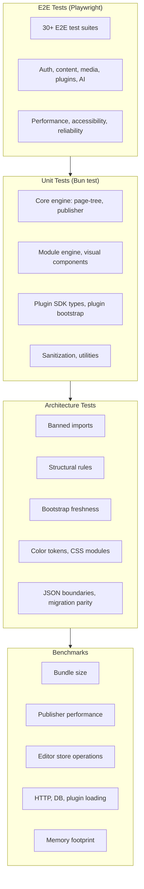

# Cross-Cutting Patterns

This document covers the banned dependencies, architectural patterns, testing strategy, and development tooling that span all of Instatic.

**Source:** `/home/darkvoid/Boxxed/@formulas/src.rust/src.AI/src.Instatic/Instatic/`

## Architectural Constraint Map



## Banned Dependencies

Instatic enforces strict boundaries on what packages are allowed:

| Banned | Replacement | Enforced By |
|--------|------------|-------------|
| `zod` | TypeBox | `ai-driver-isolation.test.ts` |
| `react-router-dom` | In-house router (`src/admin/lib/routing/`) | `admin-router-usage.test.ts` |
| `lucide-react` | pixel-art-icons (vendored) | `no-third-party-icons.test.ts` |
| `@anthropic-ai/sdk` | Direct HTTP calls | `ai-driver-isolation.test.ts` |
| `@anthropic-ai/claude-agent-sdk` | Direct HTTP calls | `ai-driver-isolation.test.ts` |
| `@openai/agents` | Direct HTTP calls | `ai-driver-isolation.test.ts` |
| `@openrouter/agent` | Direct HTTP calls | `ai-driver-isolation.test.ts` |
| `@modelcontextprotocol/sdk` | No MCP needed | `ai-driver-isolation.test.ts` |
| `immer` | Mutative (via zustand-mutative) | Architecture tests |
| Inline SVG strings | pixel-art-icons imports | `direct-icon-imports.test.ts` |
| Hard `<a href="/admin...">` | Admin router | `admin-router-usage.test.ts` |

**Aha:** The banned list isn't just documented — it's **enforced by tests**. The architecture tests in `src/__tests__/architecture/` verify these constraints at test time. If your change introduces a banned import, the test fails. This means the bans are machine-checked, not just documentation. This is the same approach used by companies like Netflix and Spotify to enforce architectural boundaries — the tests are the gatekeepers, not the code reviewers.

**Source:** `CLAUDE.md` lines 45-51, `src/__tests__/architecture/`.

## Architectural Constraints

The following constraints are enforced by architecture tests:

| Constraint | Description | Test |
|-----------|-------------|------|
| #179 | Module `render()` is a pure function — no DOM, no side effects | Architecture test |
| #211 | All props pass through `escapeProps` before render | Architecture test |
| #182 | Page tree is the single source of truth — no panel local copies | Architecture test |
| #228 | Module CSS is sanitized against `</style>` breakout | Architecture test |
| #317 | Canvas mode constraints (edit vs preview) | Architecture test |
| Admin router isolation | `src/core/` + `src/modules/` can't import admin router | `admin-router-usage.test.ts` |
| Icon purity | No third-party icon libraries | `no-third-party-icons.test.ts` |
| AI driver isolation | No provider SDKs | `ai-driver-isolation.test.ts` |
| Plugin bootstrap freshness | Bootstrap artifacts match source | `plugin-bootstrap-fresh.test.ts` |

**Source:** `src/__tests__/architecture/`.

## Testing Strategy

### Testing Pyramid



### Unit Tests

```bash
bun test              # Run all unit tests
bun test:watch        # Watch mode
bun test:coverage     # Coverage report
```

### E2E Tests

```bash
bun test:e2e          # Run Playwright E2E tests
bun test:e2e:ui       # E2E with Playwright UI
bun test:e2e:install  # Install Playwright browsers
```

### Architecture Tests

Located in `src/__tests__/architecture/`:
- Gate tests that enforce structural rules
- When your change drifts a structural rule, fix the gate test in the same change

### E2E Test Coverage

The E2E tests cover 30+ scenarios across:

| Category | Tests |
|----------|-------|
| Auth | `auth.e2e.ts`, `account.e2e.ts` |
| Content | `content.e2e.ts`, `page-management.e2e.ts` |
| Visual Editor | `visual-builder.e2e.ts`, `preview-live.e2e.ts` |
| Plugins | `plugins.e2e.ts` |
| AI | `ai.e2e.ts`, `command-palette.e2e.ts` |
| Media | `media.e2e.ts` |
| Performance | `performance.e2e.ts` |
| Accessibility | `accessibility.e2e.ts` |
| Reliability | `reliability.e2e.ts`, `error-handling.e2e.ts` |
| Forms | `forms.e2e.ts` |
| Navigation | `admin-navigation.e2e.ts`, `dashboard.e2e.ts` |
| Users | `users.e2e.ts` |
| Capabilities | `capabilities.e2e.ts` |
| Core Owner | `core-owner-lifecycle.e2e.ts` |
| Runtime | `runtime-dependencies.e2e.ts` |
| Public | `public-dynamic-fragments.e2e.ts` |
| Site Files | `site-files.e2e.ts` |

**Source:** `tests/e2e/` directory (17 E2E test files).

## Development Commands

| Command | Purpose |
|---------|---------|
| `bun dev` | Start full dev server (Vite + Bun) |
| `bun dev:server` | Start server only |
| `bun dev:vite` | Start Vite only |
| `bun dev:agent` | Start agent dev mode |
| `bun e2e:dev` | E2E development mode |
| `bun test` | Run unit tests |
| `bun test:e2e` | Run E2E tests |
| `bun doctor` | Health check all subsystems |
| `bun build` | Production build |
| `bun lint` | Lint check |
| `bun icons:sync` | Sync icon imports |
| `bun bootstrap:sync` | Rebuild plugin bootstrap |
| `bun instatic-plugin` | Scaffold a new plugin |

**Source:** `package.json` scripts (38 scripts).

## Benchmark Scripts

Instatic includes comprehensive benchmarking across every subsystem:

```bash
bun bench              # Run all benchmarks
bun bench:bundle       — Bundle size
bun bench:publisher    — Publisher performance
bun bench:publish      — Publish throughput
bun bench:editor-store — Editor store operations
bun bench:http         — HTTP request handling
bun bench:db           — Database operations
bun bench:plugin       — Plugin loading
bun bench:footprint    — Memory footprint
bun bench:health       — System health
bun bench:browser      — Browser performance
bun bench:browser:install — Install browser benchmarks
```

**Source:** `scripts/bench/`, `package.json`.

## Icon System

```bash
bun run icons:sync     # Sync icon imports
bun run icons:check    # Verify icon usage
```

Adds a new icon by importing it from `vendor/pixel-art-icons/icons/` and running `icons:sync`.

**Source:** `vendor/pixel-art-icons/`, `package.json`.

## Bootstrap System

```bash
bun run bootstrap:sync  # Rebuild bootstrap artifacts
bun run bootstrap:check # Verify bootstrap is fresh
```

The QuickJS bootstrap is authored as TypeScript in `server/plugins/quickjs/bootstrap/src/` and bundled to committed string artifacts in `bootstrap/generated/`.

**Source:** `server/plugins/quickjs/bootstrap/src/`, `bootstrap/generated/`.

## Key Architectural Patterns

### Constraint Numbering

**Aha:** Constraints are numbered (#179, #211, #182, etc.) and referenced across the codebase in comments and tests. This creates a traceable system: you can find every place a constraint is enforced by grepping for the constraint number. It also means new developers can understand the architectural rules just by reading constraint references in code.

### Module Purity (#179)

**Aha:** Module `render()` functions being pure (Constraint #179) means they have **zero** access to DOM, network, filesystem, or React. They receive props and children HTML, return a string. This makes the publisher trivially testable: you call `render()` with a props object and assert the HTML output. It also means plugins can't leak data through module renderers — there's no side-channel.

### Schema-First Validation (TypeBox, No Zod)

**Aha:** TypeBox outputs JSON Schema natively, which the AI drivers pass directly to LLM providers. If Instatic used zod, it would need a `zod-to-json-schema` adapter (another dependency, another failure mode). TypeBox eliminates the adapter entirely — the schema IS the JSON Schema, so the AI tool definitions are one `TypeBox.Value(schema)` away. This is why zod is banned: it's not just style, it's architecture.

## Aha Moments

1. **One content model, two tables** — Posts, pages, components, layouts all in `data_tables` + `data_rows`. No separate tables means simpler migrations and a unified data model.

2. **Three-layer publishing** — Static bake (A) → LRU cache (B) → lazy holes (C). Most CMS systems use one approach; Instatic uses all three, automatically selecting the right one per page.

3. **No provider SDKs** — AI drivers use raw `fetch()` calls. This eliminates SDK dependency churn and ensures all drivers share the same tool loop implementation.

4. **Plugin sandboxing** — QuickJS-WASM in a Bun.Worker with capability permissions. A crash in one plugin doesn't take down the server, and network access is explicitly gated.

5. **React Compiler** — No hand-written memoization. The compiler auto-memoizes, reducing boilerplate and eliminating a class of performance bugs.

6. **Machine-enforced bans** — Banned dependencies aren't just documented; they're tested. Architecture tests fail if you import a banned package.

7. **Constraint numbering as traceable system** — Every architectural constraint has a number (#179, #211, etc.) referenced in code comments and tests, creating a grep-traceable audit trail.

8. **TypeBox as native JSON Schema** — TypeBox outputs JSON Schema directly, eliminating the need for zod-to-json-schema adapters that would be required with any other validation library.

## Next

You've completed the src.Instatic documentation. Return to the [README](README.md) for the full index.
