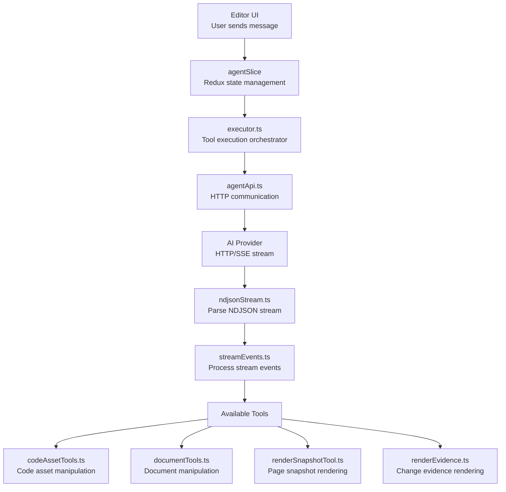

# AI Agent Deep Dive: Site Agent, Executor, Tools, Streaming

Instatic includes a built-in AI agent that can edit pages, manage content, and interact with the CMS from within the visual editor. The agent uses HTTP-only communication with AI providers (no SDKs) and has a rich tool set.

**Source:** `/home/darkvoid/Boxxed/@formulas/src.rust/src.AI/src.Instatic/Instatic/src/admin/pages/site/agent/`

## File Map

| File | Purpose |
|------|---------|
| `agentApi.ts` | AI API communication layer |
| `agentConfig.ts` | Agent configuration |
| `agentSlice.ts` | Redux Toolkit slice for agent state |
| `agentSliceTypes.ts` | Agent state type definitions |
| `agentSliceConfig.site.ts` | Site-specific agent config |
| `executor.ts` | Tool execution orchestrator |
| `types.ts` | Agent type definitions |
| `streamEvents.ts` | Streaming event handling |
| `ndjsonStream.ts` | NDJSON stream parsing |
| `tokenRunners.ts` | Token counting and management |
| `pageContext.ts` | Page context for agent |
| `siteAgentSnapshot.ts` | Site snapshot for agent context |
| `renderEvidence.ts` | Evidence rendering |
| `renderSnapshotTool.ts` | Snapshot rendering tool |
| `storeRef.ts` | Store reference for agent |
| `markdown.ts` | Markdown utilities |
| `index.ts` | Agent barrel export |

## Agent Architecture



## Agent State

The `agentSlice` manages the agent's state via Redux Toolkit:

- Conversation history
- Current agent status (idle, thinking, executing tool)
- Token usage tracking
- Configuration

## Agent API

The `agentApi` communicates with the server's AI endpoint:

```
POST /admin/api/ai/chat/site
```

This uses the same HTTP-only approach as the server-side AI handlers — no provider SDKs on the client either.

## NDJSON Streaming

The `ndjsonStream` module parses Newline-Delimited JSON streams from the server:

- Handles partial chunks
- Parses complete JSON objects
- Handles stream errors
- Supports cancellation

## Executor

The `executor` orchestrates tool execution:

1. Agent requests tool execution
2. Executor validates the tool call
3. Executor executes the tool
4. Executor returns result to agent
5. Agent continues with result

## Available Tools

### Code Asset Tools

```
codeAssetTools.ts
```

Manipulates code assets:
- Read/write code files
- Create new code assets
- Delete code assets

### Document Tools

```
documentTools.ts
```

Manipulates CMS documents:
- Read documents
- Update documents
- Create documents
- Delete documents

### Render Snapshot Tool

```
renderSnapshotTool.ts
```

Captures page snapshots for the agent to reference:
- Renders current page state
- Captures visual evidence
- Provides context for agent decisions

### Render Evidence

```
renderEvidence.ts
```

Renders evidence of agent actions:
- Shows what changed
- Provides visual diffs
- Supports undo visualization

## Token Management

The `tokenRunners` module tracks token usage:

- Counts input tokens
- Counts output tokens
- Tracks token budget
- Provides cost estimates

## Page Context

The `pageContext` module provides the agent with page context:

- Current page tree
- Module registry
- Available templates
- Site configuration

## Site Agent Snapshot

The `siteAgentSnapshot` module creates a snapshot of the site for agent context:

- Page structure
- Content data
- Module definitions
- Settings

## Streaming Events

The `streamEvents` module processes streaming events from the agent:

- Text chunks
- Tool calls
- Tool results
- Completion signals
- Error signals

## Store Reference

The `storeRef` module provides the agent with access to the editor store:

- Read current state
- Dispatch actions
- Subscribe to changes

## Markdown Utilities

The `markdown` module provides markdown parsing and rendering utilities for the agent:

- Parse markdown to structured data
- Render structured data to markdown
- Handle code blocks, lists, tables

## Next

Continue to [12-loops-forms](12-loops-forms.md) for loops, forms, media, templates, and site import.
