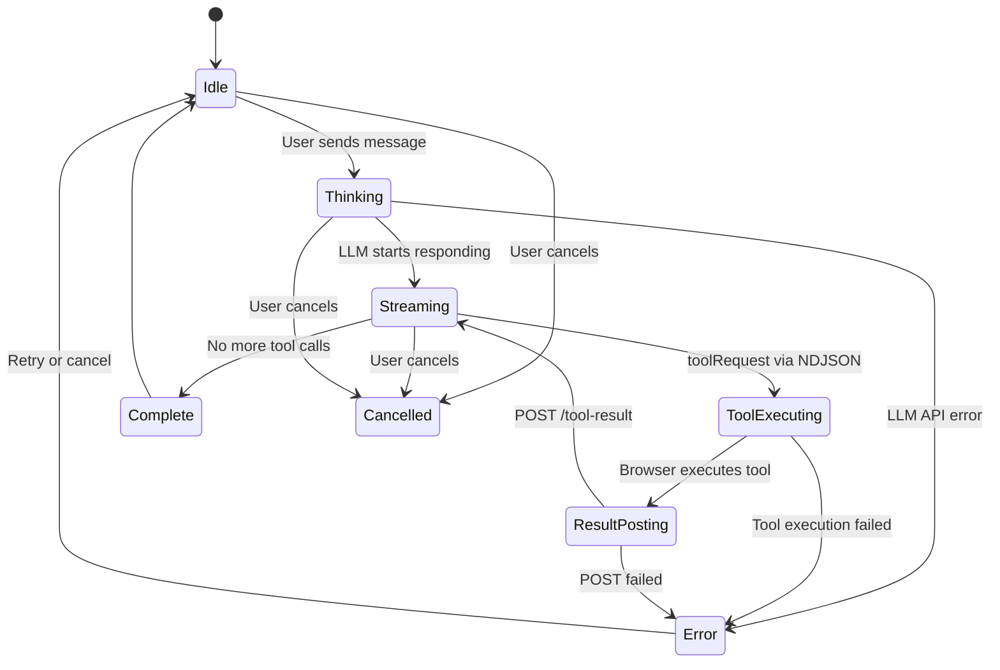
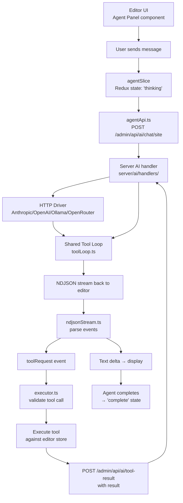

# AI Agent Deep Dive: Site Agent, Executor, Tools, Streaming

Instatic includes a built-in AI agent that can edit pages, manage content, and interact with the CMS from within the visual editor. The agent uses HTTP-only communication with AI providers (no SDKs) and has a rich tool set of 35 tools (6 server-side read + 29 browser-bridged write).

**Source:** `/home/darkvoid/Boxxed/@formulas/src.rust/src.AI/src.Instatic/Instatic/src/admin/pages/site/agent/`

## File Map

| File | Purpose |
|------|---------|
| `agentApi.ts` | AI API communication layer — POST to `/admin/api/ai/chat/site` |
| `agentConfig.ts` | Agent configuration — model, temperature, max tokens |
| `agentSlice.ts` | Redux Toolkit slice for agent state |
| `agentSliceTypes.ts` | Agent state type definitions |
| `agentSliceConfig.site.ts` | Site-specific agent config — system prompt prefix |
| `executor.ts` | Tool execution orchestrator — validates, executes, returns results |
| `types.ts` | Agent type definitions — ToolDefinition, ToolCall, etc. |
| `streamEvents.ts` | Streaming event handling — text deltas, tool calls, completion |
| `ndjsonStream.ts` | NDJSON stream parsing — handles partial chunks, cancellation |
| `tokenRunners.ts` | Token counting and management — input/output/cost tracking |
| `pageContext.ts` | Page context for agent — current page tree, module registry |
| `siteAgentSnapshot.ts` | Site snapshot for agent context — full site state |
| `renderEvidence.ts` | Evidence rendering — visual diffs of agent changes |
| `renderSnapshotTool.ts` | Snapshot rendering tool — captures page state for AI |
| `storeRef.ts` | Store reference for agent — access editor store |
| `markdown.ts` | Markdown utilities for agent communication |
| `codeAssetTools.ts` | Code asset CRUD tools — read/write/patch code files |
| `documentTools.ts` | Document CRUD tools — CMS document manipulation |
| `index.ts` | Agent barrel export |

## Agent State Machine



**Aha:** The agent uses a **split system prompt** design: a static prefix (module catalog, token families, page metadata) built once at session start, and a dynamic suffix (current page context, runtime agent state) rebuilt at each turn. This avoids re-sending the entire module catalog (which can be 10K+ tokens) on every LLM call, dramatically reducing token costs. The static prefix is ~80% of the prompt but is only paid once.

**Aha:** The browser-bridged tool execution is what makes this architecture unique. Instead of the server executing all tools (which would require giving the LLM direct access to the editor state), the server sends `toolRequest` events via NDJSON, the browser executes the tool against the live editor store, and POSTs results back to `/admin/api/ai/tool-result`. This means the AI operates on the **exact same state** the user sees — no server-side copy of the page tree needed.

## Agent Architecture



## NDJSON Streaming Pipeline

```mermaid
sequenceDiagram
    participant User as User
    participant Panel as Agent Panel
    participant API as agentApi.ts
    participant Server as Server AI Handler
    participant Driver as HTTP Driver
    participant Loop as Shared Tool Loop
    participant Executor as executor.ts

    User->>Panel: Type message, press Enter
    Panel->>Panel: State: 'thinking'
    Panel->>API: POST /admin/api/ai/chat/site
    API->>Server: HTTP request with conversation
    Server->>Driver: Route to correct provider
    Driver->>Loop: runToolLoop(adapter, messages, tools)
    
    Loop->>Driver: Build request body, send HTTP
    Driver-->>Loop: SSE stream from provider
    Loop->>Loop: Translate SSE → AiStreamEvent
    
    alt Text content
        Loop-->>API: text delta event
        API-->>Panel: Append to message
        Panel-->>User: Display streaming text
    else Tool call
        Loop-->>API: toolRequest event
        API-->>Panel: toolRequest in NDJSON
        Panel->>Executor: Execute tool in browser
        Executor->>Executor: Call tool against editor store
        Executor->>API: POST /admin/api/ai/tool-result
        API->>Server: Tool result
        Server->>Loop: Inject tool result into messages
        Loop->>Loop: Continue tool loop
    end
    
    Loop-->>API: Completion event (no more tool calls)
    API-->>Panel: State: 'complete'
    Panel-->>User: Message complete
```

## Agent State

The `agentSlice` manages the agent's state via Redux Toolkit:

- Conversation history
- Current agent status (idle, thinking, streaming, executing-tool, complete, error, cancelled)
- Token usage tracking (input, output, total, cost estimate)
- Configuration (model, temperature, max tokens)

**Source:** `src/admin/pages/site/agent/agentSlice.ts`, `agentSliceTypes.ts`.

## Agent API

The `agentApi` communicates with the server's AI endpoint:

```
POST /admin/api/ai/chat/site
```

This uses the same HTTP-only approach as the server-side AI handlers — no provider SDKs on the client either. The response is an NDJSON stream that the `ndjsonStream` module parses.

## NDJSON Streaming

The `ndjsonStream` module parses Newline-Delimited JSON streams from the server:

- Handles partial chunks (JSON objects split across chunk boundaries)
- Parses complete JSON objects
- Handles stream errors (malformed JSON, network errors)
- Supports cancellation (AbortController)

**Source:** `src/admin/pages/site/agent/ndjsonStream.ts`.

## Executor

The `executor` orchestrates tool execution:

1. Agent requests tool execution via `toolRequest` NDJSON event
2. Executor validates the tool call against available tools
3. Executor executes the tool against the live editor store
4. Executor returns result to server via POST `/admin/api/ai/tool-result`
5. Server injects result into conversation, LLM continues

**Source:** `src/admin/pages/site/agent/executor.ts`.

## Available Tools

### Server-Side Tools (6 read-only)

| Tool | What It Returns |
|------|----------------|
| `describeAgentModules` | All registered block modules with schemas |
| `describeAgentTokens` | CSS custom properties, font families, color tokens |
| `listPages` | All pages in the site |
| `listComponents` | All visual components |
| `getPageTree` | Full page tree as JSON |
| `getDataTableSchema` | Schema for a content data table |

### Browser-Bridged Tools (29 write-capable)

These execute in the browser against the editor store:

| Category | Tools |
|----------|-------|
| **Node CRUD** | `insertNode`, `replaceNodeHtml`, `deleteNode`, `updateNodeProps`, `moveNode`, `renameNode`, `duplicateNode` |
| **CSS** | `applyCss` (upserts), `assignClass`, `removeClass` |
| **Pages** | `addPage`, `deletePage`, `renamePage`, `duplicatePage`, `setPageTemplate`, `clearPageTemplate` |
| **Tokens** | `setColorTokens`, `setFontTokens`, `setTypeScale`, `setSpacingScale` |
| **Code** | `list_code_assets`, `read_code_asset`, `write_code_asset`, `patch_code_asset`, `inspect_code_runtime` |
| **Read** | `read_document`, `open_document` |
| **Debug** | `render_snapshot`, `getNodeHtml` |

### Code Asset Tools

Code asset tools manipulate code assets:
- Read/write code files
- Create new code assets
- Delete code assets
- Patch existing code assets
- Inspect code runtime state

**Source:** `src/admin/pages/site/agent/codeAssetTools.ts`.

### Document Tools

Document tools manipulate CMS documents:
- Read documents
- Update documents
- Create documents
- Delete documents

**Source:** `src/admin/pages/site/agent/documentTools.ts`.

### Render Snapshot Tool

Captures page snapshots for the agent to reference:
- Renders current page state
- Captures visual evidence
- Provides context for agent decisions

**Source:** `src/admin/pages/site/agent/renderSnapshotTool.ts`.

### Render Evidence

Renders evidence of agent actions:
- Shows what changed
- Provides visual diffs
- Supports undo visualization

**Source:** `src/admin/pages/site/agent/renderEvidence.ts`.

## Token Management

The `tokenRunners` module tracks token usage:

- Counts input tokens (messages sent to LLM)
- Counts output tokens (tokens received from LLM)
- Tracks token budget per conversation
- Provides cost estimates based on model pricing

**Source:** `src/admin/pages/site/agent/tokenRunners.ts`.

## Page Context

The `pageContext` module provides the agent with page context:

- Current page tree (NodeTree<PageNode>)
- Module registry (all available blocks)
- Available templates
- Site configuration

**Source:** `src/admin/pages/site/agent/pageContext.ts`.

## Site Agent Snapshot

The `siteAgentSnapshot` module creates a snapshot of the site for agent context:

- Page structure
- Content data
- Module definitions
- Settings

**Source:** `src/admin/pages/site/agent/siteAgentSnapshot.ts`.

## Streaming Events

The `streamEvents` module processes streaming events from the agent:

- Text chunks (incremental text display)
- Tool calls (tool execution requests)
- Tool results (execution outcomes)
- Completion signals (agent finished)
- Error signals (API failures, tool errors)

**Source:** `src/admin/pages/site/agent/streamEvents.ts`.

## Store Reference

The `storeRef` module provides the agent with access to the editor store:

- Read current state
- Dispatch actions
- Subscribe to changes

**Source:** `src/admin/pages/site/agent/storeRef.ts`.

## Markdown Utilities

The `markdown` module provides markdown parsing and rendering utilities for the agent:

- Parse markdown to structured data
- Render structured data to markdown
- Handle code blocks, lists, tables

**Source:** `src/admin/pages/site/agent/markdown.ts`.

## Next

Continue to [12-loops-forms](12-loops-forms.md) for loops, forms, media, templates, and site import.
