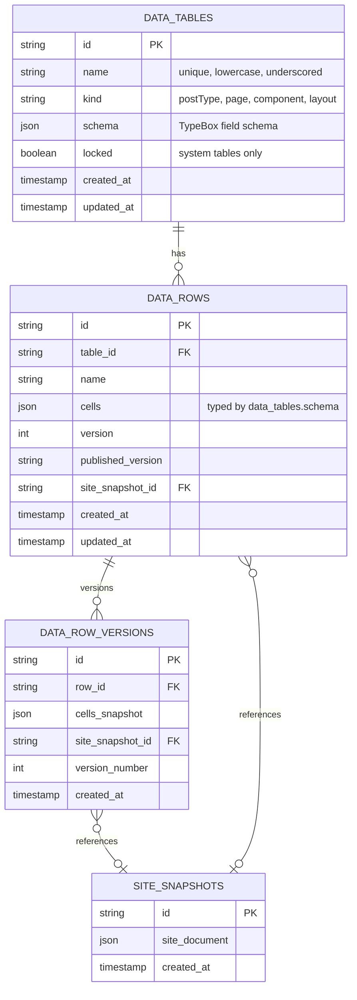
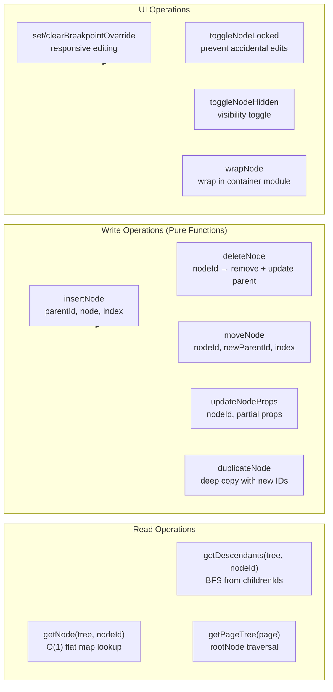

# Instatic Content Model — Two Tables, Everything Uniform

**Instatic stores all content — pages, posts, components, layouts, and user-defined collections — in just two database tables (`data_tables` and `data_rows`) with versioning in a third (`data_row_versions`).** There are no separate `pages`, `page_versions`, `components`, or `layouts` tables. The four system tables are seeded by the baseline migration and locked against rename/delete. This uniform model simplifies the entire data layer: one repository for all CRUD, one versioning mechanism, one audit trail.

Source: `src/core/page-tree/`, `src/core/visualComponents/`, `src/core/module-engine/`, `src/core/visual-components-schema/`, `server/repositories/`

## Database Schema



**Source:** Baseline migration files (`server/db/migrations/`), `docs/features/content-storage.md`.

**Aha:** JSON columns MUST be named `*_json`. The SQLite adapter auto-parses these on read and auto-stringifies on write. This convention is enforced by `db-json-column-naming.test.ts`. The naming convention is not cosmetic — the SQLite adapter specifically looks for `_json` suffix to know which columns need JSON serialization.

## Content Storage Tables

### data_tables

User-defined collections with a `kind` that classifies the type:

| Kind | Purpose | System Tables |
|------|---------|--------------|
| `postType` | Blog posts, news, articles | `posts` |
| `page` | Site pages | `pages` |
| `component` | Visual component definitions | `components` |
| `layout` | Layout templates | `layouts` |

The system tables (`posts`, `pages`, `components`, `layouts`) are seeded by the baseline migration and **locked** — they cannot be renamed or deleted. User-created tables have no lock.

### data_rows

Each row belongs to a `data_table` and has `cells` typed by the table's schema:

- Page rows have a `body` cell of type `pageTree` (a `NodeTree<PageNode>`)
- Component rows have a `tree` cell of type `pageTree` (a `NodeTree<VCNode>`) plus `params` of type `fieldSchema`
- Post rows have cells matching the `posts` table schema (title, body, date, etc.)

### data_row_versions

Version history for all rows. Each version captures:
- `cells_snapshot` — the cells state at that version
- `site_snapshot_id` — reference to the published site at that time
- `version_number` — monotonic version counter

On publish, the current `SiteDocument` is stored once in `site_snapshots`. Page versions reference it via `data_row_versions.site_snapshot_id`. The reassembled `PublishedPageSnapshot` remains the canonical audit record.

**Source:** `server/repositories/cms.ts`, `docs/features/content-storage.md`.

## NodeTree: The Universal Tree Primitive

```typescript
// src/core/page-tree/treeSchema.ts
type NodeTree<TNode> = {
  nodes: Record<string, TNode>    // Flat map — O(1) lookup by ID
  rootNodeId: string              // Entry point for traversal
}
```

**Aha:** The flat map + root ID pattern means node lookup is O(1) regardless of tree depth. There's no recursive `children` array — parent-child relationships are maintained via `parentId` and `childrenIds` on each node. This makes mutations simple: `deleteNode` removes the node from the flat map and updates the parent's child list; `moveNode` changes the `parentId` — no tree rebalancing, no deep cloning.

Every tree of nodes uses the same shape:

| Tree Type | Instantiation | Content |
|-----------|--------------|---------|
| Page Tree | `NodeTree<PageNode>` | Published page structure |
| VC Tree | `NodeTree<VCNode>` | Reusable component definition |
| Slot Fills | `NodeTree<SlotNode>` | Slot content in page tree |

### 11 Pure Mutations



**Source:** `src/core/page-tree/mutations.ts` (11 pure mutation functions), `src/admin/pages/site/store/slices/site/nodeActions.ts` (editor dispatch).

```typescript
// src/core/page-tree/mutations.ts
// All mutations are pure functions: (NodeTree<TNode>, ...args) → NodeTree<TNode>
function insertNode(tree, parentId, node, index): NodeTree<TNode>
function deleteNode(tree, nodeId): NodeTree<TNode>
function moveNode(tree, nodeId, newParentId, index): NodeTree<TNode>
function duplicateNode(tree, nodeId): NodeTree<TNode>
function wrapNode(tree, nodeId, wrapperModuleId): NodeTree<TNode>
function updateNodeProps(tree, nodeId, props): NodeTree<TNode>
function setBreakpointOverride(tree, nodeId, breakpointId, overrides): NodeTree<TNode>
function clearBreakpointOverride(tree, nodeId, nodeId, breakpointId): NodeTree<TNode>
function renameNode(tree, nodeId, name): NodeTree<TNode>
function toggleNodeLocked(tree, nodeId): NodeTree<TNode>
function toggleNodeHidden(tree, nodeId): NodeTree<TNode>
```

Mutations are tree-agnostic — the same functions work for pages AND visual components. The editor store's `mutateActiveTree(fn)` is the ONLY place that branches on whether the editor is in page mode or VC mode.

## PageNode Structure

```typescript
// src/core/page-tree/pageNode.ts — extends BaseNode
interface PageNode extends BaseNode {
  parentId: string | null
  childrenIds: string[]
  breakpointOverrides: Record<BreakpointId, Partial<PageNode>>
  dynamicBindings: DynamicBinding[]
  classIds: string[]
  inlineStyles: Record<string, string>
  hidden: boolean
  locked: boolean
}
```

## Visual Component Model

Visual Components are reusable page fragments stored as `data_rows` in the `components` table:

```typescript
interface VisualComponent {
  id: string
  name: string
  tree: NodeTree<VCNode>        // The component's node tree
  params: FieldSchema[]          // Parameter schema (editable props)
  previewImage?: string          // Thumbnail for component picker
}
```

When a `base.visual-component-ref` is dropped on a page, `syncSlotInstances` auto-generates `base.slot-instance` children for each `base.slot-outlet` in the VC definition. Slot fills live as materialized children in the consumer page tree — there's no separate slot content tree.

**Source:** `src/core/visualComponents/`, `src/core/visual-components-schema/`.

## TypeBox Validation

**Aha:** Every untyped boundary uses TypeBox — HTTP responses, request bodies, persisted JSON, plugin manifests, settings. The pattern is:

```typescript
const FooSchema = Type.Object({ ... })
type Foo = Static<typeof FooSchema>
// Never a parallel interface — the schema IS the source of truth
```

**zod is banned** repo-wide. The AI drivers pass TypeBox schemas through as JSON Schema directly, so no typebox→zod adapter is needed. TypeBox outputs JSON Schema natively, which means AI tool definitions are one `TypeBox.Value(schema)` away.

## HTML Sanitization

```
src/core/sanitize.ts           — DOMPurify at publisher boundary
src/core/html-sanitize/        — HTML sanitization utilities
src/core/css-sanitize/         — CSS sanitization
```

The publisher runs DOMPurify on all richtext content at the render boundary. CSS sanitization blocks `expression()`, `javascript:`, `behavior:`, `-moz-binding`, `data:text`, `{`, `}`, `</` in CSS values.

## Templates

Site templates provide starting points for new sites:

```
src/core/templates/
```

Templates contain:
- Page definitions (as `data_rows`)
- Content data (posts, collections)
- Media files
- Settings
- Module configurations

**Source:** `src/core/templates/`, `server/handlers/cms/import.ts`.

## HTML Import

```
src/core/htmlImport/
```

Imports HTML files into the CMS:
- Parses HTML structure into module nodes
- Maps HTML elements to corresponding modules (`<p>` → `base.text`, `` → `base.image`)
- Preserves content and styling as class assignments

**Source:** `src/core/htmlImport/`.

## Markdown

```
src/core/markdown/
```

Markdown utilities:
- Parse markdown to CMS content (richtext)
- Render CMS content to markdown
- Handle formatting, lists, tables, code blocks

**Source:** `src/core/markdown/`.

## Cross-References

- [Core Engine](01-architecture.md) — NodeTree, mutations, module engine
- [Publisher](03-publisher.md) — How the publisher renders NodeTrees
- [Plugin System](04-plugin-system.md) — Plugin content projection to data_tables

## Next

→ [Module System](14-module-system.md) — All 15 base modules with their schemas, editors, and render functions.
