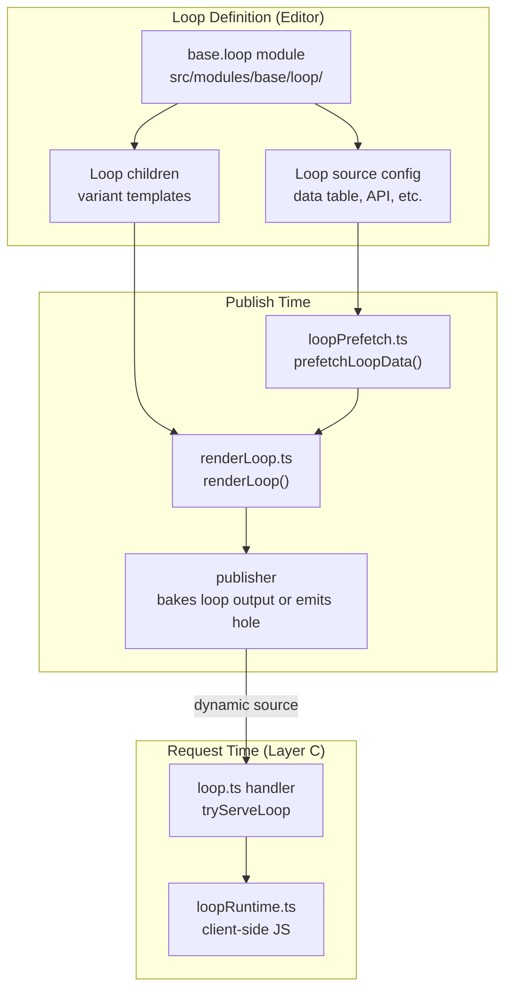
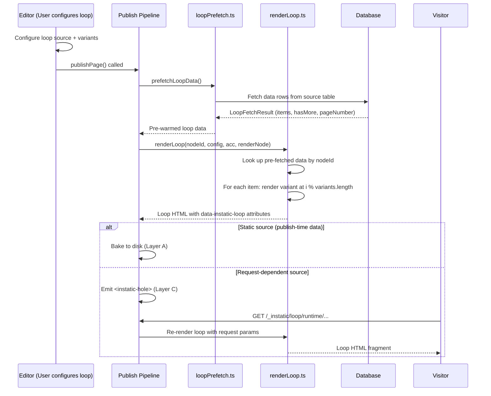
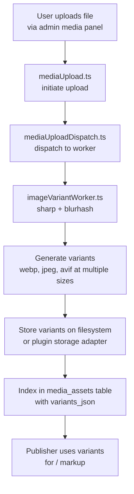

# Loops, Forms, Media, Templates, and Site Import

This document covers the remaining core CMS subsystems: loops (data iteration), forms (native CMS forms), media (storage and variants), templates (site templates), and site import/export.

**Source:** `/home/darkvoid/Boxxed/@formulas/src.rust/src.AI/src.Instatic/Instatic/`

## Loops Architecture



## Loop Lifecycle



**Aha:** Each loop iteration renders against a FRESH child `RenderConfig` whose `templateContext.entryStack` is a new array `[...baseStack, item]` — there is no in-place push/pop on a shared array, so a VC ref (or nested loop) rendered inside the body sees an immutable per-iteration snapshot rather than a live, mutating list. This prevents a subtle class of bugs where nested loops or VC refs see the wrong iteration's data.

**Aha:** The loop renderer round-robins variants: iteration `i` uses `variants[i % variants.length]`. This means if you have 3 variant cards and 10 data items, the pattern repeats as A-B-C-A-B-C-A-B-C-A. This is how you create visually interesting layouts from uniform data without writing custom layout code.

## Loops

Loops iterate over data sources to produce repeating content structures:

### Core Loop Files

| File | Purpose |
|------|---------|
| `src/core/loops/` | Loop definitions and schema |
| `src/core/loops/registry.ts` | Loop source registry |
| `src/core/publisher/renderLoop.ts` | Loop rendering in publisher |
| `server/handlers/cms/loop.ts` | Loop runtime handler |
| `server/publish/loopRuntime.ts` | Loop runtime asset |
| `server/publish/loopPrefetch.ts` | Loop data prefetch |

### Loop Rendering

```typescript
// src/core/publisher/renderLoop.ts
// renderLoop(node, config, acc, renderNode)
// Iterates loop source, round-robins child variants
```

The loop renderer:
1. Resolves the loop source (data table, API, etc.)
2. Iterates over data items
3. For each item, renders child variant nodes
4. Round-robins variants when multiple exist

### Loop Prefetch

```typescript
// server/publish/loopPrefetch.ts
// prefetchLoopData() — pre-warm loop data before publishing
```

The prefetch runs before `publishPage()` to ensure loop data is available without I/O during rendering.

### Loop Runtime

```typescript
// server/handlers/cms/loop.ts
// tryServeLoop, tryServeLoopRuntimeAsset
```

The loop runtime handles:
- Dynamic loop rendering at request time
- "Load more" pagination for infinite-mode loops
- Loop endpoint routing (`/_instatic/loop/*`)

## Forms

Native CMS forms allow site visitors to submit data:

### Form Processing Pipeline

```mermaid
flowchart TD
    FORM["HTML <form> on published page"] --> SUBMIT["Visitor submits to /_instatic/form/..."]
    SUBMIT --> HANDLER["handlePublicFormRequest()<br/>server/forms/handler.ts"]
    HANDLER --> VALIDATE{"Validate against<br/>form schema"}
    VALIDATE -->|"invalid"| ERROR["Return error response"]
    VALIDATE -->|"valid"| STORE["Store in data_rows table"]
    STORE --> RESPOND["Return success/confirmation"]
    RESPOND --> EMAIL["Optional: email notification<br/>via plugin"]
```



### Form Files

| File | Purpose |
|------|---------|
| `src/core/forms/` | Form definitions and schema |
| `server/forms/handler.ts` | Form submission handler |
| `server/handlers/cms/` → `tryServePublicForm` | Form endpoint in router |

### Form Processing

1. Visitor submits form to public endpoint
2. Handler validates against form schema
3. Data is stored in the appropriate data table
4. Confirmation is returned to visitor

## Media

Media management handles uploads, variants, and storage:

### Media Pipeline



### Media Files

| File | Purpose |
|------|---------|
| `server/handlers/cms/media.ts` | Media CRUD |
| `server/handlers/cms/mediaUpload.ts` | Upload initiation |
| `server/handlers/cms/mediaUploadDispatch.ts` | Upload dispatch |
| `server/handlers/cms/mediaUploadExecutor.ts` | Upload execution |
| `server/handlers/cms/mediaVariants.ts` | Variant management |
| `server/handlers/cms/mediaStorageAdmin.ts` | Storage admin |
| `server/handlers/cms/mediaStorageReader.ts` | Storage reading |
| `server/handlers/cms/mediaStorageMigration.ts` | Storage migration |
| `server/handlers/cms/mediaFolders.ts` | Folder management |
| `server/handlers/cms/imageVariantProtocol.ts` | Variant protocol |
| `server/handlers/cms/imageVariantWorkerHost.ts` | Variant worker host |
| `server/handlers/cms/imageVariantWorker.ts` | Variant worker |
| `server/handlers/cms/svgSanitize.ts` | SVG sanitization |
| `src/core/media/` | Media core |
| `src/core/fonts/` | Font management |

### Image Variants

When an image is uploaded:
1. Upload is initiated via `mediaUpload.ts`
2. Upload is dispatched to a worker via `mediaUploadDispatch.ts`
3. Worker generates variants via `imageVariantWorker.ts` (sharp + blurhash)
4. Variants are stored and indexed
5. Publisher uses variants for responsive `<picture>`/`<srcset>` markup

### Media Storage

Media storage is configurable:
- Local filesystem (default)
- External storage (via plugins)
- Migration between storage backends

### Sizes Resolution

```typescript
// src/core/publisher/sizesResolver.ts
// resolveAutoSizes() — derives  from layout
```

The sizes resolver uses a linear width model:
- Caps (max width per viewport)
- Fractions (percentage of container)
- Grid tracks (CSS grid column widths)
- Per viewport tier (mobile, tablet, desktop)

## Templates

Site templates provide starting points:

### Template Files

| File | Purpose |
|------|---------|
| `src/core/templates/` | Template definitions |
| `server/handlers/cms/import.ts` | Site import |
| `server/handlers/cms/importArchive.ts` | Archive import |
| `server/handlers/cms/importPreview.ts` | Import preview |

### Template Structure

Templates contain:
- Page definitions
- Content data
- Media files
- Settings
- Module configurations

## Site Import/Export

### Export

```
server/handlers/cms/export.ts
```

Exports the entire site:
- All pages and content
- Media files
- Settings
- Templates

### Import

```
server/handlers/cms/import.ts
server/handlers/cms/importArchive.ts
server/handlers/cms/importPreview.ts
```

Import process:
1. Upload archive
2. Preview import (shows what will change)
3. Execute import
4. Merge or replace content

## HTML Import

```
src/core/htmlImport/
```

Imports HTML files into the CMS:
- Parses HTML structure
- Maps to module nodes
- Preserves content and styling

## Markdown

```
src/core/markdown/
```

Markdown utilities:
- Parse markdown to CMS content
- Render CMS content to markdown
- Handle formatting, lists, tables, code blocks

## Sanitization

| File | Purpose |
|------|---------|
| `src/core/sanitize.ts` | DOMPurify at publisher boundary |
| `src/core/html-sanitize/` | HTML sanitization |
| `src/core/css-sanitize/` | CSS sanitization |

## Dashboard

```
server/handlers/cms/dashboard/
```

Dashboard endpoints:
- `activity.ts` — Site activity feed
- `media.ts` — Media overview
- `pages.ts` — Page listing
- `posts.ts` — Post listing
- `plugins.ts` — Plugin status
- `publishLineup.ts` — Publish queue
- `storage.ts` — Storage overview
- `shared.ts` — Shared dashboard components
- `types.ts` — Dashboard type definitions

## Audit

```
server/handlers/cms/audit.ts
```

Audit logging:
- Records all CMS operations
- Tracks changes to content
- Provides change history

## Page Diff / Site Diff

```
server/handlers/cms/pageDiff.ts   — Compare two page versions
server/handlers/cms/siteDiff.ts   — Compare entire site states
```

Page diff shows content changes between versions. Site diff shows structural changes across the entire site, supporting bulk change review.

## Runtime Assets

```
src/core/site-runtime/
src/core/site-runtime-schema/
```

Site runtime:
- Runtime scripts injected into published pages
- Schema for runtime configuration
- Used for holes, loops, and other dynamic features

## Aha Moments

1. **Loop prefetch prevents I/O during render** — `prefetchLoopData()` runs before `publishPage()` so the loop renderer never blocks on a database query. This makes the render phase purely CPU-bound, which is critical for consistent publish times.

2. **Form submissions become data_rows** — There's no separate "form submissions" table. Form submissions are stored as `data_rows` in the appropriate collection, which means they appear in the content explorer, can be looped over, and can be exported like any other content.

3. **Image variant generation is worker-isolated** — The sharp + blurhash processing runs in a dedicated off-main-thread worker, so a large image upload never blocks the main server thread. If variant generation fails, the original image is still available.

## Next

Continue to [14-cross-cutting](14-cross-cutting.md) for banned dependencies, patterns, testing, and benchmarks.
