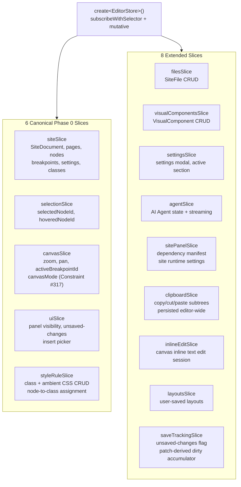
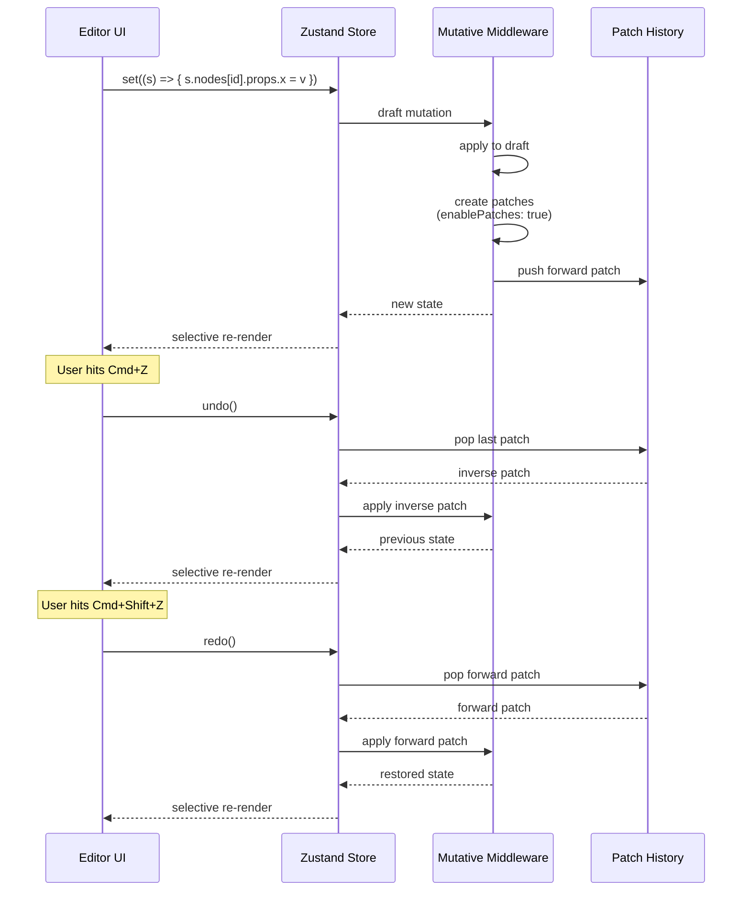

# Instatic Editor Store — 14 Slices, Patch-Based Undo, Mutative Middleware

**The visual editor's state is managed by a single Zustand store composed of 14 slices, with Mutative replacing Immer for patch-based undo history.** Every slice owns a specific domain: the site tree, selection, canvas viewport, UI panels, CSS style rules, files, visual components, settings, clipboard, inline editing, layouts, and save tracking. All mutations are draft-style (`set((s) => { s.x = ... })`) and the React Compiler auto-memoizes everything — no hand-written `useMemo`, `useCallback`, or `memo`.

Source: `src/admin/pages/site/store/`, `src/admin/pages/site/store/slices/`

## Store Architecture



## Store Creation

```typescript
// src/admin/pages/site/store/store.ts
import { create } from 'zustand'
import { mutative } from 'zustand-mutative'
import { subscribeWithSelector } from 'zustand/middleware'

export const useEditorStore = create<EditorStore>()(
  subscribeWithSelector(
    mutative(
      (...args) => ({
        ...createSiteSlice(...args),
        ...createSelectionSlice(...args),
        ...createCanvasSlice(...args),
        ...createUiSlice(...args),
        ...createStyleRuleSlice(...args),
        ...createFilesSlice(...args),
        ...createVisualComponentsSlice(...args),
        ...createSettingsSlice(...args),
        ...createAgentSlice(siteAgentSliceConfig)(...args),
        ...createSitePanelSlice(...args),
        ...createClipboardSlice(...args),
        ...createInlineEditSlice(...args),
        ...createLayoutsSlice(...args),
        ...createSaveTrackingSlice(...args),
      }),
      { enableAutoFreeze: true }  // mirrors Immer's dev guard
    )
  )
)
```

**Aha:** The combined `EditorStore` type lives in `./types` so each slice can import it without going through the store module — that's how the historical store-to-slice circular dependency cycles were eliminated. Each slice receives `StateCreator<EditorStore>` and spreads its state + actions into the combined store. This is a classic "split StateCreator" pattern that avoids `import store from './store'` inside slices.

## Site Slice

The site slice owns the `SiteDocument` — the central data structure:

```
src/admin/pages/site/store/slices/site/
├── breakpointActions.ts    — Breakpoint CRUD, active breakpoint
├── defaults.ts             — Default values for site properties
├── dirtyTracking.ts        — Unsaved change detection
├── explorerActions.ts      — Page tree navigation
├── fontActions.ts          — Font family CRUD, import management
├── framework/
│   ├── colors.ts           — Color token management
│   ├── preferences.ts      — Framework preferences
│   ├── preview.ts          — Framework preview generation
│   ├── reconcile.ts        — Style rule reconciliation
│   ├── scaleGroups.ts      — Spacing/typography scale groups
│   ├── shared.ts           — Shared framework utilities
│   ├── spacing.ts          — Spacing scale management
│   └── typography.ts       — Typography scale management
├── helpers.ts              — Site slice helpers
├── importedFonts.ts        — Imported font tracking
├── importedSiteFiles.ts    — Imported file tracking
├── importLinking.ts        — Import reference linking
├── lifecycleActions.ts     — Site lifecycle (create, load, reset)
├── nodeActions.ts          — Node CRUD on the page tree
├── pageActions.ts          — Page CRUD operations
├── settingsActions.ts      — Site settings management
└── undoRedoActions.ts      — Undo/redo with patch history
```

## Undo/Redo with Patches



**Source:** `src/admin/pages/site/store/slices/site/undoRedoActions.ts` (undo/redo with patches), `zustand-mutative` middleware (`enablePatches: true`).

**Aha:** Mutative patches record only what changed, not the entire state snapshot. For a 200-node page, a single property change produces a patch of ~50 bytes vs a ~50KB snapshot. Undo history is therefore bounded by the number of changes, not the site size.

## Style Rule Slice

The style rule slice manages CSS class rules and node-to-class assignments:

```
src/admin/pages/site/store/slices/styleRule/
├── assignmentActions.ts    — Assign/remove class from node
├── conditionActions.ts     — Media/container query conditions
├── crudActions.ts          — Style rule CRUD
├── helpers.ts              — Style rule helpers
├── propertyActions.ts      — CSS property CRUD on rules
├── registryActions.ts      — Class registry management
├── uiStateActions.ts       — UI state for style rule editor
└── types.ts                — Style rule type definitions
```

### Style Rule Structure

```typescript
interface StyleRule {
  id: string                 // Hash-named class (e.g. "a1b2c3d")
  name: string               // User-friendly name (e.g. "Hero Title")
  base: Record<string, unknown>  // Base declarations
  contextStyles: Record<string, Record<string, unknown>>  // Breakpoint overrides
  order: number              // Source order in stylesheet
}
```

The publisher's CSS generation engine (`classCss.ts`) converts these rules to CSS:
- Base declarations → `.a1b2c3d { ... }`
- Context styles → wrapped in `@media`/`@container`/`@supports` blocks
- Cascade ordering → `order` property controls emission order

**Source:** `src/admin/pages/site/store/slices/styleRuleSlice.ts`, `src/core/publisher/classCss.ts`.

## Selection Slice

```typescript
// selectionSlice — selectedNodeId, hoveredNodeId
// Single selection model — only one node selected at a time
// Hover is independent of selection
```

## Canvas Slice

```typescript
// canvasSlice — zoom, pan, activeBreakpointId, canvasMode
// Constraint #317: canvasMode controls edit vs preview behavior
// Zoom and pan are stored per-breakpoint
```

## UI Slice

```typescript
// uiSlice — panel visibility, unsaved-changes flag, insert picker
// Panel visibility is toggled independently
// Unsaved-changes flag is derived from saveTrackingSlice
```

## Clipboard Slice

```typescript
// clipboardSlice — copy/cut/paste of layer subtrees
// Persisted editor-wide (survives page navigation)
// Uses subtreeSnapshot.ts to capture complete node subtrees
```

### Subtree Snapshots

```typescript
// src/admin/pages/site/store/subtreeSnapshot.ts
// Captures a complete node subtree including:
// - The node and all descendants
// - Style rule references
// - Breakpoint overrides
// paste reconstructs with new IDs, preserving structure
```

## Cross-References

- [Visual Editor](05-visual-editor.md) — Editor overview, React Compiler
- [Canvas](08-canvas.md) — Canvas rendering system
- [Content Model](11-content-model.md) — NodeTree, data model

## Next

→ [Module System](14-module-system.md) — All 15 base modules with their schemas and render functions.
