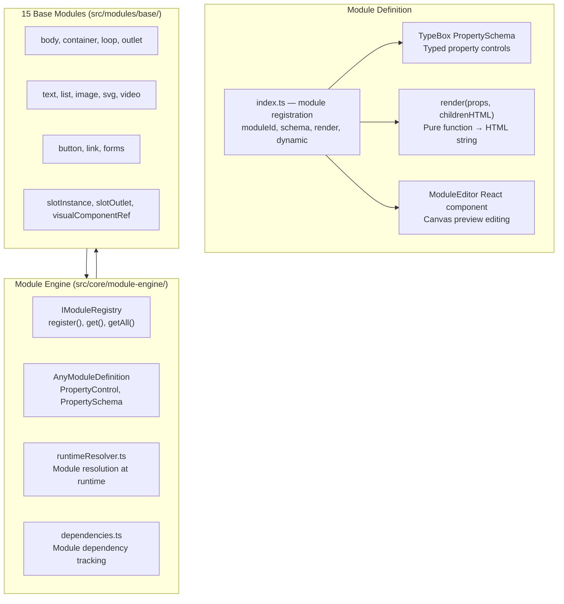
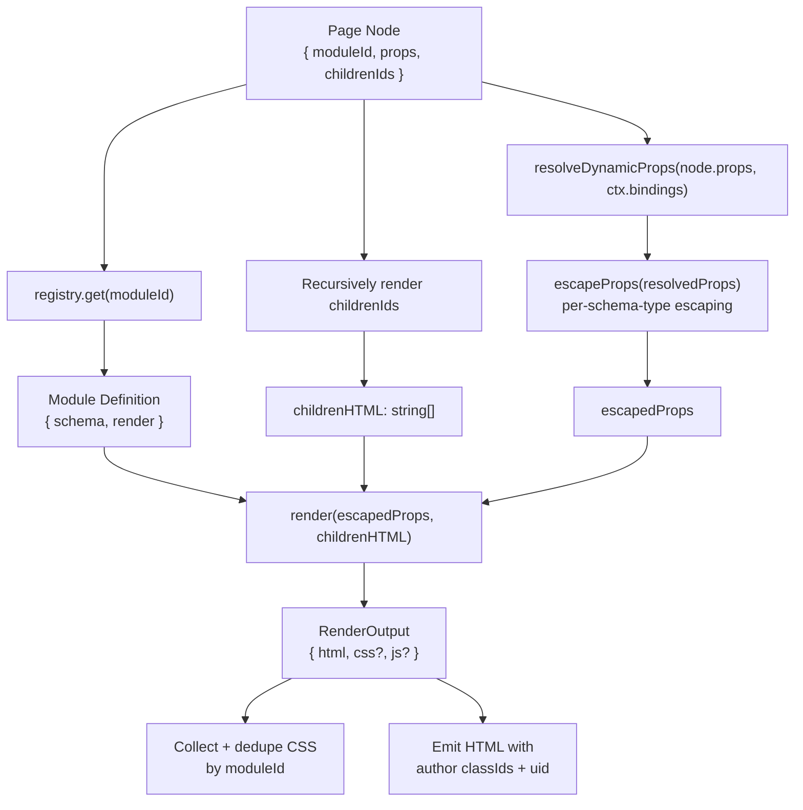

# Instatic Module System — 15 Base Blocks with Pure Render Functions

**Instatic's module system defines 15 built-in block types (container, text, image, button, link, body, list, loop, outlet, slotInstance, slotOutlet, svg, video, visualComponentRef, forms) plus utility modules (`shared/`, `utils/`), each with a TypeBox property schema, a property control for the editor, and a pure `render()` function that returns HTML.** Modules are the atomic building blocks of pages — every published page is a tree of module instances.

Source: `src/modules/base/`, `src/core/module-engine/`, `src/core/module-engine-schema/`

## Module System Architecture



## Module Definition Interface

```typescript
// src/core/module-engine/types.ts
interface AnyModuleDefinition {
  id: string                       // "base.container", "base.image"
  schema: Record<string, PropertyControl>  // TypeBox-backed property controls
  render(props, childrenHTML: string[]): RenderOutput
  publishBehavior?: 'standard' | 'special'  // 'special' bypasses standard rendering
  dynamic?: boolean                 // Dynamic detection Rule 1
  staticPlaceholder?(props): string  // Fallback content for holes
}

interface RenderOutput {
  html: string
  css?: string
  js?: string
}
```

**Constraint #179:** Module `render()` is a pure function — no DOM access, no network, no side effects. It receives props and children HTML, returns `{ html, css?, js? }`.

## All 15 Base Modules

### Layout Modules

| Module | ID | Purpose | Dynamic |
|--------|-----|---------|---------|
| Body | `base.body` | Root page element | No |
| Container | `base.container` | Flexible layout container | No |
| Loop | `base.loop` | Iterate data with variants | Yes |
| Outlet | `base.outlet` | Content injection point | No |

### Content Modules

| Module | ID | Purpose | Key Props |
|--------|-----|---------|-----------|
| Text | `base.text` | Rich text (TipTap editor) | `content` (richtext), `tag` (h1-h6, p, span) |
| Image | `base.image` | Responsive image with variants | `src` (media), `alt`, `sizes` |
| SVG | `base.svg` | Inline SVG | `svgContent` (svg) |
| Video | `base.video` | Video player (local/YouTube) | `videoUrl` (url), `poster` (media) |
| List | `base.list` | Ordered/unordered list | `items` (list items) |

### Interactive Modules

| Module | ID | Purpose | Key Props |
|--------|-----|---------|-----------|
| Button | `base.button` | CTA button | `text`, `url`, `variant` |
| Link | `base.link` | Text link with content | `url`, `content` |
| Forms | `base.forms` | CMS form with fields | `formSchema`, `action` |

### Composition Modules

| Module | ID | Purpose |
|--------|-----|---------|
| Slot Instance | `base.slotInstance` | Slot fill from VC consumer |
| Slot Outlet | `base.slotOutlet` | Slot position in VC definition |
| Visual Component Ref | `base.visualComponentRef` | VC reference on page |

## Module Render: Pure Function

**Aha:** Module `render()` functions are **pure** — no DOM access, no React, no side effects (Constraint #179). They receive props and rendered children, return HTML string. Every node's props pass through `escapeProps` before `render()` (Constraint #211), escaping string props at the render boundary based on schema control `type`. This means a module can never leak data, access the network, or cause side effects — it's just a string transformation.

### Module Render Pipeline



**Source:** `src/core/publisher/renderNode.ts` (render pipeline), `src/core/publisher/escapeProps.ts` (Constraint #211), `src/core/module-engine/types.ts` (AnyModuleDefinition interface).

### Example: Text Module

```typescript
// src/modules/base/text/index.ts
export const textModule: ModuleDefinition = {
  id: 'base.text',
  schema: {
    content: { type: 'richtext', label: 'Content' },
    tag: { type: 'select', label: 'HTML Tag', options: ['p', 'h1', 'h2', 'h3', 'h4', 'h5', 'h6', 'span', 'div'] },
  },
  render(props, childrenHTML): RenderOutput {
    const tag = props.tag || 'p'
    const content = props.content || ''
    return { html: `<${tag}>${content}${childrenHTML}</${tag}>` }
  },
}
```

### Example: Image Module

```typescript
// src/modules/base/image/index.ts
export const imageModule: ModuleDefinition = {
  id: 'base.image',
  schema: {
    src: { type: 'media', label: 'Image' },
    alt: { type: 'string', label: 'Alt Text' },
  },
  dynamic: false,
  render(props, childrenHTML): RenderOutput {
    const media = props._resolvedMediaByKey?.src
    if (!media) return { html: '<div class="image-placeholder">No image</div>' }
    // Emit <picture> with <source> for each variant
    const picture = buildPictureElement(media)
    return { html: picture }
  },
}
```

## Module Registry

```typescript
// src/core/module-engine/index.ts
export const registry: IModuleRegistry = {
  get(moduleId: string): AnyModuleDefinition,
  getAll(): AnyModuleDefinition[],
  register(def: AnyModuleDefinition): void,
}

// Registry is populated at startup from src/modules/base/
// Each module's index.ts exports its definition
// registry.get('base.text') → textModule
// registry.get('base.container') → containerModule
```

## Module Editor Components

Each module has an editor component for canvas preview editing:

| Module | Editor Component |
|--------|-----------------|
| Text | `TextEditor.tsx` — TipTap inline editing |
| Image | `ImageEditor.tsx` — Media picker, crop |
| Button | `ButtonEditor.tsx` — Text, URL editing |
| Container | `ContainerEditor.tsx` — Layout controls |
| Link | `LinkEditor.tsx` — URL, target editing |
| List | `ListEditor.tsx` — Item reorder, add/remove |
| SVG | `SvgEditor.tsx` — SVG content editing |
| Video | `VideoEditor.tsx` — URL, poster editing |
| Loop | `LoopEditor.tsx` — Source, variant config |
| Outlet | `OutletEditor.tsx` — Outlet name |
| Slot Instance | `SlotInstanceEditor.tsx` — Slot fill editing |
| Slot Outlet | `SlotOutletEditor.tsx` — Slot name |
| Visual Component Ref | `VisualComponentRefEditor.tsx` — VC inline tree |
| Forms | `FormControls.tsx` — Form field configuration |

## Module Props Escaping

**Aha:** Every prop's escaping is determined by its schema `type`, not by guessing from the prop name. This is Constraint #211:

| Prop Type | Escaping | Why |
|-----------|----------|-----|
| `url`/`image`/`media` | `isSafeUrl()` — block dangerous schemes | Allow safe URLs, block `javascript:` |
| `richtext` | `sanitizeRichtext()` — DOMPurify | Defense-in-depth sanitization |
| `svg` | `sanitizeSvg()` — DOMPurify SVG profile | Allow raw SVG markup |
| Everything else | `escapeHtml()` | Safe default — never trust unknown types |

Non-string values pass through unchanged so derived assets like `_resolvedMediaByKey` survive the boundary.

## Special Modules

### base.loop

The loop module is marked `dynamic: true` because its content depends on request-time data. The publisher renders it by iterating over resolved data and round-robining over child variants.

### base.visual-component-ref

This module inlines a VC's tree at render time. If the VC definition contains any dynamic node, the entire VC reference upgrades to `<instatic-hole>`.

### base.slotInstance / base.slotOutlet

These modules implement the slot system. `slot-outlet` defines a position in a VC definition; `slot-instance` is the consumer's fill for that position.

## Cross-References

- [Core Engine](01-architecture.md) — Module engine overview
- [Publisher](03-publisher.md) — How modules render during publishing
- [Canvas](08-canvas.md) — How modules render in the editor

## Next

→ [Media Pipeline](15-media-pipeline.md) — Upload, variants, storage adapters, and responsive image generation.
