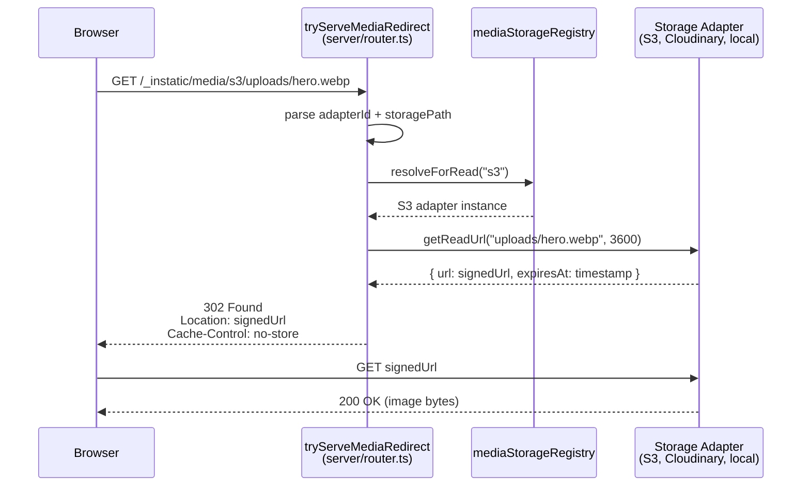

# Instatic Media Pipeline — Upload, Variant Generation, Storage Adapters

**Instatic's media pipeline handles file uploads through an off-main-thread worker (sharp + blurhash), generates responsive image variants in multiple formats (webp, jpeg, avif) at multiple sizes, and supports pluggable storage adapters with signed URL redirects.** The publisher automatically generates `` attributes using a linear width model that analyzes the page layout.

Source: `server/handlers/cms/media*.ts`, `src/core/media/`, `src/core/publisher/sizesResolver.ts`

## Media Upload Pipeline


## Media Handlers

| Handler | Purpose |
|---------|---------|
| `media.ts` | Media CRUD operations |
| `mediaUpload.ts` | Upload initiation, validation |
| `mediaUploadDispatch.ts` | Dispatch to image variant worker |
| `mediaUploadExecutor.ts` | Execute upload, generate variants |
| `mediaVariants.ts` | Variant management (create, delete) |
| `mediaStorageAdmin.ts` | Storage adapter admin UI |
| `mediaStorageReader.ts` | Storage reading interface |
| `mediaStorageMigration.ts` | Migrate between storage backends |
| `mediaFolders.ts` | Folder management |
| `imageVariantProtocol.ts` | Variant URL protocol |
| `imageVariantWorkerHost.ts` | Worker host for variant generation |
| `imageVariantWorker.ts` | sharp + blurhash worker |
| `svgSanitize.ts` | SVG sanitization on upload |

## Image Variant Generation

When an image is uploaded, the variant worker generates:

1. **Multiple formats**: webp (primary), jpeg (fallback), avif (next-gen)
2. **Multiple sizes**: 320w, 640w, 1024w, 1920w (based on original dimensions)
3. **BlurHash**: A compact placeholder string for loading state

The variants are stored on the filesystem (default) or via a plugin storage adapter (S3, Cloudinary, etc.).

## Storage Adapters

Media storage is pluggable via the storage adapter interface:

```typescript
// Core storage adapter interface
interface MediaStorageAdapter {
  id: string
  name: string
  servingMode: 'public-url' | 'signed' | 'local'
  getReadUrl(storagePath: string, ttl: number): Promise<{ url: string; expiresAt: number }>
  getWriteUrl?(storagePath: string): Promise<{ url: string; fields: Record<string, string> }>
}
```

**Aha:** Variants get the same signed URL treatment automatically — the variant URLs in `variants_json` carry the same `/_instatic/media/<adapterId>/<storagePath>` shape, so the renderer's `` emission Just Works without per-variant DB indexing. The router's `tryServeMediaRedirect` resolves the adapter from the URL, calls `getReadUrl()`, and 302-redirects to the signed URL.

## Media Redirect Router



**Source:** `server/router.ts` (`tryServeMediaRedirect`, lines 287-330), `server/plugins/host/media.ts` (media storage registry), `@core/plugins/mediaStorageRegistry`.

The media redirect:
1. Extracts `adapterId` and `storagePath` from URL
2. Resolves the adapter via `mediaStorageRegistry.resolveForRead(adapterId)`
3. Calls `adapter.getReadUrl(storagePath, 3600)` for a 1-hour signed URL
4. Returns a 302 redirect with `no-store` cache control

No cache header on the 302 itself — the redirect target is signed and expires, so every browser navigation gets a fresh signature.

## Responsive Image Sizes

The publisher's `sizesResolver.ts` generates `` attributes automatically:

```typescript
// src/core/publisher/sizesResolver.ts
// resolveAutoSizes(nodeId, page, site) → "sizes" string or null
```

### Linear Width Model

The resolver uses a **linear width model**: every node's width is `min(...)` over linear functions of the viewport (`a*vw + b px`):

- `width`/`max-width` in px → a constant candidate (`a=0`)
- `width: P%`/`max-width: P%` → scales every candidate by P/100
- `width: Nvw` → replaces the set with the viewport term
- `min-width: Npx` → raises the floor (rendered as `max(Npx, ...)`)
- px paddings → subtract from the content box (border-box)
- grid columns → the child's track share

The `prune()` function drops candidates that can never be the minimum and caps at 4 `min()` arguments (at reference viewports 360, 768, 1280, 1920).

**Aha:** The publisher generates the site's CSS, so it can compute what the browser will lay out instead of asking the author to predict it. The image module always emits the resolved value — there is no user-facing `sizes` knob. This means responsive images work automatically without the author understanding viewport breakpoints.

## Media Presentation at Publish Time

At publish time, media is materialized into responsive markup:

```typescript
// server/publish/mediaPresentation.ts
//  → <picture><source srcset=...></picture>
```

The `sizesResolver.ts` derives `` from the layout using the linear width model per viewport tier.

## Font Management

```
src/core/fonts/
```

Font management handles:
- Imported font families (Google Fonts, custom URLs)
- Font file caching
- Font injection in published pages

## SVG Sanitization

```typescript
// server/handlers/cms/svgSanitize.ts
// Sanitizes SVG on upload to prevent XSS via inline SVG
// DOMPurify with SVG profile
```

## Cross-References

- [Publisher](03-publisher.md) — How media is materialized at publish time
- [Content Model](11-content-model.md) — Media as data_rows
- [Module System](14-module-system.md) — Image and video modules

## Next

→ [Admin SPA](16-admin-spa.md) — Admin shell, workspaces, navigation, and command palette.
