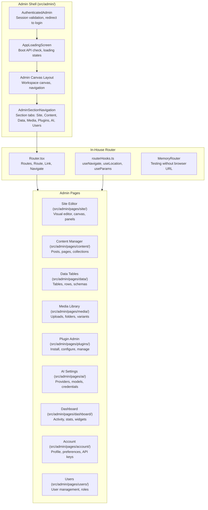
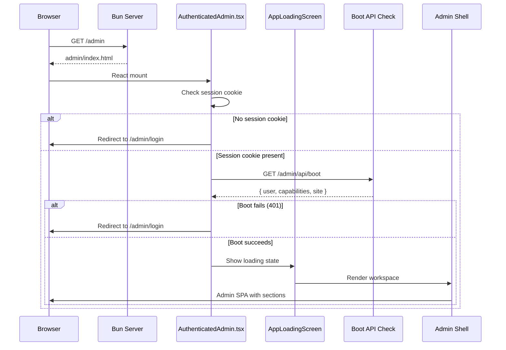

# Instatic Admin SPA — Shell, Workspaces, Navigation, Command Palette

**The Instatic admin is a React 19 SPA served under `/admin/*`, with an in-house router (no react-router-dom), workspace-based navigation, and a Spotlight command palette (Cmd+K) for fast access to all admin features.** The admin shell manages authentication, workspace layout, section navigation, and authenticated API boot-up before rendering child pages.

Source: `src/admin/`, `src/admin/lib/routing/`, `src/admin/spotlight/`, `src/admin/state/`

## Admin Architecture



## In-House Router

**Aha:** Instatic uses an in-house router at `src/admin/lib/routing/`, replacing `react-router-dom`. The rules:

1. Use the admin router for all internal admin navigation
2. Links rendered from the site editor must use the admin router
3. `react-router-dom` is **banned** repo-wide
4. Raw `<a href="/admin...">` hard navigations are **banned** in admin UI
5. `src/core/` + `src/modules/` must **not** import the admin router

This is gated by `admin-router-usage.test.ts`. The `.tsx/.ts` split between `Router.tsx` and `routerHooks.ts` is required for React Fast Refresh — mixing component and non-component exports breaks HMR.

### Router API

```typescript
// src/admin/lib/routing/Router.tsx
export { Router, MemoryRouter, Routes, Route, Navigate, Link }

// src/admin/lib/routing/routerHooks.ts
export { useLocation, useNavigate, useParams, useInRouterContext }

// src/admin/lib/routing/index.ts — barrel export
export { Router, MemoryRouter, Routes, Route, Navigate, Link } from './Router'
export { matchPath, useLocation, useNavigate, useParams, useInRouterContext } from './routerHooks'
```

## Admin Sections

The admin is organized into sections:

| Section | URL | Purpose |
|---------|-----|---------|
| Dashboard | `/admin/dashboard` | Site overview, activity, stats |
| Site | `/admin/site` | Visual editor, page tree, canvas |
| Content | `/admin/content` | Posts, pages, collections |
| Data | `/admin/data` | Data tables, rows, schemas |
| Media | `/admin/media` | Media library, uploads |
| Plugins | `/admin/plugins` | Plugin management |
| AI | `/admin/ai` | AI providers, models, credentials |
| Users | `/admin/users` | User management, roles |
| Account | `/admin/account` | Profile, preferences, API keys |

## Workspace Layout

```typescript
// src/admin/state/workspaceLayoutStorage.ts
// readWorkspaceLayout, workspaceFromPathname
// Workspace determines which section/page is active
// Layout is persisted across navigation
```

## Spotlight Command Palette

```
src/admin/spotlight/
├── commands/     — Command definitions
├── providers/    — Data providers for command results
├── scopes/       — Command scopes (section-level filtering)
```

The Spotlight command palette (Cmd+K) provides fast access to:
- Navigate to any admin page
- Search content (pages, posts, media)
- Execute common actions (publish, create page, etc.)
- Access settings and preferences

## Authentication Flow



**Source:** `src/admin/AuthenticatedAdmin.tsx` (auth gate), `src/admin/AppLoadingScreen.tsx` (boot check + loading), `src/admin/session.tsx` (session management), `src/admin/access.ts` (capability checks).

## Icon System

**Aha:** Instatic uses vendored `pixel-art-icons` — not lucide-react. The rules:

1. Deep-import icons: `pixel-art-icons/icons/<name>` (tree-shakeable)
2. No lucide-react — banned repo-wide
3. No inline SVG strings — banned repo-wide
4. Add a new icon by importing it and running `bun run icons:sync`

Gated by `no-third-party-icons.test.ts` and `direct-icon-imports.test.ts`.

## UI Components

The admin uses a shared component library:

```
src/ui/components/
├── Alert/          — Alert banners
├── Button/         — Button variants
├── Card/           — Card containers
├── Checkbox/       — Checkbox inputs
├── Code/           — Code blocks
├── ColorInput/     — Color picker
├── ContextMenu/    — Right-click menus
├── ControlRow/     — Form control rows
├── DataTable/      — Data table component
├── DateTimePicker/ — Date/time input
├── Dialog/         — Modal dialogs
├── EmptyState/     — Empty state placeholders
├── ErrorBoundary/  — Error boundaries
├── FileUpload/     — File upload input
├── FilterBar/      — Filter controls
├── FloatingActionBar/ — Floating action buttons
├── FormField/      — Form field wrappers
├── Heading/        — Heading components
├── Image/          — Image component
├── Input/          — Text input
├── Kbd/            — Keyboard shortcut badges
├── RangeTabs/      — Range tab navigation
├── SearchBar/      — Search input
├── Section/        — Section containers
├── SegmentedControl/ — Segmented controls
├── Select/         — Select dropdown
├── Separator/      — Dividers
├── Skeleton/       — Loading placeholders
├── Stack/          — Flex/stack layouts
├── Switch/         — Toggle switches
├── Tabs/           — Tab navigation
├── TagPill/        — Tag badges
├── Text/           — Text component
├── Toast/          — Toast notifications
├── Tooltip/        — Tooltip popovers
├── Widget/         — Widget containers
└── WidgetList/     — Widget list layouts
```

## Cross-References

- [Visual Editor](05-visual-editor.md) — Site editor page
- [Cross-Cutting](09-cross-cutting.md) — Banned dependencies, icon system
- [Cross-Cutting](09-cross-cutting.md) — Admin router isolation

## Next

→ [Visual Components](19-visual-components.md) — VC system, slot outlets, sync, parameters.
