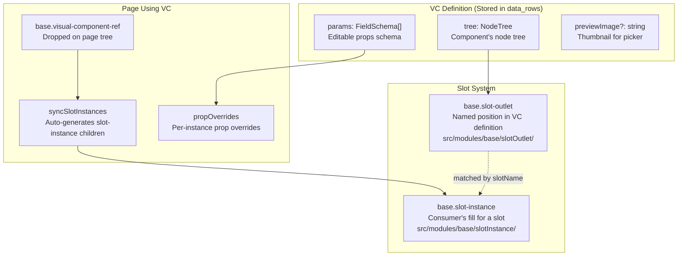
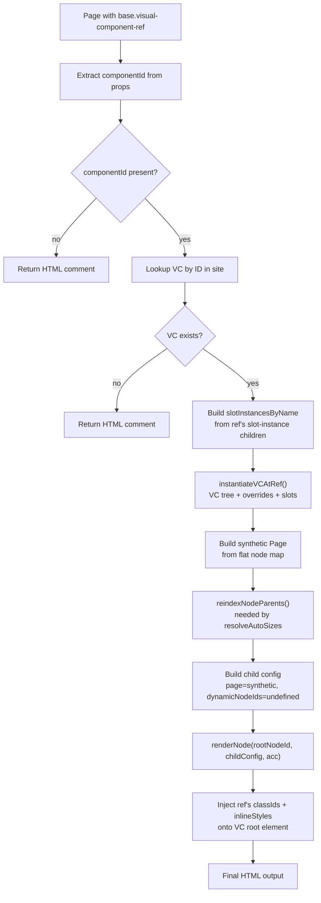

# Instatic Visual Components — Reusable Page Fragments with Slot Outlets

**Visual Components (VCs) are reusable page fragments stored as `data_rows` in the `components` table, with a definition tree (`NodeTree<VCNode>`), a parameter schema (`FieldSchema[]`), and a slot system (`base.slot-outlet` / `base.slot-instance`) that allows consumers to fill named content positions.** When a `base.visual-component-ref` is dropped on a page, `syncSlotInstances` auto-generates slot instances for each slot outlet in the VC definition.

Source: `src/core/visualComponents/`, `src/core/visual-components-schema/`, `src/modules/base/visualComponentRef/`, `src/core/publisher/renderVisualComponentRef.ts`

## Visual Component Architecture



## Visual Component Definition

```typescript
interface VisualComponent {
  id: string
  name: string
  tree: NodeTree<VCNode>        // The component's node tree
  params: FieldSchema[]          // Parameter schema (editable props)
  previewImage?: string          // Thumbnail for component picker
}
```

VCs are stored as `data_rows` in the `components` table:
- `tree` cell contains `NodeTree<VCNode>` (serialized)
- `params` cell contains the field schema array

## Slot Outlet / Slot Instance

### Slot Outlet (in VC definition)

```typescript
// src/modules/base/slotOutlet/index.ts
// base.slot-outlet — defines a named position in a VC
// Props: slotName (string), fallback content (children)
```

Slot outlets define where consumer content can be placed in a VC:
- `slotName` — the name that consumers use to identify this position
- Can have fallback content (children shown if consumer doesn't fill the slot)

### Slot Instance (on page using VC)

```typescript
// src/modules/base/slotInstance/index.ts
// base.slot-instance — consumer's fill for a slot outlet
// Props: slotName (string), content (children)
```

Slot instances are the consumer's content for a specific slot:
- `slotName` — matches the outlet's `slotName`
- Content is materialized as children in the page tree

### syncSlotInstances

When a `base.visual-component-ref` is dropped on a page, `syncSlotInstances` auto-generates `base.slot-instance` children:

1. Get the VC definition by `componentId`
2. Walk the VC tree to find all `base.slot-outlet` nodes
3. For each outlet, create a `base.slot-instance` child with matching `slotName`
4. The slot instance can be edited in the canvas (add content to the slot)

## VC Reference Rendering (Publisher)



**Source:** `src/core/publisher/renderVisualComponentRef.ts` (VC ref rendering), `src/core/publisher/renderNode.ts` (recursive rendering with same `acc` for CSS dedup).

**Aha:** The page-level ref node's own classIds are injected onto the VC's root element AFTER recursive rendering, preserving the page author's intent. The `acc` accumulators are passed through unchanged — the SAME `cssMap` instance — which is what makes CSS dedup work across the VC boundary: a VC used three times contributes module CSS only once.

## VC Reference Rendering (Canvas)

In the canvas, the VC is rendered via `VCInlineTree.tsx`:

```typescript
// src/modules/base/visualComponentRef/VCInlineTree.tsx
// Renders the VC tree inline in the canvas
// Shows slot outlets as editable regions
// Allows editing slot fills in-place
```

## Dynamic VC Detection

**Aha:** When a VC definition tree is dynamic (contains dynamic nodes), the **outer VC ref node ID** (in the page tree) goes into `dynamicPageNodeIds` — not the inner VC node IDs. The hole boundary is the VC ref, not any inner node. Diagnostic reasons from inner VC traversal are still appended so authors can see WHICH inner construct made the VC dynamic.

## VC Operations

Visual component CRUD is managed by the `visualComponentsSlice`:

```
src/admin/pages/site/store/slices/visualComponentsSlice.ts
src/admin/pages/site/store/slices/vcTreeOps.ts       — VC tree operations
src/admin/pages/site/store/slices/vcSlotReconcile.ts  — Slot reconciliation
```

### VC CRUD Operations

| Operation | Description |
|-----------|-------------|
| Create | New VC from scratch or from selection |
| Read | Load VC definition by ID |
| Update | Modify VC tree or params |
| Delete | Remove VC (with orphan reference check) |
| Duplicate | Copy VC with new ID |

### Slot Reconciliation

When a VC definition changes, `vcSlotReconcile.ts` reconciles the slot instances:
- New outlets → new slot instances added
- Removed outlets → orphaned slot instances marked
- Renamed outlets → slot instances re-matched

## VC Schema

```
src/core/visual-components-schema/
```

The VC schema defines:
- `tree` — NodeTree<VCNode> type
- `params` — Array of FieldSchema for component props
- Validation via TypeBox

## Cross-References

- [Content Model](11-content-model.md) — VCs as data_rows
- [Editor Store](13-editor-store.md) — visualComponentsSlice
- [Publisher Deep Dive](04-publisher-deep.md) — renderVisualComponentRef.ts

## Next

→ [Framework CSS](20-framework-css.md) — CSS tokens, fluid typography, generated utilities.
