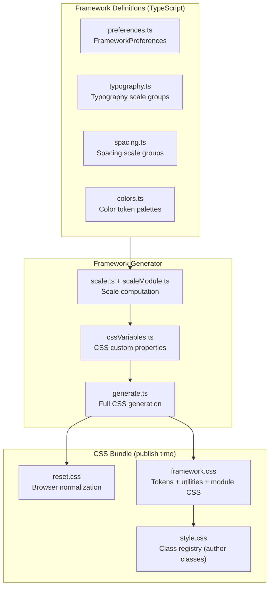
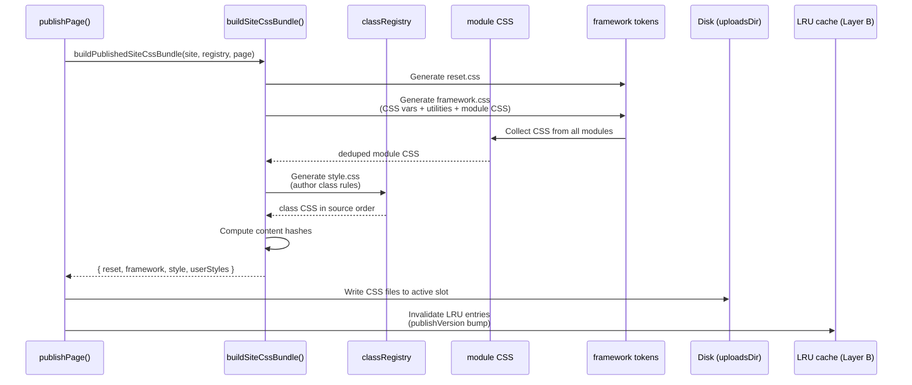

# Instatic Framework CSS — Fluid Design Tokens, Generated Utilities

**Instatic's CSS framework is a token-based design system with fluid typography and spacing scales, generated utility classes, and a three-layer CSS bundle architecture (reset → framework → userStyles).** The framework generates `@custom-media` breakpoints, CSS custom properties for colors/typography/spacing, and utility classes — all content-hashed for `immutable` caching. There are no CSS-in-JS libraries, no Tailwind, no CSS modules — the framework produces plain CSS from TypeScript definitions.

Source: `src/core/framework/`, `src/core/framework-schema/`, `src/core/publisher/siteCssBundle.ts`

## Framework Architecture



**Source:** `src/core/framework/` (12 files), `src/core/publisher/siteCssBundle.ts` (bundle assembly).

## Fluid Typography Scale

The framework defines a typography scale with **8 manual sizes** (text-xs through text-4xl) that interpolate between mobile (min) and desktop (max) values:

```typescript
// src/core/framework/defaults.ts:33
const TYPOGRAPHY_MANUAL_SEED: ManualSeed[] = [
  { name: 'text-xs',  min: 12.64, max: 10.13 },
  { name: 'text-s',   min: 14.22, max: 13.5 },
  { name: 'text-m',   min: 16,    max: 18 },
  { name: 'text-l',   min: 18,    max: 23.99 },
  { name: 'text-xl',  min: 20.25, max: 31.98 },
  { name: 'text-2xl', min: 22.78, max: 42.63 },
  { name: 'text-3xl', min: 25.63, max: 56.83 },
  { name: 'text-4xl', min: 28.83, max: 75.76 },
]
```

Each size produces a `clamp()` CSS function:

```css
/* Generated output */
.text-m {
  font-size: clamp(16px, 16px + (18 - 16) * ((100vw - 360px) / (1920 - 360));
}
```

**Aha:** The framework uses the `scaleModule.ts` pattern — each scale group (typography, spacing) has its own `ManualSize` array, computed independently. The `min`/`max` values are viewport-interpolated, not breakpoint-switched. This means text flows smoothly from 360px to 1920px without media query jumps — a genuine fluid typography system, not a set of discrete breakpoints.

## Spacing Scale

The spacing scale has **11 sizes** from `space-4xs` to `space-4xl`:

```typescript
// src/core/framework/defaults.ts:45
const SPACING_MANUAL_SEED: ManualSeed[] = [
  { name: 'space-4xs', min: 5.24,  max: 4.95 },
  { name: 'space-3xs', min: 6.55,  max: 7 },
  { name: 'space-2xs', min: 8.19,  max: 9.9 },
  { name: 'space-xs',  min: 10.24, max: 14 },
  { name: 'space-s',   min: 12.8,  max: 19.8 },
  { name: 'space-m',   min: 16,    max: 28 },
  { name: 'space-l',   min: 20,    max: 39.59 },
  { name: 'space-xl',  min: 25,    max: 55.98 },
  { name: 'space-2xl', min: 31.25, max: 79.16 },
  { name: 'space-3xl', min: 39.06, max: 111.93 },
  { name: 'space-4xl', min: 48.83, max: 158.27 },
]
```

These map to utility classes like `mt-space-m` (margin-top: space-m), `p-space-l` (padding: space-l), and so on.

## Color Tokens

The framework manages color tokens as named palettes:

```typescript
// src/core/framework/colors.ts
// Colors are stored as HSL values for programmatic manipulation
// Token families: background, foreground, border, accent
```

Color tokens produce CSS custom properties:

```css
:root {
  --color-bg: #ffffff;
  --color-fg: #0a0a0a;
  --color-border: #e5e5e5;
  --color-accent: #3b82f6;
}
```

## CSS Variable Generation

```typescript
// src/core/framework/cssVariables.ts
// Generates :root { --typography-*: ...; --spacing-*: ...; } blocks
// Each variable is content-hashed for cache invalidation
```

## Three-Layer CSS Bundle

The publisher assembles CSS in a strict cascade order:



**Source:** `src/core/publisher/siteCssBundle.ts` (`buildPublishedSiteCssBundle`), `server/router.ts` (`serveSiteCss`, lines 529-572).

| Layer | File | Content |
|-------|------|---------|
| 1 | `reset-<hash>.css` | Browser normalization, box-sizing reset |
| 2 | `framework-<hash>.css` | CSS custom properties, generated utilities, module CSS |
| 3 | `style-<hash>.css` | Author-defined classes (from class registry) |
| 4 | `userStyles-<hash>.css` | User-defined CSS (highest specificity, last) |

**Aha:** Each CSS file's hash is content-derived, so responses use `Cache-Control: public, max-age=31536000, immutable`. When the hash changes (editing, adding classes, modifying tokens), HTML pages re-render with new `<link href>` values and browsers fetch the new file exactly once. Stale-hash requests 404 so the browser falls back to refetching the HTML — returning new content under an old name would defeat `immutable` caching.

**Source:** `server/router.ts` (`tryServeSiteCssNamespace`, lines 263-265), `server/publish/siteCssBundle.ts` (`buildPublishedSiteCssBundle`).

## Generated Utility Classes

The framework generates utility classes for:

| Category | Examples |
|----------|----------|
| Typography | `text-m`, `text-l`, `font-sans`, `font-serif` |
| Spacing | `mt-space-m`, `p-space-l`, `gap-space-s` |
| Colors | `bg-color-bg`, `text-color-fg`, `border-color-border` |
| Layout | `flex`, `grid`, `block`, `inline-block` |

Utilities are emitted in `framework.css` and are available on any element via the class picker.

## Change Impact Analysis

```typescript
// src/core/framework/changeImpact.ts
// Computes which CSS classes are affected when tokens change
// Used to warn users about downstream impacts before applying changes
```

When a user changes a typography scale, the framework computes which classes will be regenerated, how many nodes on the page are affected, and whether the change will cause layout shifts.

## Font Management

```
src/core/fonts/
```

Font management handles:
- Imported font families (Google Fonts, custom URLs)
- Font file caching and optimization
- Font injection in published pages
- `@font-face` generation with `font-display: swap`

**Aha:** The framework downloads Google Fonts files at import time (not at publish time), stores them locally, and generates `@font-face` rules with all format variants (woff2, woff, ttf). This means published pages don't depend on Google Fonts CDN availability — the fonts are self-hosted.

**Source:** `src/core/fonts/`, `src/admin/pages/site/store/slices/site/fontActions.ts`.

## Framework Preferences

```typescript
// src/core/framework/preferences.ts
interface FrameworkPreferences {
  typography: TypographySettings
  spacing: SpacingSettings
  colors: ColorSettings
}
```

Preferences are stored in the `SiteDocument` and control:
- Typography scale type (manual, modular, ratio-based)
- Spacing scale generator settings
- Color palette definitions

## Cross-References

- [Publisher](03-publisher.md) — How CSS bundles are assembled at publish time
- [Editor Store](13-editor-store.md) — Framework actions in siteSlice
- [Module System](14-module-system.md) — How module CSS integrates with framework.css

## Next

→ [Forms System](21-forms-system.md) — Native CMS forms, validation, submission handling.
