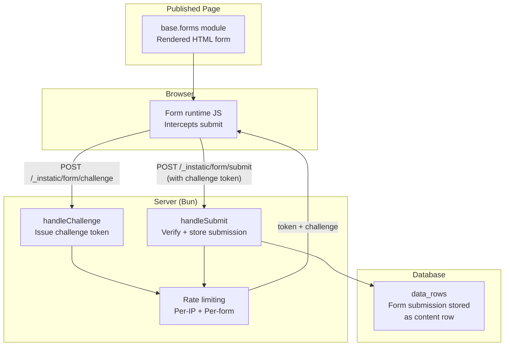
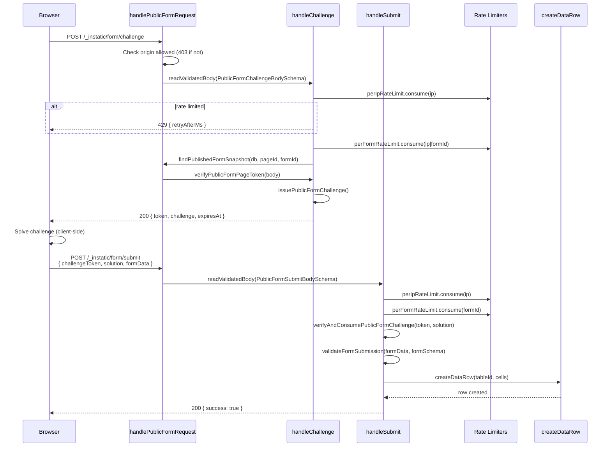

# Instatic Forms System — Challenge-Response Anti-Spam, Native CMS Handling

**Instatic provides native CMS forms with a challenge-response anti-spam system (no reCAPTCHA), per-IP and per-form rate limiting, and direct data row storage.** Forms are defined in the page tree as `base.forms` modules, submitted via `POST /_instatic/form/challenge` then `POST /_instatic/form/submit`, with TypeBox-validated payloads and origin verification. There is no third-party form service — submissions land directly in `data_rows`.

Source: `src/core/forms/`, `server/forms/`, `src/modules/base/forms/`

## Forms Architecture



**Source:** `server/forms/handler.ts` (entry point), `server/forms/challenge.ts` (challenge issuance/verification), `server/forms/rateLimit.ts` (token bucket rate limiting).

## Challenge-Response Anti-Spam

Instead of reCAPTCHA or hCaptcha, Instatic uses its own challenge-response system:

```typescript
// server/forms/challenge.ts
// 1. Client POSTs /_instatic/form/challenge with { pageId, formId, pageToken }
// 2. Server issues a challenge token with expiresAt
// 3. Client solves the challenge (client-side computation)
// 4. Client POSTs /_instatic/form/submit with { challengeToken, solution, formData }
// 5. Server verifies solution, stores submission
```

The challenge system ensures:
- **Origin verification** — submissions must come from the site's origin (`publicFormOriginAllowed`)
- **Token expiry** — challenge tokens have a TTL and expire
- **One-time use** — `verifyAndConsumePublicFormChallenge` consumes the token
- **Page token binding** — `verifyPublicFormPageToken` ties the form to a specific published page

**Aha:** The challenge-response system is entirely self-hosted — no Google reCAPTCHA keys, no external API calls, no privacy implications. The challenge is a client-side computation (likely a proof-of-work hash puzzle) that bots must solve per submission, raising the cost of automated spam without requiring users to solve CAPTCHAs. Legitimate browsers solve the challenge transparently; bots pay CPU.

## Rate Limiting

```typescript
// server/forms/rateLimit.ts
// Four rate limiters:
publicFormChallengePerIpRateLimit    // Challenge requests per IP
publicFormChallengePerFormRateLimit  // Challenge requests per IP+form combo
publicFormPerFormRateLimit           // Submit requests per form
publicFormPerIpRateLimit             // Submit requests per IP
```

All four rate limiters use a token bucket algorithm:

```typescript
interface RateLimitDecision {
  ok: boolean
  retryAfterMs?: number  // Present when rate limited
}
```

| Limiter | Scope | Purpose |
|---------|-------|---------|
| `publicFormChallengePerIpRateLimit` | Per IP | Prevent IP from flooding challenge requests |
| `publicFormChallengePerFormRateLimit` | Per IP + form | Prevent hammering a single form |
| `publicFormPerFormRateLimit` | Per form | Prevent any single form from being spammed |
| `publicFormPerIpRateLimit` | Per IP | Prevent any single IP from spamming across forms |

**Source:** `server/forms/rateLimit.ts` (token bucket implementation).

## Form Submission Flow



**Source:** `server/forms/handler.ts` (full flow), `src/core/forms/validation.ts` (validateFormSubmission), `server/repositories/data.ts` (createDataRow).

## Form Module

The `base.forms` module defines the form in the page tree:

```typescript
// src/modules/base/forms/index.ts
// base.forms — CMS form module
// schema: formSchema (TypeBox), action (url)
// render(props, childrenHTML) → <form> element
```

Forms in the editor:
- Define fields via `formSchema` (TypeBox-backed)
- Configure submission target (data table)
- Set up validation rules

## Form Schemas

```typescript
// src/core/forms/schemas.ts
interface PublishedFormSnapshot {
  pageId: string
  formId: string
  fields: FormField[]
  targetTable?: string  // Optional: store submissions in a data table
}
```

Form fields are validated against their schema at submission time:

```typescript
// src/core/forms/validation.ts
function validateFormSubmission(
  formData: Record<string, unknown>,
  formSchema: FormField[],
): { valid: boolean; errors: string[] }
```

## Form Targets

Submissions can target data tables:

```typescript
// src/core/forms/targets.ts
function isFormSubmissionTargetTable(tableSlug: string): boolean
```

When a form targets a data table, each submission creates a new `data_row` in that table. The form fields map to the table's schema cells.

## Body Size Limits

```typescript
// server/forms/handler.ts:36
const PUBLIC_FORM_CHALLENGE_MAX_BODY_BYTES = 8 * 1024       // 8 KB
const PUBLIC_FORM_SUBMIT_MAX_BODY_BYTES = 1024 * 1024       // 1 MB
```

Challenge bodies are small (just pageId + formId + pageToken). Submit bodies can be larger (file uploads, long text fields).

## Cross-References

- [Module System](14-module-system.md) — base.forms module definition
- [Content Model](11-content-model.md) — Form submissions stored as data_rows
- [Server](02-server.md) — Route: tryServePublicForm at /_instatic/form/

## Next

→ [Site Import/Export](22-site-import-export.md) — Full site export/import, templates, CMS transfer.
