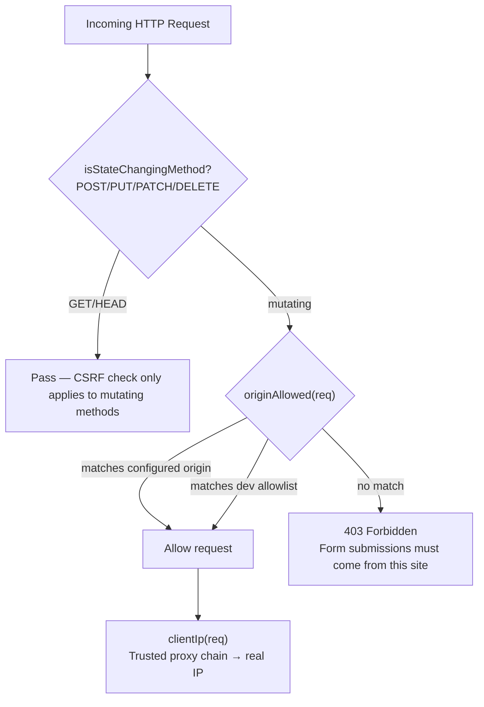
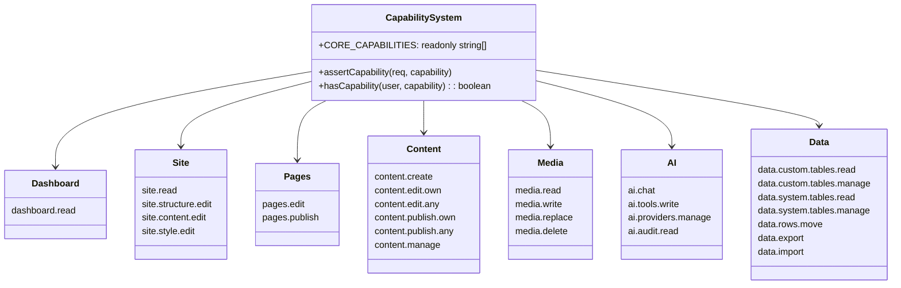

# Instatic Security — Origin-Based CSRF, Capabilities, Rate Limiting

**Instatic's security model is built on three pillars: origin-based CSRF defense (no tokens required), fine-grained capability-based access control (38 capabilities), and token-bucket rate limiting.** The system uses configured public origins for CSRF validation rather than trusting `X-Forwarded-Host` headers, and capabilities are defined in a single `CORE_CAPABILITIES` array that flows to both client and server with zero parallel lists.

Source: `server/auth/security.ts`, `src/core/capabilities.ts`, `server/auth/auth.ts`, `server/forms/rateLimit.ts`

## CSRF Defense — Origin Validation



**Source:** `server/auth/security.ts` (lines 48-55, 58-60, 68-72).

### Origin Configuration

```typescript
// server/auth/security.ts:49
export const DEV_ORIGIN_ALLOWLIST: string[] = [
  'http://localhost:5173',
  'http://127.0.0.1:5173',
  'http://localhost:5174',
  'http://127.0.0.1:5174',
  process.env.VITE_ALLOWED_ORIGIN ?? '',
].filter(Boolean)
```

**Aha:** CSRF defense is entirely origin-based — no CSRF tokens, no SameSite cookie tricks. The system derives the canonical origin from `PUBLIC_ORIGIN` / `RENDER_EXTERNAL_URL` / `RAILWAY_PUBLIC_DOMAIN` environment variables at boot. Forwarded headers (`X-Forwarded-Host` / `X-Forwarded-Proto`) are NOT consulted for CSRF — a TLS-terminating edge proxy is handled by configuring the public origin, not by trusting the proxy to relay the host/scheme. This means a misconfigured proxy can't spoof origins to bypass CSRF.

### Client IP Attribution

```typescript
// server/auth/security.ts
// clientIp walks X-Forwarded-For right-to-left and returns the
// nearest untrusted hop ONLY when the socket peer is a trusted proxy
function clientIp(req: Request): string | null
```

The `stampSocketIp` function is called at the `Bun.serve` boundary to prevent spoofing:

```typescript
// server/index.ts:79
stampSocketIp(req, server.requestIP(req)?.address ?? null)
```

This ensures `clientIp(req)` always has a reliable socket peer fallback when no proxy is involved.

## Capability-Based Access Control

Instatic uses a fine-grained capability system with **38 distinct capabilities**:



**Source:** `src/core/capabilities.ts` (27 capabilities), `server/auth/capabilities.ts` (server-side enforcement).

### Site Editing Split

The site-editing capabilities are split three ways:

| Capability | Who It's For | What It Allows |
|------------|-------------|----------------|
| `site.structure.edit` | Designers | Add/remove/move/duplicate/rename nodes; manage pages, VCs, classes |
| `site.content.edit` | Content editors | Modify text, images, links on existing nodes |
| `site.style.edit` | Designers | CSS classes, style overrides, breakpoints, framework tokens |

**Aha:** The `CORE_CAPABILITIES` array is the SINGLE source of truth. Both client and server import from it — there is NO parallel list. Adding a string to this array flows everywhere automatically. The `capability-picker-coverage.test.ts` gate enforces that every entry also has picker metadata (label/description/group) so the admin UI never shows an orphaned capability.

### Owner Capability Reset

```typescript
// server/index.ts:22
await syncSystemRoles(db)
```

The Owner role's capabilities are force-reset to `CORE_CAPABILITIES` on every boot. This ensures existing installations don't strand owners on a stale grant list when new capabilities are added in code.

**Source:** `server/repositories/roles.ts` (`syncSystemRoles`).

## Session Management

```
server/auth/auth.ts        — Session cookie creation/verification
server/auth/session.ts     — Session handling
```

Sessions use:
- **Secure cookie** — `Secure` flag set when `publicOriginIsHttps` is true
- **HttpOnly** — Not accessible to JavaScript
- **SameSite** — Strict for CSRF defense
- **Path-scoped** — Admin session cookie scoped to `Path=/admin` to keep it off the public site

**Aha:** The admin session cookie is scoped to `Path=/admin` specifically so it's NOT carried to public page requests. This means the AI endpoint at `/admin/api/ai/*` gets the cookie (authenticated), but a published page at `/about` does not (public). Without this scoping, every public page request would carry the admin cookie, bloating request sizes and potentially leaking session info to CDN logs.

## Rate Limiting

Token bucket rate limiting is used across:

| Area | Limiters |
|------|----------|
| **Forms** | Per-IP challenge, per-form challenge, per-form submit, per-IP submit |
| **Login** | Per-IP login attempts |
| **AI** | Per-conversation token tracking |

```typescript
// server/forms/rateLimit.ts
interface RateLimitDecision {
  ok: boolean
  retryAfterMs?: number
}
```

## Upload Security

```typescript
// server/static.ts
// INERT_UPLOAD_MIMES — non-executable MIME types
// hardenUploadResponse — adds nosniff + attachment headers
```

Uploads are hardened with:
- **Content-Type derived from extension** — server-chosen extensions only
- `X-Content-Type-Options: nosniff` — prevents MIME sniffing
- `Content-Disposition: attachment` — for non-inert MIMEs, prevents browser rendering
- **Plugin asset CORS** — plugin bundles under `/uploads/plugins/` get `Access-Control-Allow-Origin: *` with `Cross-Origin-Resource-Policy: cross-origin` for sandboxed iframe loading

**Source:** `server/static.ts` (`hardenUploadResponse`, `INERT_UPLOAD_MES`), `server/router.ts` (`tryServeUpload`, lines 362-395).

## RichText Sanitization

```
server/richtextSanitizer.ts  — DOMPurify server-side sanitization
src/core/sanitize.ts         — DOMPurify at publisher boundary
src/core/html-sanitize/      — HTML sanitization utilities
src/core/css-sanitize/       — CSS sanitization
```

The richtext sanitizer runs at the server level, sanitizing all rich text content before it enters the database.

**Aha:** The richtext sanitizer is loaded at boot (`await import('./richtextSanitizer')` in `server/index.ts`) before any routes are registered. This means every request passes through the sanitized environment. The sanitizer uses DOMPurify with a server-compatible configuration (jsdom-based), ensuring that even if a plugin or API endpoint tries to inject malicious HTML, it's sanitized before storage.

## Cross-References

- [Server](02-server.md) — Route handlers, CORS headers
- [Plugin System](04-plugin-system.md) — Plugin capability permissions
- [Admin SPA](16-admin-spa.md) — Admin authentication flow

## Next

→ [Site Import/Export](22-site-import-export.md) — Full site export/import, templates, CMS transfer.
