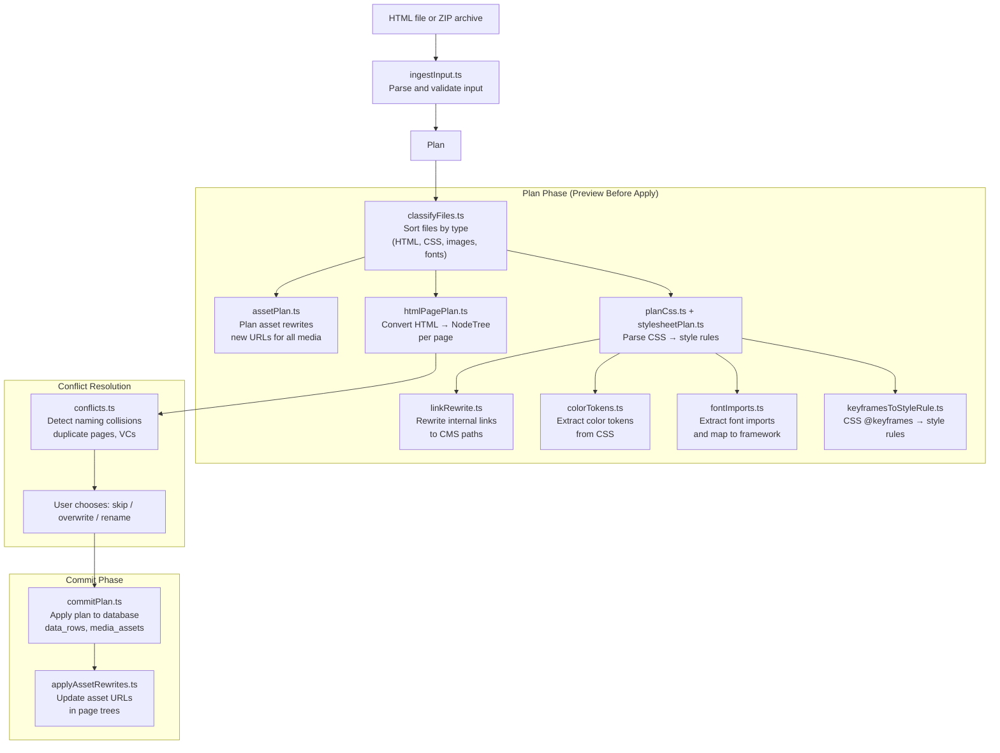
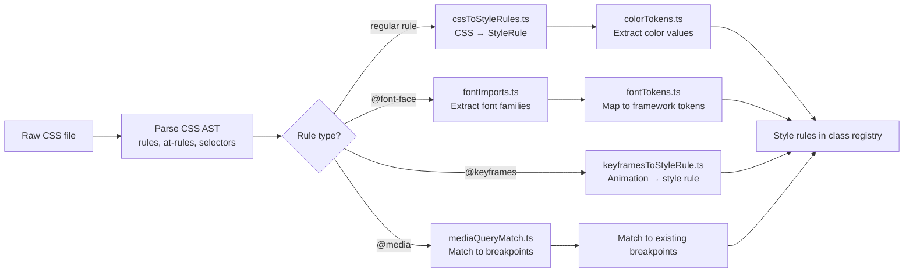

# Instatic Site Import/Export — HTML Import Pipeline, Asset Rewriting, Conflict Resolution

**Instatic's site import system converts raw HTML into CMS-native NodeTrees, rewrites assets and links, maps CSS to style rules, and resolves conflicts with existing content.** The import pipeline has 27+ modules handling everything from HTML parsing to font tokenization, with a plan-commit pattern that lets users preview changes before applying them. Templates provide pre-built starting points for new sites.

Source: `src/core/siteImport/` (27 files), `src/core/templates/`, `server/handlers/cms/import.ts`

## Site Import Pipeline



**Source:** `src/core/siteImport/` (27 modules), `server/handlers/cms/import.ts` (HTTP handler).

## Import Modules

| Module | Purpose |
|--------|---------|
| `adapter.ts` | Import adapter interface (pluggable sources) |
| `applyAssetRewrites.ts` | Update asset URLs in page trees after import |
| `assetPlan.ts` | Plan new URLs for all imported media assets |
| `buildPlan.ts` | Assemble the full import plan from sub-plans |
| `classCascades.ts` | Handle CSS cascade specificity during import |
| `classifyFiles.ts` | Sort uploaded files by MIME type |
| `colorTokens.ts` | Extract CSS color values into framework tokens |
| `commitPlan.ts` | Apply the import plan to the database |
| `conflicts.ts` | Detect and resolve naming/content conflicts |
| `cssImports.ts` | Parse CSS `@import` statements |
| `cssToStyleRules.ts` | Convert CSS rules to Instatic style rules |
| `fontImports.ts` | Extract font-face declarations |
| `fontTokens.ts` | Map imported fonts to framework font tokens |
| `htmlPagePlan.ts` | Convert HTML DOM to NodeTree<PageNode> |
| `ingestInput.ts` | Parse and validate raw import input |
| `keyframesToStyleRule.ts` | Convert CSS @keyframes to style rules |
| `linkRewrite.ts` | Rewrite internal links to CMS paths |
| `mediaQueryMatch.ts` | Match CSS media queries to framework breakpoints |
| `mimeTypes.ts` | MIME type detection and validation |
| `paths.ts` | Path normalization and resolution |
| `planCss.ts` | Plan CSS processing pipeline |
| `rootScope.ts` | Root-level import configuration |
| `stylesheetPlan.ts` | Plan individual stylesheet processing |
| `types.ts` | Import plan type definitions |

## HTML to NodeTree Conversion

The `htmlPagePlan.ts` module converts raw HTML into Instatic's `NodeTree<PageNode>`:

```
HTML <div class="hero">         →  base.container { classIds: ["hero"] }
  <h1>Welcome</h1>              →    base.text { tag: "h1", content: "Welcome" }
  <p>Subtitle text</p>          →    base.text { tag: "p", content: "Subtitle text" }
          →    base.image { src: "hero.jpg" }
</div>
```

**Aha:** The import system doesn't try to perfectly reconstruct the original HTML — it maps elements to the closest matching Instatic module (`<p>` → `base.text`, `` → `base.image`, `<div>` → `base.container`). Custom CSS classes are preserved as `classIds` so the visual design is maintained even if the module mapping isn't pixel-perfect. This pragmatic approach means any HTML can be imported, even if it uses custom elements or non-standard markup.

## CSS Import Processing

The import system processes CSS in multiple stages:



**Source:** `src/core/siteImport/cssToStyleRules.ts`, `src/core/siteImport/colorTokens.ts`, `src/core/siteImport/fontTokens.ts`.

## Conflict Resolution

When importing into an existing site, conflicts are detected:

```typescript
// src/core/siteImport/conflicts.ts
interface Conflict {
  type: 'page' | 'component' | 'media' | 'class'
  existingId: string
  importId: string
  name: string
}
```

Users can resolve conflicts by:
- **Skip** — Don't import the conflicting item
- **Overwrite** — Replace the existing item with the imported version
- **Rename** — Import with a new name (e.g., "About (imported)")

## Templates

```
src/core/templates/
```

Templates provide pre-built starting points for new sites:
- Page definitions (as `data_rows`)
- Content data (posts, collections)
- Media files
- Settings
- Module configurations

Templates are imported through the same pipeline as external HTML imports, ensuring consistency.

## CMS Transfer (Export/Import Between Sites)

```
server/handlers/cms/export.ts  — Full site export
server/handlers/cms/import.ts  — Import from archive
```

The CMS transfer system exports a complete site as an archive:
- All `data_tables` and `data_rows`
- All media assets
- All settings and preferences
- Framework tokens (typography, spacing, colors)

The archive can be imported into another Instatic instance, migrating the entire site.

**Aha:** The export/import system uses the same underlying pipeline as the HTML import — both ultimately produce `data_rows` and `NodeTree` structures. This means the import code path is battle-tested by both external HTML imports and internal CMS transfers, reducing the chance of import-related bugs.

## Cross-References

- [Content Model](11-content-model.md) — Imported content stored as data_rows
- [Framework CSS](20-framework-css.md) — CSS tokens extracted during import
- [Deployment](08-deployment.md) — Deploying imported sites

## Next

→ [Testing Architecture](23-testing-architecture.md) — 400+ architecture tests, E2E strategy, benchmark gates.
