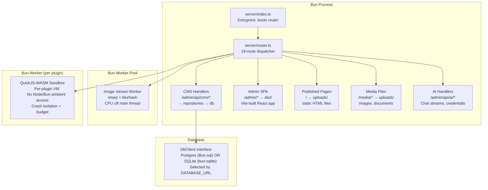
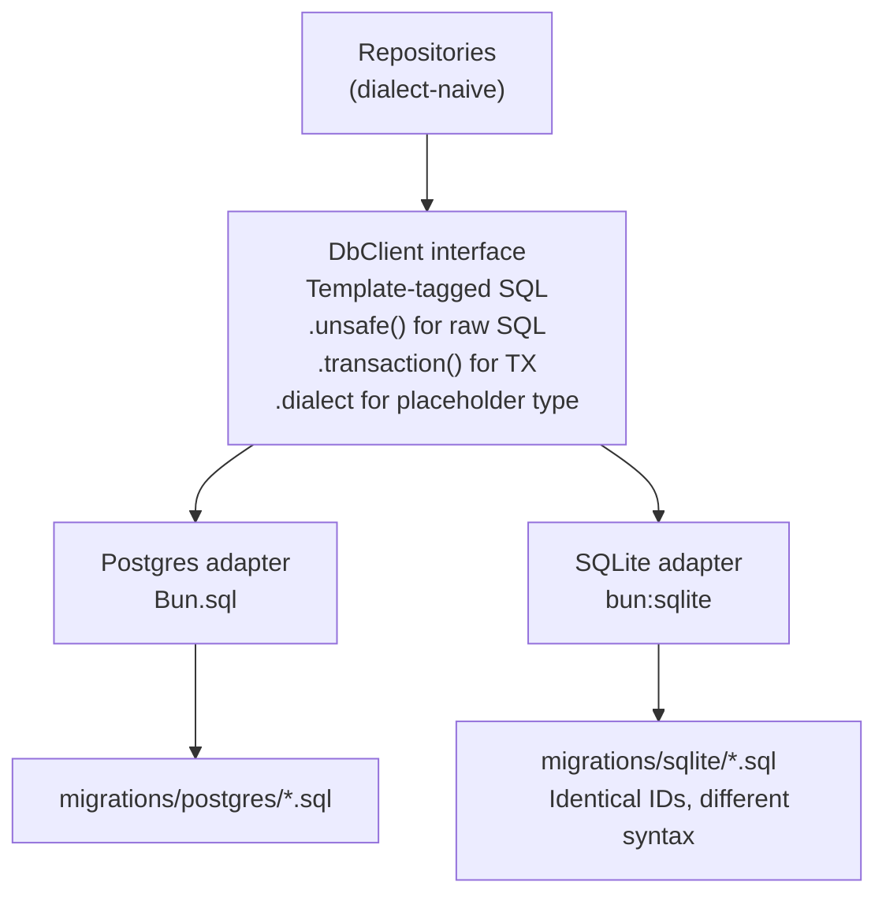

# Architecture

Instatic runs as a single Bun process with two kinds of off-main-thread workers, a hand-written routing table of 19 routes, and a dual-engine database adapter.

**Source:** `/home/darkvoid/Boxxed/@formulas/src.rust/src.AI/src.Instatic/Instatic/`

## Process Architecture



**Aha:** There is no message queue, no managed service surface. Everything runs in one process (or its workers). Scaling out is a horizontal-Postgres play: both schedulers (plugin tick + scheduled-publish tick) share a leader-election primitive via `pg_try_advisory_lock` so multiple instances behind a load balancer don't double-fire scheduled work. SQLite mode is single-instance by definition; the module falls through to a no-op sentinel.

**Source:** `docs/architecture.md`, `server/db/advisoryLock.ts`.

## Routing Table

The server uses a hand-written router — not Express, not Hono, not Fastify. Routes are tried top-to-bottom; the first match wins.

```typescript
// server/router.ts:62-85 — The 19-route table
const routes: readonly RouteHandler[] = [
  tryServeHealth,              // /health
  tryServeAi,                  // /admin/api/ai/*
  tryServeCmsApi,              // /admin/api/cms/*
  tryServeLoopRuntimeAsset,    // /_instatic/loop/*
  tryServeLoop,                // /_instatic/loop/runtime/*
  tryServeHoleRuntimeAsset,    // /_instatic/hole/runtime/*
  tryServeHole,                // /_instatic/hole/<nodeId>
  tryServeModuleJsAsset,       // /_instatic/module/*.js
  tryServePublicForm,          // Form submissions
  tryServeRuntimeAsset,        // /_instatic/runtime/*
  tryServeRuntimePackageNamespace, // /_instatic/runtime/packages/*
  tryServeSiteCssNamespace,    // /_instatic/css/*
  tryServeMediaRedirect,       // Media file redirects
  tryServeStaticAsset,         // Published static HTML
  tryServeUpload,              // /uploads/*
  tryServeAdminApp,            // /admin/* (SPA fallback)
  tryServePublicRoute,         // /* (public page routing)
  trySetupRedirect,            // Setup wizard if not configured
  tryServeNotFoundPage,        // 404 page
]
```

**Source:** `server/router.ts` lines 62-85.

**Aha:** Each route handler follows the same pattern: check the URL path, return a `Response` if it matches, return `null` if it doesn't. The dispatcher loop (`handleServerRequest`) walks the array and returns the first non-null response. Adding a new endpoint is a one-line edit to the `routes` array plus a focused `tryServeX` function — no per-call type juggling, no editing the dispatcher loop. Routes are prefix-namespaced: handlers like `/_instatic/css/` absorb their entire namespace and emit a 404 themselves rather than falling through, so unknown paths under a known prefix can't accidentally match a later route.

## Database Architecture

### Dual-Engine Adapter



**Source:** `server/db/client.ts`, `server/db/`.

The `DbClient` interface provides:
- Template-tagged SQL execution: `` db`SELECT * FROM posts` ``
- `.unsafe(sql, params)` — raw SQL strings for migrations
- `.transaction(fn)` — callback-based transactions
- `.dialect` — returns `'postgres'` or `'sqlite'`

### Placeholder Abstraction

```typescript
// server/db/client.ts:16-19
function placeholder(dialect: Dialect, index: number): string {
  return dialect === 'postgres' ? `$${index}` : '?'
}
```

This lets repositories build dialect-agnostic SQL strings. The same SQL template works on both Postgres (`$1, $2, $3`) and SQLite (`?, ?, ?`).

**Source:** `server/db/client.ts`.

### Content Storage

All content lives in two tables:

| Table | Purpose |
|-------|---------|
| `data_tables` | Table definitions (posts, pages, components, layouts, plus user-created tables) |
| `data_rows` | Row data for all tables |

**Aha:** There are no separate `pages` or `page_versions` tables. The four system tables (`posts`, `pages`, `components`, `layouts`) are seeded and locked from rename/delete. Versioning is handled through `data_row_versions` with `site_snapshot_id` references — each publish stores the `SiteDocument` once in `site_snapshots`, and page versions reference it.

**Source:** `docs/features/content-storage.md`, `docs/reference/database-dialects.md`.

## Folder Structure

```
server/                  Bun server: router, handlers, repositories, plugin runtime, DB
src/admin/               Admin app shell (auth, navigation, workspaces, plugin host UI)
src/admin/pages/site/    Visual editor (canvas, panels, toolbar, store)
src/core/                Engine: page tree, publisher, plugin SDK + runtime, persistence
src/modules/             First-party block modules (container, text, image, button, …)
src/ui/                  Shared UI primitives (Button, Input, Tree, icons, cn helper)
src/styles/              Global tokens (globals.css)
src/__tests__/architecture/   Gate tests enforcing structural rules
tests/                   Playwright E2E specs (*.e2e.ts)
docs/                    Documentation tree
examples/                Plugin templates, type declarations
vendor/                  Vendored pixel-art-icons package
scripts/                 Build, dev, icon sync, benchmark, audit scripts
```

**Source:** `docs/architecture.md` "Folders, at a glance".

## Next

Continue to [02-server](02-server.md) for a deep dive into the hand-written router, CMS handlers, and repository layer.
