# Moltis — Multi-Channel AI Agent Platform

**Moltis is a self-hosted AI agent platform that connects LLMs to 9 messaging channels through a 68-crate Rust workspace.** The architecture centers on four pillars: a **Gateway** (central hub: method dispatch, session registry, webhook verification, provisioning), an **Agent Loop** (streaming LLM → tool execution → result → repeat, with retry, compaction, and loop detection), **Channel Plugins** (each channel implements `ChannelPlugin` with optional sub-traits for config, auth, inbound/outbound messaging, webhook verification), and a **Provider Registry** (10+ LLM backends behind a unified `LlmProvider` trait with automatic model discovery and capability detection). Additional systems handle 11 STT + 6 TTS providers for voice calls, a multi-layered tool sandbox (global → provider → agent → group → sender → sandbox), WASM plugin execution, RAG memory, and native iOS/macOS apps via Swift FFI bridges.

Source: `crates/` — 1,038 Rust files, 68 crates

## The Architecture

```mermaid
flowchart TD
    subgraph Channels["9 Messaging Channels"]
        TG["Telegram"] & WA["WhatsApp<br/>Linked Devices"] & DC["Discord<br/>Serenity Gateway"]
        SL["Slack<br/>Webhooks+Socket"] & SG["Signal"] & MT["Matrix"]
        NS["Nostr"] & TP["Telephony<br/>Voice Calls"] & MST["MSTeams"]
    end

    subgraph Gateway["Gateway (128 files, 55K LOC)"]
        Methods["methods.rs — all domain logic dispatch"]
        SessionReg["session registry — nodes, pairing, state"]
        ChannelStore["channel_store.rs — per-channel state"]
        WebhookMW["channel_webhook_middleware — dedup, rate-limit, verify"]
        MCP["mcp_service.rs — MCP health, agent bridge"]
        VoiceHub["voice + tts_phrases — call orchestration"]
        Cron["cron — scheduled tasks"]
        Approval["approval — human-in-the-loop"]
    end

    subgraph AgentLoop["Agent Loop (46 files, 20K LOC)"]
        Runner["runner/streaming.rs<br/>run_agent_loop_streaming()"]
        Prompt["prompt/builder.rs — system prompt assembly"]
        ToolReg["tool_registry — dispatch"]
        LoopDetect["tool_loop_detector — fingerprint-based"]
        ProviderChain["provider_chain — fallback routing"]
    end

    subgraph Providers["Providers (57 files, 28K LOC)"]
        P_OpenAI["openai"] & P_Anthro["anthropic"] & P_Gemini["genai_provider"]
        P_Ollama["ollama"] & P_Local["local_llm, local_gguf"] & P_OC["opencode_zen"]
        P_Bedrock["bedrock"] & P_Compat["openai_compat"]
        P_Registry["ProviderRegistry — model discovery + capability detection"]
    end

    subgraph Tools["Tools (90 files, 53K LOC)"]
        T_Bash["exec — sandboxed shell"] & T_Browser["browser"]
        T_Web["web_fetch, web_search"] & T_Sandbox["sandbox + sandbox_packages"]
        T_WASM["wasm_engine, wasm_component, wasm_tool_runner"]
        T_Session["session_state, branch_session, sessions_manage"]
        T_Spawn["spawn_agent, spawn_agent_tasks"] & T_Memory["memory (RAG)"]
        T_Policy["policy — multi-layered allow/deny"]
    end

    subgraph Voice["Voice (24 files, 7.4K LOC)"]
        V_STT["11 STT: Whisper(API+CLI+Local), Deepgram, ElevenLabs, Google, Groq, Mistral, Sherpa-ONNX, Voxtral, OpenAI-compat"]
        V_TTS["6 TTS: ElevenLabs, OpenAI, Google, Coqui, Piper, Mock"]
    end

    Channels --> Gateway
    Gateway --> AgentLoop
    AgentLoop --> Providers
    AgentLoop --> Tools
    Gateway --> Voice
```



## Crate Map

| Crate | LOC | Purpose |
|-------|-----|---------|
| **gateway** | 54,994 | Central hub: method dispatch, session/node registry, channel lifecycle, webhook handling, MCP, voice orchestration |
| **tools** | 52,957 | 30+ tool implementations + multi-layered policy engine |
| **providers** | 28,119 | 10+ LLM backends, model discovery, capability detection |
| **agents** | 20,280 | Streaming agent loop, prompt assembly, tool registry, loop detection, retry, provider chain |
| **voice** | 7,361 | 11 STT + 6 TTS providers |
| **memory** | 6,330 | RAG: embedding, storage, search, summarization |
| **channels** | 4,614 | ChannelPlugin trait, registry, config, webhook middleware, media download |
| **sessions** | 4,453 | Session management, persistence |
| **mcp** | — | MCP server/client bridge |
| **plugins** | — | WASM and native extension system |
| **skills** | — | Agent skill definitions |
| **config** | — | Global TOML-based configuration |
| **routing** | — | Message routing between channels and agents |
| **protocol** | — | Wire protocol for client↔server |
| **chat** | — | Chat message types and conversation handling |
| **discord, telegram, whatsapp, slack, signal, matrix, nostr, telephony, msteams** | — | Channel-specific implementations |
| **auth** | — | Authentication, OAuth, WebAuthn |
| **httpd** | — | Axum HTTP server, routes, WebSocket upgrade |
| **browser** | — | Headless browser for tool use |
| **secret-store** | — | Encrypted secrets storage |
| **swift-bridge** | — | FFI bridge for iOS/macOS Swift apps |

## Key Design Decisions

### 1. Gateway as Method Dispatch

**Aha:** The Gateway holds a flat `Methods` registry — `method_name → async fn(Request) → Response`. When a Telegram webhook fires, the handler calls `methods.telegram_webhook(payload)`. Every domain concept (agents, voice, channels, MCP) is a separate crate that registers handlers into `Methods` at startup. Adding a new channel requires zero gateway changes — just implement `ChannelPlugin` and register the webhook handler.

### 2. Channels are Trait Objects

```rust
// channels/src/plugin.rs — the ChannelPlugin trait
pub trait ChannelPlugin: Send + Sync {
    fn descriptor(&self) -> ChannelDescriptor;
    fn capabilities(&self) -> ChannelCapabilities;
}
// Optional sub-traits:
// ChannelConfig, ChannelAuth, ChannelInbound, ChannelOutbound,
// ChannelStreamOutbound, ChannelStatus, ChannelOtpProvider
```

Each channel implements only the sub-traits it needs. The registry checks trait bounds at registration time.

### 3. Lazy Tool Mode — 3× Iteration Budget

```rust
// agents/src/runner/streaming.rs:111-115
let max_iterations = if config.tools.registry_mode == ToolRegistryMode::Lazy {
    base_max_iterations * 3  // Extra iterations for tool_search round-trips
} else { base_max_iterations };
```

In lazy mode, the LLM calls `tool_search` first to discover tools, then calls them — saving context window at the cost of one extra round-trip.

### 4. Six-Layer Tool Sandbox

```
Policy layers (restrictive — each can only REMOVE permissions):
1. Global   → 2. Provider  → 3. Agent  → 4. Group  → 5. Sender  → 6. Sandbox
```

### 5. Steer Inbox — Mid-Flight Guidance

```rust
// agents/src/runner/mod.rs:32
pub type SteerInbox = Arc<tokio::sync::Mutex<Vec<String>>>;
```

Users can send `/steer <instruction>` mid-conversation. The agent loop drains the inbox between iterations and injects the text as a system notice.

## Next

→ [Gateway](01-gateway.md) — Central hub architecture: methods, sessions, channels, webhooks.
