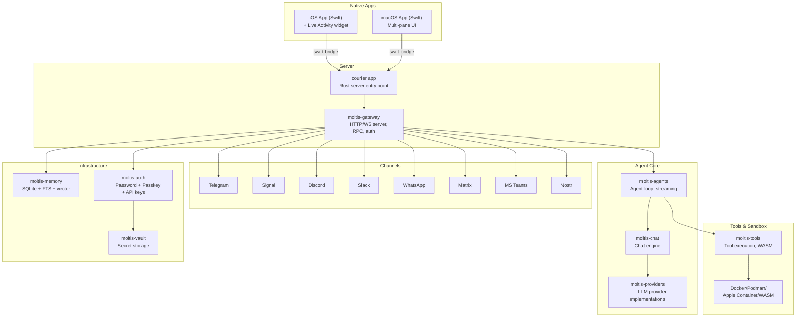
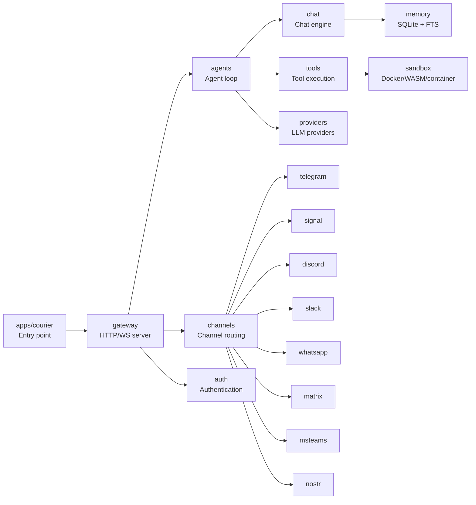
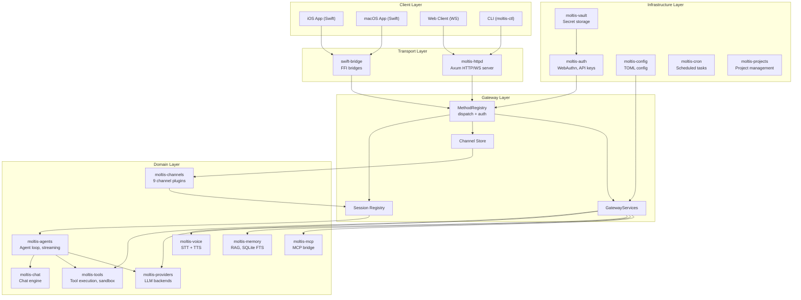

# Architecture: Workspace Structure and Crate Map

Moltis is a Rust workspace with 64 crates, an iOS Swift app, a macOS Swift app, and a courier server app. The workspace is organized into modular crates that can be audited independently.

**Source:** `/home/darkvoid/Boxxed/@formulas/src.rust/src.AI/src.Moltis/moltis/`

## High-Level Architecture



## Core Runtime Crates (by size)

| Crate | LoC | Role |
|-------|-----|------|
| `moltis-gateway` | 37.4K | HTTP/WS server, RPC, auth, startup wiring |
| `moltis-tools` | 37.0K | Tool execution, sandboxing, WASM tools |
| `moltis-providers` | 18.9K | LLM provider implementations |
| `moltis-agents` | 14.5K | Agent loop, streaming, prompt assembly |
| `moltis-chat` | 14.2K | Chat engine, agent orchestration |

**Source:** `README.md` architecture table.

## Crate Dependency Graph



## Key Crate Groups

### Agent & Chat

| Crate | Purpose |
|-------|---------|
| `moltis-agents` | Agent loop, streaming, prompt assembly |
| `moltis-chat` | Chat engine, agent orchestration |
| `moltis-sessions` | Session management |

### Channels

| Crate | Purpose |
|-------|---------|
| `moltis-channels` | Channel abstractions |
| `moltis-telegram` | Telegram bot integration |
| `moltis-signal` | Signal messaging |
| `moltis-discord` | Discord bot |
| `moltis-slack` | Slack bot |
| `moltis-whatsapp` | WhatsApp integration |
| `moltis-matrix` | Matrix protocol |
| `moltis-msteams` | MS Teams integration |
| `moltis-nostr` | Nostr protocol |
| `moltis-caldav` | CalDAV calendar integration |
| `moltis-webhooks` | Webhook handling |

### Infrastructure

| Crate | Purpose |
|-------|---------|
| `moltis-gateway` | HTTP/WS server, RPC, auth |
| `moltis-auth` | Authentication (password, passkey, API keys) |
| `moltis-vault` | Secret vault |
| `moltis-config` | Configuration management |
| `moltis-common` | Shared types and utilities |
| `moltis-protocol` | Protocol definitions |

### Tools & Execution

| Crate | Purpose |
|-------|---------|
| `moltis-tools` | Tool execution framework |
| `moltis-skills` | Skill definitions |
| `moltis-browser` | Browser automation |
| `moltis-voice` | Voice I/O (STT/TTS) |
| `moltis-media` | Media handling |

### Memory & Data

| Crate | Purpose |
|-------|---------|
| `moltis-memory` | SQLite + FTS + vector memory |
| `moltis-code-index` | Code indexing |
| `moltis-projects` | Project management |

### Providers & MCP

| Crate | Purpose |
|-------|---------|
| `moltis-providers` | LLM provider implementations |
| `moltis-mcp` | MCP protocol support |
| `moltis-mcp-agent-bridge` | MCP-to-agent bridge |
| `moltis-routing` | Message routing |

### Import Crates

| Crate | Purpose |
|-------|---------|
| `moltis-import-core` | Core import logic |
| `moltis-claude-import` | Import from Claude |
| `moltis-codex-import` | Import from Codex |
| `moltis-hermes-import` | Import from Hermes |
| `moltis-openclaw-import` | Import from OpenClaw |

### Native App Bridge

| Crate | Purpose |
|-------|---------|
| `moltis-swift-bridge` | Rust-Swift FFI layer |

### WASM

| Crate | Purpose |
|-------|---------|
| `moltis-wasm-precompile` | WASM precompilation |
| `moltis-wasm-tools/calc` | WASM calculator tool |
| `moltis-wasm-tools/web-fetch` | WASM web fetch tool |
| `moltis-wasm-tools/web-search` | WASM web search tool |

## Native Apps

### iOS App

Swift iOS app with:
- Live Activity widget
- GraphQL client
- MoltisApp.swift entry point
- Widget extension

**Source:** `apps/ios/`.

### macOS App

Swift macOS app with:
- Multi-pane UI (Chat, Settings, Httpd, Logs)
- Configuration management
- Provider configuration
- Network audit pane
- Onboarding flow

**Source:** `apps/macos/`.

## Courier App

The `apps/courier/` is the Rust server entry point:

```
apps/courier/
├── Cargo.toml
├── src/main.rs          ← Server entry point
├── README.md
└── deploy/
    ├── ansible.cfg
    └── playbook.yml     ← Ansible deployment
```

**Source:** `apps/courier/`.

## Layered Architecture



## Next

Continue to [02-gateway](02-gateway.md) for the HTTP/WS server, RPC, and MCP support.

## Aha: HTTP Transport Is Separated from Domain Logic

The gateway crate (`moltis-gateway`) holds ALL domain logic (methods, sessions, channels, MCP, voice orchestration) but ZERO HTTP routes. The HTTP/WS server lives in `moltis-httpd` (Axum routes + WebSocket upgrade). The `prepare_gateway_core()` function returns a `PreparedGatewayCore` that is completely transport-agnostic. This means the same gateway logic powers the server binary, the macOS app (via swift-bridge FFI), and any future transport layer. See `gateway/src/lib.rs:1-12` — the doc comment explicitly states this separation.

## Aha: Feature Flags Gate Entire Channel Integrations

Many crates use `#[cfg(feature = "...")]` to conditionally compile channel integrations. `#[cfg(feature = "msteams")]` gates MS Teams tools. `#[cfg(feature = "telephony")]` gates voice call tools. `#[cfg(feature = "mdns")]` gates mDNS discovery. `#[cfg(feature = "push-notifications")]` gates push notification support. This means a single build of Moltis can include or exclude entire subsystems based on feature flags — reducing binary size and attack surface.

## Aha: Courier Is the Single Entry Point for All Transports

The `apps/courier/src/main.rs` binary is the ONLY executable in the workspace. It calls `prepare_gateway_core()` to build the transport-agnostic core, then starts `moltis-httpd` for HTTP/WS. The iOS and macOS apps don't have their own binaries — they link against the swift-bridge crate which internally calls the same gateway functions via FFI. This means there's exactly one code path for every operation, whether it comes from a WebSocket, an FFI call, or the CLI. No duplicated logic between "server mode" and "desktop mode."

## Aha: Crate Sizes Correlate with Feature-Flag Coverage

The LOC counts in the architecture table (gateway 37.4K, tools 37.0K, providers 18.9K) include all feature-gated code. A minimal build of Moltis with no optional channels or providers would be significantly smaller. The `moltis-tools` crate alone is 37K LOC because it contains 30+ tool implementations, each with their own schema, execution logic, and sandbox routing — but most users only enable a subset at runtime.
