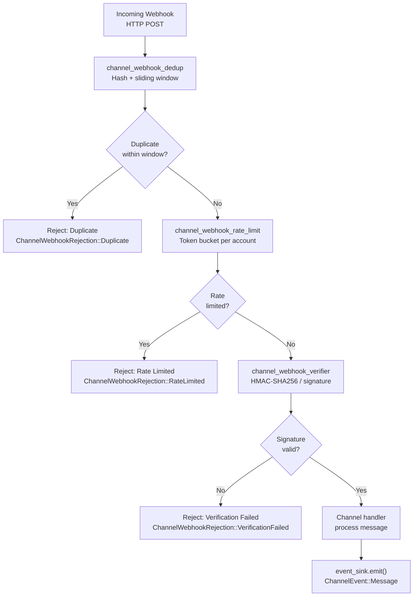

# Moltis Gateway — Central Hub

**The Gateway crate (128 files, 55K LOC) is the central nervous system of Moltis.** It does NOT contain domain logic — agents, channels, tools, and voice are separate crates. Instead, it provides the infrastructure that ties them together: a `Methods` registry for dispatch, a session/node registry for device pairing and state, channel lifecycle management (store, webhook dedup/rate-limit/verification), MCP service health monitoring, voice call orchestration, cron scheduling, and human-in-the-loop approval. HTTP transport (routes, middleware, WebSocket upgrade) lives in `moltis-httpd`; the Gateway is transport-agnostic.

Source: `crates/gateway/src/` — 128 files, 54,994 LOC

## Architecture

```mermaid
flowchart TD
    subgraph Transport["Transport Layer (moltis-httpd)"]
        HTTP["Axum HTTP Server<br/>routes, middleware, WebSocket"]
    end

    subgraph Gateway["Gateway"]
        Methods["methods.rs<br/>method_name → async fn()"]
        State["state.rs<br/>GatewayState: sessions, services, config"]
        Server["server.rs<br/>Build + start lifecycle"]
        Nodes["nodes.rs<br/>Node registry: paired devices"]
        SessionReg["session/ — session registry<br/>Create, find, bind to channels"]
        SessionTypes["session_types.rs<br/>User, Group, Channel, Scheduled"]
    end

    subgraph ChannelLayer["Channel Infrastructure"]
        ChannelStore["channel_store.rs<br/>Per-channel persistence"]
        ChannelEvents["channel_events.rs<br/>Event bus for channel state changes"]
        WebhookMW["channel_webhook_middleware<br/>Dedup, rate-limit, verification"]
        ChannelAgentTools["channel_agent_tools.rs<br/>Tools exposed to agents for channel ops"]
    end

    subgraph Services["Integrated Services"]
        MCP["mcp_service.rs<br/>MCP server health + agent bridge"]
        Voice["voice/ — voice call orchestration"]
        Cron["cron/ — scheduled task executor"]
        Approval["approval.rs<br/>Human-in-the-loop confirmation"]
        Broadcast["broadcast.rs<br/>Cross-channel announcements"]
    end

    HTTP --> Methods
    Methods --> State
    Methods --> ChannelStore
    Methods --> SessionReg
    Methods --> MCP & Voice & Cron & Approval
    ChannelEvents --> ChannelStore
    WebhookMW --> ChannelStore
```



## Webhook Middleware Pipeline



## Methods Registry — The Dispatch Hub

The `methods.rs` module is the single dispatch point for all domain operations:

```rust
// gateway/src/methods.rs (conceptual structure)
pub struct Methods {
    // Chat
    pub chat_send: ChatSendHandler,
    pub chat_history: ChatHistoryHandler,
    
    // Channels
    pub telegram_webhook: TelegramWebhookHandler,
    pub whatsapp_webhook: WhatsappWebhookHandler,
    pub discord_gateway: DiscordGatewayHandler,
    pub slack_events: SlackEventsHandler,
    pub signal_receive: SignalReceiveHandler,
    pub matrix_sync: MatrixSyncHandler,
    
    // Voice
    pub voice_call_start: VoiceCallStartHandler,
    pub voice_transcribe: VoiceTranscribeHandler,
    pub voice_synthesize: VoiceSynthesizeHandler,
    
    // Agents
    pub agent_run: AgentRunHandler,
    pub agent_stop: AgentStopHandler,
    pub agent_steer: AgentSteerHandler,
    
    // Sessions
    pub session_create: SessionCreateHandler,
    pub session_list: SessionListHandler,
    pub node_pair: NodePairHandler,
    
    // MCP
    pub mcp_list_tools: McpListToolsHandler,
    pub mcp_call_tool: McpCallToolHandler,
    
    // Provider
    pub provider_test: ProviderTestHandler,
    pub provider_discover: ProviderDiscoverHandler,
}
```

**Aha:** Methods is constructed at startup by passing `GatewayState` to each handler's constructor. Handlers are closures that capture the state they need — no global state, no static mutexes. Each crate's `register()` function adds its handlers to `Methods`:

```rust
// Conceptual registration from the agents crate:
pub fn register_agent_handlers(methods: &mut Methods, state: Arc<GatewayState>) {
    methods.agent_run = Box::new(move |req| {
        let state = state.clone();
        async move { agents::runner::handle_run(state, req).await }
    });
}
```

## Session Registry — Nodes, Pairing, State

The session system manages three concepts:

### Session Types

```rust
// gateway/src/session_types.rs
pub enum SessionType {
    User,       // A human user's conversation
    Group,      // Group chat (Telegram group, Discord server)
    Channel,    // Channel/broadcast (Telegram channel)
    Scheduled,  // Cron-triggered agent run
}
```

### Node Registry

```rust
// gateway/src/nodes.rs
pub struct NodeRegistry {
    nodes: HashMap<NodeId, NodeInfo>,  // Paired devices
    sessions: HashMap<SessionId, Session>,
}
```

Nodes are paired devices (phone, desktop, server). Each node has a unique ID, a device name, and a pairing status. Sessions are bound to nodes and channels:

```
Session { id, node_id, channel_type, chat_id, agent_config, created_at }
```

### Pairing Flow

```rust
// gateway/src/pairing.rs
// 1. New device generates a pairing code
// 2. Admin approves via existing paired device
// 3. New device receives session token
// 4. Token stored in device's secure enclave (iOS) or keyring
```

## Channel Infrastructure

### ChannelPlugin Trait (in channels crate)

```rust
// channels/src/plugin.rs:17-18
pub enum ChannelType {
    Telegram, Whatsapp, MsTeams, Discord, Slack,
    Matrix, Nostr, Signal, Telephony,
}

pub trait ChannelPlugin: Send + Sync {
    fn descriptor(&self) -> ChannelDescriptor;
    fn capabilities(&self) -> ChannelCapabilities;
}
```

### ChannelStore — Per-Channel Persistence

```rust
// gateway/src/channel_store.rs
pub struct ChannelStore {
    channels: HashMap<ChannelId, ChannelState>,
    // ChannelState tracks: enabled, connected, last_activity, error_count
}
```

### Webhook Middleware — Three Layers

```rust
// gateway/src/channel_webhook_middleware.rs
pub enum ChannelWebhookRejection {
    Duplicate(ChannelWebhookDedupeResult),   // Same payload seen recently
    RateLimited(ChannelWebhookRatePolicy),    // Too many requests
    VerificationFailed(String),              // Signature mismatch
}

pub trait ChannelWebhookVerifier {
    fn verify(&self, body: &[u8], headers: &HeaderMap) -> Result<VerifiedChannelWebhook>;
}
```

**Aha: Dedup is timestamp-based with a sliding window.** Each webhook payload is hashed. If the same hash appears within a configurable window (default: 60 seconds), it's rejected as a duplicate. This handles retry storms from upstream providers (Telegram redelivers webhooks up to 10 times if not acknowledged quickly enough).

### Telegram's classify_chat — Channel-Specific Heuristics

```rust
// channels/src/plugin.rs:63-85
pub fn classify_chat(&self, chat_id: &str) -> Option<String> {
    match self {
        Self::Telegram => {
            if chat_id.starts_with("-100") {
                Some("channel_or_supergroup".to_string())
            } else if chat_id.starts_with('-') {
                Some("group".to_string())
            } else {
                Some("private".to_string())
            }
        },
        Self::Signal => {
            if chat_id.starts_with("group:") { Some("group".to_string()) }
            else { Some("direct".to_string()) }
        },
        Self::Nostr => Some("dm".to_string()),
        Self::Telephony => Some("call".to_string()),
        _ => None,
    }
}
```

Each channel type knows how to classify its own chat IDs. Telegram uses ID prefixes (`-100` = channel/supergroup, `-` = group, anything else = private). Signal uses `group:` prefix. This classification feeds into the agent's prompt context so it knows whether it's in a private chat or a group.

### Secret Fields Per Channel

```rust
// channels/src/plugin.rs:88-100
pub fn secret_fields(&self) -> &'static [&'static str] {
    match self {
        Self::Telegram => &["token"],
        Self::Whatsapp => &[],
        Self::MsTeams => &["app_password", "webhook_secret"],
        Self::Discord => &["token"],
        Self::Slack => &["bot_token", "app_token", "signing_secret"],
        Self::Matrix => &["access_token", "password"],
        Self::Nostr => &["secret_key"],
        Self::Signal => &[],
        Self::Telephony => &["auth_token"],
    }
}
```

These fields are automatically redacted from logs and stored in the encrypted secret-store, never in plaintext config.

## Voice Call Orchestration

```rust
// gateway/src/voice/ (conceptual)
pub struct VoiceCallManager {
    stt_provider: Arc<dyn SttProvider>,
    tts_provider: Arc<dyn TtsProvider>,
    active_calls: HashMap<CallId, ActiveCall>,
}

struct ActiveCall {
    session_id: SessionId,
    stt_stream: SttStream,       // Incoming audio → text
    tts_queue: Vec<TtsChunk>,    // Outgoing text → audio
    agent_context: AgentContext,  // The agent handling this call
    dtmf_buffer: String,          // Touch-tone input
}
```

Voice calls follow this pipeline:
```
Incoming audio → STT → text → Agent Loop (LLM) → text → TTS → outgoing audio
```

## Human-in-the-Loop Approval

```rust
// gateway/src/approval.rs
pub struct ApprovalRequest {
    pub id: ApprovalId,
    pub session_id: SessionId,
    pub tool_name: String,
    pub tool_args: serde_json::Value,
    pub reason: String,            // Why approval is needed
    pub channel: ChannelType,
    pub timeout: Duration,
}

pub enum ApprovalDecision {
    Approve,
    Deny(String),  // Reason for denial
    Modify(serde_json::Value),  // Modified args
}
```

Approval requests are sent to the user's channel (Telegram message with Approve/Deny buttons). The agent pauses until a decision arrives or the timeout expires.

## Cross-References

- [Agent Loop](02-agent-loop.md) — How the Gateway dispatches agent runs
- [Channels](03-channels.md) — ChannelPlugin trait and per-channel implementations
- [Providers](04-providers.md) — LLM provider registry and capability detection
