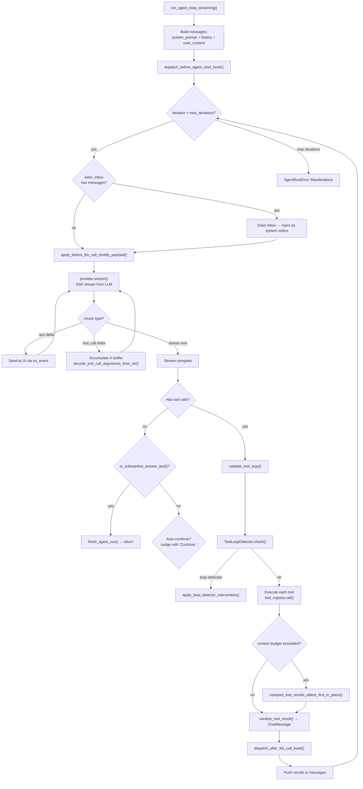

# Moltis Agent Loop — Streaming LLM Execution with Tools, Retry, and Loop Detection

**The agent loop is the core execution engine — it takes a system prompt, user content, tool registry, and LLM provider, then runs a loop of [LLM call → parse response → execute tools → feed results → repeat] until the LLM produces a final answer or the iteration limit is reached.** The default implementation (`run_agent_loop_streaming`) uses streaming to deliver text deltas to the UI as they arrive, buffering tool calls from the stream for batch execution after the stream completes. The loop includes retry with exponential backoff, tool result compaction when context windows overflow, loop detection via call fingerprinting, and a steer inbox for mid-flight human guidance.

Source: `crates/agents/src/runner/` — `mod.rs`, `streaming.rs`, `non_streaming.rs`, `retry.rs`, `helpers.rs`

## The Streaming Loop



## The Function Signature

```rust
// agents/src/runner/streaming.rs:85-115
pub async fn run_agent_loop_streaming_with_limits(
    provider: Arc<dyn LlmProvider>,
    tools: &ToolRegistry,
    system_prompt: &str,
    user_content: &UserContent,
    on_event: Option<&OnEvent>,           // UI callback: fn(RunnerEvent)
    history: Option<Vec<ChatMessage>>,     // Previous conversation turns
    tool_context: Option<serde_json::Value>, // Channel binding, session key, sender info
    hook_registry: Option<Arc<HookRegistry>>, // Before/after hooks
    sender_name: Option<String>,           // Channel sender display name
    steer_inbox: Option<SteerInbox>,       // Mid-flight /steer commands
    limits: AgentLoopLimits,               // max_iterations, max_tokens, etc.
) -> Result<AgentRunResult, AgentRunError>
```

### AgentLoopLimits

```rust
// agents/src/runner/helpers.rs
pub struct AgentLoopLimits {
    pub max_iterations: Option<usize>,   // Override config default
    pub max_tokens: Option<usize>,        // Hard token cap
    pub timeout: Option<Duration>,        // Wall-clock timeout
}
```

### AgentRunResult

```rust
pub struct AgentRunResult {
    pub messages: Vec<ChatMessage>,      // Full conversation history
    pub final_answer: Option<String>,     // Extracted final text
    pub usage: Usage,                     // Accumulated token usage
    pub tool_calls_made: usize,
    pub iterations: usize,
}
```

## Streaming Tool Call Accumulation

**Aha:** The LLM streams tool call arguments as partial JSON. The runner buffers them:

```rust
// agents/src/model/stream.rs — conceptual
// Gemini/Firebase-style: tool calls arrive as partial JSON chunks
// The runner accumulates these into complete ToolCall structs
fn decode_tool_call_arguments_from_str(
    accumulated_json: &str,
) -> Result<HashMap<String, serde_json::Value>> {
    // Parse the accumulated JSON string into structured arguments
    // Handles partial JSON that becomes valid when the stream completes
}
```

When the stream ends, accumulated tool calls are validated with `validate_tool_args()` against each tool's declared parameter schema before execution.

## Lazy Mode — 3× Iteration Budget

```rust
// agents/src/runner/streaming.rs:111-115
let max_iterations = if config.tools.registry_mode == ToolRegistryMode::Lazy {
    base_max_iterations * 3
} else {
    base_max_iterations
};
```

In lazy mode:
1. The LLM receives NO tool definitions in its system prompt
2. The LLM asks "what tools exist?" → `tool_search` is called
3. Matching tools are returned
4. The LLM calls the specific tools it needs
5. This costs 1 extra iteration per tool discovery but saves thousands of context-window tokens

## Tool Loop Detection

```rust
// agents/src/tool_loop_detector.rs
pub struct ToolLoopDetector {
    fingerprints: Vec<ToolCallFingerprint>,  // Ordered by recency
    window_size: usize,                       // Default: 10
    threshold: usize,                         // Default: 3
}

struct ToolCallFingerprint {
    tool_name: String,
    args_hash: u64,          // Hash of canonical JSON args
    iteration: usize,
}

impl ToolLoopDetector {
    pub fn check(&self, tool_name: &str, args: &serde_json::Value, iteration: usize) -> bool {
        let hash = hash_args(args);
        let count = self.fingerprints.iter()
            .filter(|f| f.tool_name == tool_name && f.args_hash == hash)
            .filter(|f| iteration - f.iteration < self.window_size)
            .count();
        count >= self.threshold  // Same tool + same args ≥ 3 times in 10 iterations = loop
    }
}
```

**Aha:** The fingerprint includes the TOOL ARGUMENTS, not just the tool name. `read_file("src/main.rs")` and `read_file("src/lib.rs")` are different fingerprints. But `replace_in_file("src/main.rs", "old", "new")` called identically 5 times triggers the loop detector.

When a loop is detected, `apply_loop_detector_intervention()` injects a system message: "You have called the same tool with the same arguments multiple times. This may indicate a loop. Consider a different approach."

## Token Budget and Compaction

```rust
// agents/src/runner/streaming.rs:100-105
let max_tool_result_bytes = config.tools.max_tool_result_bytes;
let compaction_ratio = config.tools.tool_result_compaction_ratio as usize;
let compaction_min_iterations = config.tools.compaction_min_iterations;
```

When tool results push the context over budget:
1. Oldest tool results are truncated to `compaction_ratio` of their original size
2. A placeholder message replaces truncated content: `[Content compacted — original: 15,432 bytes, compacted: 3,086 bytes]`
3. Only runs after `compaction_min_iterations` iterations (default: 5) to avoid compacting too early

## Retry Strategy

```rust
// agents/src/runner/retry.rs
const RATE_LIMIT_MAX_RETRIES: u32 = 5;

pub fn next_retry_delay_ms(attempt: u32) -> u64 {
    // Exponential backoff: 1s, 2s, 4s, 8s, 16s (capped at 30s)
    let base_ms = 1000u64;
    let delay = base_ms * 2u64.pow(attempt);
    delay.min(30_000)
}

pub fn is_context_window_error(error: &AgentRunError) -> bool {
    // Detects "context length exceeded" errors → trigger compaction, not retry
}

pub fn resolve_agent_max_iterations(configured: usize) -> usize {
    // Provider-specific caps: some models support more iterations than others
}
```

**Aha: Context window errors are NOT retried.** They trigger compaction instead. Retrying a context window overflow would just fail again — the only fix is to reduce the context size.

## Steer Inbox — Mid-Flight Guidance

```rust
// agents/src/runner/mod.rs:32
pub type SteerInbox = Arc<tokio::sync::Mutex<Vec<String>>>;

// In the loop (streaming.rs):
if let Some(inbox) = &steer_inbox {
    let mut pending = inbox.lock().await;
    if !pending.is_empty() {
        for msg in pending.drain(..) {
            messages.push(ChatMessage::system(format!(
                "[Steering guidance from user]: {}", msg
            )));
        }
    }
}
```

Users send `/steer use a different approach` via their messaging app. The gateway pushes this to the agent's steer inbox. On the next loop iteration, it's drained and injected as a system notice — the LLM sees it and adjusts behavior.

## Hooks — Before/After Extension Points

```rust
// agents/src/runner/streaming.rs — dispatch points:
dispatch_before_agent_start_hook(&hook_registry, &session_key, &channel);
// ... loop ...
dispatch_after_llm_call_hook(&hook_registry, &payload);

// Hook payload includes:
struct HookPayload {
    session_key: String,
    channel: Option<ChannelBinding>,
    iteration: usize,
    tool_calls: Vec<ToolCall>,
    tool_results: Vec<ToolResult>,
    usage: Usage,
}
```

Hooks are WASM or native plugins that intercept the agent lifecycle. They can modify tool calls, inject messages, or log metrics.

## Cross-References

- [Gateway](01-gateway.md) — How the Gateway dispatches agent runs
- [Providers](04-providers.md) — LlmProvider trait and model selection
- [Tools & Sandbox](05-tools-sandbox.md) — Tool registry, policy engine, WASM execution

## Next

→ [Channels](03-channels.md) — ChannelPlugin trait, webhook middleware, per-channel implementations.
