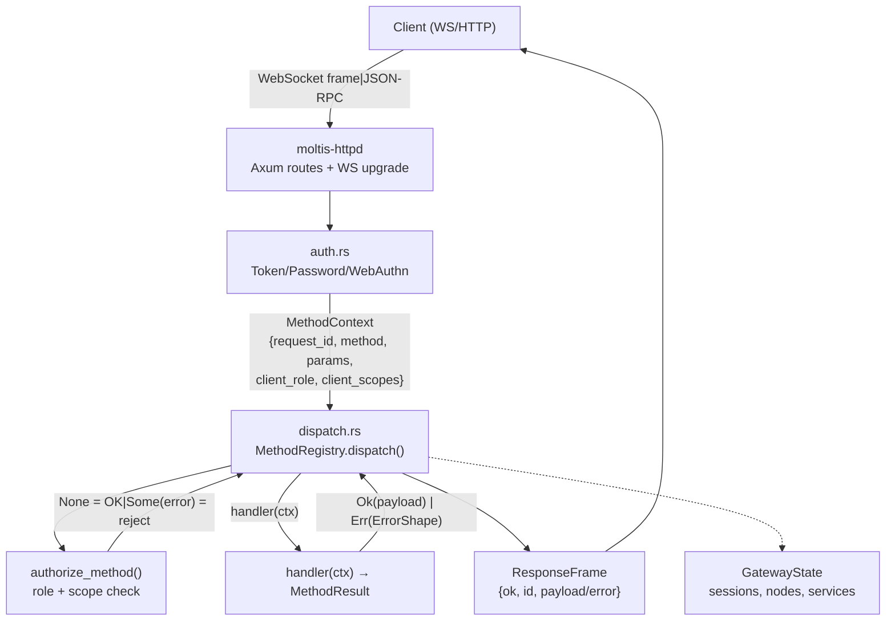
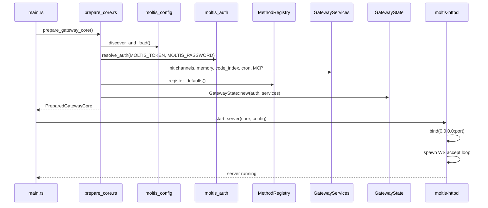

# Gateway: Central Hub Architecture

**The Gateway is Moltis's central dispatch engine.** It does not implement domain logic directly — instead, it holds a flat `MethodRegistry` of `method_name → async fn` handlers, and every domain concept (agents, voice, channels, MCP) registers its handlers at startup. This means adding a new channel requires zero gateway changes.

**Source:** `/home/darkvoid/Boxxed/@formulas/src.rust/src.AI/src.Moltis/moltis/crates/gateway/src/`

## Gateway Method Dispatch Architecture



## Gateway Startup Flow



## Method Registry: Scope-Based Authorization

**Source:** `methods/dispatch.rs:321-383`

The gateway uses scope-based authorization with five method categories:

| Category | Scope Required | Examples |
|----------|---------------|----------|
| `NODE_METHODS` | role = "node" | `node.invoke.result`, `node.event` |
| `APPROVAL_METHODS` | `operator.approvals` | `exec.approval.request`, `exec.approval.resolve` |
| `PAIRING_METHODS` | `operator.pairing` | `node.pair.request`, `node.pair.approve` |
| `READ_METHODS` | `operator.read` or `operator.write` | `health`, `sessions.list`, `models.list` |
| `WRITE_METHODS` | `operator.write` | `chat.send`, `agents.create`, `channels.add` |

```rust
// methods/dispatch.rs:321-383
pub fn authorize_method(method: &str, role: &str, scopes: &[String]) -> Option<ErrorShape> {
    // 1. NODE_METHODS: only "node" role can call
    if is_in(method, NODE_METHODS) {
        if role == "node" { return None; }
        return Some(ErrorShape::new(FORBIDDEN, format!("unauthorized role: {role}")));
    }
    // 2. Non-operator roles rejected
    if role == "node" || role != "operator" {
        return Some(ErrorShape::new(FORBIDDEN, format!("unauthorized role: {role}")));
    }
    // 3. Admin scope bypasses everything
    if has(scopes, s::ADMIN) { return None; }
    // 4. Category-specific scope checks
    if is_in(method, APPROVAL_METHODS) && !has(scopes, s::APPROVALS) { ... }
    if is_in(method, PAIRING_METHODS) && !has(scopes, s::PAIRING) { ... }
    if is_in(method, READ_METHODS) && !(has(scopes, s::READ) || has(scopes, s::WRITE)) { ... }
    if is_in(method, WRITE_METHODS) && !has(scopes, s::WRITE) { ... }
    // 5. Default: require admin
    Some(ErrorShape::new(UNAUTHORIZED, "missing scope: operator.admin"))
}
```

## Method Registration

**Source:** `methods/dispatch.rs:454-461`

The method registry auto-registers handlers from sub-modules at construction:

```rust
fn register_defaults(&mut self) {
    super::gateway::register(self);      // health, status, system-presence
    super::node::register(self);         // node.list, node.describe, node.invoke
    super::pairing::register(self);      // node.pair.*, device.pair.*
    super::services::register(self);     // services.* methods
    super::subscribe::register(self);    // subscribe, unsubscribe
    super::channel_mux::register(self);  // channel.join, channel.leave
}
```

Additional methods are registered by service initialization (agents, voice, MCP, channels, etc.) through `state.method_registry.register()`.

**Source:** `methods/gateway.rs:1-208` — registers `health`, `status`, `system-presence`, `system-event`, `system.describe`, `last-heartbeat`, `set-heartbeats`.

## Aha: Gateway is a Flat Method Dispatch, Not a Router

The Gateway does NOT have nested routes like `/api/v1/agents/create`. Instead, it holds a flat `MethodRegistry` — `method_name → async fn(Request) → Response`. When a Telegram webhook fires, the HTTPD layer routes it to `methods.handle()`, which calls `registry.dispatch(ctx)`. Every domain concept (agents, voice, channels, MCP) registers handlers into this flat registry at startup. Adding a new channel requires implementing `ChannelPlugin` and registering its webhook handler — zero gateway code changes. This is the "service bus" pattern: the gateway is dumb routing, domain logic lives in feature crates.

## Aha: `system.describe` for Protocol Schema Discovery

The gateway exposes `system.describe` (in `methods/gateway.rs:151-176`) which returns the protocol version, all registered method names, and all known event types. This is a schema discovery endpoint — clients can call it once on connect to know exactly what methods they can invoke, without needing out-of-band documentation. The method names are collected from `reg.method_names()` which iterates the live registry keys.

## Aha: Localhost Connections Skip Auth Entirely

In `methods/dispatch.rs`, the `is_local_connection()` check comes BEFORE any token or password validation. If the request originates from localhost (127.0.0.1 or ::1) AND there are no proxy headers (X-Forwarded-For, etc.), auth is completely bypassed. This means a local development setup requires zero credentials — just run the binary and connect. But the moment a reverse proxy sits in front, proxy headers are detected and auth becomes mandatory. See `crates/auth/src/locality.rs`.

## Aha: Five Scope-Based Authorization Categories

The authorization system in `authorize_method()` (`methods/dispatch.rs:321-383`) uses five distinct method categories with different scope requirements: `NODE_METHODS` require role="node", `APPROVAL_METHODS` require `operator.approvals` scope, `PAIRING_METHODS` require `operator.pairing`, `READ_METHODS` accept either `operator.read` or `operator.write`, and `WRITE_METHODS` require `operator.write`. The admin scope bypasses all checks. This means you can grant granular access — e.g., a monitoring user gets only `operator.read` to call `health` and `sessions.list` but cannot send messages.

## Key Gateway Modules

| Module | Purpose | Source |
|--------|---------|--------|
| `methods/dispatch.rs` | MethodRegistry, authorization, dispatch | `crates/gateway/src/methods/dispatch.rs` |
| `methods/gateway.rs` | health, status, system-presence, system.describe | `crates/gateway/src/methods/gateway.rs` |
| `channel_store.rs` | Per-channel state management | `crates/gateway/src/channel_store.rs` |
| `session.rs` | Session registry and lifecycle | `crates/gateway/src/session/` |
| `nodes.rs` | Multi-node coordination | `crates/gateway/src/nodes.rs` |
| `mcp_service.rs` | MCP server/client bridge | `crates/gateway/src/mcp_service.rs` |
| `channel_webhook_middleware.rs` | Dedup, rate-limit, verify | `crates/gateway/src/channel_webhook_middleware.rs` |
| `broadcast.rs` | WebSocket event broadcasting | `crates/gateway/src/broadcast.rs` |
| `state.rs` | GatewayState — all shared state | `crates/gateway/src/state.rs` |

## Next

Continue to [03-gateway-deep](03-gateway-deep.md) for the full gateway internals: 129 files, 55.6K LoC.
