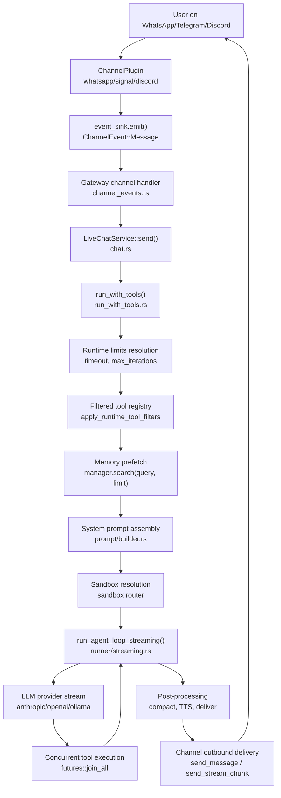
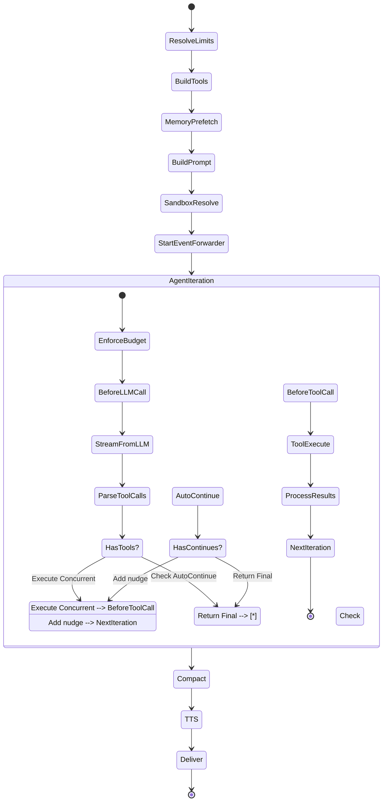

# Agents and Chat: How a Message Flows Through the System

This document explains the complete flow of a user message through Moltis: from the channel event, through prompt building, provider chain failover, streaming response, tool execution, and back to the user.

**Source:** `/home/darkvoid/Boxxed/@formulas/src.rust/src.AI/src.Moltis/moltis/crates/`

---

## System Architecture: Channel to Agent Loop



## Agent Loop State Machine



## Aha: Datetime Goes in User Message, Not System Prompt

The datetime is prepended to the **user message**, not the system prompt. This is deliberate — putting it in the system prompt would shift the position between turns and break the KV cache prefix matching. By keeping the system prompt stable across turns, Moltis maximizes KV cache hits for the system prompt tokens, reducing API costs and latency. See `agents/src/prompt/builder.rs:230-243` — `prepend_datetime_to_user_content()`.

## Aha: Tool Arguments Are Tracked Across Events for Persistence

The event forwarder tracks tool arguments in a `tool_args_map` during `ToolCallStart` events and uses them during `ToolCallEnd` to persist the complete tool call + result pair in the session store. This means the UI can show full tool call details (name + args + result) even though the events arrive separately. The alternative — sending the full payload in each event — would duplicate data across WebSocket messages. See `chat/src/run_with_tools.rs:272-400+`.

## Aha: `/sh` Command Forcing on First Iteration

If the user sends `/sh some_command` and the LLM doesn't call any tools, the agent loop has a fallback at `streaming.rs:353-357`: it creates an implicit `exec` tool call with the command from the `/sh` prefix. This only fires on iteration 1 when total_tool_calls == 0. It ensures shell commands always execute even if the model ignores the tool schema.

## Aha: Memory Prefetch Has a 10-Character Minimum Threshold

The memory prefetch in `run_with_tools.rs` only triggers for queries ≥ 10 characters that don't start with `/`. This is a cost optimization: greetings like "hi" or commands like "/help" are extremely unlikely to match any stored memory, so the embedding API call (typically $0.0001-0.001 per request) is saved. Only substantive user messages trigger the prefetch.

## Aha: All Tool Calls Run Concurrently via join_all

When the LLM returns multiple tool calls in a single response, Moltis executes ALL of them concurrently using `futures::future::join_all(tool_futures)`. There's no sequential ordering — if the model calls `exec("ls")`, `exec("pwd")`, and `glob("*.rs")` simultaneously, all three run in parallel. Results are processed in the original declaration order for deterministic message ordering. This means tool calls should be designed to be independent — if one tool's output affects another's input, the LLM must split them across iterations.

---

## The Complete Message Flow

When a user sends a message (e.g., on WhatsApp), here's exactly what happens:

```
WhatsApp message → Gateway handler → LiveChatService::send()
    ↓
run_with_tools() [chat/src/run_with_tools.rs]
    ↓
┌─ Step 1: Resolve runtime limits ──────────────────────────────────┐
│   - timeout_secs (from agent preset or global default)           │
│   - max_iterations (from agent preset or global default)         │
│   - Lazy mode? → triple max_iterations for tool_search discovery │
└────────────────────────────────────────────────────────────────────┘
    ↓
┌─ Step 2: Build filtered tool registry ────────────────────────────┐
│   - apply_runtime_tool_filters() removes disabled tools          │
│   - install_agent_scoped_memory_tools() adds memory tools        │
│   - Lazy mode? → wrap_registry_lazy() for on-demand discovery    │
└────────────────────────────────────────────────────────────────────┘
    ↓
┌─ Step 3: Memory prefetch ─────────────────────────────────────────┐
│   - If memory.prefetch_enabled AND query ≥ 10 chars:             │
│   - manager.search(query, prefetch_limit)                        │
│   - Inject results as <recalled_context> in system prompt        │
│   - Cache hit/miss/error recorded in metrics                     │
└────────────────────────────────────────────────────────────────────┘
    ↓
┌─ Step 4: Build system prompt ─────────────────────────────────────┐
│   - Identity: "You are {name} ({emoji}), {soul}."                │
│   - User: "The user is {user_name}."                             │
│   - Boot text (agent startup instructions)                        │
│   - Project context (workspace files)                            │
│   - Runtime context (datetime, sandbox state, node info)         │
│   - Tool schemas (JSON) or embedded in prompt (text mode)        │
│   - Memory context (recalled + persistent)                       │
│   - Guidelines (tool usage rules)                                │
│   - Voice reply suffix (if voice active)                         │
└────────────────────────────────────────────────────────────────────┘
    ↓
┌─ Step 5: Resolve sandbox mode ────────────────────────────────────┐
│   - Agent preset sandbox override:                               │
│     - "all" → force sandbox on                                   │
│     - "off" → force sandbox off                                  │
│     - "non-main" → sandbox non-main sessions only                │
│   - router.is_sandboxed(session_key)                             │
└────────────────────────────────────────────────────────────────────┘
    ↓
┌─ Step 6: Start event forwarder ───────────────────────────────────┐
│   - Spawn tokio task to forward RunnerEvents to UI               │
│   - Events: Thinking, TextDelta, ToolCallStart, ToolCallEnd      │
│   - Persist tool history pairs in session store                  │
│   - Deliver channel replies (WhatsApp, Slack, Discord, etc.)     │
└────────────────────────────────────────────────────────────────────┘
    ↓
┌─ Step 7: Call agent loop ─────────────────────────────────────────┐
│   run_agent_loop_streaming_with_limits()                         │
│   [agents/src/runner/streaming.rs]                               │
│                                                                  │
│   Iteration 1:                                                   │
│   - Build tool schemas for this turn                             │
│   - enforce_tool_result_context_budget()                         │
│   - BeforeLLMCall hook (can block or modify)                     │
│   - provider.stream_with_tools_and_options(messages, schemas)    │
│   - Accumulate text, reasoning, tool calls from SSE stream       │
│   - Parse tool call arguments from JSON                          │
│   - Fallback: parse from text, XML recovery, /sh forcing        │
│                                                                  │
│   If tool_calls found:                                           │
│   - Build futures for ALL tool calls                             │
│   - Pre-dispatch schema validation                               │
│   - BeforeToolCall hook                                          │
│   - futures::future::join_all(tool_futures)  ← CONCURRENT        │
│   - Process results in original order                            │
│   - Append [Tool: result] messages                               │
│   - Loop back to next iteration                                  │
│                                                                  │
│   If no tool calls:                                              │
│   - Auto-continue if model stopped early                         │
│   - Use last_answer_text fallback if needed                      │
│   - Return final text                                            │
└────────────────────────────────────────────────────────────────────┘
    ↓
┌─ Step 8: Post-processing ─────────────────────────────────────────┐
│   - Compact session if context exceeded                          │
│   - Generate TTS audio if voice active                           │
│   - Deliver final reply to channels                              │
│   - Persist assistant message in session store                   │
│   - Broadcast run complete to UI                                 │
└────────────────────────────────────────────────────────────────────┘
```

---

## Step 1: Runtime Limits

**Source:** `chat/src/run_with_tools.rs:93-102`

```rust
let runtime_limits = persona.config.agent_runtime_limits(agent_id);
// timeout_secs, max_iterations — resolved from agent preset or global defaults
```

Each agent preset can override:
- `timeout_secs` — max wall-clock time for the entire agent run
- `max_iterations` — max LLM call iterations

**Lazy mode triple:** When `registry_mode == Lazy`, `max_iterations *= 3` because tool_search needs extra round-trips to discover tools.

---

## Step 2: Filtered Tool Registry

**Source:** `chat/src/run_with_tools.rs:109-140`

```rust
let mut filtered_registry = {
    let registry_guard = tool_registry.read().await;
    if tools_enabled {
        apply_runtime_tool_filters(&registry_guard, &persona.config, skills, mcp_disabled, &policy_ctx)
    } else {
        registry_guard.clone_without(&[])
    }
};

// Add memory tools if memory manager exists
if tools_enabled && let Some(manager) = state.memory_manager() {
    install_agent_scoped_memory_tools(&mut filtered_registry, manager, provider, agent_id, ...);
}

// Wrap for lazy mode (on-demand tool discovery)
if tools_enabled && matches!(persona.config.tools.registry_mode, ToolRegistryMode::Lazy) {
    filtered_registry = moltis_agents::lazy_tools::wrap_registry_lazy(filtered_registry);
}
```

Three tool modes:
- **Native** — Tool schemas sent via API (Anthropic, OpenAI)
- **Text** — Tool schemas embedded in prompt, model calls tools via text
- **Off** — No tools, minimal prompt

---

## Step 3: Memory Prefetch

**Source:** `chat/src/run_with_tools.rs:143-195`

Before building the system prompt, query long-term memory:

```rust
if persona.config.memory.enable_prefetch {
    let query_text = match user_content {
        UserContent::Text(t) => Some(t.as_str()),
        UserContent::Multimodal(parts) => parts.iter().find_map(|p| match p {
            ContentPart::Text(t) => Some(t.as_str()),
            _ => None,
        }),
    };
    if let Some(query) = query_text
        && query.len() >= 10           // Skip very short queries
        && !query.starts_with('/')     // Skip commands
        && let Some(manager) = state.memory_manager()
    {
        let limit = persona.config.memory.prefetch_limit.clamp(1, 10);
        match manager.search(query, limit).await {
            Ok(results) if !results.is_empty() => {
                let recalled = format_recalled_context(&results);
                // Inject as <recalled_context> in system prompt
            },
            Ok(_) => { /* miss */ },
            Err(e) => { warn!("memory prefetch failed"); },
        }
    }
}
```

**Key detail:** Only queries ≥ 10 characters and not starting with `/` trigger prefetch. This avoids wasting resources on greetings and commands.

---

## Step 4: System Prompt Building

**Source:** `agents/src/prompt/builder.rs`

The system prompt is assembled from multiple sections:

```
"You are a helpful assistant. You can use tools when needed.\n\n"
"You are Moltis (🤖), a personal AI assistant.\n"
"The user is Alex.\n"
"# Boot\n{boot_text}\n"
"# Project Context\n{project_context}\n"
"# Runtime\nHost: linux, timezone: UTC\n"
"Sandbox(exec): enabled=true, home=/home/sandbox\n"
"# Tools\n{tool_schemas_as_json}\n"
"# Memory\n{memory_text}\n"
"# Guidelines\n- Start with normal conversational response...\n"
```

### Guidelines

```rust
// builder.rs:38-58
const TOOL_GUIDELINES: &str = concat!(
    "## Guidelines\n\n",
    "- Start with a normal conversational response. Do not call tools for greetings.\n",
    "- Use the calc tool for arithmetic.\n",
    "- Use the exec tool for shell/system tasks.\n",
    "- If the user starts with `/sh `, run it with `exec` exactly as written.\n",
    "- Use the browser tool for web pages.\n",
    "- For MCP servers, use `mcp__<server>__<tool>` tools.\n",
    "- Skills are not callable unless loaded with `read_skill`.\n",
    "- Before tool calls, briefly state what you are about to do.\n",
    "- For multi-step tasks, execute one step at a time.\n",
    "- Be careful with destructive operations, confirm with user first.\n",
    "- The UI already shows raw tool output. Summarize outcomes instead.\n",
    "- When you have nothing meaningful to add after a tool call, return empty.\n"
);
```

### Datetime Injection

The datetime is prepended to the **user message**, not the system prompt. This is deliberate — putting it in the system prompt would shift position between turns and break the KV cache prefix matching:

```rust
// builder.rs:230-243
pub fn prepend_datetime_to_user_content(user_content, runtime_context) -> Option<UserContent> {
    let datetime_text = runtime_datetime_message(runtime_context)?;
    // "[The current user datetime is 2026-07-03 14:30:00 UTC.]\n\n{text}"
}
```

---

## Step 5: Sandbox Resolution

**Source:** `chat/src/run_with_tools.rs:244-270`

```rust
let session_is_sandboxed = if let Some(router) = state.sandbox_router() {
    match preset.sandbox.mode {
        Some(PresetSandboxMode::All) => router.set_agent_override(session_key, true).await,
        Some(PresetSandboxMode::Off) => router.set_agent_override(session_key, false).await,
        _ => router.remove_agent_override(session_key).await,
    }
    router.is_sandboxed(session_key).await
} else { false };
```

The sandbox router decides whether `exec` runs in a container or on the host. Agent presets can override this.

---

## Step 6: Event Forwarder

**Source:** `chat/src/run_with_tools.rs:272-400+`

A tokio task forwards `RunnerEvent`s to the UI:

```rust
let (on_event, mut event_rx) = ordered_runner_event_callback();
let event_forwarder = tokio::spawn(async move {
    while let Some(event) = event_rx.recv().await {
        let payload = match event {
            RunnerEvent::Thinking => json!({"state": "thinking"}),
            RunnerEvent::ThinkingDone => json!({"state": "thinking_done"}),
            RunnerEvent::TextDelta(text) => json!({"text": text}),
            RunnerEvent::ToolCallStart { id, name, arguments, metadata } => {
                // Track args for later persistence
                tool_args_map.insert(id.clone(), arguments.clone());
                json!({"state": "tool_call_start", "tool": name, "args": arguments})
            },
            RunnerEvent::ToolCallEnd { id, result, duration_ms } => {
                // Persist tool history pair
                persist_tool_history_pair(&store, &sk, assistant_msg, tool_msg).await;
                // Send result to channels (WhatsApp, Slack, etc.)
                send_tool_result_to_channels(&sk, &id, &result).await;
                json!({"state": "tool_call_end", "result": result})
            },
            RunnerEvent::AutoContinue { iteration, max_iterations } => { ... },
            RunnerEvent::RetryingAfterError { error, delay_ms } => { ... },
        };
        broadcast(&state, "run.event", payload).await;
    }
});
```

**Key detail:** Tool arguments are tracked in `tool_args_map` during `ToolCallStart` and used during `ToolCallEnd` to persist the complete tool call + result pair in the session store.

---

## Step 7: Agent Loop

**Source:** `agents/src/runner/streaming.rs`

### The Core Loop

```rust
loop {
    iterations += 1;
    if iterations > max_iterations { return Err("exceeded max iterations"); }

    // 1. Build tool schemas (filtered by active tools)
    let schemas_for_api = ...;

    // 2. Compact old tool results if approaching context limit
    enforce_tool_result_context_budget(&mut messages, schemas_for_api, context_window, ratio, overflow)?;

    // 3. BeforeLLMCall hook — can block or modify messages
    dispatch_before_llm_call_hook(hooks, &payload)?;

    // 4. Stream from LLM
    let mut stream = provider.stream_with_tools_and_options(messages, schemas, tool_controls);

    // 5. Accumulate from stream
    while let Some(event) = stream.next().await {
        match event {
            Delta(text) => { accumulated_text += text; cb(TextDelta(text)); },
            ReasoningDelta(text) => { accumulated_reasoning += text; cb(ThinkingText(text)); },
            ToolCallStart { id, name, index } => { tool_calls.push(...); tool_call_args[index] = ""; },
            ToolCallArgumentsDelta { index, delta } => { tool_call_args[index] += delta; },
            Done(usage) => { request_usage = usage; },
            Error(msg) => { stream_error = Some(msg); break; },
        }
    }

    // 6. Parse tool call arguments
    for (idx, args_str) in &tool_call_args {
        tool_calls[vec_pos].arguments = decode_tool_call_arguments_from_str(args_str);
    }

    // 7. Fallback: if no structured tool calls, try text parsing
    if tool_calls.is_empty() && !accumulated_text.is_empty() {
        let (parsed, remaining) = parse_tool_calls_from_text(&accumulated_text);
        if !parsed.is_empty() { tool_calls = parsed; accumulated_text = remaining; }
    }

    // 8. Fallback: XML recovery for non-native providers
    if !native_tools && tool_calls.is_empty() {
        let (cleaned, recovered) = recover_tool_calls_from_content(&accumulated_text);
        if !recovered.is_empty() { tool_calls = recovered; accumulated_text = cleaned; }
    }

    // 9. Fallback: /sh command forcing
    if tool_calls.is_empty() && iterations == 1 && total_tool_calls == 0
        && let Some(command) = explicit_shell_command
    {
        tool_calls = vec![ToolCall { name: "exec", arguments: json!({"command": command}) }];
    }

    // 10. If no tool calls → return text
    if tool_calls.is_empty() {
        // Auto-continue if model stopped early
        if !is_substantive_answer_text(&accumulated_text) && total_tool_calls > 0
            && auto_continue_count < max_auto_continues
        {
            auto_continue_count += 1;
            messages.push(ChatMessage::user(AUTO_CONTINUE_NUDGE));
            continue;  // Ask model to keep going
        }
        return Ok(finish_agent_run(accumulated_text, iterations, total_tool_calls, usage));
    }

    // 11. Execute ALL tool calls CONCURRENTLY
    let tool_futures: Vec<_> = tool_calls.iter().map(|tc| {
        async move {
            // Schema validation
            let validation_error = validate_tool_args(&schema, &args);
            if let Some(err) = validation_error {
                return (false, json!({"error": err}), Some(err), true);
            }
            // BeforeToolCall hook
            dispatch_before_tool_call_hook(...)?;
            // Execute
            match tool.execute(args).await {
                Ok(val) => (true, json!({"result": val}), None, false),
                Err(e) => (false, json!({"error": e}), Some(e), false),
            }
        }
    }).collect();

    let results = futures::future::join_all(tool_futures).await;

    // 12. Process results in original order
    for (tc, (success, result, error, rejected)) in tool_calls.iter().zip(results) {
        if success {
            messages.push(ChatMessage::tool(tc.id.clone(), result));
        } else {
            messages.push(ChatMessage::tool(tc.id.clone(), json!({"error": error})));
        }
    }

    total_tool_calls += tool_calls.len();
    // Loop back to step 1
}
```

### Parallel Tool Execution

**All tool calls execute concurrently** via `futures::future::join_all(tool_futures)`. This means if the model calls `exec("ls")`, `exec("pwd")`, and `glob("*.rs")` in one turn, all three run in parallel and their results are collected together.

### Auto-Continue

If the model returns text without tool calls but had previously made tool calls, the system asks it to continue:

```rust
if !is_substantive_answer_text(&accumulated_text)
    && total_tool_calls > 0
    && total_tool_calls >= auto_continue_min_tool_calls
    && auto_continue_count < max_auto_continues
{
    auto_continue_count += 1;
    messages.push(ChatMessage::user("Please continue with the next step."));
    continue;
}
```

This handles cases where the model says "Let me do that..." then stops — the nudge tells it to actually execute the tools.

---

## Step 8: Post-Processing

**Source:** `chat/src/run_with_tools.rs` (end of function)

After the agent loop completes:

1. **Compact session** if context exceeded — `compact_session()` replaces old messages with summaries
2. **Generate TTS audio** if voice is active — `generate_tts_audio(final_text)`
3. **Deliver final reply** to channels — `deliver_channel_replies(session_key, final_text)`
4. **Persist assistant message** in session store
5. **Broadcast run complete** to UI — `broadcast(state, "run.complete", payload)`

---

## Chat Messages: The Data Model

**Source:** `agents/src/model/chat.rs`

```rust
pub enum ChatMessage {
    System { content: String },
    User { content: UserContent, name: Option<String> },
    Assistant { content: Option<String>, tool_calls: Vec<ToolCall>, reasoning: Option<String> },
    Tool { tool_call_id: String, content: String },
}

pub enum UserContent {
    Text(String),
    Multimodal(Vec<ContentPart>),  // text + images
}

pub enum ContentPart {
    Text(String),
    Image { media_type: String, data: String },  // base64
}
```

**Key design:** Metadata like `created_at`, `model`, `provider`, `inputTokens`, `outputTokens` does NOT exist here — so they can never leak into provider API requests. Metadata lives in the session store (JSONL).

---

## Provider Chain Failover

**Source:** `agents/src/provider_chain.rs`

When the primary provider fails, the chain tries fallbacks:

```
ProviderChain:
  1. Anthropic (Claude 3.5 Sonnet)  ← primary
  2. OpenAI (GPT-4o)                ← fallback 1
  3. Ollama (local qwen3.6)         ← fallback 2
```

### Circuit Breaker

Each provider has a circuit breaker:
- **Trips** after 3 consecutive failures
- **Resets** after 60 seconds cooldown
- **Skipped** when tripped — next provider in chain is tried

### Error Classification

| Error Type | Failover? | Why |
|-----------|-----------|-----|
| 429 Rate Limit | Yes | Temporary, next provider may work |
| 401 Auth Error | Yes | Bad key on this provider |
| 5xx Server Error | Yes | Provider is down |
| Billing Exhausted | Yes | Quota exceeded |
| Context Window | No | Will fail everywhere |
| Invalid Request | No | Bad format, will fail everywhere |

---

## Next

Continue to [04-channels](04-channels.md) for how channel events flow into the agent loop.
