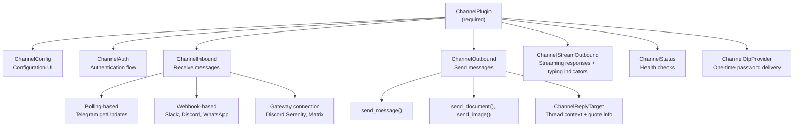
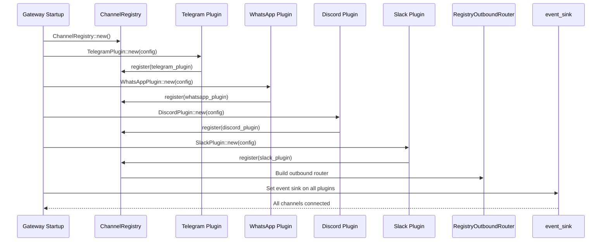

# Moltis Channels — The ChannelPlugin System

**Moltis connects AI agents to 9 messaging platforms through a trait-based plugin system.** The `ChannelPlugin` trait defines what every channel must provide; optional sub-traits (`ChannelConfig`, `ChannelAuth`, `ChannelInbound`, `ChannelOutbound`, `ChannelStreamOutbound`, `ChannelStatus`, `ChannelOtpProvider`) define what a channel CAN provide. Channels register with the `ChannelRegistry`, which validates trait bounds at registration and routes outbound messages through the `RegistryOutboundRouter`.

Source: `crates/channels/src/` — 14 files, `plugin.rs`, `registry.rs`, `channel_webhook_middleware.rs`

## The Trait Hierarchy



### ChannelPlugin — The Required Base

```rust
// channels/src/plugin.rs
pub trait ChannelPlugin: Send + Sync {
    fn descriptor(&self) -> ChannelDescriptor;
    fn capabilities(&self) -> ChannelCapabilities;
}

pub struct ChannelDescriptor {
    pub channel_type: ChannelType,
    pub display_name: &'static str,
    pub description: &'static str,
    pub supported_inbound_modes: Vec<InboundMode>,
}

pub struct ChannelCapabilities {
    pub supports_voice: bool,
    pub supports_documents: bool,
    pub supports_images: bool,
    pub supports_video: bool,
    pub supports_threading: bool,
    pub supports_reactions: bool,
    pub supports_otp: bool,             // Can deliver one-time passwords
    pub supports_interactive_buttons: bool,  // Inline keyboard / message components
    pub max_message_length: usize,
    pub max_file_size_bytes: usize,
}
```

### ChannelOutbound — Sending Messages

```rust
pub trait ChannelOutbound {
    async fn send_message(&self, target: &ChannelReplyTarget, text: &str) -> Result<()>;
    async fn send_document(&self, target: &ChannelReplyTarget, file: &SavedChannelFile) -> Result<()>;
    async fn send_image(&self, target: &ChannelReplyTarget, file: &SavedChannelFile, caption: Option<&str>) -> Result<()>;
}

pub struct ChannelReplyTarget {
    pub chat_id: String,
    pub thread_id: Option<String>,          // For threaded conversations
    pub reply_to_message_id: Option<String>, // Quote reply
    pub channel_binding: ChannelBinding,
}
```

### ChannelStreamOutbound — Typing Indicators

```rust
pub trait ChannelStreamOutbound {
    async fn start_stream(&self, target: &ChannelReplyTarget) -> Result<StreamSender>;
    async fn stop_stream(&self, target: &ChannelReplyTarget);
}

pub struct StreamSender {
    pub send_chunk: Box<dyn Fn(String) -> Result<()> + Send>,
    pub set_typing: Box<dyn Fn(bool) -> Result<()> + Send>,  // Show/hide typing indicator
}

pub enum StreamEvent {
    TextDelta(String),
    ToolCallStart { name: String },
    ToolCallEnd { result: String },
}
```

**Aha:** `set_typing()` is called with `true` when the LLM starts processing and `false` when it stops. This is the "..." typing indicator in Telegram/Discord/Slack — it tells the user the agent is working, not crashed. Without it, a 10-second tool execution feels like the agent hung.

## ChannelType — 9 Platforms

```rust
// channels/src/plugin.rs:14-28
#[derive(Debug, Clone, Copy, PartialEq, Eq, Hash, Serialize, Deserialize)]
#[serde(rename_all = "lowercase")]
#[non_exhaustive]
pub enum ChannelType {
    Telegram,
    Whatsapp,
    MsTeams,
    Discord,
    Slack,
    Matrix,
    Nostr,
    Signal,
    Telephony,
}
```

### FromStr — Flexible Input

```rust
// channels/src/plugin.rs:112-128
impl FromStr for ChannelType {
    fn from_str(s: &str) -> Result<Self, Self::Err> {
        match s {
            "telegram" => Ok(Self::Telegram),
            "whatsapp" => Ok(Self::Whatsapp),
            "msteams" | "microsoft_teams" | "microsoft-teams" | "teams" => Ok(Self::MsTeams),
            "discord" => Ok(Self::Discord),
            "slack" => Ok(Self::Slack),
            "matrix" | "element" => Ok(Self::Matrix),
            "nostr" => Ok(Self::Nostr),
            "signal" => Ok(Self::Signal),
            "telephony" | "phone" | "call" => Ok(Self::Telephony),
            _ => Err(Error::UnknownChannel(s.to_string())),
        }
    }
}
```

## Channel Registration and Event Routing



## Channel Registry

```rust
// channels/src/registry.rs
pub struct ChannelRegistry {
    channels: HashMap<ChannelType, Box<dyn ChannelPlugin>>,
    outbound_router: RegistryOutboundRouter,
}

impl ChannelRegistry {
    pub fn register(&mut self, plugin: Box<dyn ChannelPlugin>) -> Result<()> {
        let ct = plugin.descriptor().channel_type;
        // Validate: if capabilities say "supports_outbound", plugin MUST implement ChannelOutbound
        // Compile-time-like check at registration time
        self.channels.insert(ct, plugin);
        Ok(())
    }

    pub fn outbound_router(&self) -> &RegistryOutboundRouter {
        &self.outbound_router
    }
}

pub struct RegistryOutboundRouter {
    // Routes based on ChannelBinding → finds the right ChannelOutbound implementation
}
```

## Webhook Middleware — Three Defensive Layers

Every incoming webhook passes through three checks:

```rust
// channels/src/channel_webhook_middleware.rs
pub enum ChannelWebhookRejection {
    Duplicate(ChannelWebhookDedupeResult),
    RateLimited(ChannelWebhookRatePolicy),
    VerificationFailed(String),
}

pub trait ChannelWebhookVerifier {
    fn verify(&self, body: &[u8], headers: &HeaderMap) -> Result<VerifiedChannelWebhook>;
}

pub struct VerifiedChannelWebhook {
    pub channel_type: ChannelType,
    pub chat_id: String,
    pub payload: serde_json::Value,
    pub verified_at: Instant,
}

pub struct TimestampGuard {
    pub max_age: Duration,  // Default: 5 minutes. Older webhooks are rejected.
}
```

### Layer 1: Verification

Each channel has a different verification method:
- **Telegram:** SHA-256 HMAC of bot token + body
- **Slack:** `X-Slack-Signature` header (HMAC of signing secret + timestamp + body)
- **Discord:** Ed25519 signature verification of raw body
- **WhatsApp:** HMAC-SHA256 with app secret

### Layer 2: Deduplication

```rust
pub struct ChannelWebhookDedupeResult {
    pub is_duplicate: bool,
    pub original_timestamp: Option<Instant>,
    pub slide_window: Duration,  // Default: 60 seconds
}
```

Payload hash → check recent hashes → reject if seen within window. This handles Telegram's up-to-10× retry behavior.

### Layer 3: Rate Limiting

```rust
pub struct ChannelWebhookRatePolicy {
    pub max_per_window: usize,     // Default: 60
    pub window_duration: Duration, // Default: 60 seconds
    pub per_chat_id: bool,         // Track per-chat or global
}
```

## Media Download

```rust
// channels/src/media_download.rs
pub trait InboundMediaDownloader {
    async fn download(&self, source: &InboundMediaSource) -> Result<Vec<u8>>;
}

pub struct InboundMediaSource {
    pub channel_type: ChannelType,
    pub file_id: String,
    pub mime_type: Option<String>,
    pub file_size: Option<usize>,
    pub access_token: Option<String>,  // For channels that need auth for media
}
```

Downloads are authenticated (uses the channel's credentials), size-capped (configurable per channel), and cached locally.

## Interactive Messages

```rust
// channels/src/plugin.rs
pub struct InteractiveMessage {
    pub text: String,
    pub buttons: Vec<ButtonRow>,
}

pub struct ButtonRow {
    pub buttons: Vec<InteractiveButton>,
}

pub struct InteractiveButton {
    pub label: String,
    pub style: ButtonStyle,  // Primary, Secondary, Danger, Link
    pub action: String,       // Callback data sent back on click
}
```

Buttons are used for approval dialogs ("Approve" / "Deny") and choice prompts. Each channel renders them in its native format (Telegram inline keyboard, Discord message components, Slack block kit buttons).

## Per-Channel Implementations

| Channel | Crate | Transport | Key Feature |
|---------|-------|-----------|-------------|
| **Telegram** | `telegram` | Long-polling or webhook | classify_chat based on ID prefix |
| **WhatsApp** | `whatsapp` | Webhook via baileys | Linked Devices (no phone-as-server) |
| **Discord** | `discord` | Serenity gateway | Full gateway connection, slash commands |
| **Slack** | `slack` | Socket Mode or webhooks | Block Kit messages, interactive components |
| **Signal** | `signal` | signald/libsignal | E2E encryption handled by signald |
| **Matrix** | `matrix` | Homeserver client | Room-based, E2E via Olm/Megolm |
| **Nostr** | `nostr` | Relay client | DMs only, NIP-04 encrypted |
| **Telephony** | `telephony` | SIP/Twilio | Voice call handling, DTMF, transcription |
| **MSTeams** | `msteams` | Bot Framework | Adaptive Cards, team/channel scoping |

## Cross-References

- [Gateway](01-gateway.md) — How channels register with the Gateway
- [Agent Loop](02-agent-loop.md) — How channel messages become agent inputs
- [Voice](06-voice.md) — Telephony channel voice call pipeline

## Next

→ [Providers](04-providers.md) — LLM provider registry with model discovery and capability detection.
