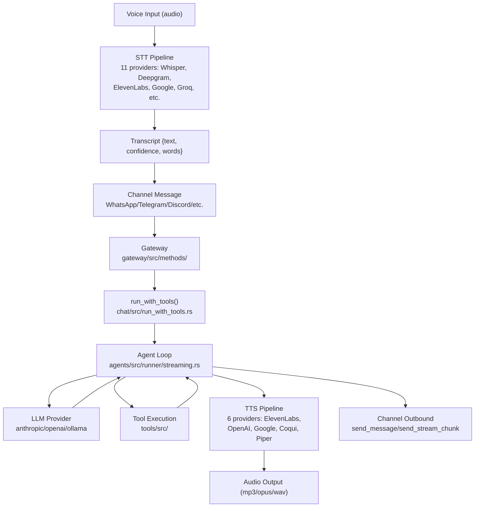
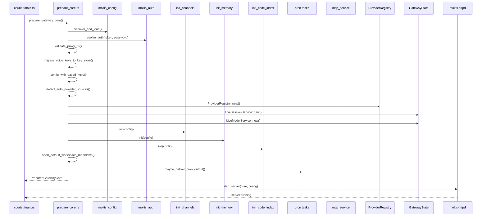

# Moltis Deep Dive: Voice, Channels, Agents, Providers, Native Apps

Comprehensive source-level documentation covering the full Moltis system: voice configuration with 11 STT and 6 TTS providers, channel implementations (WhatsApp via Linked Devices, Slack via webhooks, Discord via Serenity gateway), the agent loop with parallel tool execution, provider registry with 10+ providers, native iOS/macOS apps with FFI bridges, and the full startup sequence.

**Source:** `/home/darkvoid/Boxxed/@formulas/src.rust/src.AI/src.Moltis/moltis/`

---

## Full System Data Flow: Voice + Channel + Agent



## Gateway Startup: From Config to Running Server



## Aha: Gateway Startup is Transport-Agnostic

The `prepare_gateway_core()` function returns a `PreparedGatewayCore` that is completely transport-agnostic. It builds all state, services, and method handlers without knowing whether the transport will be HTTP, WebSocket, or FFI. The HTTP/WS server lives in `moltis-httpd` and takes the prepared core as input. This means the same gateway logic powers the server, the macOS app (via swift-bridge FFI), and any future transport layer. See `gateway/src/server/prepare_core.rs:600-653`.

## Aha: Voice API Keys Migrate to Credential Store at Startup

On every gateway startup, `migrate_voice_keys_to_key_store()` runs to migrate legacy voice API keys from the config file into the encrypted credential store. This means users who configured voice providers via environment variables or config files get automatic migration — their keys are securely stored without any manual action. See `gateway/src/server/prepare_core.rs` line 619.

## Aha: Workspace Markdown Is Seeded at Startup

The `seed_default_workspace_markdown_files()` call in `prepare_gateway_core()` creates initial markdown files in the workspace directory on first run. This means new Moltis installations get example documentation, project context, and agent boot texts pre-populated — the agent has content to work with from the very first message. See `gateway/src/server/prepare_core.rs`.

## Aha: Provider Auto-Detection Reads Environment Variables

The `detect_auto_provider_sources_with_overrides()` function scans environment variables (`OPENAI_API_KEY`, `ANTHROPIC_API_KEY`, `GROQ_API_KEY`, `GEMINI_API_KEY`, `OLLAMA_BASE_URL`) to automatically register providers without explicit config. If the user has set ANY explicit provider settings in their config file, auto-detection is skipped entirely — explicit config always wins. When `deploy_platform` is set (cloud deployment), local providers are hidden from the auto-detected list.

---

## Voice: 11 STT Providers, 6 TTS Providers

**Source:** `crates/voice/src/`

### STT (Speech-to-Text) — 11 Providers

| Provider | File | Type | Key Details |
|----------|------|------|-------------|
| **Whisper (API)** | `stt/whisper.rs` | Cloud | OpenAI Whisper API |
| **Whisper CLI** | `stt/whisper_cli.rs` | Local | CLI wrapper around `whisper.cpp` binary |
| **Whisper Local** | `stt/whisper_local.rs` | Local | Direct `whisper.cpp` library binding |
| **Deepgram** | `stt/deepgram.rs` | Cloud | Deepgram API, streaming support |
| **ElevenLabs** | `stt/elevenlabs.rs` | Cloud | ElevenLabs STT API |
| **Google** | `stt/google.rs` | Cloud | Google Cloud Speech-to-Text |
| **Groq** | `stt/groq.rs` | Cloud | Groq's Whisper-compatible API |
| **Mistral** | `stt/mistral.rs` | Cloud | Mistral's Whisper API |
| **Sherpa-ONNX** | `stt/sherpa_onnx.rs` | Local | ONNX runtime, offline |
| **Voxtral Local** | `stt/voxtral_local.rs` | Local | Local Voxtral model |
| **OpenAI-compat** | `stt/openai_compat.rs` | Cloud | Any OpenAI-compatible STT endpoint |

### SttProvider Trait

```rust
// stt/mod.rs:75-87
#[async_trait]
pub trait SttProvider: Send + Sync {
    fn id(&self) -> &'static str;
    fn name(&self) -> &'static str;
    async fn transcribe(&self, req: TranscribeRequest) -> Result<Transcript>;
}
```

### TranscribeRequest / Transcript

```rust
// stt/mod.rs:33-68
pub struct TranscribeRequest {
    pub audio: Bytes,                    // Raw audio data
    pub format: AudioFormat,             // Audio format
    pub language: Option<String>,        // ISO 639-1 hint (e.g. "en")
    pub prompt: Option<String>,          // Context/terminology guide
}

pub struct Transcript {
    pub text: String,                    // Transcribed text
    pub language: Option<String>,        // Detected language
    pub confidence: Option<f32>,         // 0.0 - 1.0
    pub duration_seconds: Option<f32>,   // Audio duration
    pub words: Option<Vec<Word>>,        // Word-level timestamps
}

pub struct Word {
    pub word: String,
    pub start: f32,                      // Start time (seconds)
    pub end: f32,                        // End time (seconds)
}
```

### TTS (Text-to-Speech) — 6 Providers

| Provider | File | Type | Key Details |
|----------|------|------|-------------|
| **ElevenLabs** | `tts/elevenlabs.rs` | Cloud | Default: Rachel voice, Flash v2.5 model (~75ms latency) |
| **OpenAI** | `tts/openai.rs` | Cloud | OpenAI TTS API |
| **Google** | `tts/google.rs` | Cloud | Google Cloud TTS |
| **Coqui** | `tts/coqui.rs` | Local | Coqui TTS, offline |
| **Piper** | `tts/piper.rs` | Local | Piper TTS, lightweight offline |
| **Mock** | `tts/mock.rs` | Test | Mock TTS for testing |

### TtsProvider Trait

```rust
// tts/mod.rs
#[async_trait]
pub trait TtsProvider: Send + Sync {
    fn id(&self) -> &'static str;
    fn name(&self) -> &'static str;
    async fn list_voices(&self) -> Result<Vec<Voice>>;
    async fn synthesize(&self, req: SynthesizeRequest) -> Result<AudioOutput>;
}
```

### ElevenLabs TTS Implementation

```rust
// tts/elevenlabs.rs:30-68
pub struct ElevenLabsTts {
    client: Client,
    api_key: Option<Secret<String>>,
    default_voice_id: String,    // Default: "21m00Tcm4TlvDq8ikWAM" (Rachel)
    default_model: String,       // Default: "eleven_flash_v2_5"
}
```

API endpoint: `POST https://api.elevenlabs.io/v1/text-to-speech/{voice_id}`

### AudioFormat

```rust
// tts/audio.rs:38-68
pub enum AudioFormat {
    Mp3,    // "audio/mpeg" — widely compatible
    Opus,   // "audio/ogg" — good for Telegram voice notes
    Aac,    // "audio/aac"
    Pcm,    // "audio/pcm" — raw
    Wav,    // "audio/wav"
    Webm,   // "audio/webm" — browser MediaRecorder default
}
```

### Voice Configuration in Config

```rust
// config schema (from config crate)
pub struct VoiceConfig {
    pub stt: SttConfig,
    pub tts: TtsConfig,
}

pub struct SttConfig {
    pub provider: SttProviderId,  // whisper, deepgram, google, groq, mistral, etc.
    pub whisper: Option<WhisperConfig>,
    pub whisper_local: Option<WhisperLocalConfig>,
    pub deepgram: Option<DeepgramConfig>,
    pub google: Option<GoogleSttConfig>,
    pub groq: Option<GroqSttConfig>,
    pub mistral: Option<MistralSttConfig>,
    pub elevenlabs: Option<ElevenLabsSttConfig>,
    pub sherpa_onnx: Option<SherpaOnnxConfig>,
    pub voxtral_local: Option<VoxtralLocalConfig>,
}

pub struct TtsConfig {
    pub provider: TtsProviderId,  // elevenlabs, openai, google, coqui, piper
    pub elevenlabs: Option<ElevenLabsConfig>,
    pub openai: Option<OpenAiTtsConfig>,
    pub google: Option<GoogleTtsConfig>,
    pub coqui: Option<CoquiTtsConfig>,
    pub piper: Option<PiperTtsConfig>,
}
```

### Voice Persona

```rust
// voice/src/config.rs
pub struct VoicePersona {
    pub name: String,
    pub provider: VoicePersonaProviderBinding,
    pub prompt: VoicePersonaPrompt,
}
```

---

## Channels: WhatsApp, Slack, Discord, Telegram, Signal, Matrix, MS Teams, Nostr, CalDAV

All channels implement the `ChannelPlugin` trait from `moltis_channels`:

```rust
// crates/channels/src/plugin.rs
#[async_trait]
pub trait ChannelPlugin: Send + Sync {
    fn channel_type(&self) -> ChannelType;
    fn register_account(&self, account_id: String, config: serde_json::Value) -> ChannelResult<()>;
    fn start_account(&self, account_id: &str, config: serde_json::Value) -> ChannelResult<()>;
    fn stop_account(&self, account_id: &str) -> ChannelResult<()>;
    fn outbound(&self) -> Arc<dyn ChannelOutbound>;
    fn status(&self, account_id: &str) -> ChannelResult<ChannelStatus>;
    fn probe(&self, account_id: &str) -> ChannelResult<ChannelHealthSnapshot>;
    fn supports_otp(&self) -> bool;
    // ... more methods
}
```

### WhatsApp: Linked Devices via QR Code Pairing

**Source:** `crates/whatsapp/src/`

```
whatsapp/
├── lib.rs              ← WhatsAppPlugin entry point
├── plugin.rs           ← ChannelPlugin implementation
├── connection.rs       ← Bot builder, event loop
├── handlers.rs         ← Event handling (messages, media, reactions)
├── outbound.rs         ← Message sending
├── config.rs           ← WhatsAppAccountConfig
├── access.rs           ← Access control
├── state.rs            ← AccountState, AccountStateMap
├── otp.rs              ← OTP challenges
├── memory_store.rs     ← In-memory store
└── sled_store.rs       ← Persistent sled store
```

#### Connection Setup

```rust
// connection.rs:17-87
pub async fn start_connection(
    account_id: String,
    config: WhatsAppAccountConfig,
    accounts: AccountStateMap,
    data_dir: PathBuf,
    message_log: Option<Arc<dyn MessageLog>>,
    event_sink: Option<Arc<dyn ChannelEventSink>>,
) -> Result<()> {
    // Persistent sled store at <data_dir>/whatsapp/<account_id>/
    let store_path = config.store_path
        .unwrap_or_else(|| data_dir.join("whatsapp").join(&account_id));

    let backend = Arc::new(SledStore::open(&store_path)?);

    let mut bot = whatsapp_rust::bot::Bot::builder()
        .with_backend(backend)
        .with_transport_factory(TokioWebSocketTransportFactory::new())
        .with_http_client(UreqHttpClient::new())
        .with_runtime(whatsapp_rust::TokioRuntime)
        .skip_history_sync()
        .with_device_props(Some("Moltis".to_string()), None, Some(PlatformType::Desktop))
        .with_push_name("Moltis")
        .on_event(move |event, client| {
            async move {
                if let Some(state) = state_ref.get() {
                    handlers::handle_event(event, client, state, accounts).await;
                }
            }
        })
        .build()
        .await?;
}
```

**Key details:**
- Uses `whatsapp_rust` library for Linked Devices protocol
- QR code pairing — session persists across restarts via sled store
- Registers as "Moltis" desktop device
- `skip_history_sync()` — doesn't download full message history

### Slack: Events API Webhooks

**Source:** `crates/slack/src/`

```
slack/
├── lib.rs              ← SlackPlugin entry point
├── plugin.rs           ← ChannelPlugin implementation
├── webhook.rs          ← Events API webhook handler
├── socket.rs           ← Socket Mode connection
├── outbound.rs         ← Message sending
├── commands.rs         ← Slash commands
├── markdown.rs         ← Slack markdown conversion
├── config.rs           ← SlackAccountConfig
├── state.rs            ← AccountState, AccountStateMap
└── channel_webhook_verifier.rs ← Webhook signature verification
```

#### Webhook Ingestion

```rust
// plugin.rs:58-66
pub async fn ingest_webhook(
    &self,
    account_id: &str,
    body: &[u8],
    timestamp: &str,
    signature: &str,
) -> ChannelResult<Option<String>> {
    crate::webhook::handle_webhook(account_id, body, timestamp, signature, &self.accounts).await
}

pub async fn ingest_interaction_webhook(
    &self,
    account_id: &str,
    body: &[u8],
    timestamp: &str,
    signature: &str,
) -> ChannelResult<()> {
    crate::webhook::handle_interaction_webhook(account_id, body, timestamp, signature, &self.accounts).await
}
```

Supports both Events API webhooks and Socket Mode.

### Discord: Serenity Gateway

**Source:** `crates/discord/src/`

```
discord/
├── lib.rs              ← DiscordPlugin entry point
├── plugin.rs           ← ChannelPlugin implementation
├── handler/
│   ├── mod.rs          ← Handler module
│   └── implementation.rs ← Serenity EventHandler
├── outbound.rs         ← Message sending
├── commands.rs         ← Slash commands
├── config.rs           ← DiscordAccountConfig
├── state.rs            ← AccountState, AccountStateMap
└── access.rs           ← Access control
```

#### Gateway Intents

```rust
// handler/implementation.rs:41-48
pub fn required_intents() -> GatewayIntents {
    GatewayIntents::GUILD_MESSAGES
        | GatewayIntents::DIRECT_MESSAGES
        | GatewayIntents::MESSAGE_CONTENT
        | GatewayIntents::GUILDS
        | GatewayIntents::GUILD_MESSAGE_REACTIONS
        | GatewayIntents::DIRECT_MESSAGE_REACTIONS
}
```

#### Serenity Handler

```rust
// handler/implementation.rs:51-66
pub struct Handler {
    pub account_id: String,
    pub accounts: AccountStateMap,
    downloader: DiscordInboundMediaDownloader,
}
```

Uses the `serenity` crate for Discord gateway connections.

### Other Channels

| Channel | Source | Connection Method |
|---------|--------|-------------------|
| Telegram | `crates/telegram/` | Bot API polling/webhooks |
| Signal | `crates/signal/` | Signal CLI / signald |
| Matrix | `crates/matrix/` | Matrix client-server API |
| MS Teams | `crates/msteams/` | Bot Framework API |
| Nostr | `crates/nostr/` | Nostr relay protocol |
| CalDAV | `crates/caldav/` | CalDAV protocol |

---

## Agent Loop: Parallel Tool Execution

**Source:** `crates/agents/src/runner/streaming.rs`

### The Core Loop

```rust
loop {
    iterations += 1;
    if iterations > max_iterations {
        return Err(AgentRunError::Other("agent loop exceeded max iterations"));
    }

    // 1. Build tool schemas (filtered by active tools)
    let schemas_for_api = ...;

    // 2. Enforce context budget (compact old tool results if needed)
    enforce_tool_result_context_budget(...)?;

    // 3. Dispatch BeforeLLMCall hook (can block or modify)
    dispatch_before_llm_call_hook(...)?;

    // 4. Stream from LLM provider
    let mut stream = provider.stream_with_tools_and_options(messages, schemas, tool_controls);

    // 5. Accumulate text, reasoning, and tool calls from stream
    while let Some(event) = stream.next().await { ... }

    // 6. Parse tool call arguments
    for (stream_idx, args_str) in &tool_call_args { ... }

    // 7. Fallback: parse tool calls from text if no structured calls
    if tool_calls.is_empty() { parse_tool_calls_from_text(...); }

    // 8. If no tool calls → return text answer (or auto-continue)
    if tool_calls.is_empty() { return Ok(final_text); }

    // 9. Execute ALL tool calls CONCURRENTLY
    let tool_futures: Vec<_> = tool_calls.iter().map(|tc| {
        // Pre-dispatch schema validation
        let validation_error = validate_tool_args(...);

        async move {
            if let Some(err) = validation_error {
                return (false, json!({"error": err}), Some(err), true);
            }
            // BeforeToolCall hook (can block or modify args)
            dispatch_before_tool_call_hook(...)?;
            // Execute tool
            match tool.execute(args).await {
                Ok(val) => (true, json!({"result": val}), None, false),
                Err(e) => (false, json!({"error": e}), Some(e), false),
            }
        }
    }).collect();

    // 10. Await ALL tools concurrently
    let results = futures::future::join_all(tool_futures).await;

    // 11. Process results in original order
    for (tc, (success, result, error, rejected)) in tool_calls.iter().zip(results) {
        messages.push(ChatMessage::tool(tc.id.clone(), result));
    }

    // 12. Loop back for next iteration
}
```

### Parallel Execution Details

```rust
// streaming.rs:689-891
let tool_futures: Vec<_> = tool_calls
    .iter()
    .map(|tc| {
        // Each tool call becomes an async future
        async move {
            // 1. Sanitize tool name
            let sanitized = sanitize_tool_name(&tc.name);

            // 2. Resolve tool from registry (handles legacy aliases)
            let (tool, resolved_name) = resolve_tool_lookup(tools, sanitized);

            // 3. Merge tool_context into args
            for (k, v) in ctx_obj { args_obj.insert(k.clone(), v.clone()); }

            // 4. Pre-dispatch schema validation (synchronous)
            let validation_error = validate_tool_args(&schema, &args);

            // 5. BeforeToolCall hook
            dispatch_before_tool_call_hook(...)?;

            // 6. Execute tool
            tool.execute(args).await

            // 7. AfterToolCall hook
            dispatch_after_tool_call_hook(...)?;
        }
    })
    .collect();

// ALL tools run concurrently
let results = futures::future::join_all(tool_futures).await;
```

### Auto-Continue

If the model stops making tool calls but hasn't finished its task:

```rust
// streaming.rs:590-616
if !is_substantive_answer_text(&accumulated_text)
    && total_tool_calls > 0
    && total_tool_calls >= auto_continue_min_tool_calls
    && auto_continue_count < max_auto_continues
{
    auto_continue_count += 1;
    messages.push(ChatMessage::user(AUTO_CONTINUE_NUDGE));
    continue;  // Ask model to keep going
}
```

### Tool Loop Detection

```rust
let mut loop_detector = ToolLoopDetector::new(
    config.tools.agent_loop_detector_window,
    config.tools.agent_loop_detector_strip_tools_on_second_fire,
);
```

On first detection: warn. On second detection: strip tools (force text-only response).

---

## Provider Registry: 10+ LLM Providers

**Source:** `crates/providers/src/`

### Provider Implementations

| Provider | File | Feature Flag | API |
|----------|------|-------------|-----|
| **Anthropic** | `anthropic.rs` | — | Messages API, SSE streaming |
| **OpenAI** | `openai.rs` | — | Chat Completions API |
| **OpenAI-compat** | `openai_compat.rs` | — | Any OpenAI-compatible endpoint |
| **Ollama** | `ollama.rs` | — | `/api/chat` endpoint |
| **Google GenAI** | `genai_provider.rs` | `provider-genai` | Google AI Studio API |
| **GitHub Copilot** | `github_copilot/` | `provider-github-copilot` | Copilot API |
| **Kimi Code** | `kimi_code.rs` | `provider-kimi-code` | Kimi API |
| **NearAI** | `nearai.rs` | — | NearAI API |
| **OpenCode Zen** | `opencode_zen.rs` | — | OpenCode Zen API |
| **Local GGUF** | `local_gguf/` | `local-llm` | llama-cpp-2, offline |
| **Local LLM** | `local_llm/` | `local-llm` | llama.cpp server |
| **OpenAI Codex** | `openai_codex/` | `provider-openai-codex` | Codex CLI API |

### Provider Registry

```rust
// registry.rs
pub struct ProviderRegistry {
    providers: HashMap<String, Box<dyn LlmProvider>>,
}
```

### Model Discovery

```rust
// discovered_model.rs
pub struct DiscoveredModel {
    pub id: String,
    pub name: String,
    pub provider: String,
    pub capabilities: ModelCapabilities,
}
```

### Model Capabilities

```rust
// model_capabilities.rs
pub struct ModelCapabilities {
    pub supports_tools: bool,
    pub supports_vision: bool,
    pub supports_reasoning: bool,
    pub context_window: usize,
    pub max_output_tokens: usize,
}
```

---

## Native Apps: iOS and macOS

### iOS App

**Source:** `apps/ios/Sources/MoltisApp.swift`

```swift
@main
struct MoltisApp: App {
    @StateObject private var authManager = AuthManager()
    @StateObject private var connectionStore = ConnectionStore()
    @StateObject private var settingsStore = SettingsStore()
    @StateObject private var locationSharingStore = LocationSharingStore()
    // ...
}
```

### macOS App

**Source:** `apps/macos/Sources/MoltisApp.swift`

```swift
@main
struct MoltisApp: App {
    @StateObject private var settings: AppSettings
    @StateObject private var chatStore: ChatStore
    @StateObject private var onboardingState: OnboardingState
    @StateObject private var providerStore: ProviderStore
    @StateObject private var logStore: LogStore
    @StateObject private var networkAuditStore: NetworkAuditStore

    init() {
        // Install Rust→Swift log bridge
        MoltisClient.installLogCallback(logStore: logStore)
        // Install Rust→Swift session event bridge
        MoltisClient.installSessionEventCallback(chatStore: chatStore)
        // Install Rust→Swift network audit bridge
        MoltisClient.installNetworkAuditCallback(store: networkAuditStore)
    }
}
```

### Swift Bridge

**Source:** `crates/swift-bridge/`

Three FFI bridges:
1. **Log callback** — Rust `tracing` logs → Swift `LogStore`
2. **Session event callback** — Gateway session events → Swift `ChatStore`
3. **Network audit callback** — Network audit events → Swift `NetworkAuditStore`

---

## Gateway Startup Sequence

**Source:** `crates/gateway/src/server/prepare_core.rs`

```rust
pub async fn prepare_gateway_core(
    bind: &str, port: u16, no_tls: bool, ...
) -> anyhow::Result<PreparedGatewayCore> {
    // 1. Apply directory overrides
    moltis_config::set_config_dir(dir);
    moltis_config::set_data_dir(dir);

    // 2. Resolve auth from environment
    let token = std::env::var("MOLTIS_TOKEN").ok();
    let password = std::env::var("MOLTIS_PASSWORD").ok();
    let resolved_auth = auth::resolve_auth(token, password);

    // 3. Load config (moltis.toml/.yaml/.json)
    let mut config = moltis_config::discover_and_load();

    // 4. Validate TLS/proxy configuration
    validate_proxy_tls_configuration(...)?;

    // 5. Migrate voice API keys to credential store
    #[cfg(feature = "voice")]
    crate::voice::migrate_voice_keys_to_key_store(&config);

    // 6. Merge saved API keys into provider config
    let effective_providers = config_with_saved_keys(...);

    // 7. Auto-detect providers from env vars
    let auto_detected = detect_auto_provider_sources_with_overrides(...);

    // 8. Build ProviderRegistry
    let provider_registry = ProviderRegistry::new(...);

    // 9. Initialize services (session, model, provider setup)
    let session_service = LiveSessionService::new(...);
    let model_service = LiveModelService::new(...);

    // 10. Initialize channels
    init_channels::init(&config, ...)?;

    // 11. Initialize memory
    init_memory::init(&config, ...)?;

    // 12. Initialize code index
    init_code_index::init(&config, ...)?;

    // 13. Seed workspace markdown files
    seed_default_workspace_markdown_files(...)?;

    // 14. Spawn background tasks (cron, update checks, MCP health)
    maybe_deliver_cron_output(...);

    // 15. Return PreparedGatewayCore (transport-agnostic)
    Ok(PreparedGatewayCore { state, ... })
}
```

---

## Crate Dependency Map

```
apps/courier (CLI entry point)
├── gateway (HTTP/WS server, RPC, MCP)
│   ├── agents (agent loop, streaming)
│   │   ├── providers (LLM providers)
│   │   └── tools (tool execution)
│   │       └── sandbox (Docker/Podman/WASM)
│   ├── channels (channel abstraction)
│   │   ├── telegram
│   │   ├── discord (serenity)
│   │   ├── slack (webhooks)
│   │   ├── whatsapp (whatsapp-rust)
│   │   ├── signal
│   │   ├── matrix
│   │   ├── msteams
│   │   ├── nostr
│   │   └── caldav
│   ├── chat (chat engine)
│   ├── memory (SQLite + FTS + vector)
│   ├── auth (credential store, WebAuthn)
│   ├── config (config loading, schema)
│   ├── voice (STT: 11 providers, TTS: 6 providers)
│   ├── mcp (MCP protocol)
│   ├── sessions (session management)
│   ├── projects (project management)
│   └── swift-bridge (Rust-Swift FFI)
├── ios (Swift app)
└── macos (Swift app)
```

## Next

Return to the [README](README.md) for the full index.
