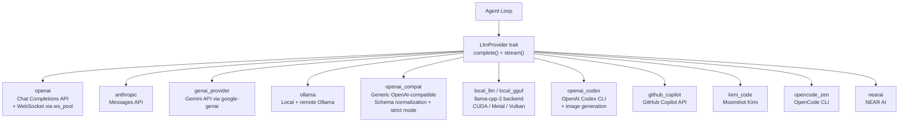

# Moltis Providers — LLM Backend Registry with Model Discovery

**The providers crate (57 files, 28K LOC) manages 10+ LLM backends behind a unified `LlmProvider` trait with automatic model discovery and capability detection.** Unlike adk-go's single `GenerateContent` method or goose's format-level backends, Moltis uses a trait with explicit `complete()` (non-streaming) and `stream()` (streaming) methods, a `ProviderRegistry` that fetches model lists from each provider's API, and a capability system that answers questions like "can this model do vision?", "does it support tools?", and "what's its context window?".

Source: `crates/providers/src/` — 57 files, 28,119 LOC

## Provider Backends



## The LlmProvider Trait

```rust
// providers/src/lib.rs — trait (conceptual, assembled from modules)
pub trait LlmProvider: Send + Sync {
    fn name(&self) -> &str;
    fn id(&self) -> &str;
    fn supports_tools(&self) -> bool;

    async fn complete(
        &self,
        messages: &[ChatMessage],
        tools: Option<&[Tool]>,
    ) -> Result<ChatMessage>;

    async fn stream(
        &self,
        messages: &[ChatMessage],
        tools: Option<&[Tool]>,
    ) -> Result<StreamHandle>;
}
```

### Streaming via WebSocket Pool

```rust
// providers/src/ws_pool.rs
pub struct WsPool {
    connections: HashMap<ProviderId, Vec<WsConnection>>,
    max_connections: usize,
}
```

**Aha:** WebSocket connections are pooled per provider. Multiple concurrent agent sessions share the same WebSocket to the LLM provider (where supported — notably OpenAI's realtime API). The pool manages connection lifecycle, health checks, and graceful reconnection.

## ProviderRegistry — Model Discovery

```rust
// providers/src/registry.rs
pub struct ProviderRegistry {
    providers: HashMap<String, Arc<dyn LlmProvider>>,
    models: HashMap<String, Vec<DiscoveredModel>>,
}

pub struct DiscoveredModel {
    pub id: String,
    pub display_name: String,
    pub context_window: usize,
    pub max_output_tokens: usize,
    pub capabilities: ModelCapabilities,
}

pub async fn fetch_discoverable_models(
    registry: &ProviderRegistry,
) -> RediscoveryResult {
    // Calls each provider's /models endpoint
    // Merges discovered models with fallback catalog
    // Returns { added, removed, changed } for diff display
}
```

### ModelCapabilities

```rust
// providers/src/model_capabilities.rs
pub struct ModelCapabilities {
    pub supports_chat: bool,
    pub supports_tools: bool,
    pub supports_vision: bool,
    pub supports_reasoning: bool,
    pub supports_streaming: bool,
}

pub fn context_window_for_model(model_id: &str) -> Option<usize> {
    // Lookup from discovered + fallback catalog
}

pub fn supports_tools_for_model(model_id: &str) -> bool { ... }
pub fn supports_vision_for_model(model_id: &str) -> bool { ... }
pub fn supports_reasoning_for_model(model_id: &str) -> bool { ... }
```

## Model ID Namespacing

```rust
// providers/src/model_id.rs
pub const MODEL_ID_NAMESPACE_SEP: &str = "/";
pub const REASONING_SUFFIX_SEP: &str = ":";
pub const REASONING_SUFFIXES: &[&str] = &["reasoning", "thinking"];

pub fn namespaced_model_id(provider: &str, model: &str) -> String {
    format!("{}{}{}", provider, MODEL_ID_NAMESPACE_SEP, model)
}
// → "openai/gpt-4o", "anthropic/claude-sonnet-4"

pub fn raw_model_id(namespaced: &str) -> &str {
    // "openai/gpt-4o" → "gpt-4o"
}

pub fn split_reasoning_suffix(model_id: &str) -> (&str, Option<&str>) {
    // "gpt-4o:reasoning" → ("gpt-4o", Some("reasoning"))
}
```

## OpenAI-Compatible Provider

```rust
// providers/src/openai_compat.rs
pub struct OpenAiCompatProvider {
    base_url: String,
    api_key: Secret<String>,
    model_id: String,
}

// Normalizes schemas from different OpenAI-compatible providers:
// - Ollama sends different finish_reason values
// - Some don't support tool_choice
// - Some have different error formats
// Strict mode: validate all responses against expected schema
```

## Local LLM — llama-cpp-2 Backend

```rust
// providers/src/local_llm (feature-gated)
pub struct LocalLlmProvider {
    model: llama_cpp::LlamaModel,
    context: llama_cpp::LlamaContext,
}

// Features:
// - GGUF model loading from HuggingFace (auto-download + cache)
// - CUDA, Metal (Apple Silicon), Vulkan acceleration
// - Jinja-compatible chat templates per model family
// - GBNF grammar generation for constrained tool-calling output
// - System info: auto-detect GPU/CPU/RAM for model sizing
```

### GBNF Tool Grammar

```rust
// providers/src/local_llm — conceptual
// When the local model needs to produce tool calls:
// 1. Generate a GBNF grammar from the tool schema
// 2. Constrain the model's output to match the grammar
// 3. Parse the grammatically-valid output as JSON
// This avoids the "invalid JSON from local models" problem
```

## ProviderChain — Fallback Routing

```rust
// agents/src/provider_chain.rs
pub struct ProviderChain {
    providers: Vec<Arc<dyn LlmProvider>>,
    current: usize,
    fallback_on_errors: bool,
}

impl LlmProvider for ProviderChain {
    async fn complete(&self, messages: &[ChatMessage], tools: Option<&[Tool]>) -> Result<ChatMessage> {
        for provider in &self.providers {
            match provider.complete(messages, tools).await {
                Ok(msg) => return Ok(msg),
                Err(e) if self.fallback_on_errors => continue,  // Try next provider
                Err(e) => return Err(e),
            }
        }
        Err(Error::AllProvidersFailed)
    }
}
```

## Cross-References

- [Agent Loop](02-agent-loop.md) — How the loop calls LlmProvider
- [Gateway](01-gateway.md) — Provider configuration and setup
- [Voice](06-voice.md) — STT/TTS providers (separate crate)

## Next

→ [Tools & Sandbox](05-tools-sandbox.md) — 30+ tool implementations with 6-layer policy engine.
