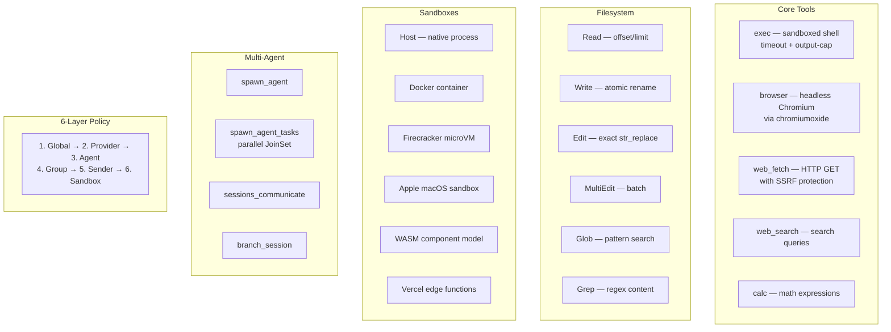
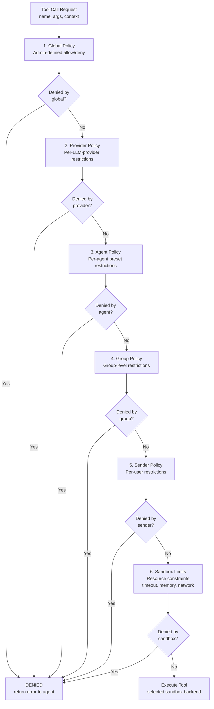

# Moltis Tools & Sandbox — 30+ Tools with Multi-Layered Policy

**The tools crate (90 files, 53K LOC) implements 30+ agent tools with a 6-layer policy engine that evaluates allow/deny at global, provider, agent, group, sender, and sandbox levels.** Each layer can only RESTRICT permissions — no layer can grant more access than the layers above it. Execution backends include native process spawning, Docker containers, Firecracker microVMs, Apple sandbox, WASM (wasmtime component model), and Vercel edge functions.

Source: `crates/tools/src/` — 90 files, 52,957 LOC

## Tool Catalog



## Policy Engine: Decision Flow



## The 6-Layer Policy Engine

```rust
// tools/src/policy.rs — conceptual
pub struct PolicyEngine {
    global: GlobalPolicy,
    providers: HashMap<ProviderId, ProviderPolicy>,
    agents: HashMap<AgentId, AgentPolicy>,
    groups: HashMap<GroupId, GroupPolicy>,
    senders: HashMap<SenderId, SenderPolicy>,
    sandbox: SandboxLimits,
}

impl PolicyEngine {
    pub fn check(&self, tool: &str, ctx: &ToolContext) -> PolicyDecision {
        // Each layer is checked in order. First Deny wins.
        // No layer can grant more access than the layers above it.
        if let Some(d) = self.global.check(tool, ctx)   { return Denied(d); }
        if let Some(d) = self.providers.get(&ctx.provider).and_then(|p| p.check(tool)) {
            return Denied(d);
        }
        // ... layers 3-5
        if let Some(d) = self.sandbox.check(tool, ctx)  { return Denied(d); }
        Allowed
    }
}
```

**Aha:** The policy engine is purely RESTRICTIVE. Even if agent configuration grants `exec`, the global policy can deny it. This provides defense-in-depth — a misconfigured agent can't escalate beyond what the admin allows.

## Sandbox Backends

| Backend | Isolation | Latency | Use Case |
|---------|-----------|---------|----------|
| **Host** | Process only | ~1ms | Trusted code, file ops |
| **Docker** | Container | ~500ms | Untrusted code, network isolation |
| **Firecracker** | microVM (KVM) | ~125ms | Multi-tenant, strong isolation |
| **Apple** | macOS seatbelt | ~1ms | Native macOS sandbox |
| **WASM** | wasmtime component model | ~1ms | Cross-platform, deterministic |

### WASM Component Model

**Aha:** WASM tools use the component model with WIT (Wasm Interface Type) declarations. The host validates WIT at load time — a tool claiming `wasi:http/outgoing-handler` without the `network` permission is rejected before any code executes.

## Agent Tools — Parallel Sub-Agent Spawning

```rust
// tools/src/spawn_agent_tasks.rs — conceptual
async fn execute(args: Vec<SpawnTaskArgs>, ctx: &ToolContext) -> Result<String> {
    let mut joinset = JoinSet::new();
    for task in args {
        let tools = ctx.tool_registry.restrict(task.allowed_tools);
        joinset.spawn(async move {
            run_agent_loop(task.prompt, tools, task.provider).await
        });
    }
    // Collect all results, merge into single response
    let results: Vec<_> = joinset.join_all().await;
    format_results(results)
}
```

N sub-agents run concurrently via `tokio::task::JoinSet`. Each gets an independent tool set and conversation context. The parent LLM only sees aggregated results — sub-agent tool calls don't consume the parent's context window.

## Cross-References

- [Agent Loop](02-agent-loop.md) — How the loop dispatches tool execution
- [Gateway](01-gateway.md) — Approval flow for dangerous tools

## Next

→ [Voice](06-voice.md) — 11 STT + 6 TTS providers for telephony.
