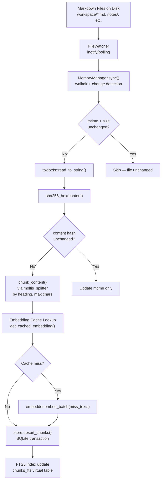
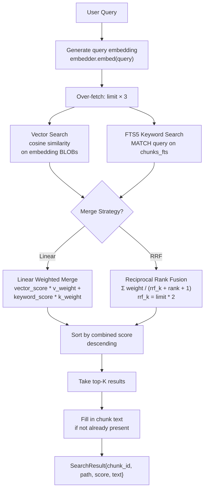

# Memory: Markdown Files → Chunks → Embeddings → SQLite Search

This document explains how Moltis manages long-term memory: file watching, chunking, embedding generation, hybrid search (FTS5 + vector similarity), and memory tools exposed to the agent.

**Source:** `/home/darkvoid/Boxxed/@formulas/src.rust/src.AI/src.Moltis/moltis/crates/memory/src/`

---

## Memory Ingestion Pipeline



## Hybrid Search: FTS5 + Vector + RRF Merge



## Aha: Content Hash Fast Path — mtime and Size Before Read

The sync algorithm has a two-level fast path. First, it checks if `mtime` and `size` are unchanged — if so, it skips reading the file entirely. Second, if mtime changed but the SHA-256 content hash is the same (e.g., file was touched but not modified), it only updates the mtime record without re-chunking or re-embedding. This means touching files doesn't trigger expensive re-indexing. See `memory/src/manager.rs:229-254`.

## Aha: Embedding Cache Prevents Redundant API Calls

Moltis caches embeddings by `(provider_key, model, chunk_hash)` tuples. When a file's content hash is the same as a previously indexed chunk, the embedding is looked up from the cache instead of calling the embedding API. The cache has a 50,000-row LRU eviction limit. This means if you re-index the same content with a different embedding provider, the old embeddings are reused until the cache fills up. See `manager.rs:294-338` and `CACHE_MAX_ROWS = 50_000`.

## Aha: RRF Merging Avoids Score Magnitude Problems

The memory system offers two merge strategies: `Linear` (weighted sum of raw scores) and `Rrf` (Reciprocal Rank Fusion). RRF is rank-based and score-magnitude-agnostic — it avoids the problem where vector cosine similarity (0.0-1.0) and FTS5 BM25 scores (potentially large numbers) have incompatible scales. The RRF formula is `score = Σ weight / (rrf_k + rank + 1)` where `rrf_k = limit * 2`. When one result set has wildly different score magnitudes, RRF produces more stable rankings than linear weighting. See `search.rs:177-218`.

## Aha: FTS5 Query Sanitization Prevents Syntax Errors from Numbers

The `sanitize_fts5_query()` function (`store_sqlite.rs`) strips non-alphanumeric characters from query tokens and wraps each in quotes. This prevents a query like "version 37.759" from producing `"fts5: syntax error near '.'"` — the dots in version numbers, IP addresses, or decimal values would otherwise break FTS5's query parser. Each cleaned token becomes a phrase search `"token"` so partial matches still work.

## Aha: Stale File Reconciliation Skips When Counts Match

The memory sync algorithm has an optimization: if the DB file count matches the discovered file count AND nothing was updated, it skips the full stale-file reconciliation. This avoids iterating the entire file list on every sync when nothing has changed. See `memory/src/manager.rs:156-176`.

---

## Memory Flow

```
Files on disk (workspace/*.md, notes/, etc.)
    ↓
FileWatcher detects changes (create/modify/delete)
    ↓
Chunker splits file into chunks (by heading, max chars)
    ↓
EmbeddingProvider generates vector for each chunk
    ↓
SqliteMemoryStore stores: files table + chunks table (with embedding BLOB)
    ↓
Agent query → manager.search(query, limit)
    ↓
1. FTS5 search on chunk text (keyword match)
2. Vector search on embeddings (semantic similarity)
3. Hybrid merge with recency boost
    ↓
Results injected as <recalled_context> in system prompt
```

---

## File Tracking

**Source:** `store_sqlite.rs`

### Files Table

```sql
CREATE TABLE files (
    path TEXT PRIMARY KEY,
    source TEXT,          -- "workspace", "notes", etc.
    hash TEXT,            -- content hash for change detection
    mtime INTEGER,        -- last modified timestamp
    size INTEGER          -- file size in bytes
);
```

### Chunks Table

```sql
CREATE TABLE chunks (
    id TEXT PRIMARY KEY,
    path TEXT,            -- FK to files.path
    source TEXT,
    start_line INTEGER,
    end_line INTEGER,
    hash TEXT,
    model TEXT,           -- embedding model name
    text TEXT,            -- chunk text
    embedding BLOB,       -- f32 vector as little-endian bytes
    updated_at INTEGER
);

-- FTS5 virtual table for full-text search
CREATE VIRTUAL TABLE chunks_fts USING fts5(text, content='chunks', content_rowid='rowid');
```

---

## Chunking

**Source:** `chunker.rs`

The chunker splits files into manageable pieces for embedding:

```rust
pub fn chunk_text(text: &str, max_chunk_size: usize) -> Vec<Chunk> {
    // Split by headings first, then by max_chunk_size
    // Each chunk tracks start_line, end_line for source reference
}
```

---

## Embeddings

**Source:** `embeddings.rs`, `embeddings_local.rs`, `embeddings_openai.rs`

### EmbeddingProvider Trait

```rust
#[async_trait]
pub trait EmbeddingProvider: Send + Sync {
    async fn embed(&self, texts: Vec<String>) -> Result<Vec<Vec<f32>>>;
}
```

### Local Embeddings (llama-cpp-2)

**Source:** `embeddings_local.rs`

```rust
#[cfg(feature = "local-embeddings")]
#[allow(unsafe_code)]  // FFI wrappers for llama-cpp-2
pub struct LocalEmbeddingProvider {
    model: Arc<Mutex<Model>>,
    dimensions: usize,
}
```

Uses `llama-cpp-2` with unsafe FFI wrappers. The `unsafe` is isolated to FFI boundaries only.

### OpenAI Embeddings

**Source:** `embeddings_openai.rs`

```rust
pub struct OpenAIEmbeddingProvider {
    client: Client,
    api_key: Secret<String>,
    model: String,  // "text-embedding-3-small"
}
```

### Batch Embedding

**Source:** `embeddings_batch.rs`

Batches embedding requests for efficiency — groups multiple texts into a single API call.

### Fallback Embedding

**Source:** `embeddings_fallback.rs`

Falls back to alternative provider if primary fails — same pattern as the LLM provider chain.

---

## SQLite Store

**Source:** `store_sqlite.rs`

### Vector Storage

Embeddings are stored as little-endian BLOBs:

```rust
fn vec_to_blob(v: &[f32]) -> Vec<u8> {
    v.iter().flat_map(|f| f.to_le_bytes()).collect()
}

fn blob_as_f32_slice(blob: &[u8]) -> Cow<'_, [f32]> {
    match bytemuck::try_cast_slice(blob) {
        Ok(slice) => Cow::Borrowed(slice),  // Zero-copy if aligned
        Err(_) => {
            // Fall back to byte-by-byte deserialization
            blob.chunks_exact(4).map(|c| f32::from_le_bytes([...])).collect()
        }
    }
}
```

### Cosine Similarity

```rust
fn cosine_similarity(a: &[f32], b: &[f32]) -> f32 {
    let mut dot = 0.0;
    let mut norm_a = 0.0;
    let mut norm_b = 0.0;
    for (x, y) in a.iter().zip(b.iter()) {
        dot += x * y;
        norm_a += x * x;
        norm_b += y * y;
    }
    let denom = norm_a.sqrt() * norm_b.sqrt();
    if denom == 0.0 { 0.0 } else { dot / denom }
}
```

### FTS5 Query Sanitization

```rust
fn sanitize_fts5_query(query: &str) -> String {
    // FTS5 has special chars: . * " + - ( ) NEAR OR AND NOT
    // "37.759" would cause "fts5: syntax error near '.'"
    // Strategy: split on whitespace, strip non-alphanumeric, wrap in quotes
    query.split_whitespace()
        .filter_map(|token| {
            let cleaned: String = token.chars().filter(|c| c.is_alphanumeric() || *c == '_').collect();
            if cleaned.is_empty() { None } else { Some(format!("\"{cleaned}\"")) }
        })
        .collect::<Vec<_>>()
        .join(" ")
}
```

### Hybrid Search

```rust
async fn search(&self, query: &str, limit: usize) -> Result<Vec<SearchResult>> {
    // 1. FTS5 search (keyword match)
    let fts_results = self.fts5_search(sanitize_fts5_query(query), limit * 2).await?;

    // 2. Generate query embedding
    let query_embedding = self.embedding_provider.embed(vec![query.to_string()]).await?;

    // 3. Vector search (cosine similarity)
    let vector_results = self.vector_search(&query_embedding[0], limit * 2).await?;

    // 4. Hybrid merge with recency boost
    let merged = hybrid_merge(fts_results, vector_results, limit);
    Ok(merged)
}
```

### Top-K Min-Heap

```rust
struct ScoredResult { score: f32, result: SearchResult }

impl Ord for ScoredResult {
    fn cmp(&self, other: &Self) -> Ordering {
        // Reverse order: smallest score at top (min-heap)
        other.score.partial_cmp(&self.score).unwrap_or(Equal)
    }
}
```

Uses a `BinaryHeap<ScoredResult>` to maintain top-K results efficiently — evict the worst candidate when heap exceeds limit.

---

## Memory Manager

**Source:** `manager.rs`

```rust
pub struct MemoryManager {
    store: Box<dyn MemoryStore>,
    embedding_provider: Box<dyn EmbeddingProvider>,
    chunker: Chunker,
}

impl MemoryManager {
    pub async fn search(&self, query: &str, limit: usize) -> Result<Vec<SearchResult>> {
        self.store.search(query, limit).await
    }

    pub async fn ingest_file(&self, path: &Path) -> Result<()> {
        let text = tokio::fs::read_to_string(path).await?;
        let chunks = self.chunker.chunk(&text);
        let embeddings = self.embedding_provider.embed(chunks.iter().map(|c| c.text.clone()).collect()).await?;
        // Store chunks with embeddings
        Ok(())
    }
}
```

---

## Memory Tools

**Source:** `tools.rs`

Memory operations exposed as agent tools:

```json
{
  "name": "memory_search",
  "parameters": {
    "query": { "type": "string" },
    "limit": { "type": "integer", "default": 5 }
  }
}

{
  "name": "memory_save",
  "parameters": {
    "content": { "type": "string" },
    "title": { "type": "string" }
  }
}

{
  "name": "memory_forget",
  "parameters": {
    "id": { "type": "string" }
  }
}
```

---

## Memory Prefetch in Agent Loop

**Source:** `chat/src/run_with_tools.rs:143-195`

Before building the system prompt, the agent loop queries memory:

```rust
if persona.config.memory.enable_prefetch {
    let query_text = match user_content {
        UserContent::Text(t) => Some(t.as_str()),
        UserContent::Multimodal(parts) => parts.iter().find_map(|p| match p {
            ContentPart::Text(t) => Some(t.as_str()), _ => None,
        }),
    };
    if let Some(query) = query_text
        && query.len() >= 10           // Skip very short queries
        && !query.starts_with('/')     // Skip commands
        && let Some(manager) = state.memory_manager()
    {
        let limit = persona.config.memory.prefetch_limit.clamp(1, 10);
        match manager.search(query, limit).await {
            Ok(results) if !results.is_empty() => {
                let recalled = format_recalled_context(&results);
                // Inject as <recalled_context> in system prompt
            },
            Ok(_) => { /* miss */ },
            Err(e) => { warn!("memory prefetch failed"); },
        }
    }
}
```

---

## File Watcher

**Source:** `watcher.rs`

```rust
#[cfg(feature = "file-watcher")]
pub struct MemoryFileWatcher {
    watcher: RecommendedWatcher,
    manager: Arc<MemoryManager>,
}
```

Watches workspace files for changes and automatically re-ingests modified files.

---

## Next

Continue to [07-native-apps](07-native-apps.md) for the iOS and macOS apps.
