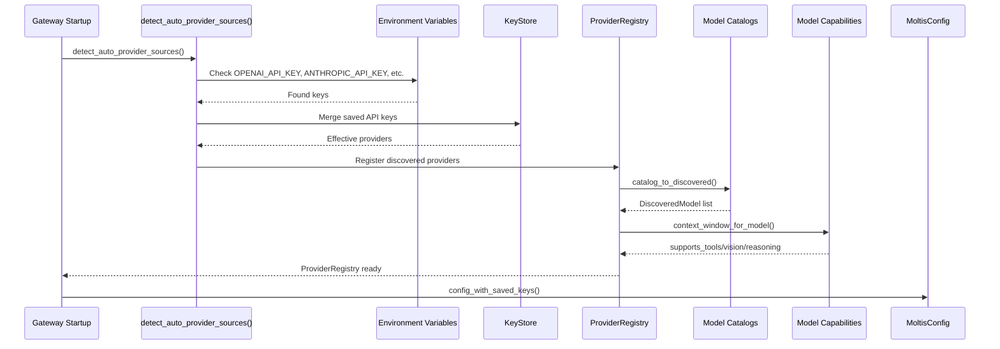

# Providers Deep Dive: LLM Implementations and Registry

The providers crate implements connections to 10+ LLM providers and manages model discovery, capabilities, and the provider registry.

**Source:** `/home/darkvoid/Boxxed/@formulas/src.rust/src.AI/src.Moltis/moltis/crates/providers/src/`

## Provider Registry Architecture

```mermaid
flowchart TD
    subgraph "ProviderRegistry"
        Reg["ProviderRegistry\nHashMap<String, Box<dyn LlmProvider>>"]
        Reg --> Register["register(name, provider)"]
        Reg --> Get["get(name) → dyn LlmProvider"]
        Reg --> List["list() → Vec<&str>"]
    end

    subgraph "LLM Providers"
        Anthro["anthropic.rs\nSSE streaming, tools"]
        OAI["openai.rs\nChat Completions"]
        OCompat["openai_compat.rs\nOpenAI-compatible"]
        Ollama["ollama.rs\n/api/chat endpoint"]
        GenAI["genai_provider.rs\nGoogle AI Studio"]
        Copilot["github_copilot/\nCopilot API"]
        Kimi["kimi_code.rs\nKimi API"]
        NearAI["nearai.rs\nNearAI API"]
        OZen["opencode_zen.rs\nOpenCode Zen API"]
        LocalGGUF["local_gguf/\nllama-cpp-2, offline"]
        LocalLLM["local_llm/\nllama.cpp server"]
        Codex["openai_codex/\nCodex CLI API"]
    end

    Register --> Anthro & OAI & OCompat & Ollama & GenAI
    Register --> Copilot & Kimi & NearAI & OZen & LocalGGUF
    Register --> LocalLLM & Codex

    subgraph "Supporting Modules"
        Discovery["discovered_model.rs\nModel discovery"]
        Caps["model_capabilities.rs\ntools/vision/reasoning"]
        Catalogs["model_catalogs.rs\nBuilt-in model catalog"]
        ModelID["model_id.rs\nNamespacing, reasoning suffix"]
        WSPool["ws_pool.rs\nWebSocket connection pool"]
        HTTP["http.rs\nRetry logic, Retry-After"]
        ConfigH["config_helpers.rs\nAPI key resolution"]
    end

    Discovery --> Caps
    Catalogs --> Discovery
    ModelID --> Discovery
    Reg -.-> WSPool
    Reg -.-> HTTP
    Reg -.-> ConfigH
```



## Model Discovery and Capability Detection Flow



## Aha: OpenAI-Compatible Provider Reuses the Same Trait

The `OpenAICompatProvider` is a generic provider that works with ANY OpenAI-compatible API endpoint (LiteLLM, vLLM, local servers). It takes a `base_url` parameter and uses the same request/response format as the OpenAI provider. This means Moltis can connect to any LLM that speaks the OpenAI protocol without writing a dedicated adapter — just configure the URL and model name.

## Aha: Local GGUF Uses Grammar-Constrained Tool Calling

The `local_gguf` module implements tool calling via grammar constraints (`tool_grammar.rs`). Instead of relying on the model's native tool calling format, it generates a GGML grammar that forces the model to output tool calls in a specific JSON schema. This means local models that don't natively support tool calling can still be used as tool-enabled agents — the grammar constrains the output to match the tool schema.

## Aha: Model ID Parsing Extracts Reasoning Suffixes

The `model_id.rs` module parses reasoning suffixes from model IDs. Models like `claude-sonnet-4-20250514-reasoning` or `gpt-4o-think` get their reasoning capability detected automatically via `split_reasoning_suffix()`. The `REASONING_SUFFIXES` list includes `["reasoning", "think", ...]`. This means users can enable reasoning by using a model ID with the suffix — no separate config flag needed.

## Aha: Model ID Namespacing Prevents Cross-Provider Collisions

Model IDs are namespaced with a forward separator: `openai/gpt-4o`, `anthropic/claude-sonnet-4`. The `MODEL_ID_NAMESPACE_SEP = "/"` constant (`model_id.rs`) ensures models from different providers never collide. The `raw_model_id()` function strips the namespace when the provider API needs just the model name. This means the UI can display fully-namespaced IDs for clarity while provider adapters receive the correct format.

## Aha: WebSocket Connection Pool Supports Multiple Concurrent Sessions

The `ws_pool.rs` module manages a pool of WebSocket connections per provider. Multiple concurrent agent sessions can share the same WebSocket to an LLM provider (notably OpenAI's realtime API). The pool handles connection lifecycle, health checks, and graceful reconnection — agents don't need to manage their own WebSocket state.

---

```
crates/providers/src/
├── lib.rs              ← Re-exports all public API
├── anthropic.rs        ← Anthropic Claude provider
├── openai.rs           ← OpenAI provider
├── openai_compat.rs    ← OpenAI-compatible provider
├── ollama.rs           ← Ollama provider
├── genai_provider.rs   ← Google GenAI (feature-gated)
├── github_copilot/     ← GitHub Copilot (feature-gated)
├── kimi_code.rs        ← Kimi Code (feature-gated)
├── local_gguf/         ← Local GGUF models (feature-gated)
├── local_llm/          ← Local LLM server (feature-gated)
├── nearai.rs           ← NearAI provider
├── openai_codex/       ← OpenAI Codex (feature-gated)
├── opencode_zen.rs     ← OpenCode Zen provider
├── registry.rs         ← ProviderRegistry
├── ws_pool.rs          ← WebSocket connection pool
├── client.rs           ← Shared HTTP client
├── http.rs             ← HTTP utilities, retry logic
├── config_helpers.rs   ← Config resolution helpers
├── discovered_model.rs ← Model discovery
├── model_capabilities.rs ← Model capability detection
├── model_catalogs.rs   ← Model catalogs
├── model_id.rs         ← Model ID parsing
└── error.rs            ← Error types
```

## Provider Registry

**Source:** `registry.rs`

```rust
pub struct ProviderRegistry {
    providers: HashMap<String, Box<dyn LlmProvider>>,
}

impl ProviderRegistry {
    pub fn register(&mut self, name: String, provider: Box<dyn LlmProvider>);
    pub fn get(&self, name: &str) -> Option<&dyn LlmProvider>;
    pub fn list(&self) -> Vec<&str>;
}
```

## Anthropic Provider

**Source:** `anthropic.rs`

Implements the Anthropic Messages API:

```rust
pub struct AnthropicProvider {
    client: HttpClient,
    api_key: Secret<String>,
    model: String,
    base_url: Option<String>,
}
```

Uses SSE streaming for responses. Supports tool calling via the native `tools` parameter.

## OpenAI Provider

**Source:** `openai.rs`

```rust
pub struct OpenAIProvider {
    client: HttpClient,
    api_key: Secret<String>,
    model: String,
}
```

Implements the OpenAI Chat Completions API.

## OpenAI-Compatible Provider

**Source:** `openai_compat.rs`

Generic provider for any OpenAI-compatible API (LiteLLM, vLLM, etc.):

```rust
pub struct OpenAICompatProvider {
    client: HttpClient,
    api_key: Secret<String>,
    model: String,
    base_url: String,
}
```

## Ollama Provider

**Source:** `ollama.rs`

```rust
pub struct OllamaProvider {
    client: HttpClient,
    model: String,
    base_url: String,  // Default: http://localhost:11434
}
```

Calls Ollama's `/api/chat` endpoint.

## Google GenAI Provider

**Source:** `genai_provider.rs` (feature-gated: `provider-genai`)

```rust
#[cfg(feature = "provider-genai")]
pub struct GenAIProvider { ... }
```

## GitHub Copilot Provider

**Source:** `github_copilot/provider.rs` (feature-gated: `provider-github-copilot`)

```rust
#[cfg(feature = "provider-github-copilot")]
pub struct GitHubCopilotProvider { ... }
```

## Local GGUF Models

**Source:** `local_gguf/` (feature-gated: `local-llm`)

```rust
#[cfg(feature = "local-llm")]
pub mod local_gguf;
```

Runs GGUF models locally via `llama-cpp-2`. Submodules:
- `backend.rs` — llama.cpp backend
- `models.rs` — Model management
- `provider.rs` — Provider implementation
- `runtime_devices.rs` — Device detection (CPU, GPU)
- `system_info.rs` — System capabilities
- `tool_grammar.rs` — Tool calling via grammar constraints

## Local LLM Server

**Source:** `local_llm/` (feature-gated: `local-llm`)

Connects to a local llama.cpp server:
- `backend.rs` — Server backend
- `models.rs` — Model management
- `provider.rs` — Provider implementation
- `response_parser.rs` — Response parsing
- `system_info.rs` — Server info

## HTTP Client and Retry Logic

**Source:** `client.rs`, `http.rs`

```rust
// client.rs
pub fn init_shared_http_client();
pub fn shared_http_client() -> HttpClient;

// http.rs
pub fn retry_after_ms_from_headers(response: &Response) -> Option<u64>;
pub fn with_retry_after_marker<T>(...) -> T;
```

## Model Discovery

**Source:** `discovered_model.rs`

```rust
pub struct DiscoveredModel {
    pub id: String,
    pub name: String,
    pub provider: String,
    pub capabilities: ModelCapabilities,
}

pub fn catalog_to_discovered(catalog: &[ModelCatalogEntry]) -> Vec<DiscoveredModel>;
pub fn merge_discovered_with_fallback_catalog(...) -> Vec<DiscoveredModel>;
```

## Model Capabilities

**Source:** `model_capabilities.rs`

```rust
pub struct ModelCapabilities {
    pub supports_tools: bool,
    pub supports_vision: bool,
    pub supports_reasoning: bool,
    pub context_window: usize,
    pub max_output_tokens: usize,
}
```

## Model ID Parsing

**Source:** `model_id.rs`

```rust
pub const MODEL_ID_NAMESPACE_SEP: &str = "/";
pub const REASONING_SUFFIX_SEP: &str = "-";
pub const REASONING_SUFFIXES: &[&str] = &["reasoning", "think", ...];

pub fn namespaced_model_id(provider: &str, model: &str) -> String;
pub fn split_reasoning_suffix(id: &str) -> (String, Option<String>);
```

## WebSocket Pool

**Source:** `ws_pool.rs`

Manages WebSocket connections for streaming providers.

## Config Helpers

**Source:** `config_helpers.rs`

```rust
pub fn configured_models_for_provider(...) -> Vec<String>;
pub fn resolve_api_key(provider: &str) -> Option<Secret<String>>;
pub fn normalize_unique_models(models: Vec<String>) -> Vec<String>;
```

## Next

Continue to [07-native-apps](07-native-apps.md) for iOS and macOS Swift apps.
