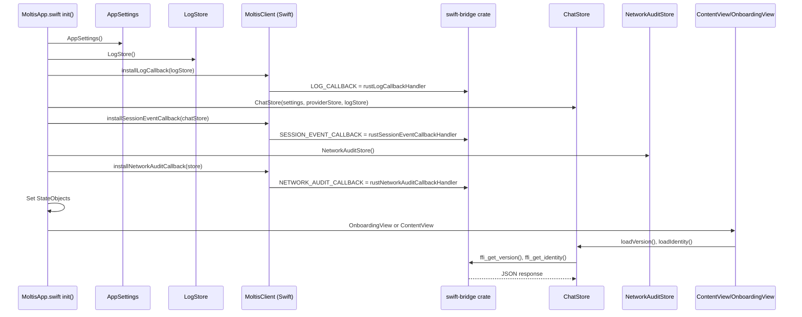
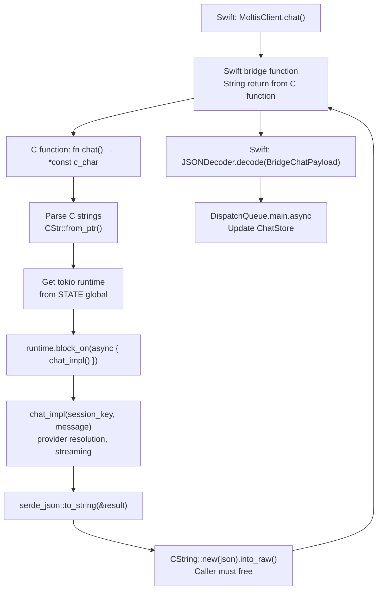

# Native Apps: iOS and macOS with Swift-Rust FFI Bridges

This document explains how the iOS and macOS Swift apps connect to the Rust backend through FFI bridges, the app lifecycle, and the three callback systems (logs, session events, network audit).

**Source:** `/home/darkvoid/Boxxed/@formulas/src.rust/src.AI/src.Moltis/moltis/apps/` and `crates/swift-bridge/`

---

## macOS App Startup Sequence



## FFI Function Execution Pattern



## Aha: Log Bridge Must Be Installed Before ANY FFI Calls

The macOS app installs the Rust→Swift log bridge (`installLogCallback`) before creating the `ChatStore`, `ProviderStore`, or any other component. This is critical because Rust `tracing` logs from initialization (config loading, provider setup, channel startup) would be lost if the log bridge isn't installed first. The Swift side copies the C string synchronously in the callback and then dispatches to the main queue asynchronously — preventing the Rust side from blocking on log delivery.

## Aha: OnceLock Callbacks Are Set Once, Never Changed

All three callbacks (log, session event, network audit) use `OnceLock` for storage. This means they can only be set once per process lifetime — there's no `uninstall` or `replace` mechanism. The design assumption is that the app lifecycle is: install callbacks at startup, use them until the app terminates. If a callback is never installed, events are silently dropped (the `if let Some(callback) = X.get()` pattern).

## Aha: FFI Functions Return Raw C Strings — Caller Must Free

Every FFI function returns `*const c_char` created by `CString::new(json).unwrap().into_raw()`. The `into_raw()` call transfers ownership of the CString's memory to Swift — Rust will NOT free it. The Swift side must call `CString.from(ptr)` which copies the string, then free the original via a corresponding `free_c_string()` FFI function (or the memory leaks). This is the classic "caller frees" pattern in C interop.

## Aha: FFI Functions Use block_on to Bridge Async Rust to Sync Swift

Every FFI function follows the same pattern: parse C strings with `CStr::from_ptr()`, get the tokio runtime from the global `STATE`, then call `runtime.block_on(async { ... })`. This means Swift calls are synchronous (blocking the caller) while the Rust side runs full async operations. The runtime is created once at startup and stored in a `OnceLock` — all FFI functions share it. This avoids the complexity of running a separate event loop per FFI call.

## Aha: Peek Returns Agent State Without Blocking

The `peek()` FFI function (`ffi_sessions.rs`) returns the current agent state — active status, thinking text, and in-progress tool calls — without waiting for the agent to finish. This powers the macOS app's "thinking indicator" in the title bar. The `BridgePeekResult` struct includes `active: Bool`, `thinkingText: String?`, and an array of `BridgePeekToolCall` with `id`, `name`, and `startedAt`. Users can see what the agent is doing at a glance without opening the full chat window.

---

## FFI Bridge Architecture

```
macOS App (Swift)                    Rust Backend (swift-bridge crate)
─────────────────                    ─────────────────────────────────
MoltisApp.swift                      callbacks.rs
├── installLogCallback()     ──────▶ LOG_CALLBACK: OnceLock<LogCallback>
├── installSessionEventCallback() ──▶ SESSION_EVENT_CALLBACK: OnceLock
└── installNetworkAuditCallback() ──▶ NETWORK_AUDIT_CALLBACK: OnceLock

MoltisClient.swift                   ffi_core.rs, ffi_sessions.rs, ffi_config.rs
├── getVersion()             ──────▶ fn get_version() -> *const c_char
├── getIdentity()            ──────▶ fn get_identity() -> *const c_char
├── chat()                   ──────▶ fn chat(session_key, message, ...) -> *const c_char
├── abort()                  ──────▶ fn abort(session_key) -> *const c_char
├── peek()                   ──────▶ fn peek(session_key) -> *const c_char
├── listSessions()           ──────▶ fn list_sessions() -> *const c_char
├── loadSessionHistory()     ──────▶ fn load_session_history(session_key) -> *const c_char
└── ... (60+ FFI functions)
```

---

## Three Callback Bridges

**Source:** `crates/swift-bridge/src/callbacks.rs`

### Callback Types

```rust
// Rust side
pub(crate) type LogCallback = unsafe extern "C" fn(log_json: *const c_char);
pub(crate) type SessionEventCallback = unsafe extern "C" fn(event_json: *const c_char);
pub(crate) type NetworkAuditCallback = unsafe extern "C" fn(event_json: *const c_char);

pub(crate) static LOG_CALLBACK: OnceLock<LogCallback> = OnceLock::new();
pub(crate) static SESSION_EVENT_CALLBACK: OnceLock<SessionEventCallback> = OnceLock::new();
pub(crate) static NETWORK_AUDIT_CALLBACK: OnceLock<NetworkAuditCallback> = OnceLock::new();
```

### Log Bridge

```rust
// Rust: emit_log → Swift callback
pub(crate) fn emit_log_with_fields(level: &str, target: &str, message: &str, fields: Option<&HashMap<&str, String>>) {
    if let Some(callback) = LOG_CALLBACK.get() {
        let event = BridgeLogEvent { level, target, message, fields };
        if let Ok(json) = serde_json::to_string(&event)
            && let Ok(c_str) = CString::new(json)
        {
            unsafe { callback(c_str.as_ptr()); }  // Swift copies before returning
        }
    }
}
```

**Swift side:**

```swift
// MoltisClient.swift:7-47
private struct BridgeLogPayload: Decodable {
    let level: String
    let target: String
    let message: String
    let fields: [String: String]?
}

private func rustLogCallbackHandler(logJson: UnsafePointer<CChar>?) {
    guard let logJson else { return }
    let jsonString = String(cString: logJson)
    let data = Data(jsonString.utf8)

    guard let payload = try? logDecoder.decode(BridgeLogPayload.self, from: data)
    else { return }

    let level: LogLevel
    switch payload.level {
    case "TRACE": level = .trace
    case "DEBUG": level = .debug
    case "INFO": level = .info
    case "WARN": level = .warn
    case "ERROR": level = .error
    default: level = .debug
    }

    DispatchQueue.main.async {
        globalLogStore?.log(level, target: payload.target, message: payload.message, fields: payload.fields ?? [:])
    }
}
```

### Session Event Bridge

**Rust side:**

```rust
pub(crate) fn emit_session_event(event: &SessionEvent) {
    if let Some(callback) = SESSION_EVENT_CALLBACK.get() {
        let event = BridgeSessionEvent {
            kind: event.kind.as_str(),
            session_key: event.session_key.clone(),
        };
        if let Ok(json) = serde_json::to_string(&event)
            && let Ok(c_str) = CString::new(json)
        { unsafe { callback(c_str.as_ptr()); } }
    }
}
```

**Swift side:**

```swift
struct BridgeSessionEventPayload: Decodable {
    let kind: String
    let sessionKey: String
}

private func rustSessionEventCallbackHandler(eventJson: UnsafePointer<CChar>?) {
    // Decode JSON → payload → DispatchQueue.main.async → globalChatStore?.handleSessionEvent(payload)
}
```

### Network Audit Bridge

**Rust side:**

```rust
pub(crate) fn emit_network_audit(domain: &str, port: u16, protocol: &str, action: &str, source: &str) {
    if let Some(callback) = NETWORK_AUDIT_CALLBACK.get() {
        let event = BridgeNetworkAuditEvent { domain, port, protocol, action, source };
        if let Ok(json) = serde_json::to_string(&event)
            && let Ok(c_str) = CString::new(json)
        { unsafe { callback(c_str.as_ptr()); } }
    }
}
```

**Swift side:**

```swift
private struct BridgeNetworkAuditPayload: Decodable {
    let domain: String
    let port: UInt16
    let networkProtocol: String
    let action: String
    let source: String
    let method: String?
    let url: String?
}

private func rustNetworkAuditCallbackHandler(eventJson: UnsafePointer<CChar>?) {
    // Decode JSON → NetworkAuditEntry → globalNetworkAuditStore?.push(entry)
}
```

---

## macOS App Startup

**Source:** `apps/macos/Sources/MoltisApp.swift`

### Installation Sequence

```swift
init() {
    let settings = AppSettings()
    let onboardingState = OnboardingState()
    let logStore = LogStore()
    let networkAuditStore = NetworkAuditStore()

    // 1. Install Rust→Swift log bridge BEFORE any FFI calls
    MoltisClient.installLogCallback(logStore: logStore)

    let providerStore = ProviderStore(logStore: logStore)
    let chatStore = ChatStore(settings: settings, providerStore: providerStore, logStore: logStore)

    // 2. Install Rust→Swift session event bridge (shares bus with gateway)
    MoltisClient.installSessionEventCallback(chatStore: chatStore)

    // 3. Install Rust→Swift network audit bridge
    MoltisClient.installNetworkAuditCallback(store: networkAuditStore)

    // 4. Set global StateObjects
    _settings = StateObject(wrappedValue: settings)
    _chatStore = StateObject(wrappedValue: chatStore)
    _onboardingState = StateObject(wrappedValue: onboardingState)
    _providerStore = StateObject(wrappedValue: providerStore)
    _logStore = StateObject(wrappedValue: logStore)
    _networkAuditStore = StateObject(wrappedValue: networkAuditStore)
}
```

**Critical order:** The log bridge must be installed before any FFI calls, so Rust logs from initialization are captured.

### Body

```swift
var body: some Scene {
    WindowGroup("Moltis") {
        Group {
            if onboardingState.isCompleted {
                ContentView(chatStore: chatStore, settings: settings, providerStore: providerStore)
                    .onAppear {
                        chatStore.loadVersion()
                        chatStore.loadIdentity()
                    }
            } else {
                OnboardingView(onboardingState: onboardingState)
            }
        }
    }
    .commands { SettingsMenuCommand() }  // ⌘, opens Settings window
}
```

### Settings Menu Command

```swift
private struct SettingsMenuCommand: Commands {
    @Environment(\.openWindow) private var openWindow

    var body: some Commands {
        CommandGroup(replacing: .appSettings) {
            Button("Settings...") { openWindow(id: "settings") }
                .keyboardShortcut(",", modifiers: .command)
        }
    }
}
```

---

## iOS App Startup

**Source:** `apps/ios/Sources/MoltisApp.swift`

```swift
@main
struct MoltisApp: App {
    @Environment(\.scenePhase) private var scenePhase

    @StateObject private var authManager = AuthManager()
    @StateObject private var connectionStore = ConnectionStore()
    @StateObject private var settingsStore = SettingsStore()
    @StateObject private var locationSharingStore = LocationSharingStore()

    var body: some Scene {
        WindowGroup {
            Group {
                if authManager.activeServer != nil {
                    ContentView()
                } else {
                    ConnectView()
                }
            }
            .task {
                authManager.loadSavedServers()
                locationSharingStore.configure(connectionStore: connectionStore)
                locationSharingStore.setAppIsActive(scenePhase == .active)
                if let server = authManager.activeServer {
                    await connectionStore.connect(to: server, authManager: authManager)
                }
                locationSharingStore.handleConnectionStateChange()
            }
            .onChange(of: scenePhase) { _, newPhase in
                locationSharingStore.setAppIsActive(newPhase == .active)
            }
        }
    }
}
```

### Lifecycle

1. On launch: `authManager.loadSavedServers()`
2. If active server → `ContentView()` (chat UI)
3. If no active server → `ConnectView()` (server connection UI)
4. On scene phase change: update location sharing active state

### Live Activity Widget

**Source:** `apps/ios/Widget/MoltisLiveActivity.swift`

```swift
struct MoltisLiveActivity: Widget {
    // Lock Screen and Dynamic Island live activity
    // Shows real-time agent status updates
}
```

---

## Swift-Bridge Crate

**Source:** `crates/swift-bridge/src/`

### Module Structure

```
swift-bridge/src/
├── lib.rs              ← Module declarations
├── types.rs            ← Request/response structs, error types
├── state.rs            ← Global bridge state (tokio runtime, registry)
├── callbacks.rs        ← Log, session event, network audit callbacks
├── helpers.rs          ← Encoding, parsing, metrics/tracing
├── chat.rs             ← Chat logic (provider resolution, streaming)
├── ffi_core.rs         ← Core FFI exports (version, providers, httpd)
├── ffi_sessions.rs     ← Session FFI exports
├── ffi_config.rs       ← Config, identity, soul, memory, env var FFI
├── ffi_auth.rs         ← Authentication FFI exports
└── ffi_sandbox.rs      ← Sandbox FFI exports
```

### FFI Function Pattern

```rust
#[no_mangle]
pub extern "C" fn chat(session_key: *const c_char, message: *const c_char, ...) -> *const c_char {
    // 1. Parse C strings
    let session_key = unsafe { CStr::from_ptr(session_key) }.to_str().unwrap();
    let message = unsafe { CStr::from_ptr(message) }.to_str().unwrap();

    // 2. Get runtime from global state
    let runtime = STATE.get().unwrap().runtime.clone();

    // 3. Execute async operation
    let result = runtime.block_on(async {
        chat_impl(session_key, message, ...).await
    });

    // 4. Serialize to JSON and return C string (caller must free)
    let json = serde_json::to_string(&result).unwrap();
    CString::new(json).unwrap().into_raw()
}
```

### Payload Types

**Source:** `apps/macos/Sources/MoltisClient.swift:148-250`

```swift
struct BridgeChatPayload: Decodable {
    let reply: String
    let model: String?
    let provider: String?
    let configDir: String
    let defaultSoul: String
    let inputTokens: UInt32?
    let outputTokens: UInt32?
    let durationMs: UInt64?
}

struct BridgePeekResult: Decodable {
    let active: Bool
    let sessionKey: String?
    let thinkingText: String?
    let toolCalls: [BridgePeekToolCall]?
}

struct BridgePeekToolCall: Decodable, Identifiable {
    let id: String
    let name: String
    let startedAt: UInt64?
}
```

---

## macOS App Panes

### Chat View

**Source:** `apps/macos/Sources/ContentView.swift`

Main chat interface with:
- Message list (bubbles)
- Input field
- Provider selector
- Model selector
- Thinking indicator

### Configuration Pane

**Source:** `apps/macos/Sources/ConfigurationPane.swift`

Server configuration, provider setup, sandbox settings.

### HTTPD Pane

**Source:** `apps/macos/Sources/HttpdPane.swift`

HTTP daemon status — shows if the internal server is running and on what address.

### Logs Pane

**Source:** `apps/macos/Sources/LogsPane.swift`

Log viewer that receives logs via the Rust→Swift bridge.

### Network Audit Pane

**Source:** `apps/macos/Sources/NetworkAuditPane.swift`

Network audit viewer that receives events via the Rust→Swift bridge. Shows:
- Domain, port, protocol
- Action (connect, request, response)
- Source (which component initiated)
- Method, URL (for HTTP)

---

## Next

Continue to [08-security](08-security.md) for the security model.
