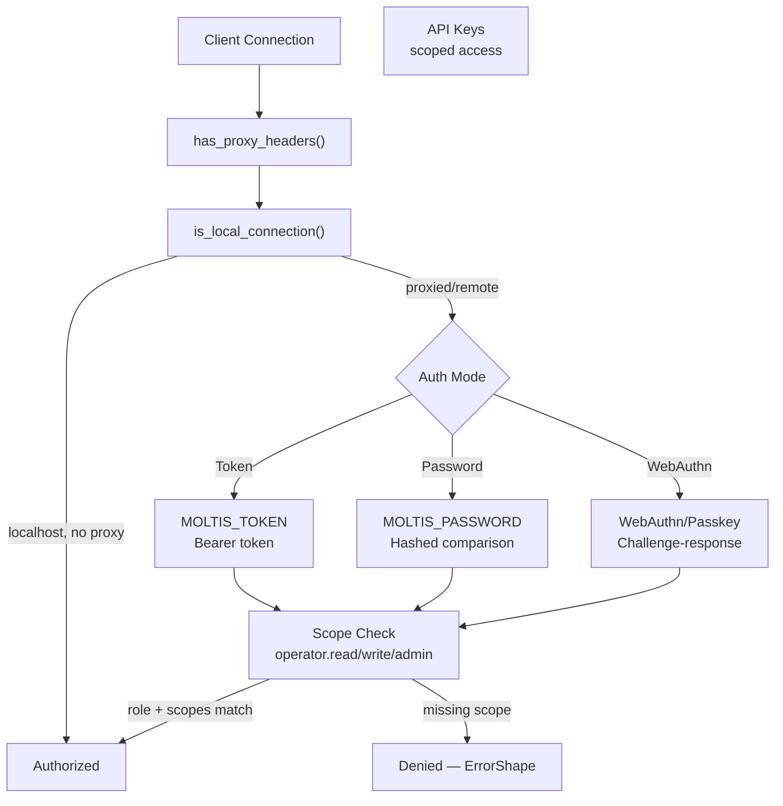

# Security Model: Auth, Sandboxing, Unsafe Code Isolation

This document explains how Moltis secures API keys, sandboxes tool execution, handles unsafe code, and protects against injection attacks.

**Source:** `/home/darkvoid/Boxxed/@formulas/src.rust/src.AI/src.Moltis/moltis/crates/`

---

## Authentication Flow



## Sandbox Router: Backend Selection

```mermaid
flowchart TD
    Config["SandboxConfig"]
    Primary["Primary Backend\nfrom config.mode"]
    Router["SandboxRouter::new(config)"]
    Vercel{VERCEL_TOKEN\nset?}
    Daytona{DAYTONA_API_KEY\nset?}
    Firecracker{firecracker binary\navailable? (Linux)}
    Register["router.register_backend()"]
    Final["SandboxRouter with multiple backends"]
    Exec["execute(command, opts)"]
    Resolve["resolve_backend(session_key)"]
    Backend["Selected backend"]

    Config --> Primary
    Primary --> Router
    Vercel -->|Yes| Register
    Daytona -->|Yes| Register
    Firecracker -->|Yes| Register
    Register --> Final
    Final --> Exec
    Exec --> Resolve
    Resolve --> Backend
```

## Aha: Sandbox Routers Register Cloud Backends Only When Credentials Exist

The sandbox router doesn't just use the configured primary backend. It probes for additional backends at startup: if `VERCEL_TOKEN` is non-empty, it registers the Vercel backend. If `DAYTONA_API_KEY` is non-empty, it registers Daytona. On Linux, if the `firecracker` binary is available, it registers Firecracker. This means the same Moltis binary can dynamically gain sandbox backends based on the deployment environment — no config changes needed. See `gateway/src/server/prepare_core/sandbox.rs:30-71`.

## Aha: exec Tool Blocks stdin and Truncates Output at 200KB

The `exec` tool sets `stdin = Stdio::null()` — child processes cannot read from stdin, preventing injection attacks where a tool might try to read sensitive data from the terminal. Output is truncated at 200KB with a `[output truncated]` suffix, preventing memory exhaustion from tools that produce massive output. See `tools/src/exec.rs`.

## Aha: Unsafe Code Is Isolated to FFI Boundaries Only

Moltis has exactly three locations with `unsafe` code:
1. `memory/embeddings_local.rs` — llama-cpp-2 FFI wrappers (~50 lines)
2. `swift-bridge/callbacks.rs` — C callback pointers (~20 lines)
3. `swift-bridge/ffi_*.rs` — C string handling (~100 lines)

The core agent loop, tool execution, channel handling, and all business logic contain **zero unsafe code**. This is a deliberate Rust safety boundary — all FFI is quarantined to specific modules with `#[allow(unsafe_code)]`.

## Aha: MOLTIS_TOKEN Takes Precedence Over MOLTIS_PASSWORD

The `resolve_auth()` function (`crates/auth/src/`) checks `MOLTIS_TOKEN` first. If both `MOLTIS_TOKEN` and `MOLTIS_PASSWORD` are set, token-based auth wins and the password is ignored. This prevents accidental downgrade from bearer-token auth (stronger, suitable for API access) to password auth (weaker, suitable for web UI) when both are configured.

## Aha: Network Filter Gates Outbound Access from Sandboxed Tools

The `network-filter` crate (`crates/network-filter/`) controls which hosts sandboxed code and plugins can reach. It uses a deny-by-default approach with an explicit allowlist of hostnames. This means a WASM plugin or containerized exec call cannot reach arbitrary internal network addresses — only hosts explicitly permitted by the filter configuration. Combined with the sandbox's stdin nullification and output truncation, this forms the third layer of the tool sandbox defense-in-depth.

---

## Authentication

**Source:** `crates/auth/src/`

### Auth Resolution

```rust
// auth.rs
pub fn resolve_auth(token: Option<String>, password: Option<String>) -> ResolvedAuth {
    // MOLTIS_TOKEN takes precedence over MOLTIS_PASSWORD
    // Returns token-based or password-based auth
}
```

Environment variables:
- `MOLTIS_TOKEN` — Bearer token for API access
- `MOLTIS_PASSWORD` — Password for web UI login

### Credential Store

**Source:** `credential_store.rs`

SQLite-backed storage:

```sql
CREATE TABLE auth_password (hash TEXT);
CREATE TABLE passkeys (id TEXT PRIMARY KEY, credential TEXT);
CREATE TABLE api_keys (id TEXT PRIMARY KEY, key_hash TEXT, scopes TEXT);
CREATE TABLE auth_sessions (id TEXT PRIMARY KEY, token TEXT, expires_at INTEGER);
```

### WebAuthn (Passkey) Authentication

**Source:** `webauthn.rs`

```rust
pub struct WebAuthnRegistry { ... }
pub struct WebAuthnState { ... }
pub fn load_passkeys() -> Vec<Passkey>;
```

WebAuthn challenge-response flow:
1. Client requests registration options
2. Server generates challenge
3. Client creates passkey (device biometric/pin)
4. Server verifies and stores credential in `passkeys` table

### Connection Locality Detection

**Source:** `locality.rs`

```rust
pub fn has_proxy_headers(request: &Request) -> bool;
pub fn is_local_connection(request: &Request) -> bool;
```

Detects whether connections are local or proxied for auth decisions. Used to skip auth for localhost development.

---

## Secret Storage

### API Key Store

**Source:** `crates/provider_setup/`

API keys are stored encrypted and merged into config at startup:

```rust
pub struct KeyStore { ... }

pub fn config_with_saved_keys(
    base_config: &ProviderConfig,
    key_store: &KeyStore,
    local_model_ids: &[String],
) -> EffectiveProviderConfig {
    // Merge base config with saved API keys
}
```

### Secret Type Usage

Throughout the codebase, `secrecy::Secret<String>` is used for sensitive values:

```rust
use secrecy::{ExposeSecret, Secret};

pub struct WhatsAppAccountConfig {
    pub phone_number: String,
    pub store_path: Option<PathBuf>,
    // No API key needed — authentication via QR pairing
}

pub struct SlackAccountConfig {
    pub bot_token: Secret<String>,
    pub signing_secret: Secret<String>,
}

pub struct DiscordAccountConfig {
    pub bot_token: Secret<String>,
}
```

`ExposeSecret` must be explicitly called to access the value — preventing accidental logging.

---

## Sandboxing

**Source:** `crates/tools/src/sandbox.rs`

### Sandbox Trait

```rust
#[async_trait]
pub trait Sandbox: Send + Sync {
    async fn execute(&self, command: &str, opts: ExecOpts) -> Result<ExecResult>;
    fn provides_fs_isolation(&self) -> bool;
    async fn cleanup(&self, id: &SandboxId) -> Result<()>;
}
```

### Sandbox Router

**Source:** `gateway/src/server/prepare_core/sandbox.rs`

```rust
pub fn build_sandbox_router(config: &SandboxConfig, prefix: &str, timezone: Option<&str>) -> SandboxRouter {
    let mut router = SandboxRouter::new(config.clone());

    // Register additional backends with credentials
    for (name, has_creds) in [
        ("vercel", has_secret(&config.vercel_token)),
        ("daytona", has_secret(&config.daytona_api_key)),
    ] {
        if has_creds && router.backend_name() != name {
            router.register_backend(select_backend_by_name(name, config));
        }
    }

    #[cfg(target_os = "linux")]
    {
        if firecracker_bin_available(config.firecracker_bin.as_deref()) {
            router.register_backend(select_backend_by_name("firecracker", config));
        }
    }

    router
}
```

### Secret Detection

```rust
fn has_secret(secret: &Option<Secret<String>>) -> bool {
    secret.as_ref().is_some_and(|s| !s.expose_secret().is_empty())
}
```

### Filesystem Isolation Check

```rust
let has_container_backend = if let Some(ref router) = self.sandbox_router {
    router.resolve_backend(session_key).await.provides_fs_isolation()
} else {
    self.sandbox.provides_fs_isolation()
};
```

When the backend doesn't provide filesystem isolation (`RestrictedHost`, `Cgroup`, `None`), commands run directly on the host.

### Exec Security Measures

**Source:** `tools/src/exec.rs`

```rust
// stdin = null — child cannot read from stdin
cmd.stdin(std::process::Stdio::null());

// Output truncated at 200KB
fn truncate_output_for_display(output: &mut String, max_bytes: usize) {
    if output.len() > max_bytes {
        output.truncate(output.floor_char_boundary(max_bytes));
        output.push_str("\n... [output truncated]");
    }
}

// Timeout enforced
let result = tokio::time::timeout(opts.timeout, child.wait_with_output()).await;
```

---

## Unsafe Code Isolation

Moltis isolates all `unsafe` code to FFI boundaries:

| Crate | Location | Purpose | Lines |
|-------|----------|---------|-------|
| `memory/embeddings_local.rs` | `#[allow(unsafe_code)]` | llama-cpp-2 FFI wrappers | ~50 |
| `swift-bridge/callbacks.rs` | `#[allow(unsafe_code)]` | C callback pointers | ~20 |
| `swift-bridge/ffi_*.rs` | `#[allow(unsafe_code)]` | C string handling | ~100 |

The core agent loop, tool execution, channel handling, and business logic contain **no unsafe code**.

---

## TLS Configuration

**Source:** `crates/tls/`, `gateway/src/server/prepare_core.rs`

### TLS Validation

```rust
// prepare_core.rs:97-112
validate_proxy_tls_configuration(behind_proxy, tls_enabled, allow_tls_behind_proxy)?;

if behind_proxy && tls_enabled && allow_tls_behind_proxy {
    warn!("MOLTIS_ALLOW_TLS_BEHIND_PROXY=true is set; ensure your proxy uses HTTPS upstream");
}
```

### Environment Flags

- `MOLTIS_NO_TLS` — Disable TLS (for local dev)
- `MOLTIS_BEHIND_PROXY` — Running behind a reverse proxy
- `MOLTIS_ALLOW_TLS_BEHIND_PROXY` — Allow TLS even behind proxy (risk of redirect loops)

---

## Network Filter

**Source:** `crates/network-filter/`

Controls outbound network access from tools and plugins. Prevents sandboxed code from reaching arbitrary hosts.

---

## Approval Gating

**Source:** `crates/tools/src/approval.rs`

Tool execution can require user approval:

```rust
pub struct ApprovalManager { ... }

pub enum ApprovalDecision {
    Approve,           // Allow this execution
    Deny,              // Block this execution
    DenyAndBlock,      // Block and add to permanent deny list
}
```

Flow:
1. `create_request()` stores pending approval
2. `broadcast_request()` notifies connected clients
3. Client approves/denies via REST API
4. `await_response()` waits with timeout

---

## Plugin Sandboxing

**Source:** `crates/plugins/`

Plugins run in isolated QuickJS-WASM sandboxes:

- **No Node/Bun ambient access** — plugins can't import `fs`, `net`, etc.
- **Network gated** by `network.outbound` permission + `networkAllowedHosts` allowlist
- **Crash isolation** via separate `Bun.Worker` per plugin
- **Crash budget** — limited restarts before plugin is disabled
- **Capability-gated SDK** — plugins access CMS through explicit SDK functions, not raw APIs

---

## Next

Return to the [README](README.md) for the full index.
