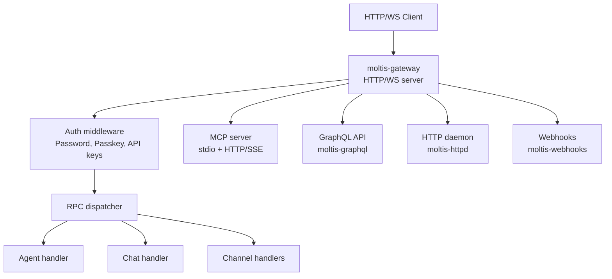

# Gateway: HTTP/WS Server, RPC, and MCP

The gateway is Moltis's HTTP/WebSocket server, handling authentication, RPC routing, and MCP protocol support. At ~37.4K LoC, it's the largest crate in the workspace.

**Source:** `/home/darkvoid/Boxxed/@formulas/src.rust/src.AI/src.Moltis/moltis/crates/gateway/`

## Architecture

## Key Features

- **HTTP/WS Server** — Serves both HTTP REST endpoints and WebSocket connections
- **RPC** — Remote procedure call dispatching to agent, chat, and channel handlers
- **Auth Middleware** — Password, passkey, and API key authentication
- **MCP Support** — Both stdio and HTTP/SSE transport modes
- **GraphQL API** — GraphQL interface for programmatic access
- **Startup Wiring** — Bootstraps all subsystems on startup

**Source:** `crates/gateway/src/`.

## HTTP Daemon

The HTTP daemon (`moltis-httpd`) handles static file serving, media delivery, and web UI serving.

**Source:** `crates/httpd/src/`.

## GraphQL

The GraphQL crate (`moltis-graphql`) provides a GraphQL API for the Moltis server.

**Source:** `crates/graphql/src/`.

## Next

Continue to [03-agents-chat](03-agents-chat.md) for the agent loop and chat engine.
