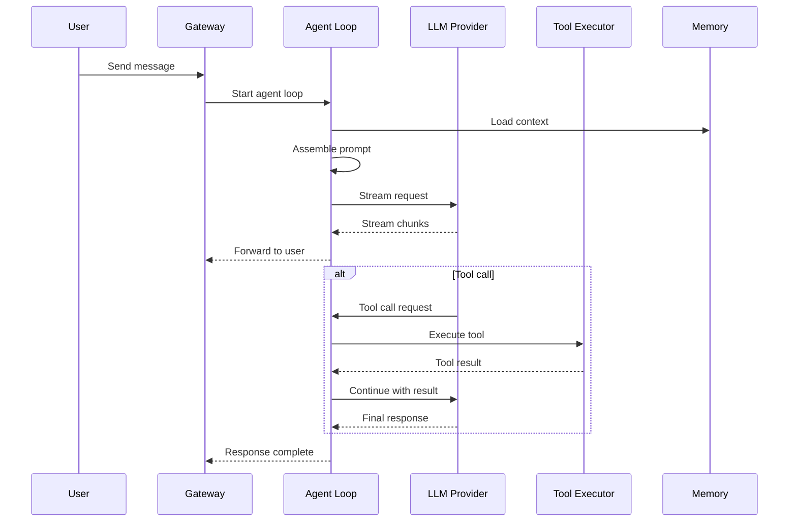

# Agents and Chat: Agent Loop, Providers, and Chat Engine

The agent loop and chat engine are at the core of Moltis. The agent orchestrates LLM calls, tool execution, and streaming responses.

**Source:** `/home/darkvoid/Boxxed/@formulas/src.rust/src.AI/src.Moltis/moltis/crates/agents/`, `chat/`, `providers/`

## Agent Loop



**Source:** `crates/agents/src/` (~14.5K LoC).

## Chat Engine

The chat engine manages conversation state, message history, and agent orchestration:

```
crates/chat/              ← Chat engine (~14.2K LoC)
crates/sessions/          ← Session management
```

**Source:** `crates/chat/src/`, `crates/sessions/src/`.

## LLM Providers

At ~18.9K LoC, the providers crate implements connections to multiple LLM providers:

```
crates/providers/         ← LLM provider implementations (~18.9K LoC)
```

The providers crate supports multiple LLM backends (Anthropic, OpenAI, etc.) through a unified interface.

**Source:** `crates/providers/src/`.

## Next

Continue to [04-channels](04-channels.md) for the communication channel integrations.
