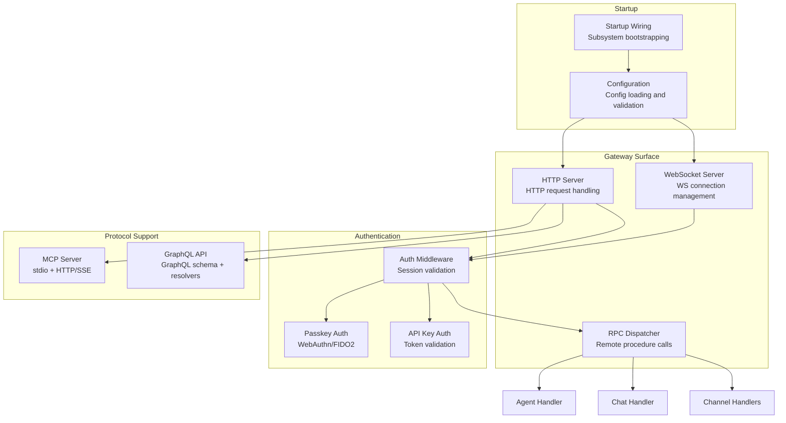

# Gateway Deep Dive: HTTP/WS Server, RPC, MCP, GraphQL

The gateway crate (`moltis-gateway`) is the largest in the workspace at 129 files and 55,619 lines of Rust. It handles HTTP/WebSocket serving, RPC dispatch, authentication, MCP protocol support, and GraphQL API.

**Source:** `/home/darkvoid/Boxxed/@formulas/src.rust/src.AI/src.Moltis/moltis/crates/gateway/`

## Crate Statistics

| Metric | Value |
|--------|-------|
| Files | 129 |
| Lines of Rust | 55,619 |
| Migrations | Yes (SQL migrations in `migrations/`) |
| Tests | Yes (in `tests/`) |

## Architecture



## HTTP Server

The HTTP server handles:
- REST API endpoints
- Static file serving
- WebSocket upgrade
- Health checks
- Startup readiness

## WebSocket Server

The WebSocket server handles:
- Real-time message streaming
- Agent status updates
- Tool execution progress
- Channel message delivery

## RPC Dispatcher

The RPC dispatcher routes remote procedure calls to:
- Agent handlers (start/stop/continue agent loops)
- Chat handlers (send/receive messages)
- Channel handlers (send messages to specific channels)
- Tool handlers (execute tools)
- Config handlers (read/update configuration)

## Authentication

### Session Auth

Session-based authentication using cookies, scoped to `/admin` path to keep tokens off public routes.

### Passkey Auth

WebAuthn/FIDO2 passkey authentication for passwordless login:
- Registration of passkeys
- Authentication via passkeys
- Passkey management (add/remove)

### API Key Auth

API key authentication for programmatic access:
- Key generation
- Key revocation
- Key scoping (permissions)

## MCP Server

The MCP (Model Context Protocol) server supports both transport modes:
- **stdio** — for local agent connections
- **HTTP/SSE** — for remote agent connections

## GraphQL API

The GraphQL crate (`moltis-graphql`) provides:
- Schema definitions
- Resolvers for all data types
- Mutations for data changes
- Subscriptions for real-time updates

**Source:** `crates/graphql/` (separate crate, used by gateway).

## Startup Wiring

The gateway bootstraps all subsystems:
1. Load configuration
2. Initialize database connections
3. Start HTTP server
4. Start WebSocket server
5. Register channel handlers
6. Start agent loops
7. Initialize MCP server
8. Initialize GraphQL API

## Migrations

```
crates/gateway/migrations/
```

SQL migrations for the gateway's database schema.

**Source:** `crates/gateway/migrations/`.

## Next

Continue to [05-agents-deep](05-agents-deep.md) for the agent internals deep dive.
