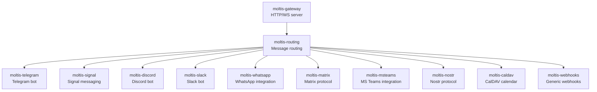

# Channels: Communication Integrations

Moltis connects to 9+ communication channels, allowing users to interact with their personal agent from wherever they prefer.

**Source:** `/home/darkvoid/Boxxed/@formulas/src.rust/src.AI/src.Moltis/moltis/crates/`

## Channel Architecture



## Channels

| Channel | Crate | Protocol |
|---------|-------|----------|
| Telegram | `moltis-telegram` | Telegram Bot API |
| Signal | `moltis-signal` | Signal protocol |
| Discord | `moltis-discord` | Discord Bot API |
| Slack | `moltis-slack` | Slack Bot API |
| WhatsApp | `moltis-whatsapp` | WhatsApp Business API |
| Matrix | `moltis-matrix` | Matrix protocol |
| MS Teams | `moltis-msteams` | MS Teams API |
| Nostr | `moltis-nostr` | Nostr protocol |
| CalDAV | `moltis-caldav` | CalDAV protocol |
| Webhooks | `moltis-webhooks` | HTTP webhooks |

**Aha:** All channels use the same `moltis-channels` abstraction layer. This means message handling is uniform across all channels — the agent loop doesn't care whether a message came from Telegram or Signal. The routing crate (`moltis-routing`) dispatches incoming messages to the agent and routes agent responses back through the correct channel.

## Channel Abstraction

The `moltis-channels` crate defines the common interface that all channel implementations follow:

```
crates/channels/     ← Channel abstractions
crates/routing/      ← Message routing
```

## Telephony

The `moltis-telephony` crate provides voice/telephony support beyond the text-based channels.

**Source:** `crates/telephony/src/`.

## Next

Continue to [05-tools-sandbox](05-tools-sandbox.md) for the tool execution system and sandboxing.
