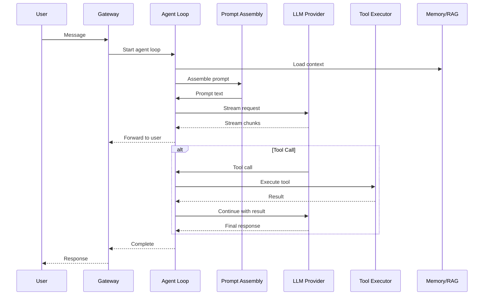

# Agents Deep Dive: Agent Loop, Streaming, Prompt Assembly

The agents crate (`moltis-agents`) manages the agent loop, streaming, and prompt assembly. At 46 files and 20,280 lines of Rust, it's the brain of Moltis.

**Source:** `/home/darkvoid/Boxxed/@formulas/src.rust/src.AI/src.Moltis/moltis/crates/agents/`

## Crate Statistics

| Metric | Value |
|--------|-------|
| Files | 46 |
| Lines of Rust | 20,280 |

## Agent Loop Architecture

## Agent Loop

The agent loop:
1. Receives a user message
2. Loads relevant context from memory (RAG)
3. Assembles the system prompt + user message
4. Streams the request to the LLM provider
5. Forwards chunks to the user in real-time
6. Handles tool calls (execute, return result, continue)
7. Completes when the provider finishes

## Streaming

The streaming implementation:
- Supports chunked transfer encoding
- Forwards tokens as they arrive
- Handles interruption (user cancels)
- Manages token counting
- Tracks usage metrics

## Prompt Assembly

The prompt assembler:
- Combines system prompt with user message
- Injects tool definitions
- Adds context from memory
- Handles multi-turn conversations
- Manages context window limits

## Agent State

The agent maintains state:
- Current conversation
- Active tool calls
- Token usage
- Agent status (idle, thinking, executing)

## Next

Continue to [06-providers-deep](06-providers-deep.md) for the provider internals deep dive.
