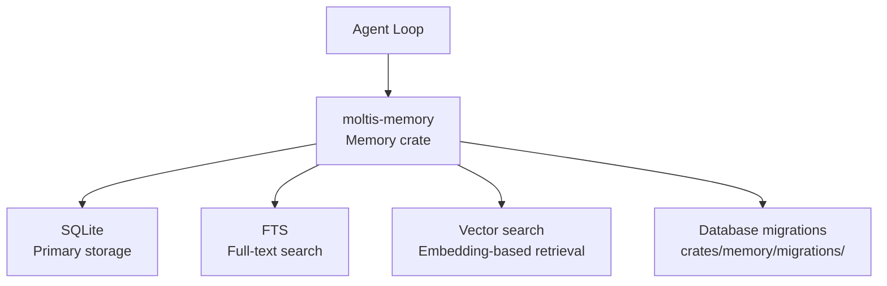

# Memory: SQLite + FTS + Vector Search

Moltis uses SQLite as its memory backend with Full-Text Search (FTS) and vector embeddings for RAG (Retrieval-Augmented Generation).

**Source:** `/home/darkvoid/Boxxed/@formulas/src.rust/src.AI/src.Moltis/moltis/crates/memory/`

## Architecture



## Memory Features

- **SQLite Storage** — All memory data stored in a single SQLite file
- **Full-Text Search** — Fast text search across stored content
- **Vector Embeddings** — Semantic search via embedding vectors
- **Migrations** — Database schema evolution with SQL migration files

**Source:** `crates/memory/src/`, `crates/memory/migrations/`.

## Code Index

The code index crate provides code-specific indexing:

```
crates/code-index/      ← Code indexing with migrations
```

**Source:** `crates/code-index/src/`, `crates/code-index/migrations/`.

## Projects

The projects crate manages project-specific data:

```
crates/projects/        ← Project management with migrations
```

**Source:** `crates/projects/src/`, `crates/projects/migrations/`.

## Cron

The cron crate manages scheduled tasks:

```
crates/cron/            ← Scheduled task execution with migrations
```

**Source:** `crates/cron/src/`, `crates/cron/migrations/`.

## Metrics

The metrics crate provides observability:

```
crates/metrics/         ← Observability and metrics
```

**Source:** `crates/metrics/src/`.

## Next

Continue to [07-native-apps](07-native-apps.md) for the iOS and macOS Swift applications.
