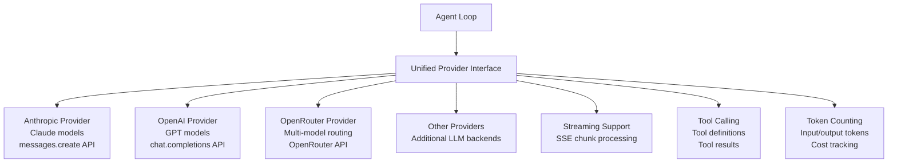

# Providers Deep Dive: LLM Provider Implementations

The providers crate (`moltis-providers`) implements connections to multiple LLM providers. At 72 files and 33,182 lines of Rust, it's the second-largest crate and the bridge to AI capabilities.

**Source:** `/home/darkvoid/Boxxed/@formulas/src.rust/src.AI/src.Moltis/moltis/crates/providers/`

## Crate Statistics

| Metric | Value |
|--------|-------|
| Files | 72 |
| Lines of Rust | 33,182 |

## Provider Architecture

## Provider Interface

All providers implement a common interface:
- **Chat completion** — send messages, receive response
- **Streaming** — SSE-based token streaming
- **Tool calling** — define tools, receive tool calls, return results
- **Model listing** — discover available models
- **Token counting** — count tokens for cost estimation

## Anthropic Provider

Implements the Anthropic Messages API:
- Claude model support
- Tool calling with tool use blocks
- Streaming via SSE
- Prompt caching support

## OpenAI Provider

Implements the OpenAI Chat Completions API:
- GPT model support
- Function calling
- Streaming support
- Token counting

## OpenRouter Provider

Implements the OpenRouter API:
- Multi-model routing
- Model fallback
- Cost comparison
- Unified streaming

## Model Discovery

The provider system supports model discovery:
- List available models per provider
- Model capabilities (context window, tool support)
- Model pricing information
- Default model selection

## Token Counting

Token counting for cost tracking:
- Input token counting
- Output token counting
- Cost estimation per model
- Usage aggregation

## Next

Continue to [09-tools-deep](09-tools-deep.md) for the tools internals deep dive.
