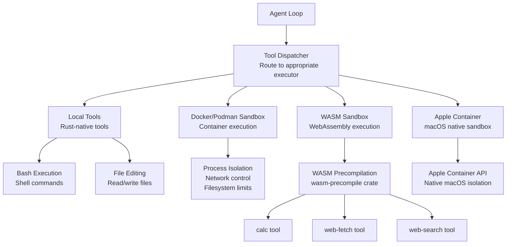

# Tools Deep Dive: Tool Execution, Sandboxing, WASM

The tools crate (`moltis-tools`) manages tool execution and sandboxing. At 90 files and 52,957 lines of Rust, it's nearly as large as the gateway and the execution engine of the agent.

**Source:** `/home/darkvoid/Boxxed/@formulas/src.rust/src.AI/src.Moltis/moltis/crates/tools/`

## Crate Statistics

| Metric | Value |
|--------|-------|
| Files | 90 |
| Lines of Rust | 52,957 |

## Tool Execution Architecture



## Tool Types

| Type | Execution | Security |
|------|-----------|----------|
| Local | Direct Rust execution | Limited (agent trust) |
| Docker | Container sandbox | Full isolation |
| Podman | Rootless container sandbox | Full isolation |
| WASM | WebAssembly VM | Memory/CPU limits |
| Apple Container | Native macOS sandbox | OS-level isolation |

## WASM Tools

### WASM Precompilation

```
crates/wasm-precompile/
```

Precompiles WASM modules for faster execution.

### Calc Tool

```
crates/wasm-tools/calc/
```

Mathematical operations in WASM.

### Web Fetch Tool

```
crates/wasm-tools/web-fetch/
```

Fetches web content in WASM.

### Web Search Tool

```
crates/wasm-tools/web-search/
```

Searches the web in WASM.

## Sandboxing

### Docker/Podman Sandbox

- Full process isolation
- Network access control (allowlist hosts)
- Filesystem limits (read-only except designated dirs)
- Resource limits (CPU, memory, time)

### Apple Container Sandbox

- Native macOS sandboxing
- Uses Apple's Container framework
- Available only on macOS
- Tighter integration than Docker

### WASM Sandbox

- Memory-safe execution
- CPU time limits
- No filesystem access
- Network access controlled

## Tool Registry

The tool registry:
- Registers available tools
- Validates tool definitions
- Maps tool names to executors
- Tracks tool capabilities

## Skills

The skills crate (`moltis-skills`) manages predefined skill sets:
- Bundled skills (predefined tool combinations)
- Workspace skills (user-defined)
- Skill import/export
- Autonomous skill improvement

## Browser Automation

The browser crate (`moltis-browser`) provides:
- Browser control for web automation
- Screenshot capture
- DOM manipulation
- JavaScript execution

**Source:** `crates/browser/`.

## Next

Continue to [11-native-apps](11-native-apps.md) for the native apps documentation.
