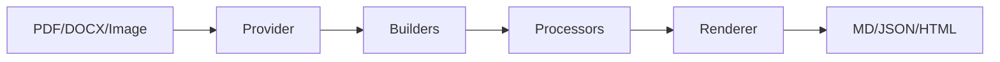

# Marker — Document to Markdown/JSON Converter

**Marker converts PDF, image, PPTX, DOCX, XLSX, HTML, and EPUB files to markdown, JSON, HTML, and structured chunks.**

Source: 209 Python files, 13,599 LOC

## Pipeline



## Features

- Multi-format input/output
- Table formatting
- Equation extraction (LaTeX)
- Image extraction
- Artifact removal
- LLM boost option
- All languages
- GPU/CPU/MPS

## Performance

2-5 pages/sec (95%+ accuracy). 25 pages/sec on H100 batch mode.

## CLI

```bash
marker_single input.pdf output_dir --output_format markdown
```

## Python API

```python
from marker.converters.pdf import PdfConverter
converter = PdfConverter(artifact_dict=models)
document = converter("input.pdf")
rendered = converter.render(document)
```

## Models

5 Surya OCR models: layout, recognition, table_rec, detection, ocr_error

## Next

→ [Architecture](01-architecture.md)
