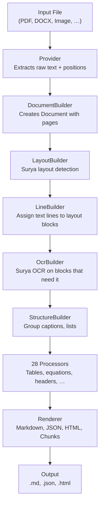

# Marker — Document to Markdown/JSON Converter

**Marker converts PDFs, images, PPTX, DOCX, XLSX, HTML, and EPUB files into structured markdown, JSON, HTML, and chunked text.** It combines five Surya OCR models with an optional LLM layer (Gemini, Claude, OpenAI, Ollama, Vertex AI) to achieve 95%+ accuracy on document conversion while handling complex regions, equations, tables, handwriting, and forms.

Source: `marker/` — 209 Python files, 17,862 LOC

## Philosophy

Marker's design centers on a **document-as-object-graph** model. Rather than treating conversion as a linear string transformation, Marker constructs a full typed `Document` object containing pages, blocks, lines, spans, and characters. This means every element has a known position (`PolygonBox`), a known type (`BlockTypes` enum with 30+ variants), and known relationships (parent/child `structure` chains). Processors and renderers traverse this graph — they don't parse flat text.

**Aha:** The separation between `Block` (the abstract node) and `ProviderOutput` (the raw input data) is the key architectural decision. The provider extracts raw text lines with polygon positions — the builders then construct typed blocks from those positions. This means the same pipeline works for PDFs (where text positions come from pdfium/pdftext), images (where everything comes from Surya OCR), and office documents (where positions come from python-docx/python-pptx). The provider normalizes the input; everything downstream only sees `PageGroup` → `Block` → `Line` → `Span`.

## The Pipeline



## The Five Surya Models

Marker depends on five specialized Surya OCR models, created via `create_model_dict()` in `marker/models.py:17-25`:

```python
# marker/models.py:17-25
def create_model_dict(device=None, dtype=None, attention_implementation=None) -> dict:
    return {
        "layout_model": LayoutPredictor(FoundationPredictor(...)),
        "recognition_model": RecognitionPredictor(FoundationPredictor(...)),
        "table_rec_model": TableRecPredictor(device=device, dtype=dtype),
        "detection_model": DetectionPredictor(device=device, dtype=dtype),
        "ocr_error_model": OCRErrorPredictor(device=device, dtype=dtype),
    }
```

| Model | Class | Purpose | Used By |
|-------|-------|---------|---------|
| `layout_model` | `LayoutPredictor` | Detects block regions (text, table, figure, equation, etc.) on each page | `LayoutBuilder` |
| `recognition_model` | `RecognitionPredictor` | OCR: converts image regions to text with formatting tags | `OcrBuilder`, `TableProcessor` |
| `table_rec_model` | `TableRecPredictor` | Detects table structure: rows, columns, cell boundaries | `TableProcessor` |
| `detection_model` | `DetectionPredictor` | Detects text line bounding boxes for OCR | `LineBuilder`, `TableProcessor` |
| `ocr_error_model` | `OCRErrorPredictor` | Classifies whether extracted PDF text is garbled/broken | `LineBuilder` |

**Aha:** The models are passed as a flat `artifact_dict` dictionary, NOT injected individually. `BaseConverter.resolve_dependencies()` (`converters/__init__.py:24-41`) inspects each class's `__init__` signature and pulls matching keys from `artifact_dict`. If a builder needs `recognition_model`, it declares it as a parameter — the DI system matches the key `"recognition_model"` in the dict. This means adding a new model requires no wiring changes — just add the key to `create_model_dict()` and declare the parameter in the consuming class.

## Feature Map

### Input Formats

| Format | Provider | Extraction Method |
|--------|----------|-------------------|
| PDF | `PdfProvider` | pdfium + pdftext (text positions) or Surya OCR |
| Image (PNG/JPG/TIFF/…) | `ImageProvider` | Surya OCR only |
| DOCX | `DocumentProvider` | python-docx |
| XLSX | `SpreadSheetProvider` | openpyxl |
| PPTX | `PowerPointProvider` | python-pptx |
| EPUB | `EpubProvider` | ebooklib |
| HTML | `HTMLProvider` | BeautifulSoup |
| Fallback | `PdfProvider` | Default for unknown types |

### Output Formats

| Format | Renderer | Output |
|--------|----------|--------|
| Markdown | `MarkdownRenderer` | `.md` with GFM tables, LaTeX math (`$`/`$$`), image references |
| HTML | `HTMLRenderer` | Self-contained `.html` with embedded images |
| JSON | `JSONRenderer` | Structured `.json` with all block types, positions, content |
| Chunks | `ChunkRenderer` | Chunked `.json` for RAG pipelines |
| OCR JSON | `OCRJSONRenderer` | Raw OCR output with character-level data |
| Extraction | `ExtractionRenderer` | Structured document JSON for programmatic use |

### LLM-Enhanced Features

When `use_llm=True` is set (requires a configured LLM service):

- **Complex Region Processing** — handles multi-column, mixed-content areas
- **Equation Recognition** — LaTeX conversion for math
- **Table Enhancement** — merges split tables, fixes cell alignment
- **Handwriting Recognition** — OCR for handwritten text
- **Form Recognition** — identifies form fields and their values
- **Section Header Detection** — improves heading level classification
- **Page Correction** — fixes OCR errors using page-level context
- **Image Description** — generates alt text for images
- **Math Block Detection** — identifies display math vs inline math

## Performance

| Mode | Speed | Accuracy |
|------|-------|----------|
| CPU (default) | 2-5 pages/sec | 95%+ |
| GPU (CUDA) | ~25 pages/sec (batch) | 95%+ |
| GPU + LLM | 5-10 pages/sec | 98%+ |

Batch sizes auto-scale by device: CUDA gets larger batches (12 for layout, 48 for recognition, 14 for table rec), MPS gets medium (6, 16, 6), CPU gets smallest (6, 32, 6).

## Key Design Decisions

1. **Document as object graph, not flat text.** Every element has type, position, and parent/child relationships. Processors traverse and mutate the graph; renderers serialize it.
2. **Dual text extraction.** PDFs use pdftext first (extracting text directly from the PDF). If that fails (detected by `OCRErrorPredictor` + layout coverage checks), Surya OCR kicks in on a per-page basis.
3. **Block-level vs line-level OCR.** The `OcrBuilder` has two modes: block mode (OCR the entire block at once, used for headers, list items, footnotes, short text) and line mode (OCR individual lines, used for longer text blocks). The fallback logic in `select_ocr_blocks_by_mode()` prevents block mode on blocks that are too tall (`>50%` of page height) or have too many lines (`>15`).
4. **Processors are order-dependent and pluggable.** The default processor tuple in `PdfConverter` has 28 entries in a specific order — e.g., `OrderProcessor` must run first (assigns reading order), `DebugProcessor` last (saves debug data). Users can specify a custom processor list via `--processors`.
5. **LLM is optional but integrated throughout.** When `use_llm=True`, an `LLMSimpleBlockMetaProcessor` coordinates concurrent LLM calls across all `BaseLLMSimpleBlockProcessor` instances, batching prompt construction and response handling.

## Next

→ [Architecture](01-architecture.md) — Deep dive into the Document model, block types, dependency injection, and the converter lifecycle.
