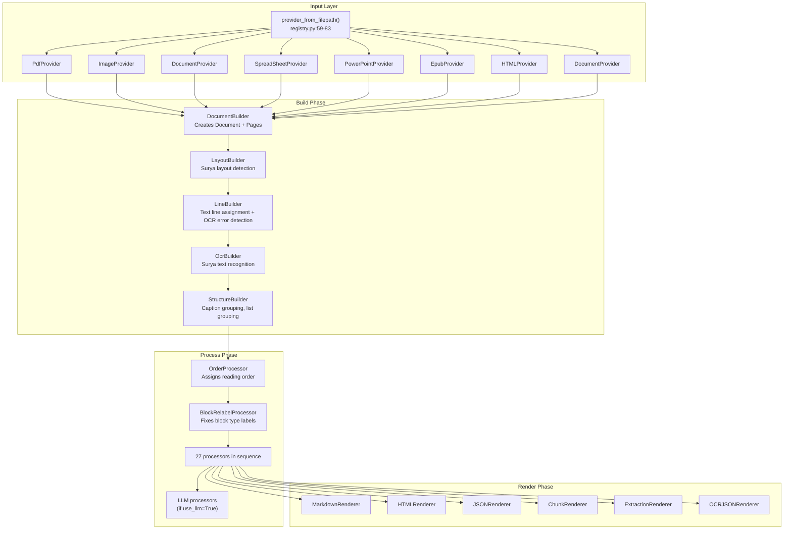
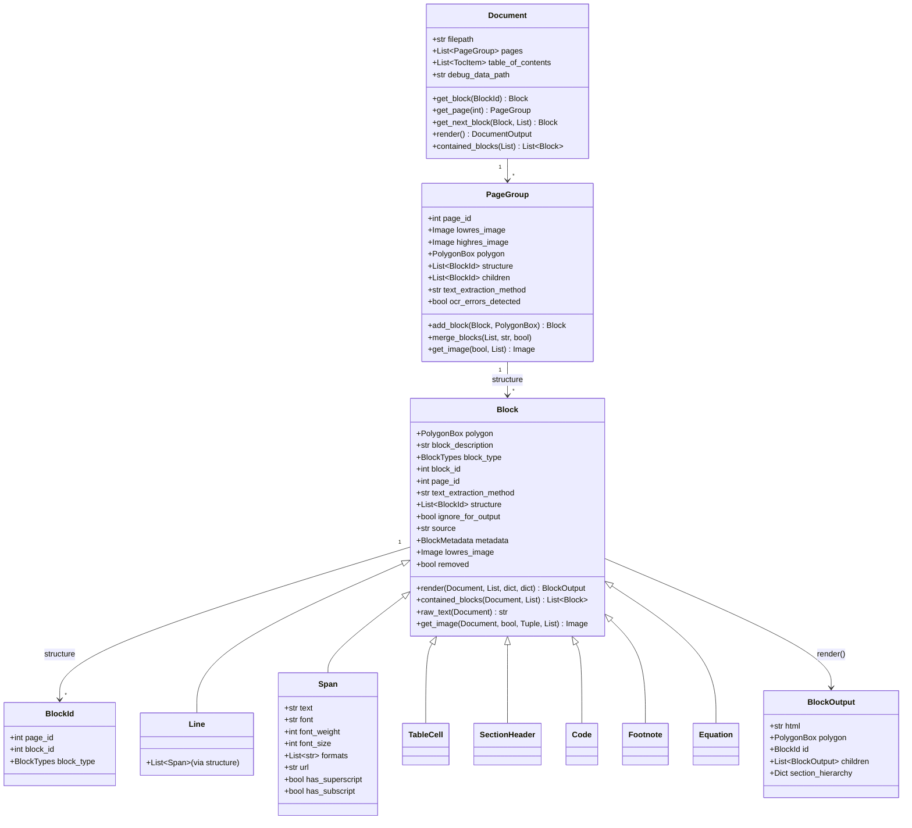
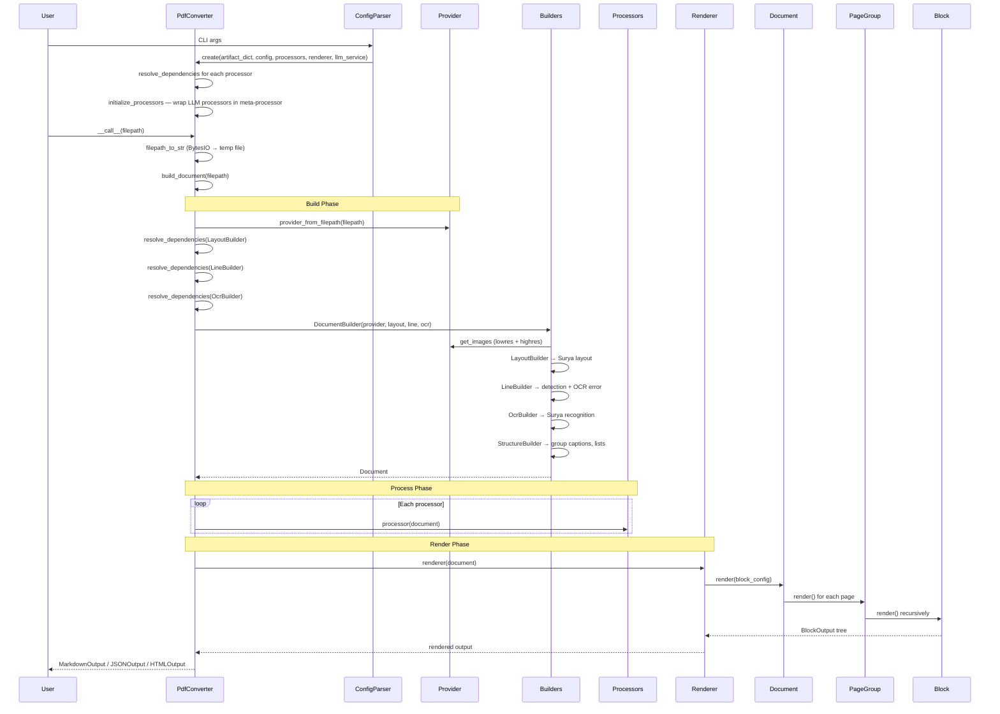

# Marker Architecture — Document Model, Block Types, and Dependency Injection

**Marker's architecture is a pipeline of four composable stages built around a typed document object graph.** The `Document` is not a flat string but a tree of typed blocks with polygon positions, parent/child relationships, and metadata. This design enables the same pipeline to handle PDFs, images, DOCX, XLSX, PPTX, EPUB, and HTML through provider-specific input normalizers, while all downstream processing operates on the same block types.

Source: `marker/marker/` — 8 core modules

## Architecture Overview



## The Document Object Graph

The Document is the central data structure. It holds pages; pages hold blocks; blocks hold child blocks, lines, spans, and characters.



Source: `marker/schema/document.py`, `marker/schema/blocks/base.py`, `marker/schema/groups/page.py`

### BlockId — The Universal Address

Every block in the document has a `BlockId` that uniquely addresses it:

```python
# marker/schema/blocks/base.py:41-53
class BlockId(BaseModel):
    page_id: int
    block_id: Optional[int] = None
    block_type: BlockTypes | None = None

    def __str__(self):
        if self.block_type is None or self.block_id is None:
            return f"/page/{self.page_id}"
        return f"/page/{self.page_id}/{self.block_type.name}/{self.block_id}"
```

This means any block can be referenced as a path like `/page/3/Text/42`. The `Document.get_block()` method resolves these paths:

```python
# marker/schema/document.py:32-37
def get_block(self, block_id: BlockId):
    page = self.get_page(block_id.page_id)
    block = page.get_block(block_id)
    if block:
        return block
    return None
```

**Aha:** Blocks are stored flat on pages (in `page.children`), NOT nested in the block tree. The tree is maintained through `structure` lists of `BlockId` references. This means the same block can appear in multiple places (though in practice it doesn't), and blocks can be moved between parents by just updating `BlockId` references — no deep copying. This is why `block.render()` works: it recursively follows `structure` BlockIds, resolving each through `document.get_block()`, building the output tree depth-first.

### The BlockTypes Enum

`marker/schema/__init__.py` defines 30+ block types as a `str, Enum`:

```
Line, Span, Char              ← Text primitives
FigureGroup, TableGroup,      ← Group types (created by StructureBuilder)
ListGroup, PictureGroup
Page, Document                 ← Container types
Caption, Code, Figure,        ← Content block types
Footnote, Form, Equation,
Handwriting, TextInlineMath,
ListItem, PageFooter,
PageHeader, Picture,
SectionHeader, Table,
Text, TableOfContents,
ComplexRegion, TableCell,
Reference
```

Group types (`FigureGroup`, `TableGroup`, `PictureGroup`, `ListGroup`) are created by `StructureBuilder` during the build phase — they don't come from Surya layout detection. They wrap a base block plus its caption/footnote into a single parent block.

### The Render Tree

The `Block.render()` method is the core traversal. Every block type inherits from `Block` and can override `assemble_html()`:

```python
# marker/schema/blocks/base.py:282-316
def render(self, document, parent_structure=None,
           section_hierarchy=None, block_config=None) -> BlockOutput:
    child_content = []
    if section_hierarchy is None:
        section_hierarchy = {}
    section_hierarchy = self.assign_section_hierarchy(section_hierarchy)

    if self.structure is not None and len(self.structure) > 0:
        for block_id in self.structure:
            block = document.get_block(block_id)
            rendered = block.render(document, self.structure,
                                     section_hierarchy, block_config)
            section_hierarchy = rendered.section_hierarchy.copy()
            child_content.append(rendered)

    return BlockOutput(
        html=self.assemble_html(document, child_content,
                                parent_structure, block_config),
        polygon=self.polygon, id=self.id,
        children=child_content,
        section_hierarchy=section_hierarchy,
    )
```

**Aha:** `section_hierarchy` is threaded through the entire render tree as a mutable dict. When a `SectionHeader` block renders, it inserts itself at its heading level and removes any deeper levels. This dict is then passed to all subsequent siblings — so a child block always knows what section it's in. The `BlockOutput` carries a copy of the hierarchy at its point in the tree, enabling the markdown renderer to reconstruct the heading structure.

### Section Hierarchy Propagation

```python
# marker/schema/blocks/base.py:247-255
def assign_section_hierarchy(self, section_hierarchy):
    if self.block_type == BlockTypes.SectionHeader and self.heading_level:
        levels = list(section_hierarchy.keys())
        for level in levels:
            if level >= self.heading_level:
                del section_hierarchy[level]
        section_hierarchy[self.heading_level] = self.id
    return section_hierarchy
```

When a header at level 2 is encountered, any existing level 2, 3, 4... headers are popped, and the new header is inserted. This implements the standard document heading model: an H2 replaces the previous H2 and all its sub-sections.

## Dependency Injection: resolve_dependencies()

The `BaseConverter.resolve_dependencies()` method is the backbone of Marker's component wiring:

```python
# marker/converters/__init__.py:24-41
def resolve_dependencies(self, cls):
    init_signature = inspect.signature(cls.__init__)
    parameters = init_signature.parameters

    resolved_kwargs = {}
    for param_name, param in parameters.items():
        if param_name == 'self':
            continue
        elif param_name == 'config':
            resolved_kwargs[param_name] = self.config
        elif param.name in self.artifact_dict:
            resolved_kwargs[param_name] = self.artifact_dict[param_name]
        elif param.default != inspect.Parameter.empty:
            resolved_kwargs[param_name] = param.default
        else:
            raise ValueError(f"Cannot resolve dependency for parameter: {param_name}")

    return cls(**resolved_kwargs)
```

**Aha:** The DI system uses Python's `inspect.signature` on `__init__` to discover parameters at runtime. It resolves in this order: (1) `config` gets the config dict, (2) named parameters matching keys in `artifact_dict` get those values, (3) parameters with defaults use defaults, (4) everything else raises `ValueError`. This is type-agnostic — it works the same for models, services, or any future dependency. The downside: if a required parameter is missing from `artifact_dict`, it only fails at runtime when `resolve_dependencies` is called.

### The artifact_dict

```python
# marker/models.py:17-25
def create_model_dict(device=None, dtype=None, attention_implementation=None) -> dict:
    return {
        "layout_model": LayoutPredictor(...),
        "recognition_model": RecognitionPredictor(...),
        "table_rec_model": TableRecPredictor(...),
        "detection_model": DetectionPredictor(...),
        "ocr_error_model": OCRErrorPredictor(...),
    }
```

But `artifact_dict` grows beyond just models. During `PdfConverter.__init__()`, the LLM service is injected:

```python
# marker/converters/pdf.py:142
self.artifact_dict["llm_service"] = llm_service
```

So any processor that declares `def __init__(self, llm_service, config=None)` in its signature gets the LLM service auto-injected. The `artifact_dict` is the single source of truth for all injectable dependencies.

## The Converter Lifecycle



## Config System

Configuration flows through two paths: `Settings` (global, from env) and `ConfigParser` (per-invocation, from CLI):

```python
# marker/settings.py:10-58
class Settings(BaseSettings):
    TORCH_DEVICE: Optional[str] = None  # "cuda", "mps", or None (auto-detect)
    # TORCH_DEVICE_MODEL and MODEL_DTYPE are computed fields

# marker/config/parser.py:19-177
class ConfigParser:
    def __init__(self, cli_options: dict): ...
    def generate_config_dict(self): ...  # CLI → dict
    def get_converter_cls(self): ...     # Default: PdfConverter
    def get_renderer(self): ...          # markdown, json, html, chunks
    def get_processors(self): ...        # Custom processor list or None (use defaults)
    def get_llm_service(self): ...       # None unless use_llm=True
```

The `assign_config()` utility (`marker/util.py`) maps config dict keys to object attributes using type annotations:

```python
# marker/util.py
def assign_config(obj, config):
    if config is None:
        return
    for field_name, field_info in obj.__class__.model_fields.items():
        if field_name in config:
            setattr(obj, field_name, config[field_name])
```

This works because all builder/processor/renderer classes use Pydantic `BaseModel` with `Annotated` fields — `assign_config` reads the model fields and sets values from the config dict.

## File Map

| File | Purpose |
|------|---------|
| `marker/converters/__init__.py` | `BaseConverter` with `resolve_dependencies()` |
| `marker/converters/pdf.py` | `PdfConverter` — main converter, 200 lines |
| `marker/schema/__init__.py` | `BlockTypes` enum (30+ variants) |
| `marker/schema/document.py` | `Document`, `DocumentOutput`, `TocItem` |
| `marker/schema/blocks/base.py` | `Block`, `BlockId`, `BlockOutput`, `BlockMetadata` — 318 lines |
| `marker/schema/groups/page.py` | `PageGroup` — page container |
| `marker/settings.py` | `Settings` — global config from env |
| `marker/config/parser.py` | `ConfigParser` — CLI config parsing |
| `marker/models.py` | `create_model_dict()` — Surya model factory |
| `marker/output.py` | `save_output()`, `text_from_rendered()` |
| `marker/util.py` | `assign_config()`, `classes_to_strings()`, `download_font()` |

## Next

→ [Providers](02-providers.md) — How Marker reads and normalizes 8 input formats into a common representation.
